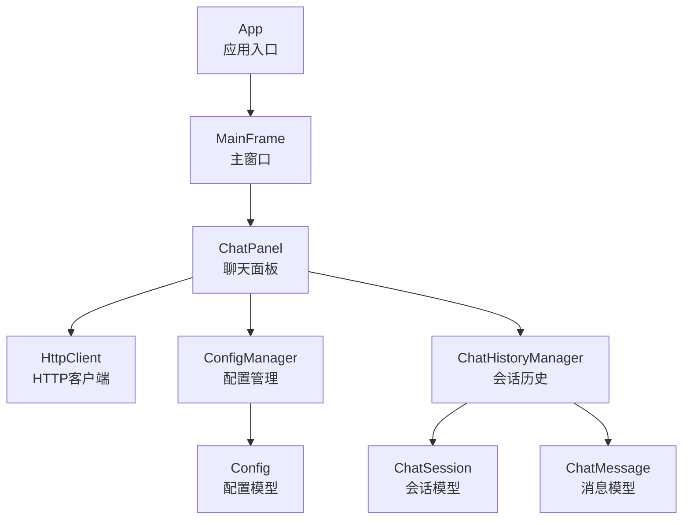
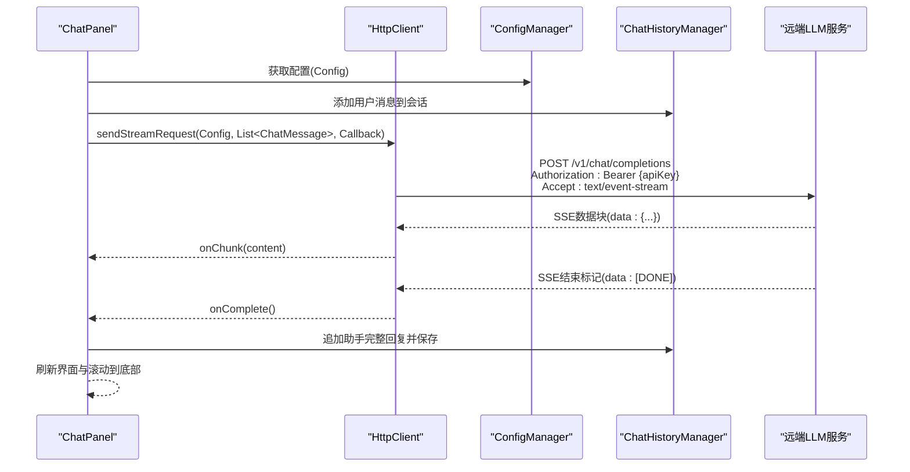
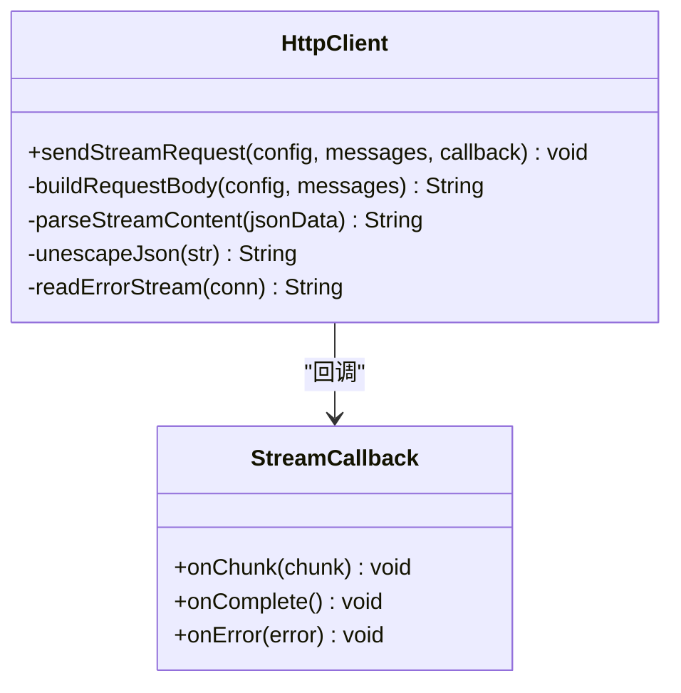
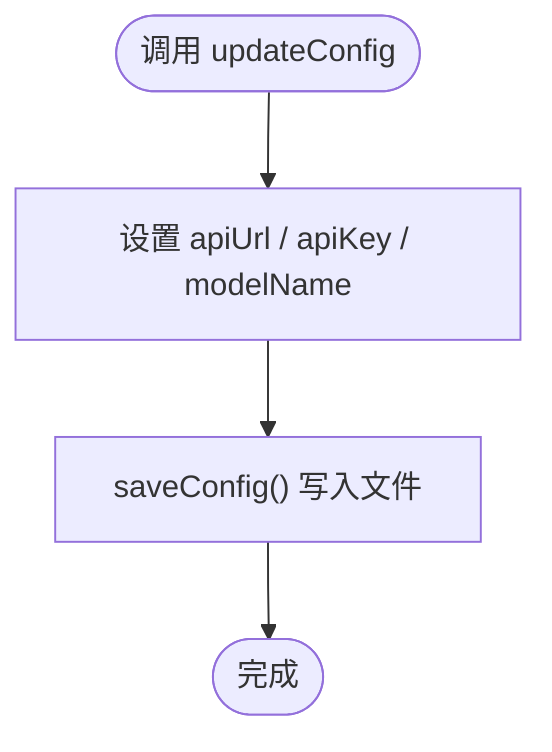
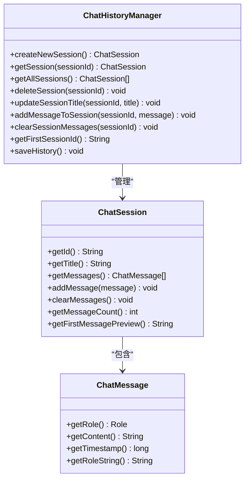
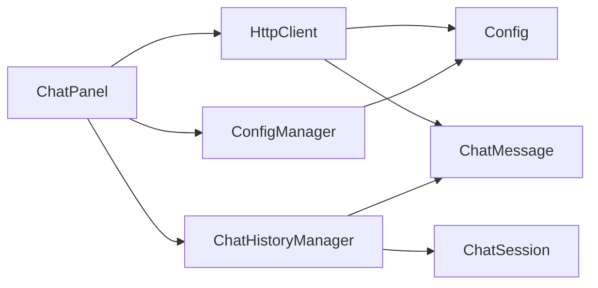

# API参考

<cite>
**本文引用的文件**
- [App.java](file://src/com/llmchat/App.java)
- [MainFrame.java](file://src/com/llmchat/ui/MainFrame.java)
- [ChatPanel.java](file://src/com/llmchat/ui/ChatPanel.java)
- [HttpClient.java](file://src/com/llmchat/http/HttpClient.java)
- [ConfigManager.java](file://src/com/llmchat/config/ConfigManager.java)
- [ChatHistoryManager.java](file://src/com/llmchat/config/ChatHistoryManager.java)
- [Config.java](file://src/com/llmchat/model/Config.java)
- [ChatMessage.java](file://src/com/llmchat/model/ChatMessage.java)
- [ChatSession.java](file://src/com/llmchat/model/ChatSession.java)
</cite>

## 目录
1. [简介](#简介)
2. [项目结构](#项目结构)
3. [核心组件](#核心组件)
4. [架构总览](#架构总览)
5. [详细组件分析](#详细组件分析)
6. [依赖关系分析](#依赖关系分析)
7. [性能与优化](#性能与优化)
8. [故障排查指南](#故障排查指南)
9. [结论](#结论)
10. [附录：常见使用场景与客户端实现指南](#附录常见使用场景与客户端实现指南)

## 简介
本API参考面向Java LLM聊天界面项目，聚焦以下目标：
- 记录HTTP客户端接口sendStreamRequest的HTTP方法、URL模式、请求/响应模式与认证方式
- 文档化ConfigManager与ChatHistoryManager的公共接口（方法签名、参数、返回值）
- 提供具体代码示例路径与客户端实现指南
- 总结错误处理策略、安全注意事项与速率限制建议
- 给出常见使用场景、性能优化技巧与调试/监控方法
- 如有弃用功能或兼容性问题，提供迁移与兼容性说明

## 项目结构
项目采用按职责分层的组织方式：
- 应用入口与UI：App、MainFrame、ChatPanel等
- HTTP通信：HttpClient（支持SSE流式响应）
- 配置与会话：Config、ConfigManager、ChatMessage、ChatSession、ChatHistoryManager
- UI组件：ChatListPanel、MessageBubble、ModernButton、ModernTextArea等

图表来源
- [App.java:11-26](file://src/com/llmchat/App.java#L11-L26)
- [MainFrame.java:30-36](file://src/com/llmchat/ui/MainFrame.java#L30-L36)
- [ChatPanel.java:44-55](file://src/com/llmchat/ui/ChatPanel.java#L44-L55)
- [HttpClient.java:16](file://src/com/llmchat/http/HttpClient.java#L16)
- [ConfigManager.java:14](file://src/com/llmchat/config/ConfigManager.java#L14)
- [ChatHistoryManager.java:16](file://src/com/llmchat/config/ChatHistoryManager.java#L16)
- [Config.java:8](file://src/com/llmchat/model/Config.java#L8)
- [ChatSession.java:11](file://src/com/llmchat/model/ChatSession.java#L11)
- [ChatMessage.java:8](file://src/com/llmchat/model/ChatMessage.java#L8)

章节来源
- [App.java:11-26](file://src/com/llmchat/App.java#L11-L26)
- [MainFrame.java:38-101](file://src/com/llmchat/ui/MainFrame.java#L38-L101)
- [ChatPanel.java:44-55](file://src/com/llmchat/ui/ChatPanel.java#L44-L55)

## 核心组件
- HTTP客户端：HttpClient，提供sendStreamRequest方法，支持SSE流式响应，回调接口包含onChunk、onComplete、onError
- 配置管理：ConfigManager，负责配置的加载、保存、更新与API Key的简单加密/解密
- 会话历史：ChatHistoryManager，负责会话的创建、加载、保存、删除、标题更新、消息添加与清空
- 数据模型：Config、ChatMessage、ChatSession

章节来源
- [HttpClient.java:66-127](file://src/com/llmchat/http/HttpClient.java#L66-L127)
- [ConfigManager.java:27-75](file://src/com/llmchat/config/ConfigManager.java#L27-L75)
- [ChatHistoryManager.java:32-154](file://src/com/llmchat/config/ChatHistoryManager.java#L32-L154)
- [Config.java:22-50](file://src/com/llmchat/model/Config.java#L22-L50)
- [ChatMessage.java:18-42](file://src/com/llmchat/model/ChatMessage.java#L18-L42)
- [ChatSession.java:20-89](file://src/com/llmchat/model/ChatSession.java#L20-L89)

## 架构总览
下图展示从UI到HTTP客户端再到远端服务的调用链路，以及配置与历史管理的协作关系。

图表来源
- [ChatPanel.java:189-297](file://src/com/llmchat/ui/ChatPanel.java#L189-L297)
- [HttpClient.java:66-127](file://src/com/llmchat/http/HttpClient.java#L66-L127)
- [ConfigManager.java:63-75](file://src/com/llmchat/config/ConfigManager.java#L63-L75)
- [ChatHistoryManager.java:170-182](file://src/com/llmchat/config/ChatHistoryManager.java#L170-L182)

## 详细组件分析

### HTTP客户端：HttpClient
- 功能概述
  - 支持SSE流式响应，逐块推送模型生成的内容
  - 自动构建请求体，包含模型名、是否流式、消息数组
  - 使用Bearer Token进行认证
  - 超时控制与错误流读取
- 关键接口
  - 方法：sendStreamRequest(Config, List<ChatMessage>, StreamCallback)
  - 回调接口：StreamCallback.onChunk/onComplete/onError
- 请求/响应模式
  - HTTP方法：POST
  - URL模式：由Config.getApiUrl()决定，默认OpenAI兼容路径
  - 请求头：Content-Type: application/json；Authorization: Bearer {apiKey}；Accept: text/event-stream
  - 请求体：包含model、stream=true、messages数组
  - 响应：SSE格式，每行以"data:"开头，结束标记"[DONE]"
- 错误处理
  - 非200响应：读取错误流并回调onError
  - 异常：捕获并回调onError
- 安全与速率限制
  - 安全：API Key通过Authorization头传递，注意避免日志泄露
  - 速率限制：未在客户端实现，需遵循远端服务限制
- 性能与优化
  - 流式增量渲染，提升交互体验
  - 建议：在UI线程外处理网络I/O，避免阻塞

图表来源
- [HttpClient.java:16-25](file://src/com/llmchat/http/HttpClient.java#L16-L25)
- [HttpClient.java:66-127](file://src/com/llmchat/http/HttpClient.java#L66-L127)

章节来源
- [HttpClient.java:66-127](file://src/com/llmchat/http/HttpClient.java#L66-L127)
- [HttpClient.java:132-163](file://src/com/llmchat/http/HttpClient.java#L132-L163)
- [HttpClient.java:193-206](file://src/com/llmchat/http/HttpClient.java#L193-L206)

### 配置管理：ConfigManager
- 职责
  - 配置的持久化存储与加载
  - 配置更新与保存
  - API Key的简单加密/解密（Base64）
- 公共接口
  - saveConfig()：保存配置到本地文件
  - getConfig()：获取当前配置对象
  - updateConfig(apiUrl, apiKey, modelName)：更新配置并保存
  - encryptApiKey(apiKey)：Base64加密
  - decryptApiKey(encrypted)：Base64解密
- 文件位置
  - 配置目录：用户工作目录下的“.llmchat”子目录
  - 配置文件：config.dat
- 安全建议
  - 建议使用更安全的密钥管理方案（如系统密钥库、环境变量）
  - 避免在日志中打印敏感信息

图表来源
- [ConfigManager.java:70-75](file://src/com/llmchat/config/ConfigManager.java#L70-L75)
- [ConfigManager.java:44-58](file://src/com/llmchat/config/ConfigManager.java#L44-L58)

章节来源
- [ConfigManager.java:27-75](file://src/com/llmchat/config/ConfigManager.java#L27-L75)
- [ConfigManager.java:80-99](file://src/com/llmchat/config/ConfigManager.java#L80-L99)

### 会话历史：ChatHistoryManager
- 职责
  - 会话的创建、加载、保存、删除
  - 会话标题更新（基于第一条用户消息预览）
  - 消息的追加与清空
  - 历史索引与并发访问支持
- 公共接口
  - createNewSession()：创建新会话并返回会话对象
  - getSession(sessionId)：获取指定会话
  - getAllSessions()：按顺序返回所有会话
  - deleteSession(sessionId)：删除会话并清理文件
  - updateSessionTitle(sessionId, title)：更新会话标题
  - addMessageToSession(sessionId, message)：添加消息并自动更新标题
  - clearSessionMessages(sessionId)：清空消息并重置标题
  - getFirstSessionId()：获取首个会话ID（若无则创建）
  - saveHistory()：保存索引与各会话文件
- 文件位置
  - 历史目录：用户主目录下的“.llmchat/history”
  - 索引文件：index.dat
  - 会话文件：history/{sessionId}.dat
- 并发与健壮性
  - 使用ConcurrentHashMap与同步列表保证并发安全
  - 单个会话加载/保存失败时进行容错与日志记录

图表来源
- [ChatHistoryManager.java:16](file://src/com/llmchat/config/ChatHistoryManager.java#L16)
- [ChatSession.java:11](file://src/com/llmchat/model/ChatSession.java#L11)
- [ChatMessage.java:8](file://src/com/llmchat/model/ChatMessage.java#L8)

章节来源
- [ChatHistoryManager.java:32-154](file://src/com/llmchat/config/ChatHistoryManager.java#L32-L154)
- [ChatSession.java:20-89](file://src/com/llmchat/model/ChatSession.java#L20-L89)
- [ChatMessage.java:18-42](file://src/com/llmchat/model/ChatMessage.java#L18-L42)

### 数据模型：Config、ChatMessage、ChatSession
- Config
  - 字段：apiUrl、apiKey、modelName
  - 方法：get/set、isValid()
- ChatMessage
  - 枚举：Role(USER, ASSISTANT, SYSTEM)
  - 字段：role、content、timestamp
  - 方法：getRole/getContent/getTimestamp/getRoleString()
- ChatSession
  - 字段：id、title、createdAt、updatedAt、messages
  - 方法：addMessage/clearMessages/getMessageCount/getFirstMessagePreview()

章节来源
- [Config.java:22-50](file://src/com/llmchat/model/Config.java#L22-L50)
- [ChatMessage.java:18-42](file://src/com/llmchat/model/ChatMessage.java#L18-L42)
- [ChatSession.java:20-89](file://src/com/llmchat/model/ChatSession.java#L20-L89)

## 依赖关系分析
- ChatPanel依赖HttpClient、ConfigManager、ChatHistoryManager
- HttpClient依赖Config、ChatMessage
- ChatHistoryManager依赖ChatSession、ChatMessage
- ConfigManager依赖Config

图表来源
- [ChatPanel.java:44-47](file://src/com/llmchat/ui/ChatPanel.java#L44-L47)
- [HttpClient.java:3-4](file://src/com/llmchat/http/HttpClient.java#L3-L4)
- [ChatHistoryManager.java:3-4](file://src/com/llmchat/config/ChatHistoryManager.java#L3-L4)
- [ConfigManager.java:3](file://src/com/llmchat/config/ConfigManager.java#L3)

章节来源
- [ChatPanel.java:44-47](file://src/com/llmchat/ui/ChatPanel.java#L44-L47)
- [HttpClient.java:3-4](file://src/com/llmchat/http/HttpClient.java#L3-L4)
- [ChatHistoryManager.java:3-4](file://src/com/llmchat/config/ChatHistoryManager.java#L3-L4)
- [ConfigManager.java:3](file://src/com/llmchat/config/ConfigManager.java#L3)

## 性能与优化
- 流式渲染：UI在onChunk中增量拼接与渲染，减少等待时间
- 线程模型：HTTP请求在独立线程执行，避免阻塞UI线程
- I/O优化：使用UTF-8编码与缓冲读取，降低内存占用
- 建议
  - 对超长会话进行消息截断或分页
  - 合理设置连接/读取超时，避免长时间阻塞
  - 在高频请求场景下增加退避与重试策略（可在上层封装）

[本节为通用性能建议，不直接分析具体文件]

## 故障排查指南
- 常见错误类型
  - 配置无效：当Config.isValid()为false时，UI提示“请先配置API设置”
  - HTTP非200：读取错误流并回调onError，UI弹窗显示错误
  - 异常：网络异常、解析异常等统一回调onError
- 排查步骤
  - 检查ConfigManager保存的配置文件是否存在且可读
  - 确认API URL与API Key正确，Authorization头是否包含
  - 观察SSE响应行首是否为"data:"，结束标记是否为"[DONE]"
  - 查看会话文件是否损坏，必要时重建默认会话
- 日志与调试
  - HTTP客户端内部有调试输出（收到数据与解析结果），可用于定位问题
  - 建议在生产环境关闭或降级调试输出级别

章节来源
- [ChatPanel.java:195-202](file://src/com/llmchat/ui/ChatPanel.java#L195-L202)
- [HttpClient.java:88-93](file://src/com/llmchat/http/HttpClient.java#L88-L93)
- [HttpClient.java:107-113](file://src/com/llmchat/http/HttpClient.java#L107-L113)
- [ChatHistoryManager.java:54-58](file://src/com/llmchat/config/ChatHistoryManager.java#L54-L58)

## 结论
本项目通过清晰的分层设计实现了从UI到HTTP服务的完整链路，并提供了配置与会话历史的本地持久化能力。HTTP客户端采用SSE流式响应，配合UI增量渲染，带来良好的交互体验。建议在生产环境中加强安全与稳定性措施（如密钥管理、重试与限速、日志脱敏）。

[本节为总结性内容，不直接分析具体文件]

## 附录：常见使用场景与客户端实现指南

### 场景一：首次运行与配置
- 步骤
  - 启动应用，进入主界面
  - 点击“设置”，填写API URL、API Key、模型名
  - 点击保存，配置被加密并写入本地文件
- 示例路径
  - [App.java:12-25](file://src/com/llmchat/App.java#L12-L25)
  - [MainFrame.java:122-125](file://src/com/llmchat/ui/MainFrame.java#L122-L125)
  - [ConfigManager.java:44-75](file://src/com/llmchat/config/ConfigManager.java#L44-L75)

章节来源
- [App.java:12-25](file://src/com/llmchat/App.java#L12-L25)
- [MainFrame.java:122-125](file://src/com/llmchat/ui/MainFrame.java#L122-L125)
- [ConfigManager.java:44-75](file://src/com/llmchat/config/ConfigManager.java#L44-L75)

### 场景二：发起一次流式对话
- 步骤
  - 用户输入消息，点击发送
  - ChatPanel校验配置有效性
  - 将用户消息加入历史并显示
  - 调用HttpClient.sendStreamRequest，逐块渲染助手回复
  - 完成后保存完整回复并刷新列表
- 示例路径
  - [ChatPanel.java:189-297](file://src/com/llmchat/ui/ChatPanel.java#L189-L297)
  - [HttpClient.java:66-127](file://src/com/llmchat/http/HttpClient.java#L66-L127)
  - [ChatHistoryManager.java:170-182](file://src/com/llmchat/config/ChatHistoryManager.java#L170-L182)

章节来源
- [ChatPanel.java:189-297](file://src/com/llmchat/ui/ChatPanel.java#L189-L297)
- [HttpClient.java:66-127](file://src/com/llmchat/http/HttpClient.java#L66-L127)
- [ChatHistoryManager.java:170-182](file://src/com/llmchat/config/ChatHistoryManager.java#L170-L182)

### 场景三：新建/切换/删除会话
- 步骤
  - 新建：ChatHistoryManager.createNewSession，返回新会话ID
  - 切换：ChatPanel.loadSession，刷新消息显示
  - 删除：ChatHistoryManager.deleteSession，清理文件并重建默认会话
- 示例路径
  - [ChatHistoryManager.java:104-110](file://src/com/llmchat/config/ChatHistoryManager.java#L104-L110)
  - [ChatPanel.java:124-142](file://src/com/llmchat/ui/ChatPanel.java#L124-L142)
  - [ChatHistoryManager.java:136-154](file://src/com/llmchat/config/ChatHistoryManager.java#L136-L154)

章节来源
- [ChatHistoryManager.java:104-110](file://src/com/llmchat/config/ChatHistoryManager.java#L104-L110)
- [ChatPanel.java:124-142](file://src/com/llmchat/ui/ChatPanel.java#L124-L142)
- [ChatHistoryManager.java:136-154](file://src/com/llmchat/config/ChatHistoryManager.java#L136-L154)

### 安全与合规建议
- 不要在日志中打印API Key或请求体
- 建议使用HTTPS与受信CA证书
- 对于多用户或多实例部署，建议集中式密钥管理
- 遵循远端服务的使用条款与数据保护要求

[本节为通用建议，不直接分析具体文件]

### 速率限制与退避策略
- 未在客户端内置重试/退避逻辑
- 建议在上层封装中增加指数退避与最大重试次数
- 监控HTTP状态码与错误流，区分临时错误与永久错误

[本节为通用建议，不直接分析具体文件]

### 调试与监控
- HTTP客户端内联调试输出（收到数据与解析结果）
- 建议在生产环境关闭或降级调试输出
- 可结合系统网络抓包工具（如Wireshark）与服务端日志进行联合诊断

[本节为通用建议，不直接分析具体文件]

### 兼容性与迁移说明
- 当前版本未发现明确的弃用功能
- 若未来更换远端服务（如从OpenAI迁移到其他兼容服务），需调整Config.apiUrl与可能的请求字段映射
- 保持ConfigManager与ChatHistoryManager的接口稳定，便于平滑迁移

[本节为通用建议，不直接分析具体文件]