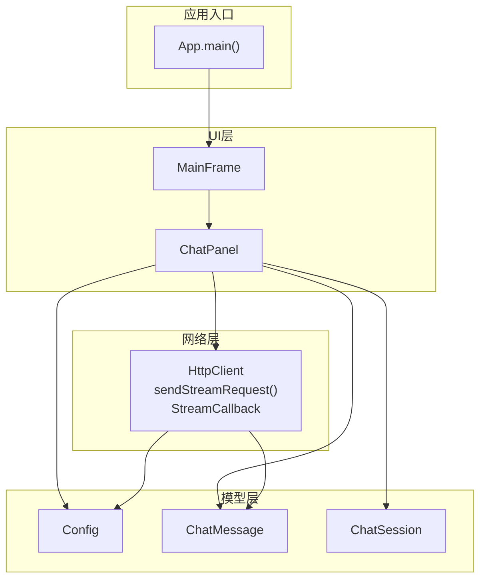
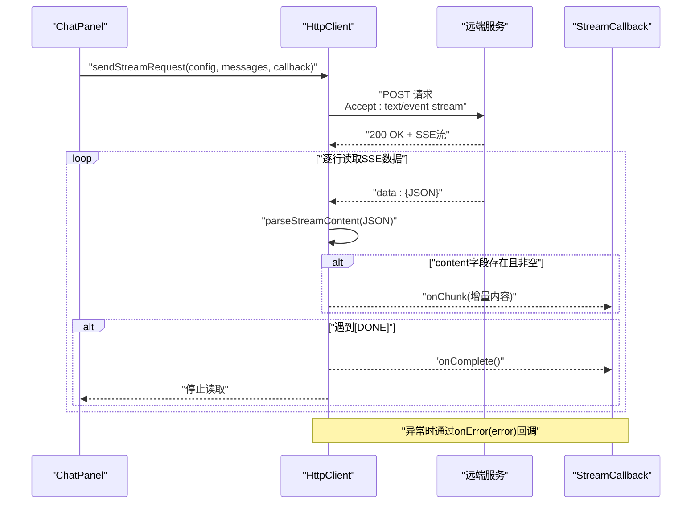
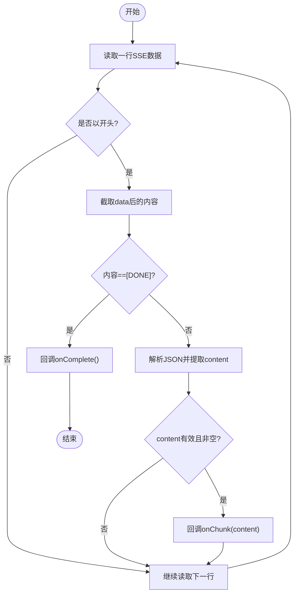
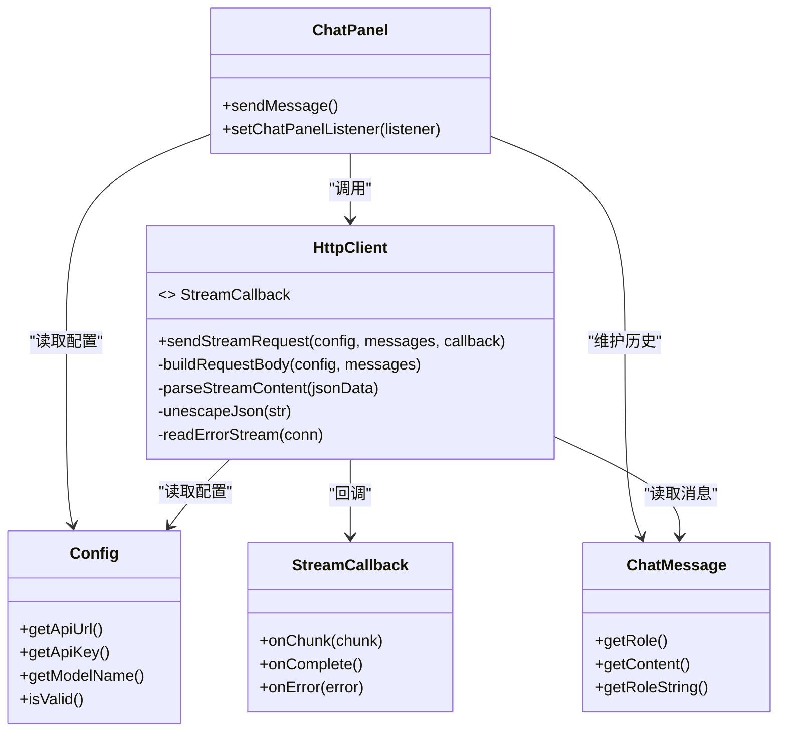

# HTTP客户端API

<cite>
**本文引用的文件**
- [HttpClient.java](file://src/com/llmchat/http/HttpClient.java)
- [ChatPanel.java](file://src/com/llmchat/ui/ChatPanel.java)
- [Config.java](file://src/com/llmchat/model/Config.java)
- [ChatMessage.java](file://src/com/llmchat/model/ChatMessage.java)
- [ChatSession.java](file://src/com/llmchat/model/ChatSession.java)
- [App.java](file://src/com/llmchat/App.java)
</cite>

## 目录
1. [简介](#简介)
2. [项目结构](#项目结构)
3. [核心组件](#核心组件)
4. [架构总览](#架构总览)
5. [详细组件分析](#详细组件分析)
6. [依赖关系分析](#依赖关系分析)
7. [性能考量](#性能考量)
8. [故障排查指南](#故障排查指南)
9. [结论](#结论)
10. [附录：完整使用示例与最佳实践](#附录完整使用示例与最佳实践)

## 简介
本文件面向HTTP客户端API的使用者，重点文档化sendStreamRequest方法的完整接口规范，涵盖：
- HTTP POST方法、请求URL格式、请求体JSON结构
- 响应处理机制与SSE流式响应的data:前缀解析、[DONE]终止信号、增量内容提取
- StreamCallback回调接口onChunk/onComplete/onError的使用方式
- 错误处理策略、超时配置与连接管理的最佳实践
- 完整的流式聊天请求使用示例路径

## 项目结构
该项目采用分层设计，核心HTTP能力位于http包，业务模型位于model包，UI交互位于ui包，应用入口在顶层App类中。

图表来源
- [App.java:11-26](file://src/com/llmchat/App.java#L11-L26)
- [ChatPanel.java:44-55](file://src/com/llmchat/ui/ChatPanel.java#L44-L55)
- [HttpClient.java:16-25](file://src/com/llmchat/http/HttpClient.java#L16-L25)
- [Config.java:8-51](file://src/com/llmchat/model/Config.java#L8-L51)
- [ChatMessage.java:8-43](file://src/com/llmchat/model/ChatMessage.java#L8-L43)
- [ChatSession.java:11-90](file://src/com/llmchat/model/ChatSession.java#L11-L90)

章节来源
- [App.java:11-26](file://src/com/llmchat/App.java#L11-L26)
- [ChatPanel.java:44-55](file://src/com/llmchat/ui/ChatPanel.java#L44-L55)
- [HttpClient.java:16-25](file://src/com/llmchat/http/HttpClient.java#L16-L25)

## 核心组件
- HttpClient：提供sendStreamRequest方法，支持SSE流式响应，内部实现StreamCallback接口用于回调增量内容、完成与错误事件。
- StreamCallback：定义onChunk、onComplete、onError三个回调方法，分别用于处理SSE数据块、流结束与异常。
- Config：封装API地址、密钥与模型名称等配置项。
- ChatMessage/ChatSession：承载对话上下文，用于构建请求体与维护会话历史。

章节来源
- [HttpClient.java:16-25](file://src/com/llmchat/http/HttpClient.java#L16-L25)
- [HttpClient.java:66-127](file://src/com/llmchat/http/HttpClient.java#L66-L127)
- [Config.java:8-51](file://src/com/llmchat/model/Config.java#L8-L51)
- [ChatMessage.java:8-43](file://src/com/llmchat/model/ChatMessage.java#L8-L43)
- [ChatSession.java:11-90](file://src/com/llmchat/model/ChatSession.java#L11-L90)

## 架构总览
下图展示了从UI触发到HTTP请求、SSE流式响应解析与回调的端到端流程。

图表来源
- [ChatPanel.java:243-296](file://src/com/llmchat/ui/ChatPanel.java#L243-L296)
- [HttpClient.java:66-127](file://src/com/llmchat/http/HttpClient.java#L66-L127)
- [HttpClient.java:132-163](file://src/com/llmchat/http/HttpClient.java#L132-L163)

## 详细组件分析

### sendStreamRequest 方法接口规范
- HTTP方法：POST
- 请求头：
  - Content-Type: application/json
  - Authorization: Bearer {apiKey}
  - Accept: text/event-stream
- 请求体JSON结构（由buildRequestBody生成）：
  - model: 字符串，来自Config.modelName
  - stream: 布尔值，固定为true
  - messages: 数组，元素为对象，包含：
    - role: 字符串，来自ChatMessage.role（小写）
    - content: 字符串，来自ChatMessage.content
- 超时配置：
  - 连接超时：30秒
  - 读取超时：60秒
- 响应处理：
  - 非200状态码：读取错误流并回调onError
  - 200状态码：逐行读取SSE流，以"data: "开头的行被解析
  - 遇到"[DONE]"即终止流并回调onComplete
  - 解析成功则回调onChunk，否则忽略空或解析失败的数据

章节来源
- [HttpClient.java:66-127](file://src/com/llmchat/http/HttpClient.java#L66-L127)
- [HttpClient.java:30-49](file://src/com/llmchat/http/HttpClient.java#L30-L49)
- [HttpClient.java:77-78](file://src/com/llmchat/http/HttpClient.java#L77-L78)
- [HttpClient.java:88-93](file://src/com/llmchat/http/HttpClient.java#L88-L93)

### StreamCallback 回调接口
- onChunk(String chunk)
  - 用途：接收SSE流中的增量内容片段
  - 触发时机：解析到有效content字段且非空时
  - 注意：回调发生在后台线程，如需更新UI，请切换至EDT
- onComplete()
  - 用途：SSE流正常结束（收到[DONE]）
  - 触发时机：读取到[DONE]后
- onError(String error)
  - 用途：请求失败或异常
  - 触发时机：非200响应或运行时异常

章节来源
- [HttpClient.java:21-25](file://src/com/llmchat/http/HttpClient.java#L21-L25)
- [HttpClient.java:119-121](file://src/com/llmchat/http/HttpClient.java#L119-L121)

### SSE流式响应解析流程
- 数据行过滤：仅处理以"data: "开头的行
- 终止信号：当data内容等于"[DONE]"时，立即停止读取
- 内容提取：从JSON中定位"content"字段，提取其值并反转义
- 增量回调：仅在content非空时回调onChunk

图表来源
- [HttpClient.java:100-114](file://src/com/llmchat/http/HttpClient.java#L100-L114)
- [HttpClient.java:132-163](file://src/com/llmchat/http/HttpClient.java#L132-L163)

### 请求体JSON结构详解
- model: 来自Config.modelName
- stream: 固定为true
- messages: 数组，每条消息包含role与content
- 特殊字符转义：请求体中的双引号、反斜杠、换行、回车、制表符均进行JSON转义

章节来源
- [HttpClient.java:30-49](file://src/com/llmchat/http/HttpClient.java#L30-L49)
- [HttpClient.java:54-61](file://src/com/llmchat/http/HttpClient.java#L54-L61)
- [ChatMessage.java:40-42](file://src/com/llmchat/model/ChatMessage.java#L40-L42)

### 错误处理与异常分支
- 非200响应：读取错误流并回调onError
- 运行时异常：捕获异常并回调onError
- UI线程安全：回调在后台线程触发，UI侧需通过SwingUtilities.invokeLater切换到EDT

章节来源
- [HttpClient.java:88-93](file://src/com/llmchat/http/HttpClient.java#L88-L93)
- [HttpClient.java:119-121](file://src/com/llmchat/http/HttpClient.java#L119-L121)
- [ChatPanel.java:244-296](file://src/com/llmchat/ui/ChatPanel.java#L244-L296)

## 依赖关系分析
- ChatPanel依赖HttpClient进行流式请求，并通过StreamCallback与UI交互
- HttpClient依赖Config与ChatMessage构建请求体
- UI层通过ConfigManager与ChatHistoryManager管理配置与会话

图表来源
- [HttpClient.java:16-25](file://src/com/llmchat/http/HttpClient.java#L16-L25)
- [HttpClient.java:66-127](file://src/com/llmchat/http/HttpClient.java#L66-L127)
- [Config.java:8-51](file://src/com/llmchat/model/Config.java#L8-L51)
- [ChatMessage.java:8-43](file://src/com/llmchat/model/ChatMessage.java#L8-L43)
- [ChatPanel.java:44-55](file://src/com/llmchat/ui/ChatPanel.java#L44-L55)

章节来源
- [HttpClient.java:16-25](file://src/com/llmchat/http/HttpClient.java#L16-L25)
- [ChatPanel.java:44-55](file://src/com/llmchat/ui/ChatPanel.java#L44-L55)

## 性能考量
- 线程模型：sendStreamRequest在独立线程中执行I/O，避免阻塞UI线程
- 超时设置：连接超时30秒，读取超时60秒，适合大多数SSE场景
- 字符串处理：请求体与响应解析均为逐行读取，内存占用低
- UI刷新：回调中通过SwingUtilities.invokeLater切换到EDT，保证线程安全

章节来源
- [HttpClient.java:66-127](file://src/com/llmchat/http/HttpClient.java#L66-L127)
- [HttpClient.java:77-78](file://src/com/llmchat/http/HttpClient.java#L77-L78)
- [ChatPanel.java:244-296](file://src/com/llmchat/ui/ChatPanel.java#L244-L296)

## 故障排查指南
- 配置无效：若Config.isValid()为false，UI会提示配置错误
- 非200响应：检查API地址、密钥与权限；onError会返回具体错误信息
- 无增量内容：确认服务端SSE输出是否包含"data: "前缀与正确的JSON结构
- UI不更新：确保在onChunk/onComplete/onError中通过SwingUtilities.invokeLater切换到EDT
- 连接超时：适当调整超时参数或检查网络状况

章节来源
- [Config.java:46-50](file://src/com/llmchat/model/Config.java#L46-L50)
- [ChatPanel.java:195-202](file://src/com/llmchat/ui/ChatPanel.java#L195-L202)
- [HttpClient.java:88-93](file://src/com/llmchat/http/HttpClient.java#L88-L93)
- [ChatPanel.java:244-296](file://src/com/llmchat/ui/ChatPanel.java#L244-L296)

## 结论
本HTTP客户端API提供了简洁而健壮的SSE流式请求能力，结合StreamCallback可实现流畅的增量内容展示。通过合理的超时配置与UI线程切换，可在桌面应用中获得良好的用户体验。建议在生产环境中进一步增强日志记录与重试策略。

## 附录：完整使用示例与最佳实践

### 使用示例（路径指引）
以下示例展示了如何在UI中发起一次流式聊天请求，包括配置校验、发送消息、增量渲染与错误处理。

- 配置校验与消息添加
  - 参考路径：[ChatPanel.java:195-220](file://src/com/llmchat/ui/ChatPanel.java#L195-L220)
- 发起流式请求与回调
  - 参考路径：[ChatPanel.java:242-296](file://src/com/llmchat/ui/ChatPanel.java#L242-L296)
- 构建请求体与SSE解析
  - 参考路径：[HttpClient.java:30-49](file://src/com/llmchat/http/HttpClient.java#L30-L49)、[HttpClient.java:132-163](file://src/com/llmchat/http/HttpClient.java#L132-L163)

### 最佳实践清单
- 配置管理
  - 使用Config.isValid()在发送前校验API地址、密钥与模型名
- UI线程安全
  - 在onChunk/onComplete/onError中通过SwingUtilities.invokeLater更新UI
- 错误处理
  - 对非200响应与异常统一回调onError，并向用户友好提示
- 超时与稳定性
  - 保持默认超时设置，必要时根据网络环境调整
- 会话与历史
  - 将完整响应追加到ChatMessage列表并持久化到ChatSession

章节来源
- [Config.java:46-50](file://src/com/llmchat/model/Config.java#L46-L50)
- [ChatPanel.java:195-220](file://src/com/llmchat/ui/ChatPanel.java#L195-L220)
- [ChatPanel.java:242-296](file://src/com/llmchat/ui/ChatPanel.java#L242-L296)
- [HttpClient.java:77-78](file://src/com/llmchat/http/HttpClient.java#L77-L78)