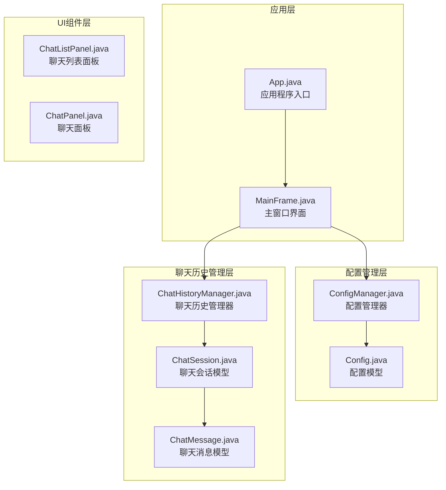
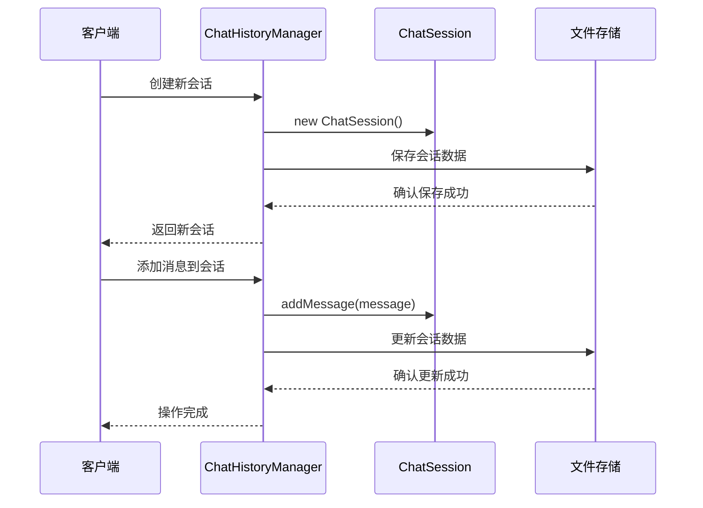
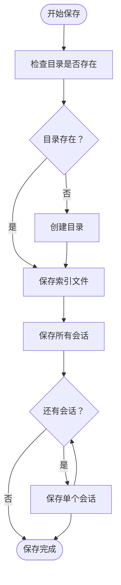
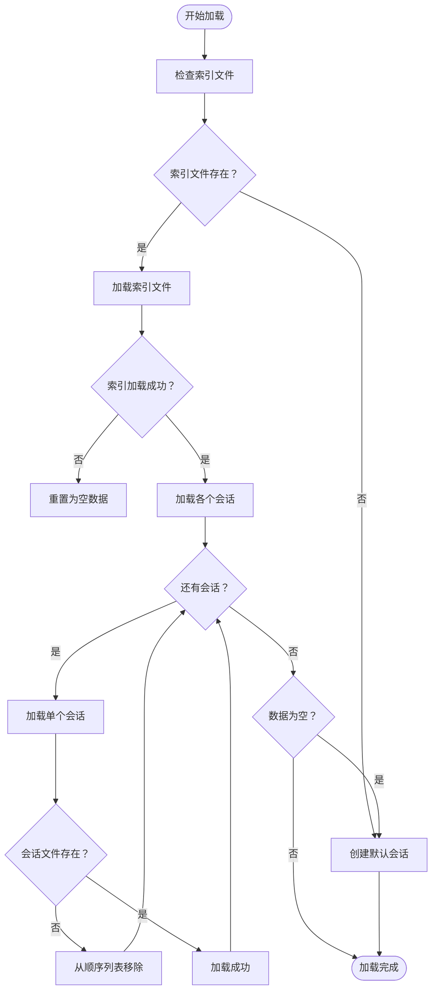
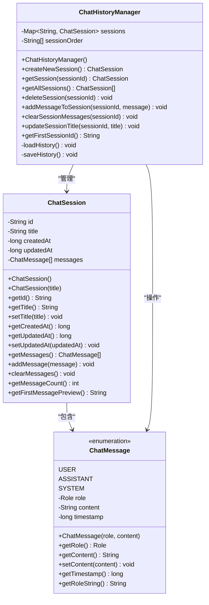

# 聊天历史管理API

<cite>
**本文档引用的文件**
- [ChatHistoryManager.java](file://src/com/llmchat/config/ChatHistoryManager.java)
- [ChatSession.java](file://src/com/llmchat/model/ChatSession.java)
- [ChatMessage.java](file://src/com/llmchat/model/ChatMessage.java)
- [ConfigManager.java](file://src/com/llmchat/config/ConfigManager.java)
- [Config.java](file://src/com/llmchat/model/Config.java)
- [MainFrame.java](file://src/com/llmchat/ui/MainFrame.java)
- [App.java](file://src/com/llmchat/App.java)
</cite>

## 目录
1. [简介](#简介)
2. [项目结构](#项目结构)
3. [核心组件](#核心组件)
4. [架构概览](#架构概览)
5. [详细组件分析](#详细组件分析)
6. [依赖关系分析](#依赖关系分析)
7. [性能考虑](#性能考虑)
8. [故障排除指南](#故障排除指南)
9. [结论](#结论)
10. [附录：API使用示例](#附录api使用示例)

## 简介

聊天历史管理API是Java LLM聊天应用程序的核心组件，负责管理用户的聊天会话历史数据。该API提供了完整的会话生命周期管理功能，包括会话创建、消息添加、历史加载、数据持久化和清理等功能。

本API采用对象序列化机制实现数据持久化，将聊天会话存储在用户主目录下的`.llmchat/history`目录中，确保数据的安全性和可靠性。系统支持多会话并发管理，并提供了完善的错误处理和数据恢复机制。

## 项目结构

项目采用模块化的架构设计，主要分为以下几个核心模块：



**图表来源**
- [App.java:11-26](file://src/com/llmchat/App.java#L11-L26)
- [MainFrame.java:19-36](file://src/com/llmchat/ui/MainFrame.java#L19-L36)
- [ChatHistoryManager.java:16-27](file://src/com/llmchat/config/ChatHistoryManager.java#L16-L27)

**章节来源**
- [App.java:1-27](file://src/com/llmchat/App.java#L1-L27)
- [MainFrame.java:1-177](file://src/com/llmchat/ui/MainFrame.java#L1-L177)

## 核心组件

### ChatHistoryManager 类

ChatHistoryManager是聊天历史管理的核心类，负责所有会话相关的操作。它实现了完整的CRUD操作，并提供了数据持久化和恢复功能。

**主要职责：**
- 会话创建和管理
- 消息添加和更新
- 历史数据加载和保存
- 会话删除和清理
- 数据恢复和错误处理

**关键特性：**
- 使用ConcurrentHashMap保证线程安全
- 维护会话顺序列表
- 支持自动数据恢复
- 提供完整的API接口

**章节来源**
- [ChatHistoryManager.java:13-27](file://src/com/llmchat/config/ChatHistoryManager.java#L13-L27)

### 数据模型

#### ChatSession 会话模型

ChatSession代表单个聊天会话，包含会话的基本信息和消息列表。

**核心属性：**
- `id`: 唯一标识符（UUID生成）
- `title`: 会话标题
- `createdAt`: 创建时间戳
- `updatedAt`: 最后更新时间戳
- `messages`: 消息列表

**章节来源**
- [ChatSession.java:11-26](file://src/com/llmchat/model/ChatSession.java#L11-L26)

#### ChatMessage 消息模型

ChatMessage表示单条聊天消息，支持多种角色类型。

**核心属性：**
- `role`: 消息角色（USER、ASSISTANT、SYSTEM）
- `content`: 消息内容
- `timestamp`: 时间戳

**角色枚举：**
- USER: 用户发送的消息
- ASSISTANT: AI助手回复的消息
- SYSTEM: 系统消息

**章节来源**
- [ChatMessage.java:8-12](file://src/com/llmchat/model/ChatMessage.java#L8-L12)

## 架构概览

聊天历史管理系统采用分层架构设计，各层职责明确，耦合度低。



**图表来源**
- [ChatHistoryManager.java:104-110](file://src/com/llmchat/config/ChatHistoryManager.java#L104-L110)
- [ChatHistoryManager.java:170-182](file://src/com/llmchat/config/ChatHistoryManager.java#L170-L182)

**章节来源**
- [ChatHistoryManager.java:67-99](file://src/com/llmchat/config/ChatHistoryManager.java#L67-L99)

## 详细组件分析

### ChatHistoryManager API规范

#### 构造函数
```java
public ChatHistoryManager()
```
初始化管理器并加载现有历史数据。

**参数：** 无  
**返回值：** 无  
**异常：** 无  

#### 核心方法

##### 创建新会话
```java
public ChatSession createNewSession()
```
创建一个新的聊天会话并自动保存到磁盘。

**参数：** 无  
**返回值：** 新创建的ChatSession实例  
**异常：** 无  
**行为：** 自动保存到磁盘，新会话位于列表首位

##### 获取指定会话
```java
public ChatSession getSession(String sessionId)
```
根据会话ID获取对应的会话对象。

**参数：** sessionId - 会话唯一标识符  
**返回值：** 对应的ChatSession对象或null  
**异常：** 无  

##### 获取所有会话
```java
public List<ChatSession> getAllSessions()
```
获取所有会话，按时间顺序排列。

**参数：** 无  
**返回值：** ChatSession列表（按时间顺序）  
**异常：** 无  

##### 删除会话
```java
public void deleteSession(String sessionId)
```
删除指定的会话及其所有相关数据。

**参数：** sessionId - 要删除的会话ID  
**返回值：** 无  
**异常：** 无  
**行为：** 删除对应的数据文件，如果没有任何会话则创建新会话

##### 添加消息到会话
```java
public void addMessageToSession(String sessionId, ChatMessage message)
```
向指定会话添加一条消息。

**参数：** 
- sessionId - 会话ID
- message - 要添加的消息对象  
**返回值：** 无  
**异常：** 无  
**行为：** 如果是第一条用户消息，自动更新会话标题

##### 清空会话消息
```java
public void clearSessionMessages(String sessionId)
```
清空指定会话的所有消息。

**参数：** sessionId - 会话ID  
**返回值：** 无  
**异常：** 无  
**行为：** 清空消息列表并将标题重置为"新对话"

##### 更新会话标题
```java
public void updateSessionTitle(String sessionId, String title)
```
手动更新会话标题。

**参数：** 
- sessionId - 会话ID
- title - 新标题  
**返回值：** 无  
**异常：** 无  

##### 获取第一个会话ID
```java
public String getFirstSessionId()
```
获取当前显示的第一个会话ID。

**参数：** 无  
**返回值：** 第一个会话的ID  
**异常：** 无  

**章节来源**
- [ChatHistoryManager.java:104-205](file://src/com/llmchat/config/ChatHistoryManager.java#L104-L205)

### 数据存储机制

#### 文件存储格式

系统采用对象序列化的方式存储数据，具体格式如下：

**存储位置：** `${user.home}/.llmchat/history/`

**文件结构：**
- `index.dat`: 包含会话ID列表的索引文件
- `sessionId.dat`: 每个会话的独立数据文件

**序列化机制：**
- 使用Java标准序列化API
- 所有数据模型都实现Serializable接口
- 支持复杂对象的完整持久化



**图表来源**
- [ChatHistoryManager.java:70-99](file://src/com/llmchat/config/ChatHistoryManager.java#L70-L99)

**章节来源**
- [ChatHistoryManager.java:17-18](file://src/com/llmchat/config/ChatHistoryManager.java#L17-L18)
- [ChatHistoryManager.java:70-99](file://src/com/llmchat/config/ChatHistoryManager.java#L70-L99)

### 数据恢复流程

系统具备完善的错误处理和数据恢复能力：



**图表来源**
- [ChatHistoryManager.java:32-65](file://src/com/llmchat/config/ChatHistoryManager.java#L32-L65)

**章节来源**
- [ChatHistoryManager.java:32-65](file://src/com/llmchat/config/ChatHistoryManager.java#L32-L65)

## 依赖关系分析

### 类关系图



**图表来源**
- [ChatHistoryManager.java:16-27](file://src/com/llmchat/config/ChatHistoryManager.java#L16-L27)
- [ChatSession.java:11-26](file://src/com/llmchat/model/ChatSession.java#L11-L26)
- [ChatMessage.java:8-12](file://src/com/llmchat/model/ChatMessage.java#L8-L12)

### 外部依赖

系统依赖于以下外部组件：
- Java标准库（java.io、java.nio.file、java.util）
- Java Swing用于GUI界面
- Java序列化机制用于数据持久化

**章节来源**
- [ChatHistoryManager.java:3-11](file://src/com/llmchat/config/ChatHistoryManager.java#L3-L11)

## 性能考虑

### 存储性能优化

1. **并发安全性**：使用ConcurrentHashMap确保多线程环境下的数据一致性
2. **延迟保存**：只在必要时保存数据，减少I/O操作频率
3. **增量更新**：支持部分数据更新而非全量重写

### 内存管理

1. **对象池化**：复用ChatMessage对象减少内存分配
2. **及时清理**：定期清理不再使用的会话引用
3. **垃圾回收**：合理管理大消息内容的内存占用

### I/O性能

1. **批量操作**：支持批量保存多个会话
2. **异步处理**：后台执行保存操作避免阻塞UI
3. **错误隔离**：单个会话保存失败不影响其他会话

## 故障排除指南

### 常见问题及解决方案

#### 数据丢失问题
**症状：** 启动后历史数据消失  
**原因：** 索引文件损坏或会话文件缺失  
**解决：** 系统会自动检测并重建默认会话

#### 保存失败
**症状：** 消息无法持久化  
**原因：** 磁盘空间不足或权限问题  
**解决：** 检查存储权限和磁盘空间

#### 加载异常
**症状：** 应用启动缓慢或卡顿  
**原因：** 大量历史数据导致加载时间过长  
**解决：** 考虑清理历史数据或优化存储结构

**章节来源**
- [ChatHistoryManager.java:48-58](file://src/com/llmchat/config/ChatHistoryManager.java#L48-L58)
- [ChatHistoryManager.java:89-93](file://src/com/llmchat/config/ChatHistoryManager.java#L89-L93)

## 结论

聊天历史管理API提供了完整、可靠的聊天会话管理解决方案。通过采用对象序列化和文件存储机制，系统确保了数据的安全性和可恢复性。同时，良好的架构设计使得API易于扩展和维护。

该API的主要优势包括：
- 完整的会话生命周期管理
- 线程安全的设计
- 完善的错误处理和数据恢复机制
- 易于使用的API接口
- 良好的性能表现

## 附录：API使用示例

### 基本会话管理

```java
// 创建历史管理器实例
ChatHistoryManager historyManager = new ChatHistoryManager();

// 创建新会话
ChatSession newSession = historyManager.createNewSession();
String sessionId = newSession.getId();

// 添加用户消息
ChatMessage userMessage = new ChatMessage(ChatMessage.Role.USER, "你好");
historyManager.addMessageToSession(sessionId, userMessage);

// 添加AI回复
ChatMessage aiMessage = new ChatMessage(ChatMessage.Role.ASSISTANT, "你好！有什么可以帮助你的吗？");
historyManager.addMessageToSession(sessionId, aiMessage);

// 获取所有会话
List<ChatSession> allSessions = historyManager.getAllSessions();
```

**章节来源**
- [ChatHistoryManager.java:104-110](file://src/com/llmchat/config/ChatHistoryManager.java#L104-L110)
- [ChatHistoryManager.java:170-182](file://src/com/llmchat/config/ChatHistoryManager.java#L170-L182)
- [ChatHistoryManager.java:122-131](file://src/com/llmchat/config/ChatHistoryManager.java#L122-L131)

### 会话清理和管理

```java
// 删除特定会话
historyManager.deleteSession(sessionId);

// 清空会话消息
historyManager.clearSessionMessages(sessionId);

// 更新会话标题
historyManager.updateSessionTitle(sessionId, "新的会话标题");

// 获取第一个会话ID
String firstSessionId = historyManager.getFirstSessionId();
```

**章节来源**
- [ChatHistoryManager.java:136-154](file://src/com/llmchat/config/ChatHistoryManager.java#L136-L154)
- [ChatHistoryManager.java:187-194](file://src/com/llmchat/config/ChatHistoryManager.java#L187-L194)
- [ChatHistoryManager.java:159-165](file://src/com/llmchat/config/ChatHistoryManager.java#L159-L165)
- [ChatHistoryManager.java:199-204](file://src/com/llmchat/config/ChatHistoryManager.java#L199-L204)

### 配置管理集成

```java
// 配置管理器用于API密钥等配置
ConfigManager configManager = new ConfigManager();
Config config = configManager.getConfig();

// 更新配置
configManager.updateConfig("https://api.example.com", "your-api-key", "model-name");

// 加密敏感数据
String encryptedKey = ConfigManager.encryptApiKey("your-sensitive-key");
String decryptedKey = ConfigManager.decryptApiKey(encryptedKey);
```

**章节来源**
- [ConfigManager.java:70-100](file://src/com/llmchat/config/ConfigManager.java#L70-L100)