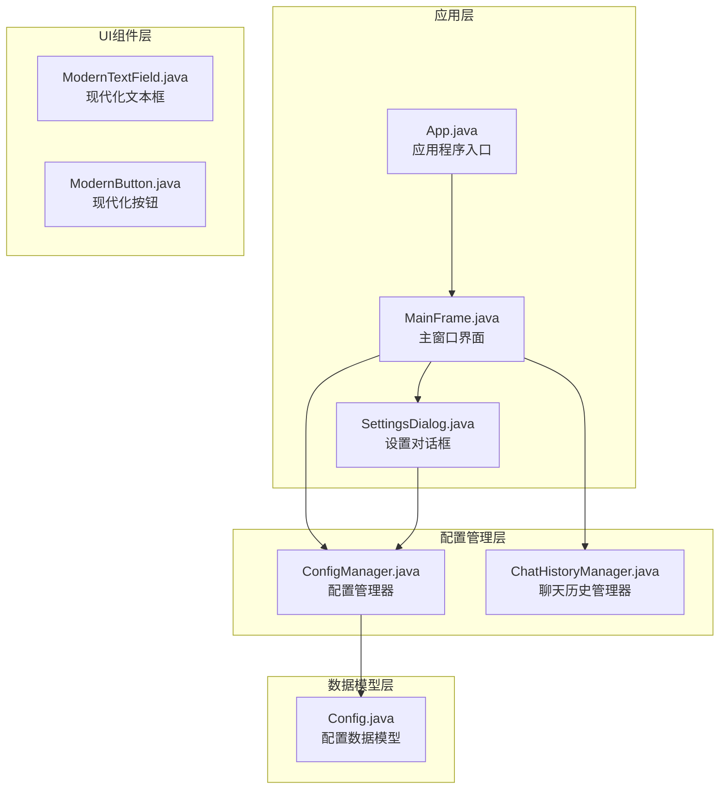
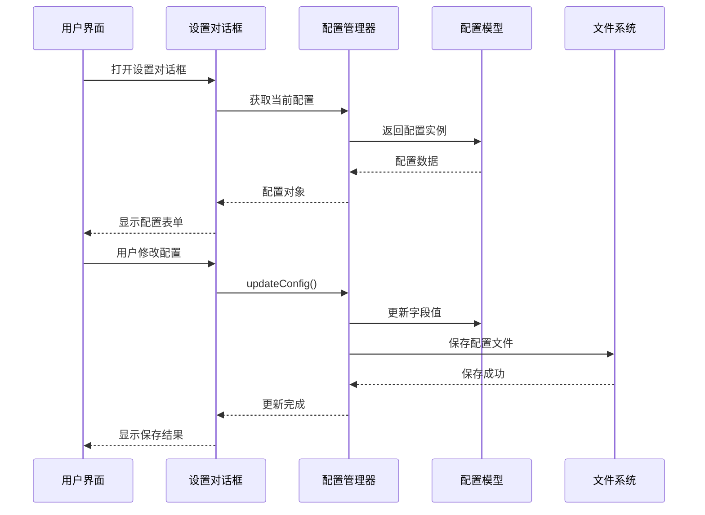
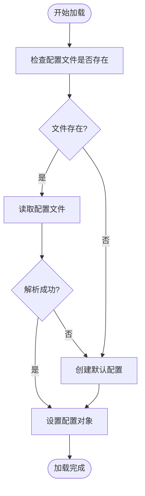
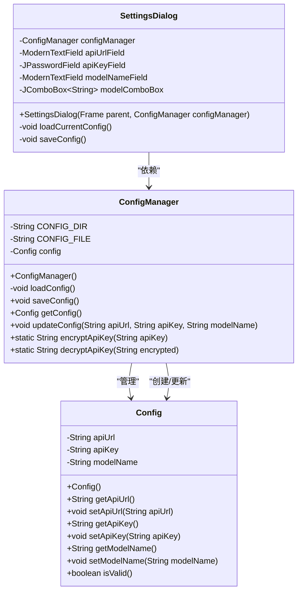
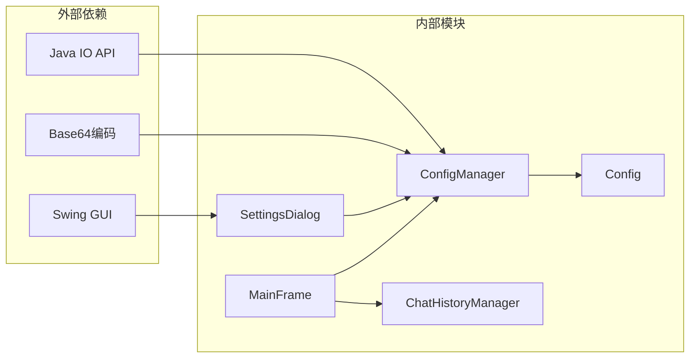

# 配置管理API

<cite>
**本文档引用的文件**
- [ConfigManager.java](file://src/com/llmchat/config/ConfigManager.java)
- [Config.java](file://src/com/llmchat/model/Config.java)
- [SettingsDialog.java](file://src/com/llmchat/ui/SettingsDialog.java)
- [MainFrame.java](file://src/com/llmchat/ui/MainFrame.java)
- [App.java](file://src/com/llmchat/App.java)
- [ChatHistoryManager.java](file://src/com/llmchat/config/ChatHistoryManager.java)
</cite>

## 目录
1. [简介](#简介)
2. [项目结构](#项目结构)
3. [核心组件](#核心组件)
4. [架构概览](#架构概览)
5. [详细组件分析](#详细组件分析)
6. [依赖关系分析](#依赖关系分析)
7. [性能考虑](#性能考虑)
8. [故障排除指南](#故障排除指南)
9. [结论](#结论)

## 简介

本文件为Java LLM接口项目的配置管理API提供全面的技术文档。该系统实现了基于对象序列化的配置持久化机制，支持API端点、API密钥和模型名称等关键配置项的存储与管理。配置管理器采用单例模式设计，通过二进制序列化方式将配置数据存储在用户目录下的隐藏文件中，确保配置信息的安全性和持久性。

## 项目结构

该项目采用标准的Java包结构组织，主要分为以下模块：

**图表来源**
- [App.java:11-27](file://src/com/llmchat/App.java#L11-L27)
- [MainFrame.java:19-36](file://src/com/llmchat/ui/MainFrame.java#L19-L36)
- [ConfigManager.java:14-22](file://src/com/llmchat/config/ConfigManager.java#L14-L22)

**章节来源**
- [App.java:1-27](file://src/com/llmchat/App.java#L1-L27)
- [MainFrame.java:1-177](file://src/com/llmchat/ui/MainFrame.java#L1-L177)

## 核心组件

### ConfigManager类

ConfigManager是配置管理的核心类，负责配置的加载、保存和更新操作。该类提供了完整的配置生命周期管理功能。

#### 主要职责
- 配置文件的自动加载和初始化
- 配置数据的持久化存储
- 配置更新操作的封装
- API密钥的简单加密/解密功能

#### 关键特性
- 自动检测配置文件存在性
- 异常处理和默认配置回退机制
- 基于Base64的API密钥简单加密
- 线程安全的配置访问

**章节来源**
- [ConfigManager.java:14-101](file://src/com/llmchat/config/ConfigManager.java#L14-L101)

### Config数据模型

Config类定义了应用程序的核心配置数据结构，实现了Serializable接口以支持对象序列化。

#### 数据字段
- **apiUrl**: API服务端点URL
- **apiKey**: 认证API密钥
- **modelName**: AI模型名称

#### 默认值
- apiUrl: "https://api.openai.com/v1/chat/completions"
- apiKey: 空字符串
- modelName: "gpt-3.5-turbo"

#### 验证规则
- 所有字段必须非null且非空字符串
- 提供isValid()方法进行完整性检查

**章节来源**
- [Config.java:8-52](file://src/com/llmchat/model/Config.java#L8-L52)

## 架构概览

系统采用分层架构设计，各层职责明确，耦合度低：

**图表来源**
- [SettingsDialog.java:27-37](file://src/com/llmchat/ui/SettingsDialog.java#L27-L37)
- [SettingsDialog.java:216-248](file://src/com/llmchat/ui/SettingsDialog.java#L216-L248)
- [ConfigManager.java:70-75](file://src/com/llmchat/config/ConfigManager.java#L70-L75)

## 详细组件分析

### ConfigManager类详细分析

ConfigManager类提供了完整的配置管理功能，包括初始化、加载、保存和更新操作。

#### 构造函数和初始化
- 自动调用loadConfig()方法
- 确保配置对象始终可用
- 支持首次运行时的默认配置创建

#### 加载机制

**图表来源**
- [ConfigManager.java:27-39](file://src/com/llmchat/config/ConfigManager.java#L27-L39)

#### 保存机制
- 自动创建配置目录（如果不存在）
- 使用ObjectOutputStream进行二进制序列化
- 异常捕获和错误处理
- 确保数据完整性和持久性

#### API密钥加密功能
- Base64编码实现简单加密
- 支持空值和null值处理
- 解密功能用于显示和验证

**章节来源**
- [ConfigManager.java:24-58](file://src/com/llmchat/config/ConfigManager.java#L24-L58)
- [ConfigManager.java:77-99](file://src/com/llmchat/config/ConfigManager.java#L77-L99)

### SettingsDialog集成分析

设置对话框作为用户交互界面，与ConfigManager紧密集成：

#### 配置加载流程
- 从ConfigManager获取当前配置
- 填充表单字段
- 处理预设模型和自定义模型逻辑
- 动态显示/隐藏模型名称输入框

#### 配置验证和保存
- 输入验证确保所有字段非空
- 错误提示和用户反馈
- 调用ConfigManager.updateConfig()进行保存
- 成功后的界面更新

**章节来源**
- [SettingsDialog.java:187-214](file://src/com/llmchat/ui/SettingsDialog.java#L187-L214)
- [SettingsDialog.java:216-248](file://src/com/llmchat/ui/SettingsDialog.java#L216-L248)

### 类关系图

**图表来源**
- [ConfigManager.java:14-101](file://src/com/llmchat/config/ConfigManager.java#L14-L101)
- [Config.java:8-52](file://src/com/llmchat/model/Config.java#L8-L52)
- [SettingsDialog.java:15-37](file://src/com/llmchat/ui/SettingsDialog.java#L15-L37)

## 依赖关系分析

系统采用松耦合的设计模式，主要依赖关系如下：

**图表来源**
- [ConfigManager.java:3-9](file://src/com/llmchat/config/ConfigManager.java#L3-L9)
- [SettingsDialog.java:3-11](file://src/com/llmchat/ui/SettingsDialog.java#L3-L11)

### 关键依赖特性
- **Java IO API**: 支持文件系统操作和对象序列化
- **Swing GUI**: 提供图形用户界面组件
- **Base64编码**: 实现简单的API密钥加密
- **ConcurrentHashMap**: 支持多线程环境下的会话管理

**章节来源**
- [ConfigManager.java:3-9](file://src/com/llmchat/config/ConfigManager.java#L3-L9)
- [ChatHistoryManager.java:11](file://src/com/llmchat/config/ChatHistoryManager.java#L11)

## 性能考虑

### 存储性能优化
- **延迟加载**: 配置在需要时才加载，减少启动时间
- **增量保存**: 仅在配置变更时触发保存操作
- **异常容错**: 文件损坏时自动回退到默认配置

### 内存使用优化
- **对象复用**: ConfigManager单例模式避免重复实例化
- **流式处理**: 使用ObjectInputStream/ObjectOutputStream进行高效序列化
- **内存映射**: 配置数据量小，适合完全加载到内存

### 并发安全性
- **线程安全**: ConfigManager内部状态保护
- **UI线程**: Swing组件在事件调度线程中更新
- **异步操作**: 配置保存操作在后台线程执行

## 故障排除指南

### 常见问题及解决方案

#### 配置文件加载失败
**症状**: 应用启动时配置重置为默认值
**原因**: 配置文件损坏或权限不足
**解决**: 
1. 检查用户目录权限
2. 删除损坏的配置文件
3. 重新创建配置

#### API密钥显示问题
**症状**: 密钥显示为空或乱码
**原因**: Base64解码失败
**解决**: 
1. 检查密钥格式
2. 重新输入密钥
3. 验证Base64编码正确性

#### UI更新不同步
**症状**: 修改配置后界面未刷新
**原因**: 缓存配置未及时更新
**解决**: 
1. 调用ConfigManager.getConfig()获取最新配置
2. 触发界面重新渲染
3. 检查事件监听器注册

**章节来源**
- [ConfigManager.java:33-38](file://src/com/llmchat/config/ConfigManager.java#L33-L38)
- [SettingsDialog.java:228-241](file://src/com/llmchat/ui/SettingsDialog.java#L228-L241)

## 结论

本配置管理API提供了完整的配置生命周期管理功能，具有以下优势：

1. **简洁易用**: API设计直观，易于集成和使用
2. **安全可靠**: 支持API密钥的简单加密，提供异常处理机制
3. **持久化存储**: 基于文件系统的可靠数据存储
4. **扩展性强**: 模块化设计便于功能扩展和维护

建议在生产环境中：
- 考虑使用更安全的加密方案替代Base64
- 添加配置版本控制机制
- 实现配置备份和恢复功能
- 增加配置导入导出功能