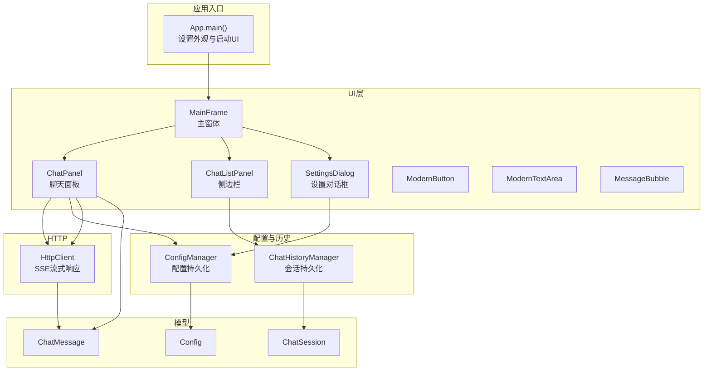
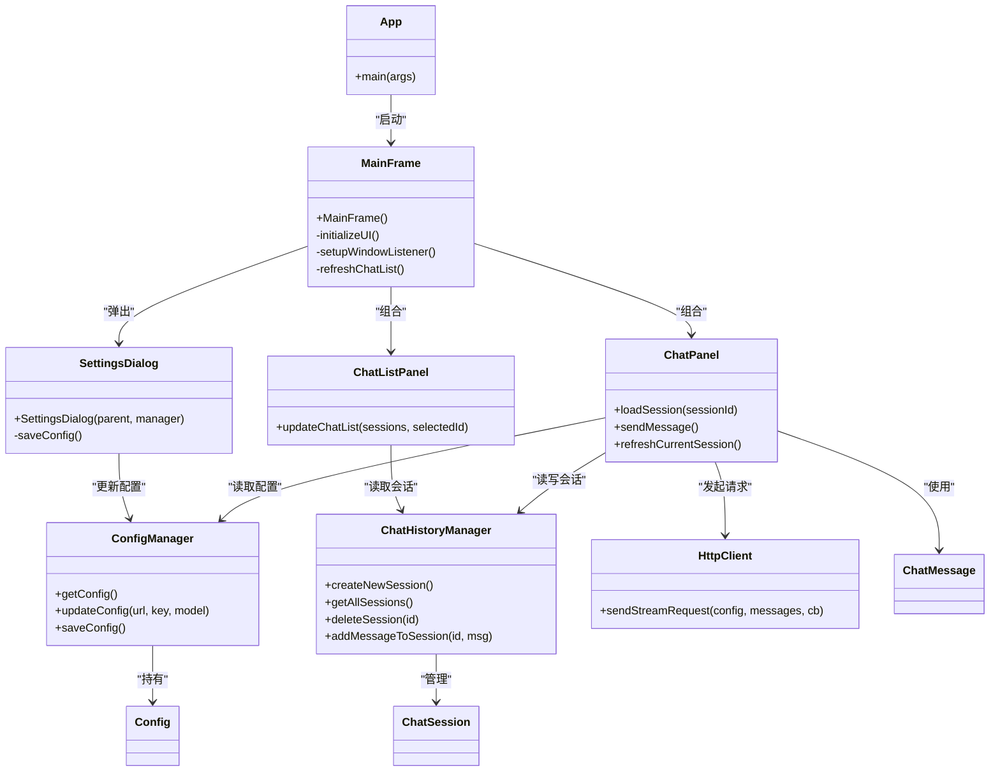
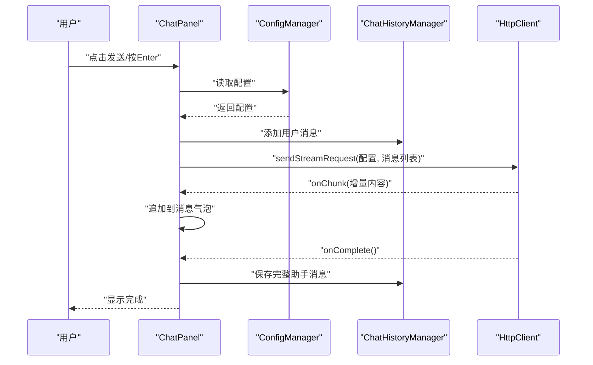
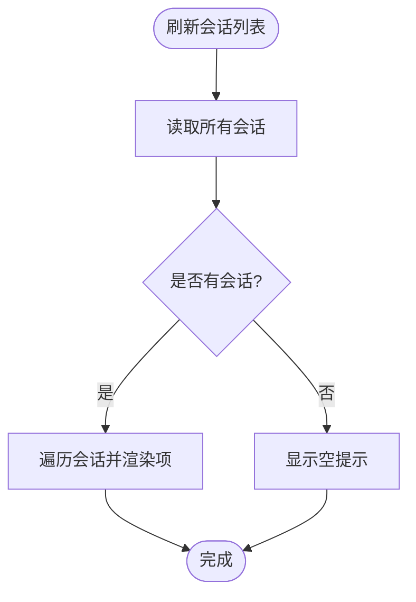
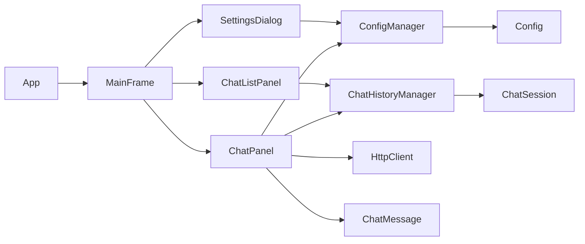

# 开发指南

<cite>
**本文引用的文件**
- [App.java](file://src/com/llmchat/App.java)
- [MainFrame.java](file://src/com/llmchat/ui/MainFrame.java)
- [ChatPanel.java](file://src/com/llmchat/ui/ChatPanel.java)
- [ChatListPanel.java](file://src/com/llmchat/ui/components/ChatListPanel.java)
- [MessageBubble.java](file://src/com/llmchat/ui/components/MessageBubble.java)
- [ModernButton.java](file://src/com/llmchat/ui/components/ModernButton.java)
- [ModernTextArea.java](file://src/com/llmchat/ui/components/ModernTextArea.java)
- [SettingsDialog.java](file://src/com/llmchat/ui/SettingsDialog.java)
- [ConfigManager.java](file://src/com/llmchat/config/ConfigManager.java)
- [ChatHistoryManager.java](file://src/com/llmchat/config/ChatHistoryManager.java)
- [Config.java](file://src/com/llmchat/model/Config.java)
- [ChatMessage.java](file://src/com/llmchat/model/ChatMessage.java)
- [ChatSession.java](file://src/com/llmchat/model/ChatSession.java)
- [HttpClient.java](file://src/com/llmchat/http/HttpClient.java)
- [compile.bat](file://compile.bat)
</cite>

## 目录
1. [简介](#简介)
2. [项目结构](#项目结构)
3. [核心组件](#核心组件)
4. [架构总览](#架构总览)
5. [详细组件分析](#详细组件分析)
6. [依赖关系分析](#依赖关系分析)
7. [性能与可扩展性](#性能与可扩展性)
8. [测试方案](#测试方案)
9. [开发环境与IDE配置](#开发环境与ide配置)
10. [版本控制与代码评审](#版本控制与代码评审)
11. [调试与故障排除](#调试与故障排除)
12. [结论](#结论)

## 简介
本指南面向Java LLM聊天界面项目的开发者，覆盖从入门到进阶的完整开发流程：新功能开发、插件与第三方集成、编码规范与代码组织、测试策略、IDE配置、版本控制与评审、调试与排错、以及扩展与设计模式应用。目标是帮助新手快速上手，同时为有经验的开发者提供实用技巧。

## 项目结构
项目采用按职责分层的包结构：
- app入口与UI主窗体：com.llmchat.App、com.llmchat.ui.MainFrame
- UI组件：com.llmchat.ui.components（现代化按钮、输入框、消息气泡、侧边栏等）
- 业务逻辑：com.llmchat.ui.ChatPanel（聊天面板）、com.llmchat.ui.SettingsDialog（设置）
- 配置与历史：com.llmchat.config.ConfigManager、com.llmchat.config.ChatHistoryManager
- 数据模型：com.llmchat.model.ChatMessage、ChatSession、Config
- HTTP通信：com.llmchat.http.HttpClient
- 构建脚本：compile.bat（Windows批处理）

图表来源
- [App.java:11-26](file://src/com/llmchat/App.java#L11-L26)
- [MainFrame.java:30-101](file://src/com/llmchat/ui/MainFrame.java#L30-L101)
- [ChatPanel.java:44-55](file://src/com/llmchat/ui/ChatPanel.java#L44-L55)
- [ChatListPanel.java:34-84](file://src/com/llmchat/ui/components/ChatListPanel.java#L34-L84)
- [SettingsDialog.java:27-37](file://src/com/llmchat/ui/SettingsDialog.java#L27-L37)
- [ConfigManager.java:20-22](file://src/com/llmchat/config/ConfigManager.java#L20-L22)
- [ChatHistoryManager.java:23-27](file://src/com/llmchat/config/ChatHistoryManager.java#L23-L27)
- [Config.java:15-20](file://src/com/llmchat/model/Config.java#L15-L20)
- [ChatMessage.java:18-22](file://src/com/llmchat/model/ChatMessage.java#L18-L22)
- [ChatSession.java:20-26](file://src/com/llmchat/model/ChatSession.java#L20-L26)
- [HttpClient.java:66-127](file://src/com/llmchat/http/HttpClient.java#L66-L127)

章节来源
- [App.java:11-26](file://src/com/llmchat/App.java#L11-L26)
- [compile.bat:1-21](file://compile.bat#L1-L21)

## 核心组件
- 应用入口与外观：设置系统外观、在EDT中启动主窗体
- 主窗体：组合头部工具栏、侧边栏、聊天面板；处理关闭事件与会话刷新
- 聊天面板：输入区、消息展示区、发送按钮；负责消息构建、流式响应处理、滚动定位
- 侧边栏：会话列表、新建会话、删除确认；与历史管理器交互
- 设置对话框：API URL、API Key、模型选择（含自定义）；保存配置
- 配置管理：配置对象持久化（序列化）、Base64加解密
- 历史管理：会话集合、索引顺序、新增/删除/清空/标题更新、消息追加
- HTTP客户端：SSE流式响应解析、超时与错误处理
- 自定义组件：现代化按钮（加载动画）、输入框（焦点态边框）、消息气泡（emoji字体适配、圆角背景、动态尺寸）

章节来源
- [App.java:12-25](file://src/com/llmchat/App.java#L12-L25)
- [MainFrame.java:38-101](file://src/com/llmchat/ui/MainFrame.java#L38-L101)
- [ChatPanel.java:86-119](file://src/com/llmchat/ui/ChatPanel.java#L86-L119)
- [ChatListPanel.java:96-125](file://src/com/llmchat/ui/components/ChatListPanel.java#L96-L125)
- [SettingsDialog.java:187-214](file://src/com/llmchat/ui/SettingsDialog.java#L187-L214)
- [ConfigManager.java:27-39](file://src/com/llmchat/config/ConfigManager.java#L27-L39)
- [ChatHistoryManager.java:32-65](file://src/com/llmchat/config/ChatHistoryManager.java#L32-L65)
- [HttpClient.java:66-127](file://src/com/llmchat/http/HttpClient.java#L66-L127)
- [ModernButton.java:78-98](file://src/com/llmchat/ui/components/ModernButton.java#L78-L98)
- [ModernTextArea.java:33-43](file://src/com/llmchat/ui/components/ModernTextArea.java#L33-L43)
- [MessageBubble.java:89-121](file://src/com/llmchat/ui/components/MessageBubble.java#L89-L121)

## 架构总览
应用采用Swing桌面应用的经典MVC思想：UI组件负责视图与交互，控制器由各面板承担（如ChatPanel），模型为Config、ChatMessage、ChatSession，配置与历史通过Manager类进行持久化管理，HTTP客户端封装网络请求与SSE解析。

图表来源
- [App.java:11-26](file://src/com/llmchat/App.java#L11-L26)
- [MainFrame.java:30-101](file://src/com/llmchat/ui/MainFrame.java#L30-L101)
- [ChatPanel.java:44-55](file://src/com/llmchat/ui/ChatPanel.java#L44-L55)
- [ChatListPanel.java:96-125](file://src/com/llmchat/ui/components/ChatListPanel.java#L96-L125)
- [SettingsDialog.java:27-37](file://src/com/llmchat/ui/SettingsDialog.java#L27-L37)
- [ConfigManager.java:63-75](file://src/com/llmchat/config/ConfigManager.java#L63-L75)
- [ChatHistoryManager.java:104-110](file://src/com/llmchat/config/ChatHistoryManager.java#L104-L110)
- [HttpClient.java:66-127](file://src/com/llmchat/http/HttpClient.java#L66-L127)
- [Config.java:15-20](file://src/com/llmchat/model/Config.java#L15-L20)
- [ChatMessage.java:18-22](file://src/com/llmchat/model/ChatMessage.java#L18-L22)
- [ChatSession.java:20-26](file://src/com/llmchat/model/ChatSession.java#L20-L26)

## 详细组件分析

### 应用入口与主窗体
- 入口设置系统外观并在EDT中创建主窗体
- 主窗体初始化UI、分割面板、侧边栏与聊天面板联动
- 关闭事件：二次确认、保存历史、退出进程

章节来源
- [App.java:12-25](file://src/com/llmchat/App.java#L12-L25)
- [MainFrame.java:38-101](file://src/com/llmchat/ui/MainFrame.java#L38-L101)
- [MainFrame.java:148-166](file://src/com/llmchat/ui/MainFrame.java#L148-L166)

### 聊天面板（核心交互）
- 输入区：支持Enter发送、自动滚动到底部
- 发送流程：校验配置、添加用户消息、显示加载、流式接收、保存助手回复、通知会话更新
- 错误处理：异常回调、移除空气泡、回滚用户消息、提示错误

图表来源
- [ChatPanel.java:189-297](file://src/com/llmchat/ui/ChatPanel.java#L189-L297)
- [ConfigManager.java:63-75](file://src/com/llmchat/config/ConfigManager.java#L63-L75)
- [ChatHistoryManager.java:170-182](file://src/com/llmchat/config/ChatHistoryManager.java#L170-L182)
- [HttpClient.java:66-127](file://src/com/llmchat/http/HttpClient.java#L66-L127)

章节来源
- [ChatPanel.java:86-119](file://src/com/llmchat/ui/ChatPanel.java#L86-L119)
- [ChatPanel.java:189-297](file://src/com/llmchat/ui/ChatPanel.java#L189-L297)

### 侧边栏与会话管理
- 列表渲染：逐项绘制、悬停/选中态、删除确认
- 事件回调：选择会话、删除会话、新建会话
- 历史管理：持久化索引与会话文件、顺序维护、标题预览

图表来源
- [ChatListPanel.java:96-125](file://src/com/llmchat/ui/components/ChatListPanel.java#L96-L125)
- [ChatHistoryManager.java:122-131](file://src/com/llmchat/config/ChatHistoryManager.java#L122-L131)

章节来源
- [ChatListPanel.java:96-125](file://src/com/llmchat/ui/components/ChatListPanel.java#L96-L125)
- [ChatHistoryManager.java:32-65](file://src/com/llmchat/config/ChatHistoryManager.java#L32-L65)

### 设置对话框与配置管理
- 表单字段：API URL、API Key、模型下拉（含“自定义…”）
- 校验与保存：非空校验、更新配置、持久化
- 加密存储：API Key Base64加解密

章节来源
- [SettingsDialog.java:187-214](file://src/com/llmchat/ui/SettingsDialog.java#L187-L214)
- [ConfigManager.java:70-75](file://src/com/llmchat/config/ConfigManager.java#L70-L75)
- [ConfigManager.java:80-99](file://src/com/llmchat/config/ConfigManager.java#L80-L99)

### 模型与持久化
- Config：默认值、有效性校验
- ChatMessage：角色枚举、时间戳、内容
- ChatSession：UUID标识、标题、消息列表、首条用户消息预览
- ConfigManager：配置序列化、目录创建、异常兜底
- ChatHistoryManager：索引文件、并发Map、会话增删改查、文件级容错

章节来源
- [Config.java:15-50](file://src/com/llmchat/model/Config.java#L15-L50)
- [ChatMessage.java:18-42](file://src/com/llmchat/model/ChatMessage.java#L18-L42)
- [ChatSession.java:78-89](file://src/com/llmchat/model/ChatSession.java#L78-L89)
- [ConfigManager.java:27-39](file://src/com/llmchat/config/ConfigManager.java#L27-L39)
- [ChatHistoryManager.java:32-65](file://src/com/llmchat/config/ChatHistoryManager.java#L32-L65)

### HTTP客户端与流式响应
- 请求构建：JSON序列化、转义、SSE头
- 响应解析：逐行读取data:行，提取content字段，转义还原
- 超时与错误：连接/读取超时、错误流读取、回调错误

章节来源
- [HttpClient.java:30-49](file://src/com/llmchat/http/HttpClient.java#L30-L49)
- [HttpClient.java:66-127](file://src/com/llmchat/http/HttpClient.java#L66-L127)
- [HttpClient.java:132-163](file://src/com/llmchat/http/HttpClient.java#L132-L163)
- [HttpClient.java:193-206](file://src/com/llmchat/http/HttpClient.java#L193-L206)

## 依赖关系分析
- UI层依赖：ChatPanel依赖ConfigManager、ChatHistoryManager、HttpClient；MainFrame组合ChatPanel与ChatListPanel；SettingsDialog依赖ConfigManager
- 模型依赖：ChatHistoryManager持有ChatSession；ChatPanel使用ChatMessage；ConfigManager持有Config
- 外部依赖：JDK标准库（Swing、IO、NIO、Net、AWT）

图表来源
- [App.java:11-26](file://src/com/llmchat/App.java#L11-L26)
- [MainFrame.java:30-101](file://src/com/llmchat/ui/MainFrame.java#L30-L101)
- [ChatPanel.java:44-47](file://src/com/llmchat/ui/ChatPanel.java#L44-L47)
- [ChatListPanel.java:96-125](file://src/com/llmchat/ui/components/ChatListPanel.java#L96-L125)
- [SettingsDialog.java:27-37](file://src/com/llmchat/ui/SettingsDialog.java#L27-L37)
- [ConfigManager.java:63-75](file://src/com/llmchat/config/ConfigManager.java#L63-L75)
- [ChatHistoryManager.java:104-110](file://src/com/llmchat/config/ChatHistoryManager.java#L104-L110)
- [ChatMessage.java:18-22](file://src/com/llmchat/model/ChatMessage.java#L18-L22)
- [ChatSession.java:20-26](file://src/com/llmchat/model/ChatSession.java#L20-L26)
- [Config.java:15-20](file://src/com/llmchat/model/Config.java#L15-L20)

## 性能与可扩展性
- UI线程安全：所有Swing操作通过SwingUtilities.invokeLater保证在EDT执行
- 流式渲染：消息增量追加，避免全量重绘
- I/O异步：HTTP请求在独立线程中执行，避免阻塞UI
- 存储优化：会话按文件分离，索引文件记录顺序，减少单文件体积
- 可扩展点：
  - 插件化模型：通过Config.modelName切换不同服务端
  - 自定义组件：ModernButton/ModernTextArea可复用到其他面板
  - 回调抽象：HttpClient.StreamCallback便于接入不同SSE格式

章节来源
- [ChatPanel.java:243-297](file://src/com/llmchat/ui/ChatPanel.java#L243-L297)
- [HttpClient.java:66-127](file://src/com/llmchat/http/HttpClient.java#L66-L127)
- [ChatHistoryManager.java:70-99](file://src/com/llmchat/config/ChatHistoryManager.java#L70-L99)

## 测试方案
- 单元测试
  - 模型类：断言Config.isValid、ChatMessage构造与时间戳、ChatSession标题预览
  - 工具函数：ConfigManager.encryptApiKey/decryptApiKey、HttpClient.escapeJson/unescapeJson
  - 并发与容错：ChatHistoryManager在部分会话加载失败时的恢复逻辑
- 集成测试
  - 完整对话流程：设置对话框保存配置 → 新建会话 → 输入消息 → 流式响应 → 历史落盘
  - 异常路径：无效配置提示、网络异常回调、错误流读取
- 性能测试
  - 大消息流式渲染：统计渲染延迟与内存占用
  - 多会话并发：模拟高并发下的索引与文件I/O稳定性

章节来源
- [Config.java:46-50](file://src/com/llmchat/model/Config.java#L46-L50)
- [ConfigManager.java:80-99](file://src/com/llmchat/config/ConfigManager.java#L80-L99)
- [HttpClient.java:54-61](file://src/com/llmchat/http/HttpClient.java#L54-L61)
- [HttpClient.java:168-188](file://src/com/llmchat/http/HttpClient.java#L168-L188)
- [ChatHistoryManager.java:48-58](file://src/com/llmchat/config/ChatHistoryManager.java#L48-L58)
- [ChatPanel.java:195-202](file://src/com/llmchat/ui/ChatPanel.java#L195-L202)
- [ChatPanel.java:275-295](file://src/com/llmchat/ui/ChatPanel.java#L275-L295)

## 开发环境与IDE配置
- JDK要求：建议使用JDK 8或更高版本
- IDE推荐：IntelliJ IDEA 或 Eclipse
- 编码：UTF-8
- 构建方式：
  - 使用提供的批处理脚本编译：运行 [compile.bat:1-21](file://compile.bat#L1-L21)
  - 输出目录：bin
- 运行：双击run脚本或在命令行执行java -cp bin com.llmchat.App

章节来源
- [compile.bat:1-21](file://compile.bat#L1-L21)

## 版本控制与代码评审
- 分支策略：采用Git Flow，主分支保护，特性分支开发，发布前合并
- 提交规范：简短主题 + 详细描述，关联Issue编号
- 代码评审：PR至少一名同行评审，关注UI线程安全、异常处理、性能影响
- 合并策略：squash合并，保持提交历史整洁

## 调试与故障排除
- 常见问题
  - UI无响应：检查是否在EDT外修改组件；确认SwingUtilities.invokeLater使用
  - 流式响应不显示：检查SSE数据行格式与content字段解析
  - 配置未生效：确认ConfigManager.saveConfig调用与文件权限
  - 会话丢失：检查索引文件完整性与单会话加载异常捕获
- 排错要点
  - 打印HTTP响应状态与错误流
  - 断言Config.isValid
  - 捕获并记录序列化异常

章节来源
- [ChatPanel.java:243-297](file://src/com/llmchat/ui/ChatPanel.java#L243-L297)
- [HttpClient.java:88-93](file://src/com/llmchat/http/HttpClient.java#L88-L93)
- [HttpClient.java:193-206](file://src/com/llmchat/http/HttpClient.java#L193-L206)
- [ConfigManager.java:44-58](file://src/com/llmchat/config/ConfigManager.java#L44-L58)
- [ChatHistoryManager.java:48-58](file://src/com/llmchat/config/ChatHistoryManager.java#L48-L58)

## 结论
本项目以清晰的分层与模块化设计实现了LLM聊天界面的核心能力。遵循本文档的开发流程、编码规范与测试策略，可在保证UI流畅性的前提下，稳定地扩展新功能与第三方集成。建议在迭代中持续关注UI线程安全、流式渲染性能与配置/历史的健壮性。