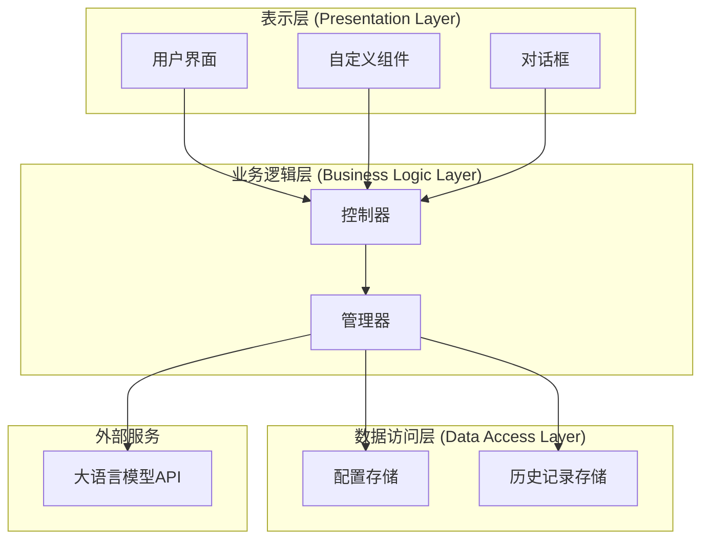
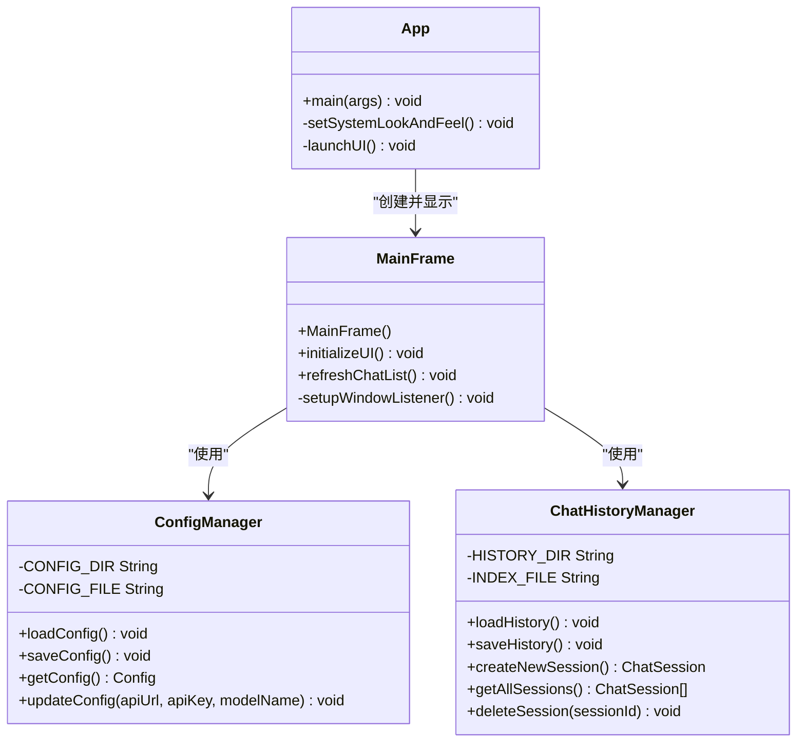
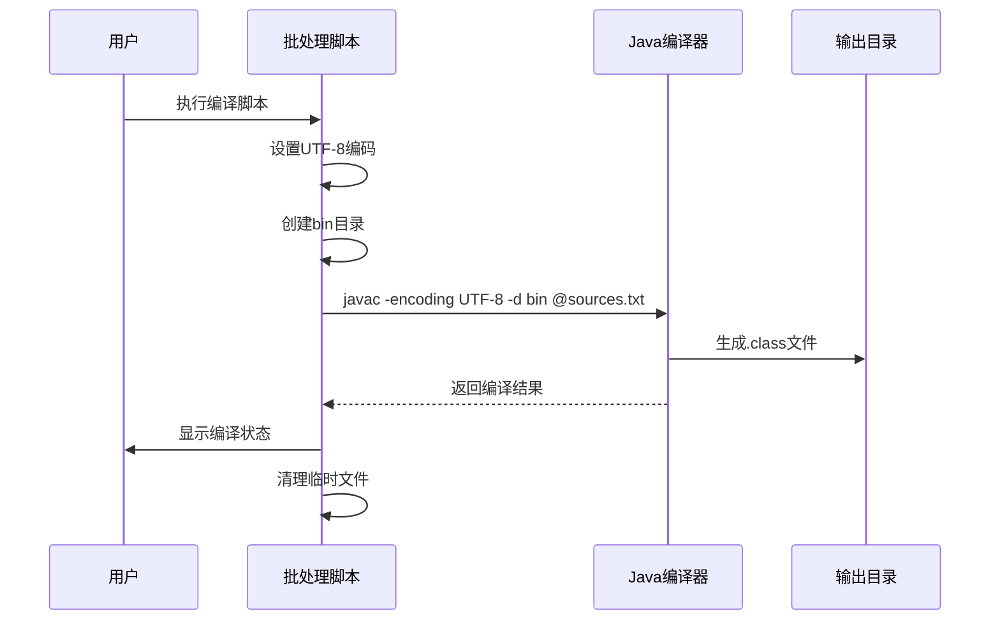
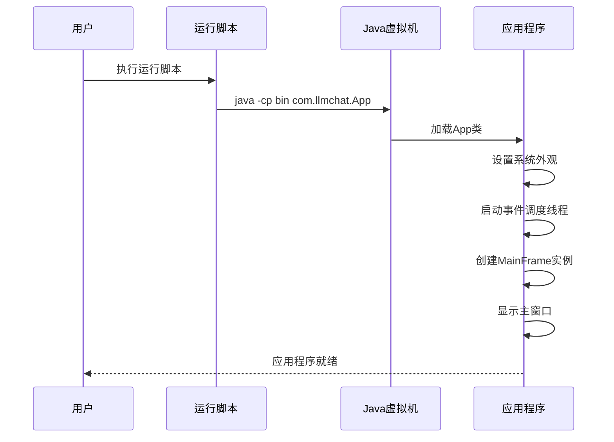
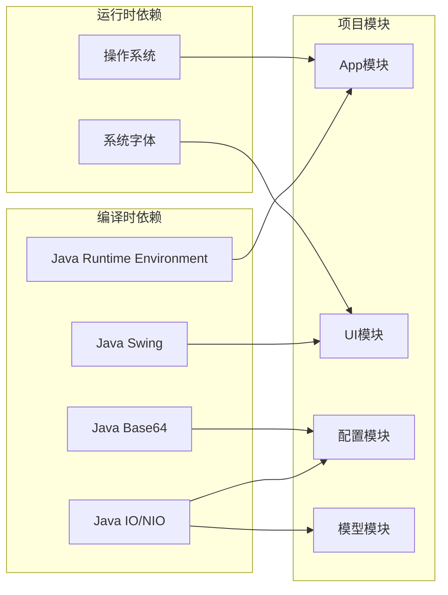

# 开发环境搭建

<cite>
**本文档引用的文件**
- [compile.bat](file://compile.bat)
- [compile.ps1](file://compile.ps1)
- [run.bat](file://run.bat)
- [run.ps1](file://run.ps1)
- [.gitignore](file://.gitignore)
- [App.java](file://src/com/llmchat/App.java)
- [MainFrame.java](file://src/com/llmchat/ui/MainFrame.java)
- [ConfigManager.java](file://src/com/llmchat/config/ConfigManager.java)
- [ChatHistoryManager.java](file://src/com/llmchat/config/ChatHistoryManager.java)
- [Config.java](file://src/com/llmchat/model/Config.java)
- [ChatSession.java](file://src/com/llmchat/model/ChatSession.java)
- [ChatMessage.java](file://src/com/llmchat/model/ChatMessage.java)
</cite>

## 目录
1. [简介](#简介)
2. [项目结构](#项目结构)
3. [核心组件](#核心组件)
4. [架构概览](#架构概览)
5. [详细组件分析](#详细组件分析)
6. [依赖分析](#依赖分析)
7. [性能考虑](#性能考虑)
8. [故障排除指南](#故障排除指南)
9. [结论](#结论)

## 简介

Java LLM聊天界面是一个基于Java Swing的桌面应用程序，提供了现代化的聊天界面，支持与大语言模型进行交互。该项目采用模块化设计，包含配置管理、聊天历史记录、用户界面等核心功能模块。

## 项目结构

该项目采用标准的Java项目结构，主要包含以下目录和文件：

```mermaid
graph TB
subgraph "项目根目录"
Root[项目根目录]
Src[src/] - Java源代码
Bin[bin/] - 编译输出目录
LLMS[.llmchat/] - 用户配置目录
Scripts[批处理脚本]
GitIgnore[.gitignore]
end
subgraph "src/com/llmchat/"
App[App.java - 应用入口]
Config[配置包]
Http[HTTP包]
Model[模型包]
UI[界面包]
end
subgraph "配置管理"
ConfigManager[ConfigManager.java]
ChatHistoryManager[ChatHistoryManager.java]
ConfigModel[Config.java]
end
subgraph "模型层"
ChatSession[ChatSession.java]
ChatMessage[ChatMessage.java]
end
subgraph "界面层"
MainFrame[MainFrame.java]
ChatPanel[ChatPanel.java]
SettingsDialog[SettingsDialog.java]
Components[组件包]
end
Root --> Src
Root --> Scripts
Root --> GitIgnore
Src --> App
Src --> Config
Src --> Http
Src --> Model
Src --> UI
Config --> ConfigManager
Config --> ChatHistoryManager
Config --> ConfigModel
Model --> ChatSession
Model --> ChatMessage
UI --> MainFrame
UI --> ChatPanel
UI --> SettingsDialog
UI --> Components
```

**图表来源**
- [compile.bat:1-21](file://compile.bat#L1-L21)
- [run.bat:1-5](file://run.bat#L1-L5)
- [App.java:1-27](file://src/com/llmchat/App.java#L1-L27)

**章节来源**
- [compile.bat:1-21](file://compile.bat#L1-L21)
- [run.bat:1-5](file://run.bat#L1-L5)
- [.gitignore:1-2](file://.gitignore#L1-L2)

## 核心组件

### 应用入口点

应用的主入口点位于 `App.java` 文件中，负责初始化系统外观并启动主窗口。

### 配置管理系统

配置管理系统包含三个核心组件：
- **ConfigManager**: 负责配置的持久化存储和管理
- **ChatHistoryManager**: 管理聊天历史记录的持久化
- **Config**: 配置数据模型

### 模型层

模型层包含聊天相关的数据结构：
- **ChatSession**: 表示单个聊天会话
- **ChatMessage**: 表示聊天消息
- **Config**: 应用配置信息

### 界面层

界面层采用Swing框架实现现代化的用户界面：
- **MainFrame**: 主窗口类
- **ChatPanel**: 聊天面板
- **SettingsDialog**: 设置对话框
- **各种自定义组件**: 包括消息气泡、输入框等

**章节来源**
- [App.java:11-26](file://src/com/llmchat/App.java#L11-L26)
- [ConfigManager.java:14-101](file://src/com/llmchat/config/ConfigManager.java#L14-L101)
- [ChatHistoryManager.java:16-206](file://src/com/llmchat/config/ChatHistoryManager.java#L16-L206)

## 架构概览

该应用程序采用分层架构设计，清晰分离了关注点：



**图表来源**
- [MainFrame.java:19-36](file://src/com/llmchat/ui/MainFrame.java#L19-L36)
- [ConfigManager.java:20-22](file://src/com/llmchat/config/ConfigManager.java#L20-L22)
- [ChatHistoryManager.java:23-27](file://src/com/llmchat/config/ChatHistoryManager.java#L23-L27)

## 详细组件分析

### 应用入口组件分析



**图表来源**
- [App.java:11-26](file://src/com/llmchat/App.java#L11-L26)
- [MainFrame.java:30-36](file://src/com/llmchat/ui/MainFrame.java#L30-L36)
- [ConfigManager.java:14-22](file://src/com/llmchat/config/ConfigManager.java#L14-L22)
- [ChatHistoryManager.java:16-27](file://src/com/llmchat/config/ChatHistoryManager.java#L16-L27)

### 编译流程分析



**图表来源**
- [compile.bat:1-21](file://compile.bat#L1-L21)
- [compile.ps1:1-25](file://compile.ps1#L1-L25)

### 运行流程分析



**图表来源**
- [run.bat:1-5](file://run.bat#L1-L5)
- [run.ps1:1-4](file://run.ps1#L1-L4)
- [App.java:12-25](file://src/com/llmchat/App.java#L12-L25)

**章节来源**
- [App.java:11-26](file://src/com/llmchat/App.java#L11-L26)
- [compile.bat:1-21](file://compile.bat#L1-L21)
- [run.bat:1-5](file://run.bat#L1-L5)

## 依赖分析

### 编译时依赖

项目采用标准的Java SE依赖，主要依赖于：
- **Java Swing**: 图形用户界面
- **Java IO/NIO**: 文件操作和序列化
- **Java Base64**: 配置加密解密

### 运行时依赖

应用程序运行时需要：
- **Java Runtime Environment**: 支持Swing图形界面
- **系统字体**: 支持中文显示



**图表来源**
- [App.java:3-6](file://src/com/llmchat/App.java#L3-L6)
- [ConfigManager.java:5-9](file://src/com/llmchat/config/ConfigManager.java#L5-L9)

**章节来源**
- [App.java:1-27](file://src/com/llmchat/App.java#L1-L27)
- [ConfigManager.java:1-101](file://src/com/llmchat/config/ConfigManager.java#L1-L101)

## 性能考虑

### 内存管理

- **对象池**: 使用ConcurrentHashMap管理会话，支持并发访问
- **延迟加载**: 历史记录按需加载，避免内存占用过高
- **及时清理**: 窗口关闭时自动保存并释放资源

### I/O优化

- **批量操作**: 批量保存多个会话，减少磁盘I/O次数
- **增量更新**: 只更新修改过的会话，避免全量重写
- **异常处理**: 对文件操作进行异常捕获，防止I/O错误影响整体性能

### 界面响应性

- **事件调度**: 使用SwingUtilities.invokeLater确保UI操作在事件调度线程中执行
- **异步处理**: 配置加载和历史记录读取在后台完成
- **资源管理**: 及时释放不再使用的资源

## 故障排除指南

### JDK版本兼容性问题

**问题**: 编译时报错，提示不支持的语法或类

**解决方案**:
1. 确认已安装Java 8或更高版本
2. 检查JAVA_HOME环境变量是否正确设置
3. 验证javac命令可用性

**章节来源**
- [compile.bat:10](file://compile.bat#L10)
- [compile.ps1:17](file://compile.ps1#L17)

### 字符编码问题

**问题**: 中文字符显示乱码或编译时出现编码错误

**解决方案**:
1. 确保编译脚本使用UTF-8编码
2. 检查系统区域设置
3. 验证源文件保存为UTF-8格式

**章节来源**
- [compile.bat:10](file://compile.bat#L10)
- [compile.ps1:2](file://compile.ps1#L2)

### 类路径问题

**问题**: 运行时找不到主类或类加载失败

**解决方案**:
1. 确保bin目录存在且包含编译后的.class文件
2. 检查主类名是否正确（com.llmchat.App）
3. 验证classpath设置

**章节来源**
- [run.bat:4](file://run.bat#L4)
- [run.ps1:3](file://run.ps1#L3)

### 文件权限问题

**问题**: 无法创建配置文件或保存聊天记录

**解决方案**:
1. 检查用户目录的写入权限
2. 确认磁盘空间充足
3. 关闭可能占用文件的其他程序

**章节来源**
- [ConfigManager.java:44-58](file://src/com/llmchat/config/ConfigManager.java#L44-L58)
- [ChatHistoryManager.java:70-99](file://src/com/llmchat/config/ChatHistoryManager.java#L70-L99)

### 界面显示问题

**问题**: 界面元素显示异常或布局错乱

**解决方案**:
1. 确保系统字体可用
2. 检查屏幕分辨率设置
3. 验证Swing支持

**章节来源**
- [MainFrame.java:109-111](file://src/com/llmchat/ui/MainFrame.java#L109-L111)
- [MainFrame.java:148-166](file://src/com/llmchat/ui/MainFrame.java#L148-L166)

### 网络连接问题

**问题**: 无法连接到大语言模型API

**解决方案**:
1. 检查网络连接状态
2. 验证API地址配置
3. 确认防火墙设置允许出站连接

**章节来源**
- [Config.java:17](file://src/com/llmchat/model/Config.java#L17)

## 结论

Java LLM聊天界面项目提供了一个完整的桌面应用程序开发示例，展示了现代Java桌面应用的最佳实践。通过本文档的指导，开发者可以快速搭建开发环境并开始项目开发。

### 关键要点

1. **环境要求**: Java 8+，支持Swing图形界面
2. **项目结构**: 标准的Java项目组织方式
3. **构建工具**: 提供批处理和PowerShell脚本简化构建过程
4. **配置管理**: 完整的配置持久化机制
5. **界面设计**: 现代化的Swing界面实现

### 下一步建议

1. 阅读各个组件的详细实现
2. 尝试修改配置参数测试功能
3. 探索扩展新的聊天模型支持
4. 自定义界面主题和样式