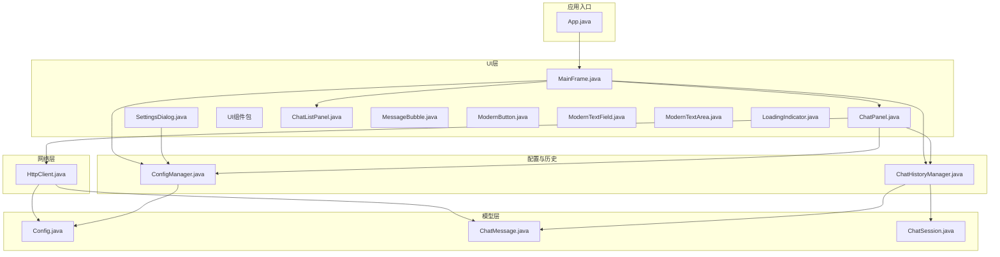
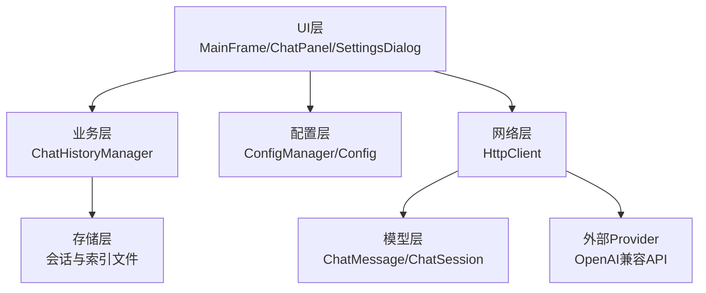
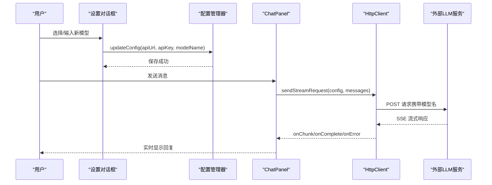
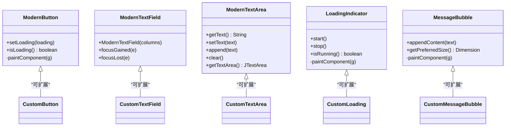
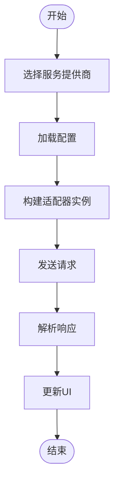
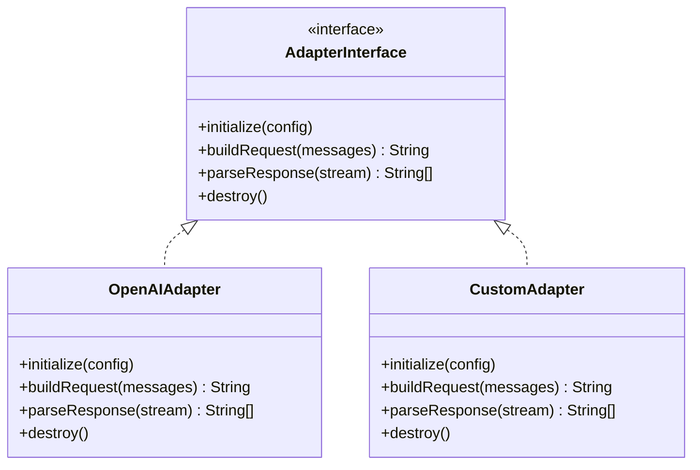
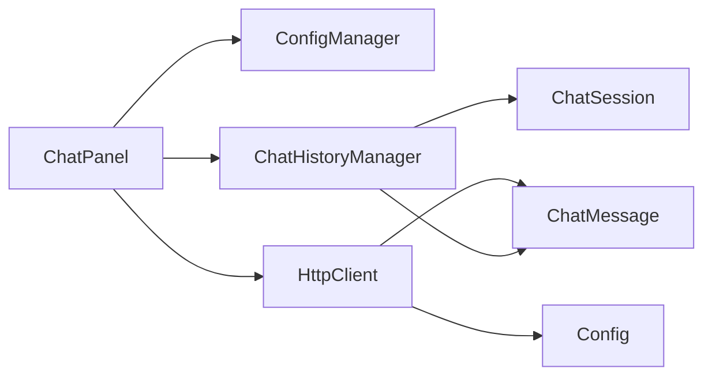

# 扩展开发指南

<cite>
**本文档引用的文件**
- [App.java](file://src/com/llmchat/App.java)
- [Config.java](file://src/com/llmchat/model/Config.java)
- [ConfigManager.java](file://src/com/llmchat/config/ConfigManager.java)
- [HttpClient.java](file://src/com/llmchat/http/HttpClient.java)
- [ChatHistoryManager.java](file://src/com/llmchat/config/ChatHistoryManager.java)
- [ChatMessage.java](file://src/com/llmchat/model/ChatMessage.java)
- [ChatSession.java](file://src/com/llmchat/model/ChatSession.java)
- [ChatPanel.java](file://src/com/llmchat/ui/ChatPanel.java)
- [MainFrame.java](file://src/com/llmchat/ui/MainFrame.java)
- [SettingsDialog.java](file://src/com/llmchat/ui/SettingsDialog.java)
- [ChatListPanel.java](file://src/com/llmchat/ui/components/ChatListPanel.java)
- [MessageBubble.java](file://src/com/llmchat/ui/components/MessageBubble.java)
- [ModernButton.java](file://src/com/llmchat/ui/components/ModernButton.java)
- [ModernTextField.java](file://src/com/llmchat/ui/components/ModernTextField.java)
- [ModernTextArea.java](file://src/com/llmchat/ui/components/ModernTextArea.java)
- [LoadingIndicator.java](file://src/com/llmchat/ui/components/LoadingIndicator.java)
</cite>

## 目录
1. [简介](#简介)
2. [项目结构](#项目结构)
3. [核心组件](#核心组件)
4. [架构总览](#架构总览)
5. [详细组件分析](#详细组件分析)
6. [依赖关系分析](#依赖关系分析)
7. [性能考虑](#性能考虑)
8. [故障排除指南](#故障排除指南)
9. [结论](#结论)
10. [附录](#附录)

## 简介
本指南面向需要在 Java LLM 聊天界面项目中进行扩展开发的工程师，涵盖以下主题：
- 如何添加新的大语言模型支持（含配置与API适配）
- 自定义UI组件与界面定制方法
- 第三方集成与插件化扩展思路
- 插件架构的设计原理与实现方式
- 新功能开发的完整流程：从需求分析到代码实现再到测试验证
- 配置扩展、API适配器与界面定制的具体实现示例
- 向后兼容性与版本管理最佳实践

## 项目结构
该项目采用基于包的分层组织方式，清晰分离了应用入口、模型、配置、HTTP通信、UI组件与对话界面等模块。

**图表来源**
- [App.java:11-25](file://src/com/llmchat/App.java#L11-L25)
- [MainFrame.java:30-100](file://src/com/llmchat/ui/MainFrame.java#L30-L100)
- [ChatPanel.java:44-55](file://src/com/llmchat/ui/ChatPanel.java#L44-L55)
- [ConfigManager.java:14-22](file://src/com/llmchat/config/ConfigManager.java#L14-L22)
- [ChatHistoryManager.java:16-27](file://src/com/llmchat/config/ChatHistoryManager.java#L16-L27)
- [HttpClient.java:16-25](file://src/com/llmchat/http/HttpClient.java#L16-L25)
- [Config.java:8-51](file://src/com/llmchat/model/Config.java#L8-L51)
- [ChatMessage.java:8-43](file://src/com/llmchat/model/ChatMessage.java#L8-L43)
- [ChatSession.java:11-90](file://src/com/llmchat/model/ChatSession.java#L11-L90)

**章节来源**
- [App.java:11-25](file://src/com/llmchat/App.java#L11-L25)
- [MainFrame.java:30-100](file://src/com/llmchat/ui/MainFrame.java#L30-L100)

## 核心组件
- 应用入口与启动：负责设置系统外观并在事件调度线程中启动主窗口。
- 配置模型与管理：封装API地址、密钥、模型名等配置信息，并提供序列化持久化能力。
- HTTP客户端：支持流式响应的请求发送与SSE数据解析。
- 聊天历史管理：负责会话的创建、加载、保存、删除与标题更新。
- UI框架：主窗口、设置对话框、聊天面板、侧边栏列表与消息气泡等组件。
- UI组件库：现代化按钮、文本域、文本区、加载指示器等可复用组件。

**章节来源**
- [App.java:11-25](file://src/com/llmchat/App.java#L11-L25)
- [Config.java:8-51](file://src/com/llmchat/model/Config.java#L8-L51)
- [ConfigManager.java:14-75](file://src/com/llmchat/config/ConfigManager.java#L14-L75)
- [HttpClient.java:16-127](file://src/com/llmchat/http/HttpClient.java#L16-L127)
- [ChatHistoryManager.java:16-99](file://src/com/llmchat/config/ChatHistoryManager.java#L16-L99)
- [ChatPanel.java:21-55](file://src/com/llmchat/ui/ChatPanel.java#L21-L55)
- [ChatListPanel.java:15-40](file://src/com/llmchat/ui/components/ChatListPanel.java#L15-L40)
- [MessageBubble.java:14-58](file://src/com/llmchat/ui/components/MessageBubble.java#L14-L58)
- [ModernButton.java:14-40](file://src/com/llmchat/ui/components/ModernButton.java#L14-L40)
- [ModernTextField.java:12-24](file://src/com/llmchat/ui/components/ModernTextField.java#L12-L24)
- [ModernTextArea.java:12-30](file://src/com/llmchat/ui/components/ModernTextArea.java#L12-L30)
- [LoadingIndicator.java:10-29](file://src/com/llmchat/ui/components/LoadingIndicator.java#L10-L29)

## 架构总览
系统采用“模型-配置-网络-UI”分层架构，UI层通过事件驱动与业务层解耦；网络层对配置层透明，便于替换不同模型或服务提供商；历史管理独立于UI，保证数据持久化与一致性。

**图表来源**
- [ChatPanel.java:44-55](file://src/com/llmchat/ui/ChatPanel.java#L44-L55)
- [ConfigManager.java:14-75](file://src/com/llmchat/config/ConfigManager.java#L14-L75)
- [ChatHistoryManager.java:16-99](file://src/com/llmchat/config/ChatHistoryManager.java#L16-L99)
- [HttpClient.java:16-127](file://src/com/llmchat/http/HttpClient.java#L16-L127)
- [Config.java:8-51](file://src/com/llmchat/model/Config.java#L8-L51)
- [ChatMessage.java:8-43](file://src/com/llmchat/model/ChatMessage.java#L8-L43)
- [ChatSession.java:11-90](file://src/com/llmchat/model/ChatSession.java#L11-L90)

## 详细组件分析

### 组件A：新增大语言模型支持（以新模型适配为例）
目标：在不破坏现有逻辑的前提下，支持新的模型名称与API端点。

实现步骤
- 扩展配置模型与管理器
  - 在配置模型中增加或保留模型相关字段（如模型名、参数映射）。
  - 在配置管理器中提供更新方法，确保配置变更后持久化。
  - 参考路径：[Config.java:8-51](file://src/com/llmchat/model/Config.java#L8-L51)，[ConfigManager.java:60-75](file://src/com/llmchat/config/ConfigManager.java#L60-L75)

- 扩展设置对话框
  - 在设置界面中新增模型下拉选项或自定义输入框，支持预设模型与自定义模型名。
  - 参考路径：[SettingsDialog.java:120-169](file://src/com/llmchat/ui/SettingsDialog.java#L120-L169)，[SettingsDialog.java:187-214](file://src/com/llmchat/ui/SettingsDialog.java#L187-L214)

- 适配HTTP客户端
  - 在构建请求体时，根据配置中的模型名拼接请求参数。
  - 若新模型需要特殊头部或参数，可在请求头或请求体中扩展。
  - 参考路径：[HttpClient.java:30-49](file://src/com/llmchat/http/HttpClient.java#L30-L49)，[HttpClient.java:70-85](file://src/com/llmchat/http/HttpClient.java#L70-L85)

- 测试与验证
  - 使用设置对话框切换至新模型，发起一次流式请求，观察回调与UI渲染。
  - 参考路径：[ChatPanel.java:243-296](file://src/com/llmchat/ui/ChatPanel.java#L243-L296)，[HttpClient.java:66-127](file://src/com/llmchat/http/HttpClient.java#L66-L127)

**图表来源**
- [SettingsDialog.java:216-248](file://src/com/llmchat/ui/SettingsDialog.java#L216-L248)
- [ConfigManager.java:70-75](file://src/com/llmchat/config/ConfigManager.java#L70-L75)
- [ChatPanel.java:243-296](file://src/com/llmchat/ui/ChatPanel.java#L243-L296)
- [HttpClient.java:66-127](file://src/com/llmchat/http/HttpClient.java#L66-L127)

**章节来源**
- [Config.java:8-51](file://src/com/llmchat/model/Config.java#L8-L51)
- [ConfigManager.java:60-75](file://src/com/llmchat/config/ConfigManager.java#L60-L75)
- [SettingsDialog.java:120-169](file://src/com/llmchat/ui/SettingsDialog.java#L120-L169)
- [SettingsDialog.java:187-214](file://src/com/llmchat/ui/SettingsDialog.java#L187-L214)
- [HttpClient.java:30-49](file://src/com/llmchat/http/HttpClient.java#L30-L49)
- [ChatPanel.java:243-296](file://src/com/llmchat/ui/ChatPanel.java#L243-L296)

### 组件B：自定义UI组件与界面定制
目标：在不破坏现有组件行为的前提下，新增或定制UI组件。

实现要点
- 组件继承与行为扩展
  - 新增组件时建议继承现有组件（如JButton/JTextField/JScrollPane），重写绘制或交互逻辑。
  - 参考现有组件：[ModernButton.java:14-98](file://src/com/llmchat/ui/components/ModernButton.java#L14-L98)，[ModernTextField.java:12-43](file://src/com/llmchat/ui/components/ModernTextField.java#L12-L43)，[ModernTextArea.java:12-64](file://src/com/llmchat/ui/components/ModernTextArea.java#L12-L64)，[LoadingIndicator.java:10-57](file://src/com/llmchat/ui/components/LoadingIndicator.java#L10-L57)

- 与现有组件协作
  - 在聊天面板中使用自定义组件，保持事件与状态一致（如加载状态同步）。
  - 参考路径：[ChatPanel.java:92-118](file://src/com/llmchat/ui/ChatPanel.java#L92-L118)，[ChatPanel.java:108-113](file://src/com/llmchat/ui/ChatPanel.java#L108-L113)

- 界面布局与样式
  - 使用统一的颜色与圆角策略，确保视觉一致性。
  - 参考路径：[MessageBubble.java:14-58](file://src/com/llmchat/ui/components/MessageBubble.java#L14-L58)，[ChatListPanel.java:15-40](file://src/com/llmchat/ui/components/ChatListPanel.java#L15-L40)

**图表来源**
- [ModernButton.java:14-98](file://src/com/llmchat/ui/components/ModernButton.java#L14-L98)
- [ModernTextField.java:12-43](file://src/com/llmchat/ui/components/ModernTextField.java#L12-L43)
- [ModernTextArea.java:12-64](file://src/com/llmchat/ui/components/ModernTextArea.java#L12-L64)
- [LoadingIndicator.java:10-57](file://src/com/llmchat/ui/components/LoadingIndicator.java#L10-L57)
- [MessageBubble.java:14-58](file://src/com/llmchat/ui/components/MessageBubble.java#L14-L58)

**章节来源**
- [ModernButton.java:14-98](file://src/com/llmchat/ui/components/ModernButton.java#L14-L98)
- [ModernTextField.java:12-43](file://src/com/llmchat/ui/components/ModernTextField.java#L12-L43)
- [ModernTextArea.java:12-64](file://src/com/llmchat/ui/components/ModernTextArea.java#L12-L64)
- [LoadingIndicator.java:10-57](file://src/com/llmchat/ui/components/LoadingIndicator.java#L10-L57)
- [MessageBubble.java:14-58](file://src/com/llmchat/ui/components/MessageBubble.java#L14-L58)
- [ChatPanel.java:92-118](file://src/com/llmchat/ui/ChatPanel.java#L92-L118)

### 组件C：第三方集成与插件化扩展
目标：在不修改核心代码的情况下，接入新的服务提供商或适配不同API格式。

实现思路
- 抽象网络适配器
  - 定义统一的请求适配器接口，屏蔽不同服务提供商的差异。
  - 参考现有HTTP客户端的职责边界：[HttpClient.java:16-25](file://src/com/llmchat/http/HttpClient.java#L16-L25)

- 配置与路由
  - 在配置管理器中增加服务类型字段，根据类型选择不同的适配器。
  - 参考路径：[ConfigManager.java:60-75](file://src/com/llmchat/config/ConfigManager.java#L60-L75)，[Config.java:8-51](file://src/com/llmchat/model/Config.java#L8-L51)

- UI联动
  - 在设置对话框中增加服务提供商选择与参数配置项。
  - 参考路径：[SettingsDialog.java:120-169](file://src/com/llmchat/ui/SettingsDialog.java#L120-L169)

**图表来源**
- [ConfigManager.java:60-75](file://src/com/llmchat/config/ConfigManager.java#L60-L75)
- [SettingsDialog.java:120-169](file://src/com/llmchat/ui/SettingsDialog.java#L120-L169)
- [HttpClient.java:66-127](file://src/com/llmchat/http/HttpClient.java#L66-L127)

**章节来源**
- [ConfigManager.java:60-75](file://src/com/llmchat/config/ConfigManager.java#L60-L75)
- [SettingsDialog.java:120-169](file://src/com/llmchat/ui/SettingsDialog.java#L120-L169)
- [HttpClient.java:16-25](file://src/com/llmchat/http/HttpClient.java#L16-L25)

### 组件D：插件架构设计与实现
目标：通过接口与工厂模式实现插件化扩展，支持动态加载与替换。

设计要点
- 接口契约
  - 定义统一的“模型适配器”接口，包含初始化、构建请求、解析响应等方法。
  - 参考现有职责划分：[HttpClient.java:16-25](file://src/com/llmchat/http/HttpClient.java#L16-L25)

- 工厂与注册
  - 提供工厂类用于根据配置选择具体适配器实现。
  - 参考现有配置驱动行为：[ConfigManager.java:60-75](file://src/com/llmchat/config/ConfigManager.java#L60-L75)

- 生命周期管理
  - 在应用启动时加载插件清单，在运行时按需实例化与销毁。
  - 参考应用入口与主窗口生命周期：[App.java:11-25](file://src/com/llmchat/App.java#L11-L25)，[MainFrame.java:148-166](file://src/com/llmchat/ui/MainFrame.java#L148-L166)

**图表来源**
- [HttpClient.java:16-25](file://src/com/llmchat/http/HttpClient.java#L16-L25)
- [ConfigManager.java:60-75](file://src/com/llmchat/config/ConfigManager.java#L60-L75)

**章节来源**
- [HttpClient.java:16-25](file://src/com/llmchat/http/HttpClient.java#L16-L25)
- [ConfigManager.java:60-75](file://src/com/llmchat/config/ConfigManager.java#L60-L75)
- [App.java:11-25](file://src/com/llmchat/App.java#L11-L25)
- [MainFrame.java:148-166](file://src/com/llmchat/ui/MainFrame.java#L148-L166)

### 组件E：配置扩展、API适配器与界面定制示例
- 配置扩展
  - 在配置模型中新增字段（如超时、重试次数、代理设置），并在配置管理器中提供读写与持久化。
  - 参考路径：[Config.java:8-51](file://src/com/llmchat/model/Config.java#L8-L51)，[ConfigManager.java:27-39](file://src/com/llmchat/config/ConfigManager.java#L27-L39)

- API适配器
  - 在HTTP客户端中增加对新服务的请求头与参数处理，保持回调接口不变。
  - 参考路径：[HttpClient.java:70-85](file://src/com/llmchat/http/HttpClient.java#L70-L85)，[HttpClient.java:132-163](file://src/com/llmchat/http/HttpClient.java#L132-L163)

- 界面定制
  - 在设置对话框中新增配置项，使用现代化组件提升用户体验。
  - 参考路径：[SettingsDialog.java:67-103](file://src/com/llmchat/ui/SettingsDialog.java#L67-L103)，[ModernButton.java:14-98](file://src/com/llmchat/ui/components/ModernButton.java#L14-L98)

**章节来源**
- [Config.java:8-51](file://src/com/llmchat/model/Config.java#L8-L51)
- [ConfigManager.java:27-39](file://src/com/llmchat/config/ConfigManager.java#L27-L39)
- [HttpClient.java:70-85](file://src/com/llmchat/http/HttpClient.java#L70-L85)
- [HttpClient.java:132-163](file://src/com/llmchat/http/HttpClient.java#L132-L163)
- [SettingsDialog.java:67-103](file://src/com/llmchat/ui/SettingsDialog.java#L67-L103)
- [ModernButton.java:14-98](file://src/com/llmchat/ui/components/ModernButton.java#L14-L98)

## 依赖关系分析
- 组件内聚与耦合
  - UI层通过接口与业务层解耦，网络层对配置层透明，降低跨层依赖。
  - 参考路径：[ChatPanel.java:44-55](file://src/com/llmchat/ui/ChatPanel.java#L44-L55)，[HttpClient.java:16-25](file://src/com/llmchat/http/HttpClient.java#L16-L25)

- 外部依赖与集成点
  - 通过配置管理器集中管理外部服务凭据与端点，避免硬编码。
  - 参考路径：[ConfigManager.java:14-75](file://src/com/llmchat/config/ConfigManager.java#L14-L75)

**图表来源**
- [ChatPanel.java:44-55](file://src/com/llmchat/ui/ChatPanel.java#L44-L55)
- [ConfigManager.java:14-75](file://src/com/llmchat/config/ConfigManager.java#L14-L75)
- [ChatHistoryManager.java:16-99](file://src/com/llmchat/config/ChatHistoryManager.java#L16-L99)
- [HttpClient.java:16-127](file://src/com/llmchat/http/HttpClient.java#L16-L127)
- [Config.java:8-51](file://src/com/llmchat/model/Config.java#L8-L51)
- [ChatMessage.java:8-43](file://src/com/llmchat/model/ChatMessage.java#L8-L43)
- [ChatSession.java:11-90](file://src/com/llmchat/model/ChatSession.java#L11-L90)

**章节来源**
- [ChatPanel.java:44-55](file://src/com/llmchat/ui/ChatPanel.java#L44-L55)
- [ConfigManager.java:14-75](file://src/com/llmchat/config/ConfigManager.java#L14-L75)
- [ChatHistoryManager.java:16-99](file://src/com/llmchat/config/ChatHistoryManager.java#L16-L99)
- [HttpClient.java:16-127](file://src/com/llmchat/http/HttpClient.java#L16-L127)

## 性能考虑
- 线程与异步
  - HTTP请求在独立线程中执行，避免阻塞UI线程；回调在EDT中刷新UI。
  - 参考路径：[HttpClient.java:66-127](file://src/com/llmchat/http/HttpClient.java#L66-L127)，[ChatPanel.java:243-296](file://src/com/llmchat/ui/ChatPanel.java#L243-L296)

- 流式响应与增量渲染
  - SSE数据到达即渲染，减少等待时间；注意控制重绘频率与布局计算。
  - 参考路径：[HttpClient.java:95-115](file://src/com/llmchat/http/HttpClient.java#L95-L115)，[MessageBubble.java:89-121](file://src/com/llmchat/ui/components/MessageBubble.java#L89-L121)

- 数据持久化与并发
  - 历史管理使用并发Map与有序列表，保证多线程安全与顺序一致性。
  - 参考路径：[ChatHistoryManager.java:20-27](file://src/com/llmchat/config/ChatHistoryManager.java#L20-L27)，[ChatHistoryManager.java:70-99](file://src/com/llmchat/config/ChatHistoryManager.java#L70-L99)

## 故障排除指南
- 配置校验失败
  - 当配置不完整时，聊天面板会提示用户先完成设置。
  - 参考路径：[ChatPanel.java:195-202](file://src/com/llmchat/ui/ChatPanel.java#L195-L202)，[Config.java:46-50](file://src/com/llmchat/model/Config.java#L46-L50)

- 请求异常与错误展示
  - HTTP客户端捕获异常并通过回调返回错误信息，聊天面板弹窗提示并回滚用户消息。
  - 参考路径：[HttpClient.java:119-126](file://src/com/llmchat/http/HttpClient.java#L119-L126)，[ChatPanel.java:275-294](file://src/com/llmchat/ui/ChatPanel.java#L275-L294)

- 历史加载失败
  - 历史管理器在索引或会话文件损坏时会重建默认会话，保证应用可用性。
  - 参考路径：[ChatHistoryManager.java:32-59](file://src/com/llmchat/config/ChatHistoryManager.java#L32-L59)，[ChatHistoryManager.java:62-64](file://src/com/llmchat/config/ChatHistoryManager.java#L62-L64)

**章节来源**
- [ChatPanel.java:195-202](file://src/com/llmchat/ui/ChatPanel.java#L195-L202)
- [ChatPanel.java:275-294](file://src/com/llmchat/ui/ChatPanel.java#L275-L294)
- [Config.java:46-50](file://src/com/llmchat/model/Config.java#L46-L50)
- [HttpClient.java:119-126](file://src/com/llmchat/http/HttpClient.java#L119-L126)
- [ChatHistoryManager.java:32-59](file://src/com/llmchat/config/ChatHistoryManager.java#L32-L59)
- [ChatHistoryManager.java:62-64](file://src/com/llmchat/config/ChatHistoryManager.java#L62-L64)

## 结论
本指南提供了在现有Java LLM聊天界面项目中进行扩展开发的系统性方法论。通过配置扩展、API适配器与UI组件定制，结合插件化架构与严格的依赖管理，可以在保持向后兼容性的前提下快速迭代新功能。建议在实施过程中遵循“最小改动、最大收益”的原则，并通过完善的测试与日志监控保障稳定性。

## 附录
- 版本管理与向后兼容
  - 使用语义化版本控制，重大变更前提供迁移指南与兼容层。
  - 对配置文件与历史数据格式变更提供自动迁移脚本或降级策略。
  - 参考路径：[ConfigManager.java:27-39](file://src/com/llmchat/config/ConfigManager.java#L27-L39)，[ChatHistoryManager.java:32-59](file://src/com/llmchat/config/ChatHistoryManager.java#L32-L59)

- 最佳实践清单
  - 保持UI组件的单一职责与可测试性。
  - 在网络层抽象出适配器接口，便于替换与扩展。
  - 使用EDT进行UI更新，避免并发问题。
  - 对外部依赖进行超时与重试策略配置。
  - 对敏感配置（如API Key）进行加密存储与传输。