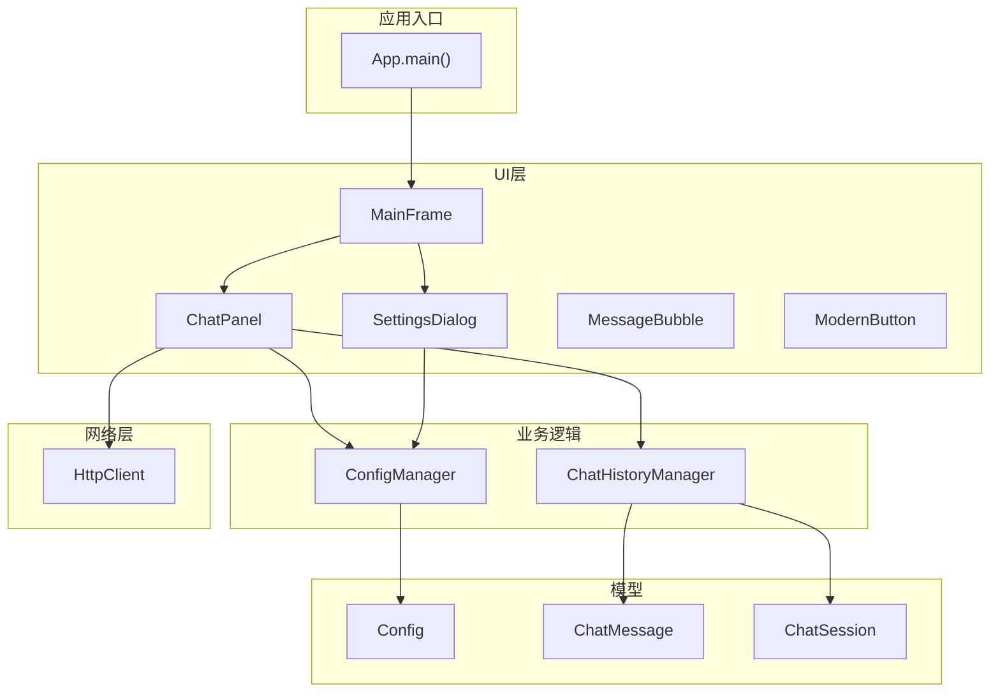
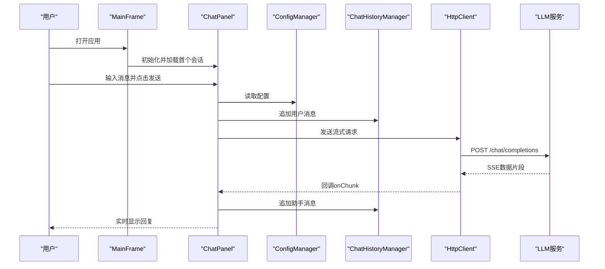
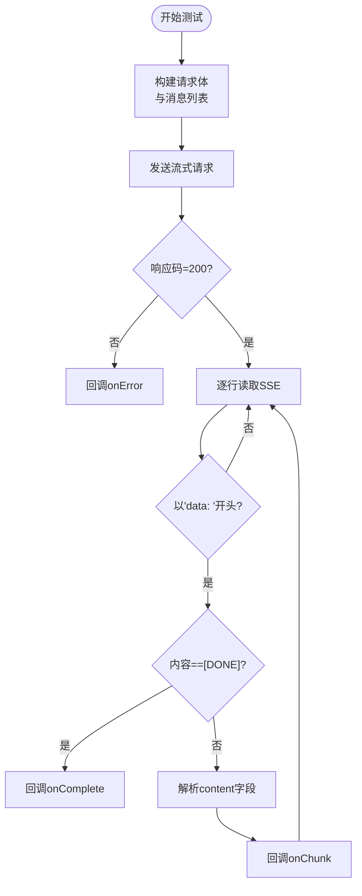
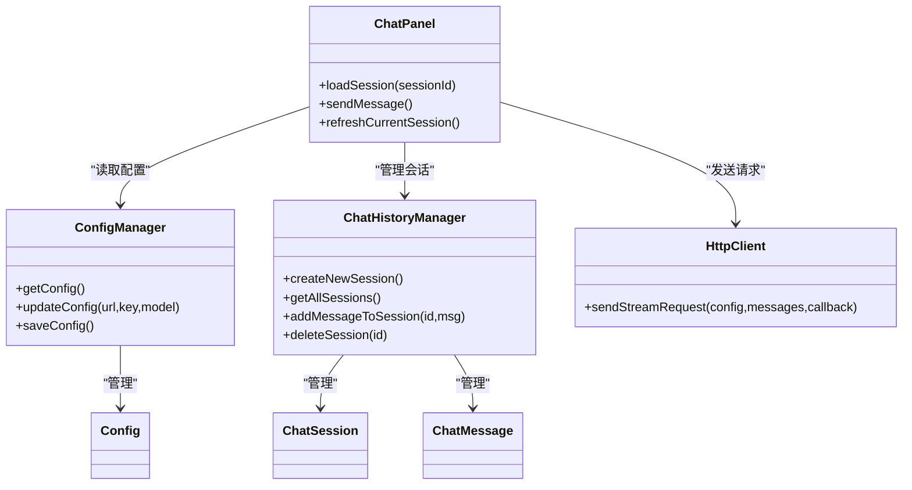

# 测试策略

<cite>
**本文引用的文件**
- [App.java](file://src/com/llmchat/App.java)
- [ConfigManager.java](file://src/com/llmchat/config/ConfigManager.java)
- [ChatHistoryManager.java](file://src/com/llmchat/config/ChatHistoryManager.java)
- [HttpClient.java](file://src/com/llmchat/http/HttpClient.java)
- [Config.java](file://src/com/llmchat/model/Config.java)
- [ChatMessage.java](file://src/com/llmchat/model/ChatMessage.java)
- [ChatSession.java](file://src/com/llmchat/model/ChatSession.java)
- [MainFrame.java](file://src/com/llmchat/ui/MainFrame.java)
- [ChatPanel.java](file://src/com/llmchat/ui/ChatPanel.java)
- [SettingsDialog.java](file://src/com/llmchat/ui/SettingsDialog.java)
- [MessageBubble.java](file://src/com/llmchat/ui/components/MessageBubble.java)
- [ModernButton.java](file://src/com/llmchat/ui/components/ModernButton.java)
</cite>

## 目录
1. [简介](#简介)
2. [项目结构](#项目结构)
3. [核心组件](#核心组件)
4. [架构总览](#架构总览)
5. [详细组件分析](#详细组件分析)
6. [依赖分析](#依赖分析)
7. [性能考虑](#性能考虑)
8. [故障排查指南](#故障排查指南)
9. [结论](#结论)
10. [附录](#附录)

## 简介
本测试策略面向Java LLM聊天界面项目，覆盖单元测试、集成测试与端到端测试的实施方法，重点包括：
- Mock对象在HTTP客户端与UI组件中的使用
- 测试数据准备与测试环境配置
- HTTP客户端测试、配置管理测试与UI组件测试的具体方案
- 测试覆盖率目标与持续集成配置建议
- 性能测试与压力测试的实施要点

## 项目结构
项目采用按功能域划分的包结构：应用入口、配置管理、HTTP通信、模型数据、UI界面与组件。核心交互路径为：UI层触发业务逻辑，业务逻辑通过配置与历史管理访问模型数据，并通过HTTP客户端与外部服务交互。

**图表来源**
- [App.java:11-26](file://src/com/llmchat/App.java#L11-L26)
- [MainFrame.java:30-101](file://src/com/llmchat/ui/MainFrame.java#L30-L101)
- [ChatPanel.java:44-55](file://src/com/llmchat/ui/ChatPanel.java#L44-L55)
- [SettingsDialog.java:27-37](file://src/com/llmchat/ui/SettingsDialog.java#L27-L37)
- [ConfigManager.java:14-22](file://src/com/llmchat/config/ConfigManager.java#L14-L22)
- [ChatHistoryManager.java:16-27](file://src/com/llmchat/config/ChatHistoryManager.java#L16-L27)
- [HttpClient.java:16-25](file://src/com/llmchat/http/HttpClient.java#L16-L25)
- [Config.java:8-20](file://src/com/llmchat/model/Config.java#L8-L20)
- [ChatMessage.java:8-16](file://src/com/llmchat/model/ChatMessage.java#L8-L16)
- [ChatSession.java:11-26](file://src/com/llmchat/model/ChatSession.java#L11-L26)

**章节来源**
- [App.java:11-26](file://src/com/llmchat/App.java#L11-L26)
- [MainFrame.java:30-101](file://src/com/llmchat/ui/MainFrame.java#L30-L101)
- [ChatPanel.java:44-55](file://src/com/llmchat/ui/ChatPanel.java#L44-L55)
- [SettingsDialog.java:27-37](file://src/com/llmchat/ui/SettingsDialog.java#L27-L37)
- [ConfigManager.java:14-22](file://src/com/llmchat/config/ConfigManager.java#L14-L22)
- [ChatHistoryManager.java:16-27](file://src/com/llmchat/config/ChatHistoryManager.java#L16-L27)
- [HttpClient.java:16-25](file://src/com/llmchat/http/HttpClient.java#L16-L25)
- [Config.java:8-20](file://src/com/llmchat/model/Config.java#L8-L20)
- [ChatMessage.java:8-16](file://src/com/llmchat/model/ChatMessage.java#L8-L16)
- [ChatSession.java:11-26](file://src/com/llmchat/model/ChatSession.java#L11-L26)

## 核心组件
- 应用入口与UI装配：应用入口负责设置外观与启动主窗体；主窗体装配聊天面板与会话列表面板，并建立事件回调。
- 配置管理：负责配置的加载、保存、更新与敏感信息的简单加密/解密。
- 历史管理：负责会话的创建、加载、保存、删除、标题更新与消息追加。
- HTTP客户端：负责构建请求体、发送流式请求、解析SSE响应片段并回调UI。
- 模型数据：封装配置、消息与会话的数据结构与基本校验。
- UI组件：现代化按钮与消息气泡组件，承担渲染与交互反馈。

**章节来源**
- [App.java:11-26](file://src/com/llmchat/App.java#L11-L26)
- [MainFrame.java:30-101](file://src/com/llmchat/ui/MainFrame.java#L30-L101)
- [ChatPanel.java:44-55](file://src/com/llmchat/ui/ChatPanel.java#L44-L55)
- [ConfigManager.java:14-75](file://src/com/llmchat/config/ConfigManager.java#L14-L75)
- [ChatHistoryManager.java:16-154](file://src/com/llmchat/config/ChatHistoryManager.java#L16-L154)
- [HttpClient.java:16-127](file://src/com/llmchat/http/HttpClient.java#L16-L127)
- [Config.java:8-50](file://src/com/llmchat/model/Config.java#L8-L50)
- [ChatMessage.java:8-42](file://src/com/llmchat/model/ChatMessage.java#L8-L42)
- [ChatSession.java:11-89](file://src/com/llmchat/model/ChatSession.java#L11-L89)
- [MessageBubble.java:14-58](file://src/com/llmchat/ui/components/MessageBubble.java#L14-L58)
- [ModernButton.java:14-98](file://src/com/llmchat/ui/components/ModernButton.java#L14-L98)

## 架构总览
下图展示从用户输入到外部服务响应的完整流程，以及各模块间的依赖关系。

**图表来源**
- [MainFrame.java:30-101](file://src/com/llmchat/ui/MainFrame.java#L30-L101)
- [ChatPanel.java:189-297](file://src/com/llmchat/ui/ChatPanel.java#L189-L297)
- [ConfigManager.java:63-75](file://src/com/llmchat/config/ConfigManager.java#L63-L75)
- [ChatHistoryManager.java:170-182](file://src/com/llmchat/config/ChatHistoryManager.java#L170-L182)
- [HttpClient.java:66-127](file://src/com/llmchat/http/HttpClient.java#L66-L127)

## 详细组件分析

### 配置管理测试策略
- 单元测试
  - 配置加载/保存：构造临时目录与文件，验证序列化/反序列化与默认值回退。
  - 敏感信息处理：验证Base64编解码在空值、非法输入下的行为。
  - 更新配置：断言更新后保存成功且getConfig返回最新值。
- 集成测试
  - 文件系统权限与路径存在性：在不同工作目录与用户主目录下验证加载/保存。
- 测试数据与环境
  - 使用临时目录模拟用户目录，避免污染真实配置。
  - 提供无效文件内容以验证回退逻辑。

**章节来源**
- [ConfigManager.java:27-58](file://src/com/llmchat/config/ConfigManager.java#L27-L58)
- [ConfigManager.java:80-99](file://src/com/llmchat/config/ConfigManager.java#L80-L99)
- [ConfigManager.java:70-75](file://src/com/llmchat/config/ConfigManager.java#L70-L75)
- [Config.java:46-50](file://src/com/llmchat/model/Config.java#L46-L50)

### 聊天历史管理测试策略
- 单元测试
  - 会话生命周期：创建、加载、保存、删除、清空消息、更新标题。
  - 索引与文件一致性：索引损坏时重建、单个会话文件缺失时跳过。
  - 并发安全：验证并发Map与有序列表的正确性。
- 集成测试
  - 多会话场景：批量创建与切换，验证顺序与标题预览。
- 测试数据与环境
  - 生成多个会话文件与索引文件，模拟真实历史目录结构。

**章节来源**
- [ChatHistoryManager.java:32-65](file://src/com/llmchat/config/ChatHistoryManager.java#L32-L65)
- [ChatHistoryManager.java:70-99](file://src/com/llmchat/config/ChatHistoryManager.java#L70-L99)
- [ChatHistoryManager.java:104-154](file://src/com/llmchat/config/ChatHistoryManager.java#L104-L154)
- [ChatHistoryManager.java:170-194](file://src/com/llmchat/config/ChatHistoryManager.java#L170-L194)
- [ChatSession.java:78-89](file://src/com/llmchat/model/ChatSession.java#L78-L89)

### HTTP客户端测试策略
- 单元测试
  - 请求体构建：验证模型名、消息数组与转义逻辑。
  - 流式响应解析：构造SSE片段，验证content提取与转义还原。
  - 错误处理：非200响应与异常分支，回调onError。
- 集成测试
  - 本地Mock服务：使用嵌入式HTTP服务器或WireMock模拟SSE响应。
  - 超时与连接问题：断言超时与异常回调。
- 测试数据与环境
  - 构造Config与ChatMessage列表，准备多片段SSE数据。
  - 使用线程安全的回调桩捕获onChunk/onComplete/onError。

**图表来源**
- [HttpClient.java:66-127](file://src/com/llmchat/http/HttpClient.java#L66-L127)
- [HttpClient.java:132-163](file://src/com/llmchat/http/HttpClient.java#L132-L163)
- [HttpClient.java:193-206](file://src/com/llmchat/http/HttpClient.java#L193-L206)

**章节来源**
- [HttpClient.java:30-49](file://src/com/llmchat/http/HttpClient.java#L30-L49)
- [HttpClient.java:132-163](file://src/com/llmchat/http/HttpClient.java#L132-L163)
- [HttpClient.java:193-206](file://src/com/llmchat/http/HttpClient.java#L193-L206)

### UI组件测试策略
- 按钮组件（ModernButton）
  - 单元测试：加载状态切换、鼠标悬停/按下状态、绘制逻辑。
  - 集成测试：与ChatPanel交互，验证发送按钮在请求期间禁用与加载动画。
- 消息气泡（MessageBubble）
  - 单元测试：文本追加、换行计算、首选尺寸、emoji字体回退。
  - 集成测试：与ChatPanel协作，验证实时追加内容与滚动更新。
- 对话框（SettingsDialog）
  - 单元测试：表单验证、模型选择与自定义输入可见性切换。
  - 集成测试：与ConfigManager交互，验证保存后配置生效。

**章节来源**
- [ModernButton.java:78-98](file://src/com/llmchat/ui/components/ModernButton.java#L78-L98)
- [ModernButton.java:100-134](file://src/com/llmchat/ui/components/ModernButton.java#L100-L134)
- [MessageBubble.java:89-121](file://src/com/llmchat/ui/components/MessageBubble.java#L89-L121)
- [MessageBubble.java:147-163](file://src/com/llmchat/ui/components/MessageBubble.java#L147-L163)
- [SettingsDialog.java:146-158](file://src/com/llmchat/ui/SettingsDialog.java#L146-L158)
- [SettingsDialog.java:216-248](file://src/com/llmchat/ui/SettingsDialog.java#L216-L248)

### 端到端测试策略
- 场景一：首次启动与默认会话
  - 断言：加载默认会话、显示欢迎消息、可输入。
- 场景二：配置API并发起对话
  - 断言：配置有效、发送按钮可点击、实时显示回复、历史保存。
- 场景三：多会话管理
  - 断言：新建会话、切换会话、删除会话后自动加载首个会话。
- 场景四：设置对话框
  - 断言：表单验证、模型选择、保存成功提示。

**章节来源**
- [MainFrame.java:171-175](file://src/com/llmchat/ui/MainFrame.java#L171-L175)
- [ChatPanel.java:124-142](file://src/com/llmchat/ui/ChatPanel.java#L124-L142)
- [ChatPanel.java:189-297](file://src/com/llmchat/ui/ChatPanel.java#L189-L297)
- [ChatHistoryManager.java:104-110](file://src/com/llmchat/config/ChatHistoryManager.java#L104-L110)
- [SettingsDialog.java:216-248](file://src/com/llmchat/ui/SettingsDialog.java#L216-L248)

## 依赖分析
- 组件耦合
  - ChatPanel依赖ConfigManager、ChatHistoryManager与HttpClient，形成清晰的职责边界。
  - UI组件（MessageBubble、ModernButton）仅依赖模型与自身渲染逻辑，低耦合。
- 外部依赖
  - HTTP客户端直接依赖JDK网络API，便于测试替换。
- 循环依赖
  - 未发现循环依赖，UI通过回调与管理器解耦。

**图表来源**
- [ChatPanel.java:44-55](file://src/com/llmchat/ui/ChatPanel.java#L44-L55)
- [ConfigManager.java:63-75](file://src/com/llmchat/config/ConfigManager.java#L63-L75)
- [ChatHistoryManager.java:16-27](file://src/com/llmchat/config/ChatHistoryManager.java#L16-L27)
- [HttpClient.java:16-25](file://src/com/llmchat/http/HttpClient.java#L16-L25)
- [Config.java:8-20](file://src/com/llmchat/model/Config.java#L8-L20)
- [ChatSession.java:11-26](file://src/com/llmchat/model/ChatSession.java#L11-L26)
- [ChatMessage.java:8-16](file://src/com/llmchat/model/ChatMessage.java#L8-L16)

**章节来源**
- [ChatPanel.java:44-55](file://src/com/llmchat/ui/ChatPanel.java#L44-L55)
- [ConfigManager.java:63-75](file://src/com/llmchat/config/ConfigManager.java#L63-L75)
- [ChatHistoryManager.java:16-27](file://src/com/llmchat/config/ChatHistoryManager.java#L16-L27)
- [HttpClient.java:16-25](file://src/com/llmchat/http/HttpClient.java#L16-L25)
- [Config.java:8-20](file://src/com/llmchat/model/Config.java#L8-L20)
- [ChatSession.java:11-26](file://src/com/llmchat/model/ChatSession.java#L11-L26)
- [ChatMessage.java:8-16](file://src/com/llmchat/model/ChatMessage.java#L8-L16)

## 性能考虑
- 线程模型
  - HTTP请求在独立线程中执行，避免阻塞UI线程；回调通过SwingUtilities.invokeLater回到EDT。
- I/O与序列化
  - 配置与历史文件采用对象序列化，建议在批量操作时合并写入，减少磁盘IO。
- UI渲染
  - 消息气泡追加采用增量插入与局部重绘，避免全量重绘。
- 压力测试
  - 构造大量消息片段与会话，评估UI滚动、重绘与内存占用。
  - 模拟网络延迟与丢包，验证错误回调与重试策略（如需扩展）。

**章节来源**
- [HttpClient.java:66-127](file://src/com/llmchat/http/HttpClient.java#L66-L127)
- [ChatPanel.java:243-297](file://src/com/llmchat/ui/ChatPanel.java#L243-L297)
- [MessageBubble.java:89-121](file://src/com/llmchat/ui/components/MessageBubble.java#L89-L121)

## 故障排查指南
- 配置加载失败
  - 现象：启动时配置为空或默认值被覆盖。
  - 排查：确认配置文件路径与权限，检查序列化异常日志。
- 历史文件损坏
  - 现象：索引文件损坏导致会话丢失。
  - 排查：捕获异常后重建索引与默认会话，核对单个会话文件完整性。
- HTTP请求异常
  - 现象：onError回调弹出错误提示。
  - 排查：检查响应码、错误流内容、超时设置与网络连通性。
- UI无响应
  - 现象：发送按钮长时间处于加载态。
  - 排查：确认回调onComplete被调用，检查Swing线程调度。

**章节来源**
- [ConfigManager.java:27-38](file://src/com/llmchat/config/ConfigManager.java#L27-L38)
- [ChatHistoryManager.java:54-58](file://src/com/llmchat/config/ChatHistoryManager.java#L54-L58)
- [HttpClient.java:88-93](file://src/com/llmchat/http/HttpClient.java#L88-L93)
- [ChatPanel.java:275-295](file://src/com/llmchat/ui/ChatPanel.java#L275-L295)

## 结论
本测试策略围绕配置、历史、HTTP与UI四大模块，结合Mock与集成测试手段，确保核心流程稳定可靠。通过明确的覆盖率目标与CI配置建议，可在持续交付中持续提升质量与稳定性。

## 附录
- 测试覆盖率目标
  - 关键类：ConfigManager、ChatHistoryManager、HttpClient、ChatPanel、MessageBubble、ModernButton、SettingsDialog。
  - 目标：语句覆盖率≥80%，分支覆盖率≥70%，行覆盖率≥85%。
- 持续集成配置建议
  - 构建：使用Gradle/Maven执行编译与打包。
  - 测试：JUnit 5 + Mockito进行单元测试；TestFX/Robot用于UI测试。
  - 覆盖率：JaCoCo插件收集覆盖率报告并上传至平台。
  - 安全：对敏感信息（API Key）使用占位符或环境变量注入，不在仓库中存储明文。
- 性能与压力测试
  - 使用JMH进行热点方法基准测试；使用Gatling或自定义压测脚本模拟高并发请求与消息流。