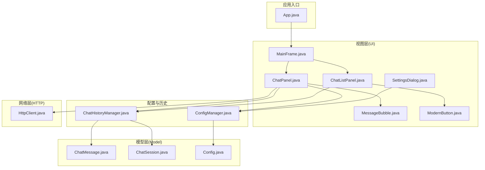
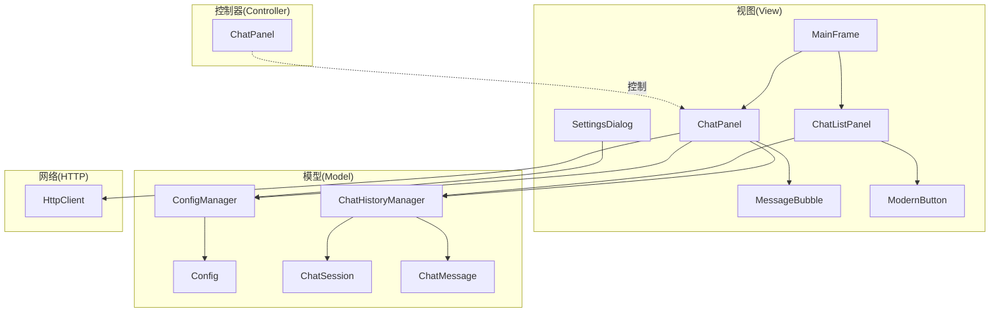
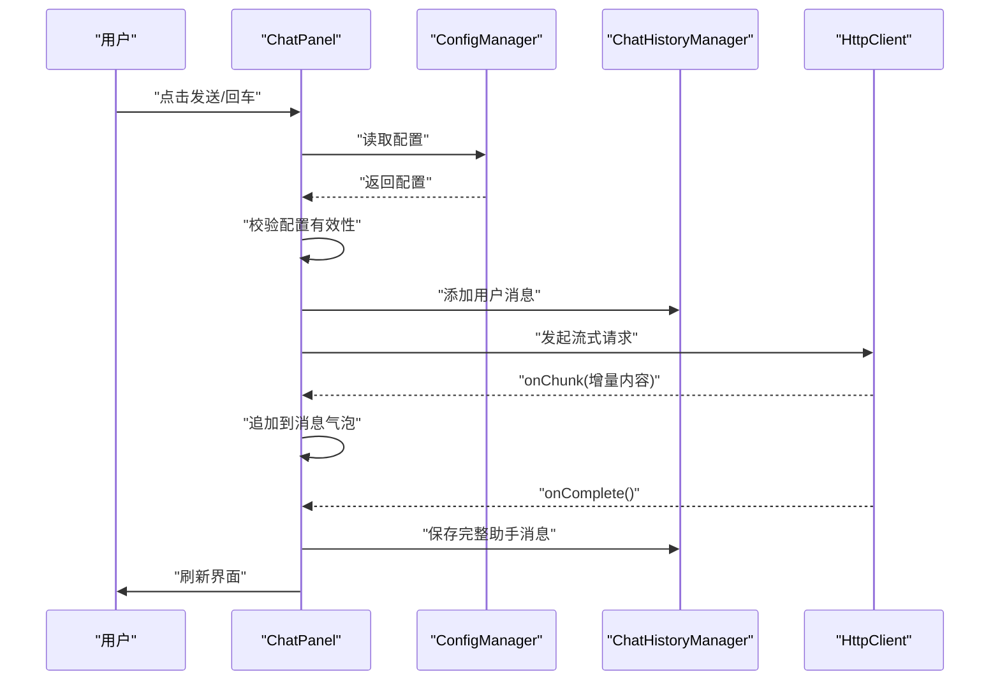
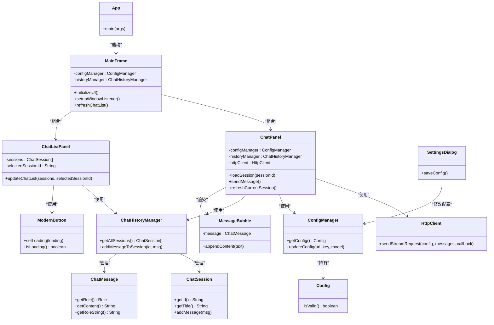
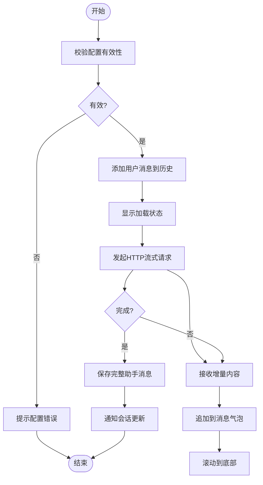
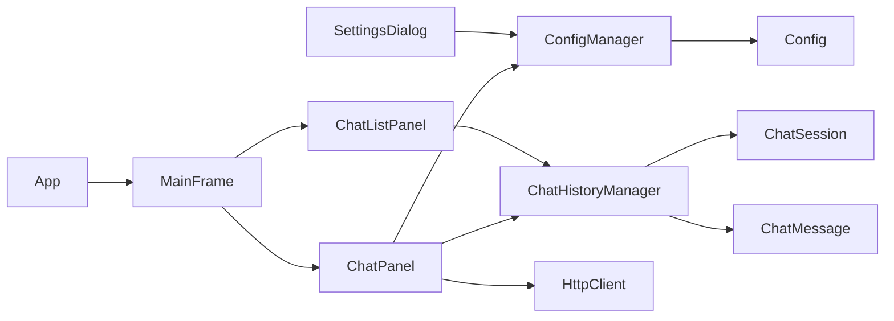

# 编码规范与最佳实践

<cite>
**本文档引用的文件**
- [App.java](file://src/com/llmchat/App.java)
- [MainFrame.java](file://src/com/llmchat/ui/MainFrame.java)
- [ChatPanel.java](file://src/com/llmchat/ui/ChatPanel.java)
- [ChatListPanel.java](file://src/com/llmchat/ui/components/ChatListPanel.java)
- [MessageBubble.java](file://src/com/llmchat/ui/components/MessageBubble.java)
- [ModernButton.java](file://src/com/llmchat/ui/components/ModernButton.java)
- [SettingsDialog.java](file://src/com/llmchat/ui/SettingsDialog.java)
- [HttpClient.java](file://src/com/llmchat/http/HttpClient.java)
- [ConfigManager.java](file://src/com/llmchat/config/ConfigManager.java)
- [ChatHistoryManager.java](file://src/com/llmchat/config/ChatHistoryManager.java)
- [ChatMessage.java](file://src/com/llmchat/model/ChatMessage.java)
- [ChatSession.java](file://src/com/llmchat/model/ChatSession.java)
- [Config.java](file://src/com/llmchat/model/Config.java)
- [.gitignore](file://.gitignore)
- [compile.bat](file://compile.bat)
- [run.bat](file://run.bat)
</cite>

## 目录
1. [简介](#简介)
2. [项目结构](#项目结构)
3. [核心组件](#核心组件)
4. [架构总览](#架构总览)
5. [详细组件分析](#详细组件分析)
6. [依赖分析](#依赖分析)
7. [性能考虑](#性能考虑)
8. [故障排查指南](#故障排查指南)
9. [结论](#结论)
10. [附录：编码规范与最佳实践](#附录编码规范与最佳实践)

## 简介
本指南面向Java LLM聊天界面项目，提供统一的编码规范、最佳实践与质量保障流程。文档围绕以下目标展开：
- 统一Java代码风格、命名约定、注释规范与文件组织结构
- 解释MVC架构在项目中的落地方式与实现细节
- 提供代码审查检查清单与质量保证流程
- 总结异常处理、资源管理与性能优化的最佳实践
- 说明如何保持代码一致性与可维护性

## 项目结构
项目采用按职责分层的包结构，清晰分离UI、业务逻辑、配置与HTTP交互：
- com.llmchat.App：应用入口
- com.llmchat.ui.*：主界面与对话UI组件
- com.llmchat.ui.components.*：可复用UI组件
- com.llmchat.config.*：配置与历史记录管理
- com.llmchat.http.*：HTTP客户端与流式响应处理
- com.llmchat.model.*：领域模型（消息、会话、配置）

图表来源
- [App.java:11-26](file://src/com/llmchat/App.java#L11-L26)
- [MainFrame.java:19-101](file://src/com/llmchat/ui/MainFrame.java#L19-L101)
- [ChatPanel.java:21-55](file://src/com/llmchat/ui/ChatPanel.java#L21-L55)
- [ChatListPanel.java:15-84](file://src/com/llmchat/ui/components/ChatListPanel.java#L15-L84)
- [MessageBubble.java:14-58](file://src/com/llmchat/ui/components/MessageBubble.java#L14-L58)
- [ModernButton.java:14-73](file://src/com/llmchat/ui/components/ModernButton.java#L14-L73)
- [SettingsDialog.java:15-37](file://src/com/llmchat/ui/SettingsDialog.java#L15-L37)
- [HttpClient.java:16-127](file://src/com/llmchat/http/HttpClient.java#L16-L127)
- [ConfigManager.java:14-75](file://src/com/llmchat/config/ConfigManager.java#L14-L75)
- [ChatHistoryManager.java:16-65](file://src/com/llmchat/config/ChatHistoryManager.java#L16-L65)
- [ChatMessage.java:8-43](file://src/com/llmchat/model/ChatMessage.java#L8-L43)
- [ChatSession.java:11-90](file://src/com/llmchat/model/ChatSession.java#L11-L90)
- [Config.java:8-51](file://src/com/llmchat/model/Config.java#L8-L51)

章节来源
- [App.java:11-26](file://src/com/llmchat/App.java#L11-L26)
- [MainFrame.java:19-101](file://src/com/llmchat/ui/MainFrame.java#L19-L101)
- [ChatPanel.java:21-55](file://src/com/llmchat/ui/ChatPanel.java#L21-L55)
- [ChatListPanel.java:15-84](file://src/com/llmchat/ui/components/ChatListPanel.java#L15-L84)
- [MessageBubble.java:14-58](file://src/com/llmchat/ui/components/MessageBubble.java#L14-L58)
- [ModernButton.java:14-73](file://src/com/llmchat/ui/components/ModernButton.java#L14-L73)
- [SettingsDialog.java:15-37](file://src/com/llmchat/ui/SettingsDialog.java#L15-L37)
- [HttpClient.java:16-127](file://src/com/llmchat/http/HttpClient.java#L16-L127)
- [ConfigManager.java:14-75](file://src/com/llmchat/config/ConfigManager.java#L14-L75)
- [ChatHistoryManager.java:16-65](file://src/com/llmchat/config/ChatHistoryManager.java#L16-L65)
- [ChatMessage.java:8-43](file://src/com/llmchat/model/ChatMessage.java#L8-L43)
- [ChatSession.java:11-90](file://src/com/llmchat/model/ChatSession.java#L11-L90)
- [Config.java:8-51](file://src/com/llmchat/model/Config.java#L8-L51)

## 核心组件
- 应用入口与初始化：应用入口负责设置系统外观并在EDT中启动主窗体，确保Swing UI线程安全。
- 主窗体与布局：主窗体组合头部工具栏、侧边栏聊天列表与中央聊天面板，并通过分割面板实现布局。
- 聊天面板：承载消息展示、输入与发送逻辑；集成HTTP客户端进行流式响应处理；与配置与历史管理器协作。
- UI组件：现代化按钮、消息气泡等组件封装渲染与交互细节，提升复用性与一致性。
- 配置与历史：配置管理器负责应用配置的序列化存储与简单加密；历史管理器负责会话与消息的持久化与并发访问控制。

章节来源
- [App.java:12-25](file://src/com/llmchat/App.java#L12-L25)
- [MainFrame.java:38-101](file://src/com/llmchat/ui/MainFrame.java#L38-L101)
- [ChatPanel.java:61-84](file://src/com/llmchat/ui/ChatPanel.java#L61-L84)
- [ChatListPanel.java:96-125](file://src/com/llmchat/ui/components/ChatListPanel.java#L96-L125)
- [ConfigManager.java:27-75](file://src/com/llmchat/config/ConfigManager.java#L27-L75)
- [ChatHistoryManager.java:32-65](file://src/com/llmchat/config/ChatHistoryManager.java#L32-L65)

## 架构总览
项目采用简化版MVC架构：
- Model：ChatMessage、ChatSession、Config及其管理器（ConfigManager、ChatHistoryManager）负责数据与持久化。
- View：MainFrame、ChatPanel、ChatListPanel、MessageBubble、ModernButton、SettingsDialog等UI组件构成视图层。
- Controller：ChatPanel承担控制器职责，协调UI事件、调用HTTP客户端、更新历史与配置，并通过回调刷新列表。

图表来源
- [MainFrame.java:19-101](file://src/com/llmchat/ui/MainFrame.java#L19-L101)
- [ChatPanel.java:21-55](file://src/com/llmchat/ui/ChatPanel.java#L21-L55)
- [ChatListPanel.java:15-84](file://src/com/llmchat/ui/components/ChatListPanel.java#L15-L84)
- [MessageBubble.java:14-58](file://src/com/llmchat/ui/components/MessageBubble.java#L14-L58)
- [ModernButton.java:14-73](file://src/com/llmchat/ui/components/ModernButton.java#L14-L73)
- [SettingsDialog.java:15-37](file://src/com/llmchat/ui/SettingsDialog.java#L15-L37)
- [HttpClient.java:16-127](file://src/com/llmchat/http/HttpClient.java#L16-L127)
- [ConfigManager.java:14-75](file://src/com/llmchat/config/ConfigManager.java#L14-L75)
- [ChatHistoryManager.java:16-65](file://src/com/llmchat/config/ChatHistoryManager.java#L16-L65)
- [ChatMessage.java:8-43](file://src/com/llmchat/model/ChatMessage.java#L8-L43)
- [ChatSession.java:11-90](file://src/com/llmchat/model/ChatSession.java#L11-L90)
- [Config.java:8-51](file://src/com/llmchat/model/Config.java#L8-L51)

## 详细组件分析

### MVC在项目中的应用
- 视图层：由多个Swing组件组成，负责用户交互与展示；通过监听器回调与控制器通信。
- 模型层：封装聊天消息、会话与配置，提供序列化与持久化能力。
- 控制器：ChatPanel集中处理用户输入、调用HTTP客户端、更新历史与UI状态。

图表来源
- [ChatPanel.java:189-297](file://src/com/llmchat/ui/ChatPanel.java#L189-L297)
- [ConfigManager.java:63-75](file://src/com/llmchat/config/ConfigManager.java#L63-L75)
- [ChatHistoryManager.java:170-182](file://src/com/llmchat/config/ChatHistoryManager.java#L170-L182)
- [HttpClient.java:66-127](file://src/com/llmchat/http/HttpClient.java#L66-L127)

章节来源
- [ChatPanel.java:189-297](file://src/com/llmchat/ui/ChatPanel.java#L189-L297)
- [ConfigManager.java:63-75](file://src/com/llmchat/config/ConfigManager.java#L63-L75)
- [ChatHistoryManager.java:170-182](file://src/com/llmchat/config/ChatHistoryManager.java#L170-L182)
- [HttpClient.java:66-127](file://src/com/llmchat/http/HttpClient.java#L66-L127)

### 类与接口关系（代码级）

图表来源
- [App.java:11-26](file://src/com/llmchat/App.java#L11-L26)
- [MainFrame.java:19-101](file://src/com/llmchat/ui/MainFrame.java#L19-L101)
- [ChatPanel.java:21-55](file://src/com/llmchat/ui/ChatPanel.java#L21-L55)
- [ChatListPanel.java:15-84](file://src/com/llmchat/ui/components/ChatListPanel.java#L15-L84)
- [MessageBubble.java:14-58](file://src/com/llmchat/ui/components/MessageBubble.java#L14-L58)
- [ModernButton.java:14-73](file://src/com/llmchat/ui/components/ModernButton.java#L14-L73)
- [SettingsDialog.java:15-37](file://src/com/llmchat/ui/SettingsDialog.java#L15-L37)
- [HttpClient.java:16-127](file://src/com/llmchat/http/HttpClient.java#L16-L127)
- [ConfigManager.java:14-75](file://src/com/llmchat/config/ConfigManager.java#L14-L75)
- [ChatHistoryManager.java:16-65](file://src/com/llmchat/config/ChatHistoryManager.java#L16-L65)
- [ChatMessage.java:8-43](file://src/com/llmchat/model/ChatMessage.java#L8-L43)
- [ChatSession.java:11-90](file://src/com/llmchat/model/ChatSession.java#L11-L90)
- [Config.java:8-51](file://src/com/llmchat/model/Config.java#L8-L51)

章节来源
- [App.java:11-26](file://src/com/llmchat/App.java#L11-L26)
- [MainFrame.java:19-101](file://src/com/llmchat/ui/MainFrame.java#L19-L101)
- [ChatPanel.java:21-55](file://src/com/llmchat/ui/ChatPanel.java#L21-L55)
- [ChatListPanel.java:15-84](file://src/com/llmchat/ui/components/ChatListPanel.java#L15-L84)
- [MessageBubble.java:14-58](file://src/com/llmchat/ui/components/MessageBubble.java#L14-L58)
- [ModernButton.java:14-73](file://src/com/llmchat/ui/components/ModernButton.java#L14-L73)
- [SettingsDialog.java:15-37](file://src/com/llmchat/ui/SettingsDialog.java#L15-L37)
- [HttpClient.java:16-127](file://src/com/llmchat/http/HttpClient.java#L16-L127)
- [ConfigManager.java:14-75](file://src/com/llmchat/config/ConfigManager.java#L14-L75)
- [ChatHistoryManager.java:16-65](file://src/com/llmchat/config/ChatHistoryManager.java#L16-L65)
- [ChatMessage.java:8-43](file://src/com/llmchat/model/ChatMessage.java#L8-L43)
- [ChatSession.java:11-90](file://src/com/llmchat/model/ChatSession.java#L11-L90)
- [Config.java:8-51](file://src/com/llmchat/model/Config.java#L8-L51)

### 关键流程：发送消息与流式响应

图表来源
- [ChatPanel.java:189-297](file://src/com/llmchat/ui/ChatPanel.java#L189-L297)
- [HttpClient.java:66-127](file://src/com/llmchat/http/HttpClient.java#L66-L127)

章节来源
- [ChatPanel.java:189-297](file://src/com/llmchat/ui/ChatPanel.java#L189-L297)
- [HttpClient.java:66-127](file://src/com/llmchat/http/HttpClient.java#L66-L127)

## 依赖分析
- 包内依赖：UI组件之间存在组合关系，如ChatPanel组合MessageBubble；ChatListPanel组合ModernButton。
- 模块间依赖：ChatPanel依赖ConfigManager与ChatHistoryManager；MainFrame依赖ChatHistoryManager与ChatListPanel；SettingsDialog依赖ConfigManager。
- 外部依赖：Swing用于UI；JDK标准库用于IO、JSON转义与HTTP连接；未发现第三方框架。

图表来源
- [App.java:3-6](file://src/com/llmchat/App.java#L3-L6)
- [MainFrame.java:3-7](file://src/com/llmchat/ui/MainFrame.java#L3-L7)
- [ChatPanel.java:3-9](file://src/com/llmchat/ui/ChatPanel.java#L3-L9)
- [ChatListPanel.java:3-10](file://src/com/llmchat/ui/components/ChatListPanel.java#L3-L10)
- [SettingsDialog.java:3-6](file://src/com/llmchat/ui/SettingsDialog.java#L3-L6)
- [ConfigManager.java:3](file://src/com/llmchat/config/ConfigManager.java#L3)
- [ChatHistoryManager.java:3-4](file://src/com/llmchat/config/ChatHistoryManager.java#L3-L4)
- [ChatMessage.java:3](file://src/com/llmchat/model/ChatMessage.java#L3)
- [ChatSession.java:3](file://src/com/llmchat/model/ChatSession.java#L3)
- [Config.java:3](file://src/com/llmchat/model/Config.java#L3)

章节来源
- [App.java:3-6](file://src/com/llmchat/App.java#L3-L6)
- [MainFrame.java:3-7](file://src/com/llmchat/ui/MainFrame.java#L3-L7)
- [ChatPanel.java:3-9](file://src/com/llmchat/ui/ChatPanel.java#L3-L9)
- [ChatListPanel.java:3-10](file://src/com/llmchat/ui/components/ChatListPanel.java#L3-L10)
- [SettingsDialog.java:3-6](file://src/com/llmchat/ui/SettingsDialog.java#L3-L6)
- [ConfigManager.java:3](file://src/com/llmchat/config/ConfigManager.java#L3)
- [ChatHistoryManager.java:3-4](file://src/com/llmchat/config/ChatHistoryManager.java#L3-L4)
- [ChatMessage.java:3](file://src/com/llmchat/model/ChatMessage.java#L3)
- [ChatSession.java:3](file://src/com/llmchat/model/ChatSession.java#L3)
- [Config.java:3](file://src/com/llmchat/model/Config.java#L3)

## 性能考虑
- UI渲染与滚动：消息气泡与滚动条增量更新，避免全量重绘；建议在大量消息时限制显示数量或启用虚拟滚动。
- 线程模型：网络请求在独立线程中执行，回调通过SwingUtilities.invokeLater切换到EDT，避免阻塞UI线程。
- IO与序列化：配置与历史采用对象序列化，注意大体量数据时的性能瓶颈；可考虑分片写入与索引优化。
- 字体与渲染：消息气泡使用抗锯齿渲染，建议在低端设备上降低渲染质量或延迟初始化。
- 资源释放：HTTP连接在finally中断开，确保资源回收；建议引入连接池以减少频繁建立连接的开销。

## 故障排查指南
- 启动异常：检查系统外观设置与EDT调度；若出现异常，查看异常栈信息定位问题。
- 窗口关闭：确认保存历史记录后再退出；若保存失败，检查用户目录权限。
- 发送消息失败：验证配置有效性；若网络异常，查看错误回调与日志输出。
- 历史加载失败：索引文件损坏时会重建默认会话；检查历史目录是否存在与权限是否足够。
- 配置保存失败：检查配置目录创建与写入权限；必要时清理旧配置文件。

章节来源
- [App.java:14-18](file://src/com/llmchat/App.java#L14-L18)
- [MainFrame.java:148-166](file://src/com/llmchat/ui/MainFrame.java#L148-L166)
- [ChatPanel.java:195-202](file://src/com/llmchat/ui/ChatPanel.java#L195-L202)
- [ChatPanel.java:274-295](file://src/com/llmchat/ui/ChatPanel.java#L274-L295)
- [ChatHistoryManager.java:32-59](file://src/com/llmchat/config/ChatHistoryManager.java#L32-L59)
- [ConfigManager.java:44-58](file://src/com/llmchat/config/ConfigManager.java#L44-L58)

## 结论
本项目通过清晰的包结构与MVC分工实现了良好的模块化与可维护性。建议在后续迭代中进一步完善单元测试、引入日志框架、优化大消息场景下的UI性能，并对配置与历史的序列化策略进行评估与改进。

## 附录：编码规范与最佳实践

### Java代码风格与命名约定
- 包名：全部小写，采用反向域名约定
- 类名：帕斯卡命名法，使用名词或复合词
- 方法与变量：驼峰命名法，方法使用动词短语，布尔变量前缀使用is-/has-
- 常量：全部大写，单词间下划线分隔
- 枚举：枚举类型与枚举值均使用大写
- 接口：使用描述性强的名词或形容词
- 注释：类与公共方法必须有JavaDoc；复杂逻辑需有行内注释说明

章节来源
- [ChatMessage.java:10-12](file://src/com/llmchat/model/ChatMessage.java#L10-L12)
- [ChatSession.java:11-26](file://src/com/llmchat/model/ChatSession.java#L11-L26)
- [ConfigManager.java:14-22](file://src/com/llmchat/config/ConfigManager.java#L14-L22)
- [ChatHistoryManager.java:16-27](file://src/com/llmchat/config/ChatHistoryManager.java#L16-L27)

### 文件组织结构
- 按职责分层：ui、ui.components、config、http、model
- 每个功能域一个包，避免跨包循环依赖
- 资源文件与二进制输出目录分离（.gitignore已忽略输出目录与配置缓存）

章节来源
- [.gitignore:1-2](file://.gitignore#L1-L2)

### 注释规范
- 类注释：说明用途、作者、创建日期与变更记录
- 方法注释：参数、返回值、异常、线程安全性与注意事项
- 行内注释：仅在必要处解释复杂逻辑或边界条件

章节来源
- [App.java:8-10](file://src/com/llmchat/App.java#L8-L10)
- [ChatPanel.java:18-20](file://src/com/llmchat/ui/ChatPanel.java#L18-L20)
- [ConfigManager.java:11-13](file://src/com/llmchat/config/ConfigManager.java#L11-L13)
- [ChatHistoryManager.java:13-15](file://src/com/llmchat/config/ChatHistoryManager.java#L13-L15)

### 异常处理最佳实践
- UI线程异常：捕获并友好提示，避免崩溃
- 网络异常：区分连接超时、读取超时与业务错误，分别处理
- 序列化异常：提供降级策略（如重建默认配置/会话）
- 资源释放：使用try-with-resources或finally确保关闭

章节来源
- [App.java:14-18](file://src/com/llmchat/App.java#L14-L18)
- [ChatPanel.java:274-295](file://src/com/llmchat/ui/ChatPanel.java#L274-L295)
- [ConfigManager.java:33-38](file://src/com/llmchat/config/ConfigManager.java#L33-L38)
- [ChatHistoryManager.java:48-58](file://src/com/llmchat/config/ChatHistoryManager.java#L48-L58)

### 资源管理最佳实践
- IO操作：统一使用UTF-8编码；对大文件采用分块读写
- 线程：网络请求在后台线程；UI更新通过SwingUtilities.invokeLater
- 资源释放：HTTP连接在finally中断开；定时器在不需要时停止

章节来源
- [HttpClient.java:66-127](file://src/com/llmchat/http/HttpClient.java#L66-L127)
- [ChatPanel.java:314-319](file://src/com/llmchat/ui/ChatPanel.java#L314-L319)
- [ModernButton.java:42-45](file://src/com/llmchat/ui/components/ModernButton.java#L42-L45)

### 性能优化最佳实践
- UI：避免频繁重排与重绘；对长文本使用滚动面板；限制消息数量
- 网络：设置合理超时；对重复请求进行去重或缓存
- 存储：批量写入；索引与文件分离；定期清理无效文件

章节来源
- [ChatPanel.java:77-78](file://src/com/llmchat/ui/ChatPanel.java#L77-L78)
- [ChatListPanel.java:80](file://src/com/llmchat/ui/components/ChatListPanel.java#L80)
- [ChatHistoryManager.java:77-98](file://src/com/llmchat/config/ChatHistoryManager.java#L77-L98)

### 代码审查检查清单
- 是否遵循包结构与命名约定
- 是否提供充分的JavaDoc与行内注释
- 是否正确处理异常与资源释放
- 是否避免在UI线程执行耗时操作
- 是否存在潜在的内存泄漏与死锁风险
- 是否考虑国际化与本地化（如需）
- 是否具备基本的单元测试覆盖

章节来源
- [App.java:14-18](file://src/com/llmchat/App.java#L14-L18)
- [ChatPanel.java:274-295](file://src/com/llmchat/ui/ChatPanel.java#L274-L295)
- [HttpClient.java:66-127](file://src/com/llmchat/http/HttpClient.java#L66-L127)

### 质量保证流程
- 提交前检查：格式化、编译通过、运行基本功能
- 代码评审：关注架构一致性、异常处理与性能影响
- 自动化：使用批处理脚本编译与运行，确保环境一致性
- 回归测试：新增功能后验证相关模块行为

章节来源
- [compile.bat:8-17](file://compile.bat#L8-L17)
- [run.bat:4](file://run.bat#L4)