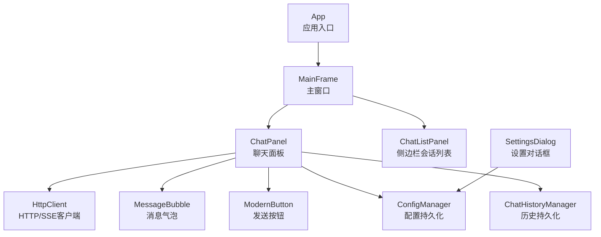
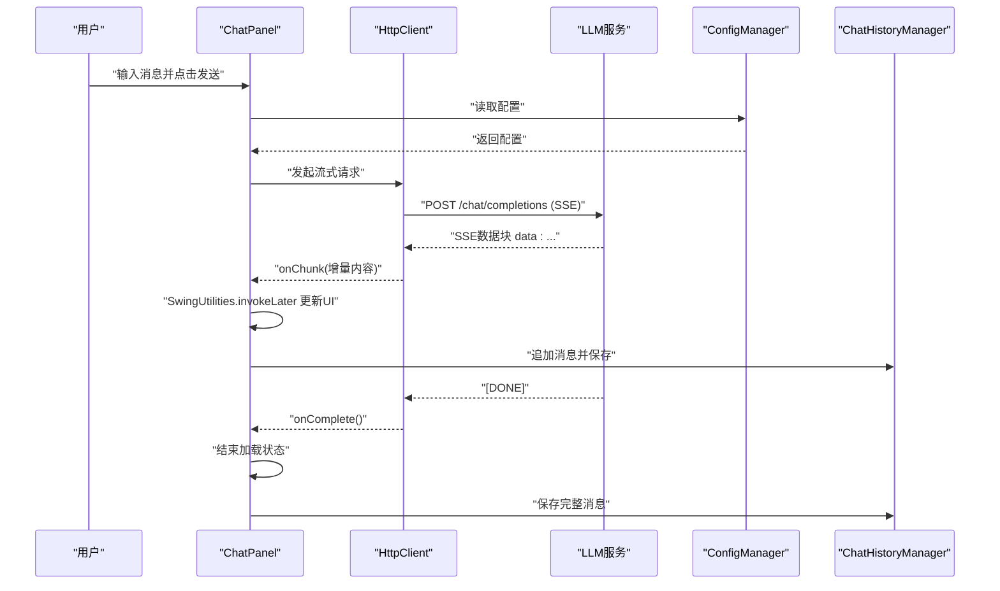
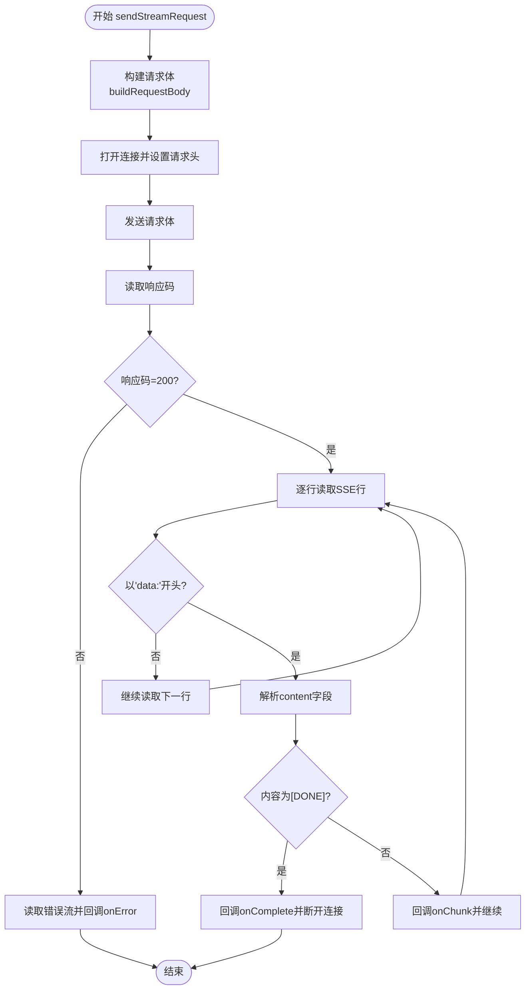
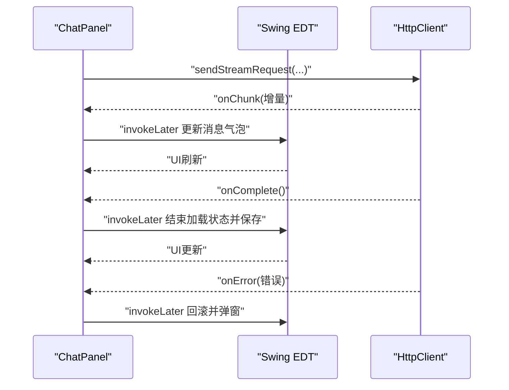
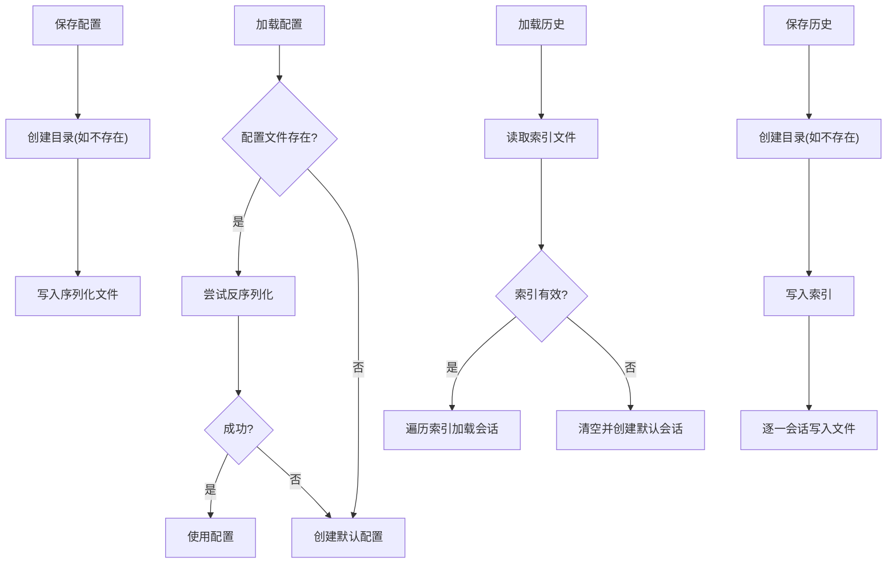
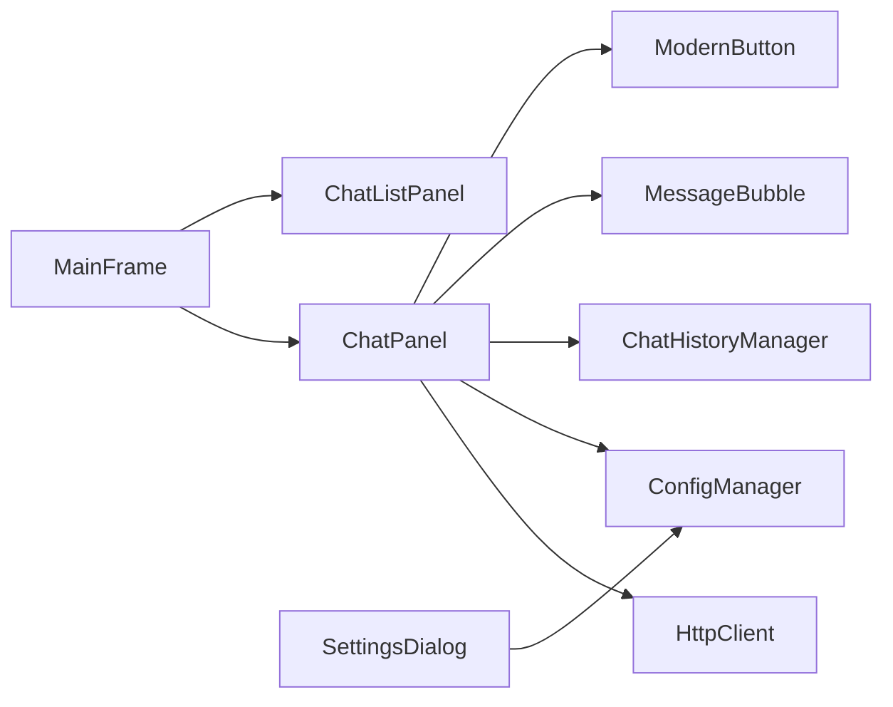

# 调试与故障排除

<cite>
**本文引用的文件**
- [App.java](file://src/com/llmchat/App.java)
- [HttpClient.java](file://src/com/llmchat/http/HttpClient.java)
- [ConfigManager.java](file://src/com/llmchat/config/ConfigManager.java)
- [ChatHistoryManager.java](file://src/com/llmchat/config/ChatHistoryManager.java)
- [Config.java](file://src/com/llmchat/model/Config.java)
- [ChatPanel.java](file://src/com/llmchat/ui/ChatPanel.java)
- [MainFrame.java](file://src/com/llmchat/ui/MainFrame.java)
- [SettingsDialog.java](file://src/com/llmchat/ui/SettingsDialog.java)
- [ChatListPanel.java](file://src/com/llmchat/ui/components/ChatListPanel.java)
- [MessageBubble.java](file://src/com/llmchat/ui/components/MessageBubble.java)
- [ModernButton.java](file://src/com/llmchat/ui/components/ModernButton.java)
- [ChatMessage.java](file://src/com/llmchat/model/ChatMessage.java)
- [ChatSession.java](file://src/com/llmchat/model/ChatSession.java)
</cite>

## 目录
1. [简介](#简介)
2. [项目结构](#项目结构)
3. [核心组件](#核心组件)
4. [架构总览](#架构总览)
5. [详细组件分析](#详细组件分析)
6. [依赖分析](#依赖分析)
7. [性能考虑](#性能考虑)
8. [故障排除指南](#故障排除指南)
9. [结论](#结论)
10. [附录](#附录)

## 简介
本指南面向Java LLM聊天界面项目的开发者与运维人员，聚焦于常见问题的诊断与修复：网络连接异常、配置错误、数据持久化失败、流式响应处理、文件I/O与Swing UI线程问题。文档提供日志记录策略、错误监控建议、性能分析思路，并给出可直接定位问题的代码路径与修复要点。

## 项目结构
项目采用按职责分层的组织方式：
- 应用入口与UI：App、MainFrame、ChatPanel、SettingsDialog、各组件类
- 网络通信：HttpClient（SSE流式响应）
- 数据模型：Config、ChatMessage、ChatSession
- 配置与历史：ConfigManager（配置持久化）、ChatHistoryManager（会话与消息持久化）

图表来源
- [App.java:11-26](file://src/com/llmchat/App.java#L11-L26)
- [MainFrame.java:30-101](file://src/com/llmchat/ui/MainFrame.java#L30-L101)
- [ChatPanel.java:44-55](file://src/com/llmchat/ui/ChatPanel.java#L44-L55)
- [SettingsDialog.java:27-37](file://src/com/llmchat/ui/SettingsDialog.java#L27-L37)

章节来源
- [App.java:11-26](file://src/com/llmchat/App.java#L11-L26)
- [MainFrame.java:30-101](file://src/com/llmchat/ui/MainFrame.java#L30-L101)
- [ChatPanel.java:44-55](file://src/com/llmchat/ui/ChatPanel.java#L44-L55)
- [SettingsDialog.java:27-37](file://src/com/llmchat/ui/SettingsDialog.java#L27-L37)

## 核心组件
- 应用入口与UI初始化：在EDT中启动，避免跨线程访问UI风险
- 聊天面板：负责消息展示、输入处理、流式响应回调与UI更新
- HTTP客户端：构建SSE请求、解析data:行、回调分片与完成事件
- 配置管理：本地序列化存储，含简单Base64加密API Key
- 历史管理：会话索引与独立文件存储，支持并发读写与部分失败容错

章节来源
- [App.java:12-24](file://src/com/llmchat/App.java#L12-L24)
- [ChatPanel.java:189-297](file://src/com/llmchat/ui/ChatPanel.java#L189-L297)
- [HttpClient.java:66-127](file://src/com/llmchat/http/HttpClient.java#L66-L127)
- [ConfigManager.java:27-58](file://src/com/llmchat/config/ConfigManager.java#L27-L58)
- [ChatHistoryManager.java:32-99](file://src/com/llmchat/config/ChatHistoryManager.java#L32-L99)

## 架构总览
下图展示从用户输入到远端服务、再到UI渲染与持久化的完整流程。

图表来源
- [ChatPanel.java:189-297](file://src/com/llmchat/ui/ChatPanel.java#L189-L297)
- [HttpClient.java:66-127](file://src/com/llmchat/http/HttpClient.java#L66-L127)
- [ConfigManager.java:63-65](file://src/com/llmchat/config/ConfigManager.java#L63-L65)
- [ChatHistoryManager.java:170-182](file://src/com/llmchat/config/ChatHistoryManager.java#L170-L182)

## 详细组件分析

### 组件A：网络与流式响应（HttpClient）
- 关键点
  - 使用独立线程执行HTTP请求，避免阻塞EDT
  - 请求头设置Accept为text/event-stream，启用SSE
  - 逐行读取SSE数据，过滤"data:"前缀，解析content字段
  - 错误分支通过getErrorStream读取错误体并回调onError
  - 调试输出用于定位解析问题
- 常见问题
  - 未设置Accept或Authorization导致401/403
  - SSE数据格式不符合预期导致解析失败
  - 超时或连接中断导致回调未触发
- 诊断步骤
  - 检查请求头与URL、API Key是否正确
  - 对比服务端返回的SSE行格式
  - 增加更详细的日志记录（请求体、响应码、错误体）
  - 验证超时参数与网络环境

图表来源
- [HttpClient.java:66-127](file://src/com/llmchat/http/HttpClient.java#L66-L127)
- [HttpClient.java:132-163](file://src/com/llmchat/http/HttpClient.java#L132-L163)
- [HttpClient.java:193-206](file://src/com/llmchat/http/HttpClient.java#L193-L206)

章节来源
- [HttpClient.java:66-127](file://src/com/llmchat/http/HttpClient.java#L66-L127)
- [HttpClient.java:132-163](file://src/com/llmchat/http/HttpClient.java#L132-L163)
- [HttpClient.java:193-206](file://src/com/llmchat/http/HttpClient.java#L193-L206)

### 组件B：UI线程与流式更新（ChatPanel）
- 关键点
  - 所有UI更新均通过SwingUtilities.invokeLater进行线程切换
  - onChunk中追加内容并滚动到底部；onComplete中保存完整消息
  - onError中回滚用户消息与错误提示
- 常见问题
  - 频繁重绘导致卡顿
  - 未及时断开连接或重复提交请求
  - 文本插入位置与滚动逻辑不一致
- 诊断步骤
  - 在onChunk与onComplete中增加日志，确认回调触发顺序
  - 检查消息气泡组件的revalidate/repaint链路
  - 验证发送按钮的加载状态切换

图表来源
- [ChatPanel.java:243-297](file://src/com/llmchat/ui/ChatPanel.java#L243-L297)

章节来源
- [ChatPanel.java:243-297](file://src/com/llmchat/ui/ChatPanel.java#L243-L297)

### 组件C：配置与持久化（ConfigManager、ChatHistoryManager）
- 关键点
  - ConfigManager使用对象序列化存储配置，目录位于用户工作目录下的.llmchat
  - ChatHistoryManager维护会话索引与独立会话文件，支持部分会话损坏时的容错
  - 加密API Key采用Base64，解密失败时返回空串
- 常见问题
  - 权限不足导致无法创建目录或写入文件
  - 序列化版本不兼容导致读取失败
  - 索引文件损坏导致会话丢失
- 诊断步骤
  - 检查配置与历史目录是否存在且可写
  - 观察保存历史时的异常日志，定位具体会话文件
  - 验证配置对象的序列化字段与版本一致性

图表来源
- [ConfigManager.java:27-58](file://src/com/llmchat/config/ConfigManager.java#L27-L58)
- [ChatHistoryManager.java:32-99](file://src/com/llmchat/config/ChatHistoryManager.java#L32-L99)

章节来源
- [ConfigManager.java:27-58](file://src/com/llmchat/config/ConfigManager.java#L27-L58)
- [ChatHistoryManager.java:32-99](file://src/com/llmchat/config/ChatHistoryManager.java#L32-L99)

### 组件D：设置与验证（SettingsDialog、Config）
- 关键点
  - SettingsDialog提供模型选择与自定义输入，保存前进行非空校验
  - Config提供isValid校验，确保必要字段齐全
- 常见问题
  - 用户未填写必填项即保存
  - 自定义模型名为空导致保存失败
- 诊断步骤
  - 在保存时检查各字段非空与格式
  - 使用Config.isValid在发送前快速校验

章节来源
- [SettingsDialog.java:216-248](file://src/com/llmchat/ui/SettingsDialog.java#L216-L248)
- [Config.java:46-50](file://src/com/llmchat/model/Config.java#L46-L50)

## 依赖分析
- 组件耦合
  - ChatPanel依赖HttpClient、ConfigManager、ChatHistoryManager
  - MainFrame组合ChatPanel与ChatListPanel，协调会话切换
  - UI组件（MessageBubble、ModernButton）被ChatPanel复用
- 外部依赖
  - Java标准库（io、net、awt、swing等）
  - 无第三方框架依赖，便于部署与排查

图表来源
- [ChatPanel.java:44-55](file://src/com/llmchat/ui/ChatPanel.java#L44-L55)
- [MainFrame.java:57-83](file://src/com/llmchat/ui/MainFrame.java#L57-L83)
- [SettingsDialog.java:27-37](file://src/com/llmchat/ui/SettingsDialog.java#L27-L37)

章节来源
- [ChatPanel.java:44-55](file://src/com/llmchat/ui/ChatPanel.java#L44-L55)
- [MainFrame.java:57-83](file://src/com/llmchat/ui/MainFrame.java#L57-L83)
- [SettingsDialog.java:27-37](file://src/com/llmchat/ui/SettingsDialog.java#L27-L37)

## 性能考虑
- UI渲染
  - 频繁追加文本时，尽量减少中间revalidate次数，合并更新
  - 使用JTextPane配合StyledDocument，避免频繁创建组件
- 网络
  - 合理设置连接与读取超时，避免长时间阻塞
  - 流式响应按块处理，避免一次性拼接大字符串
- 持久化
  - 批量保存历史时捕获单个会话异常，避免整体失败
  - 使用ConcurrentHashMap与同步列表保证并发安全

## 故障排除指南

### 一、网络连接问题
- 症状
  - 发送按钮加载状态一直不结束
  - 弹出“请求错误”对话框
- 可能原因
  - API URL或Authorization头缺失/错误
  - 服务端返回非200状态码
  - 网络超时或SSE格式不符
- 诊断与修复
  - 在设置对话框中核对API URL与API Key
  - 在发送前调用Config.isValid进行快速校验
  - 在HttpClient中打印请求体与响应码，检查错误流内容
  - 若服务端返回非标准SSE，请调整解析逻辑或服务端配置

章节来源
- [SettingsDialog.java:216-248](file://src/com/llmchat/ui/SettingsDialog.java#L216-L248)
- [Config.java:46-50](file://src/com/llmchat/model/Config.java#L46-L50)
- [ChatPanel.java:195-202](file://src/com/llmchat/ui/ChatPanel.java#L195-L202)
- [HttpClient.java:88-93](file://src/com/llmchat/http/HttpClient.java#L88-L93)
- [HttpClient.java:193-206](file://src/com/llmchat/http/HttpClient.java#L193-L206)

### 二、配置错误
- 症状
  - 保存设置后仍提示“请先配置API设置”
- 可能原因
  - 设置对话框未正确读取或写入配置
  - ConfigManager保存失败（权限/IO异常）
- 诊断与修复
  - 在ConfigManager.saveConfig中增加try-catch并记录异常
  - 在SettingsDialog.saveConfig中增加字段非空校验与提示
  - 检查配置文件路径与权限

章节来源
- [SettingsDialog.java:216-248](file://src/com/llmchat/ui/SettingsDialog.java#L216-L248)
- [ConfigManager.java:44-58](file://src/com/llmchat/config/ConfigManager.java#L44-L58)

### 三、数据持久化问题
- 症状
  - 重启后聊天记录丢失或部分丢失
  - 保存历史时报错
- 可能原因
  - 历史目录不可写
  - 索引文件损坏
  - 单个会话文件损坏
- 诊断与修复
  - 检查历史目录（用户主目录/.llmchat/history）是否存在且可写
  - 若索引损坏，ChatHistoryManager会自动清空并重建默认会话
  - 单个会话保存失败会被吞并，不影响其他会话；可在控制台查看错误信息

章节来源
- [ChatHistoryManager.java:32-99](file://src/com/llmchat/config/ChatHistoryManager.java#L32-L99)
- [ChatHistoryManager.java:170-182](file://src/com/llmchat/config/ChatHistoryManager.java#L170-L182)

### 四、流式响应处理问题
- 症状
  - 响应内容不完整或乱码
  - 最终未触发onComplete
- 可能原因
  - SSE行格式不匹配
  - JSON内容转义/反转义异常
  - 线程切换导致UI更新不同步
- 诊断与修复
  - 在HttpClient.parseStreamContent前后打印原始与解析结果
  - 在ChatPanel.onChunk中确认SwingUtilities.invokeLater包裹
  - 确保[DONE]行被正确识别并终止循环

章节来源
- [HttpClient.java:132-163](file://src/com/llmchat/http/HttpClient.java#L132-L163)
- [ChatPanel.java:243-297](file://src/com/llmchat/ui/ChatPanel.java#L243-L297)

### 五、文件I/O与权限问题
- 症状
  - 保存配置/历史时报错
  - 无法创建.llmchat或history目录
- 可能原因
  - 当前用户无写权限
  - 路径非法或磁盘空间不足
- 诊断与修复
  - 手动检查并创建目录，赋予写权限
  - 在保存前先判断目录是否存在，不存在则创建

章节来源
- [ConfigManager.java:44-58](file://src/com/llmchat/config/ConfigManager.java#L44-L58)
- [ChatHistoryManager.java:70-99](file://src/com/llmchat/config/ChatHistoryManager.java#L70-L99)

### 六、Swing UI线程问题
- 症状
  - 界面卡顿或无响应
  - 文本追加后不换行或布局异常
- 可能原因
  - 在非EDT线程直接修改UI
  - 重绘链路未正确触发
- 诊断与修复
  - 确认所有UI更新均通过SwingUtilities.invokeLater
  - 在MessageBubble.appendContent中多次调用revalidate/repaint
  - 在ChatPanel.scrollToBottom中统一滚动到底部

章节来源
- [ChatPanel.java:243-297](file://src/com/llmchat/ui/ChatPanel.java#L243-L297)
- [MessageBubble.java:89-121](file://src/com/llmchat/ui/components/MessageBubble.java#L89-L121)
- [ChatPanel.java:314-319](file://src/com/llmchat/ui/ChatPanel.java#L314-L319)

### 七、日志记录策略与错误监控
- 建议
  - 在关键路径（请求构建、响应读取、解析、保存）增加结构化日志
  - 对异常进行分类记录（网络异常、解析异常、IO异常）
  - 在UI中提供“复制日志”功能以便反馈
- 实施位置
  - HttpClient中增加请求与响应日志
  - ChatPanel中记录回调触发与UI更新
  - ConfigManager/ChatHistoryManager中记录保存与加载异常

章节来源
- [HttpClient.java:106-114](file://src/com/llmchat/http/HttpClient.java#L106-L114)
- [ChatPanel.java:243-297](file://src/com/llmchat/ui/ChatPanel.java#L243-L297)
- [ConfigManager.java:55-57](file://src/com/llmchat/config/ConfigManager.java#L55-L57)
- [ChatHistoryManager.java:90-98](file://src/com/llmchat/config/ChatHistoryManager.java#L90-L98)

### 八、性能分析工具使用
- 建议
  - 使用JDK自带工具（jstack、jconsole、jfr）观察线程与GC
  - 在高频UI更新处使用轻量级计时器统计耗时
  - 对网络请求增加埋点，统计延迟与成功率
- 关注点
  - UI线程是否被长时间占用
  - 流式响应处理是否造成内存抖动

## 结论
本项目通过明确的分层设计与EDT保护，实现了较为稳健的聊天界面。针对网络、配置、持久化与UI线程问题，建议优先从请求头与URL校验、配置非空校验、目录权限检查与Swing线程切换四个方面入手。结合结构化日志与性能工具，可快速定位并解决问题。

## 附录

### A. 常见错误代码与定位路径
- 配置校验失败
  - [Config.java:46-50](file://src/com/llmchat/model/Config.java#L46-L50)
  - [ChatPanel.java:195-202](file://src/com/llmchat/ui/ChatPanel.java#L195-L202)
- 网络请求失败
  - [HttpClient.java:88-93](file://src/com/llmchat/http/HttpClient.java#L88-L93)
  - [HttpClient.java:193-206](file://src/com/llmchat/http/HttpClient.java#L193-L206)
- 流式解析异常
  - [HttpClient.java:132-163](file://src/com/llmchat/http/HttpClient.java#L132-L163)
- UI线程更新异常
  - [ChatPanel.java:243-297](file://src/com/llmchat/ui/ChatPanel.java#L243-L297)
  - [MessageBubble.java:89-121](file://src/com/llmchat/ui/components/MessageBubble.java#L89-L121)
- 持久化失败
  - [ConfigManager.java:44-58](file://src/com/llmchat/config/ConfigManager.java#L44-L58)
  - [ChatHistoryManager.java:70-99](file://src/com/llmchat/config/ChatHistoryManager.java#L70-L99)

### B. 修复清单
- 确保设置对话框保存前完成非空校验
- 在HttpClient中补充请求体与错误体日志
- 在ChatPanel中统一使用SwingUtilities.invokeLater包裹UI更新
- 在ConfigManager/ChatHistoryManager中完善异常捕获与降级策略
- 在Main生命周期中确保历史保存与资源释放