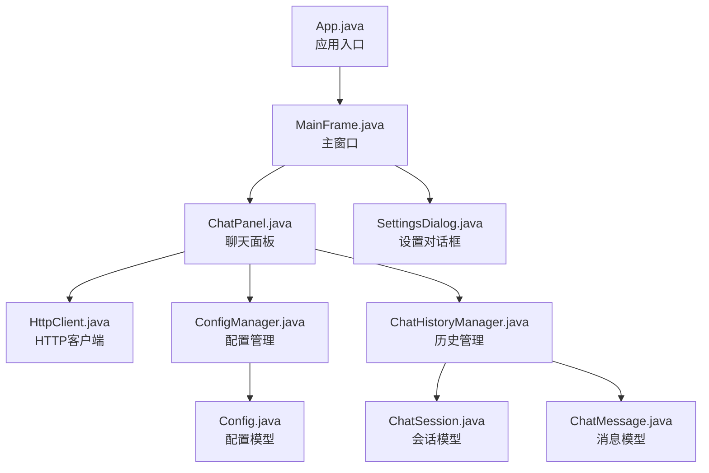
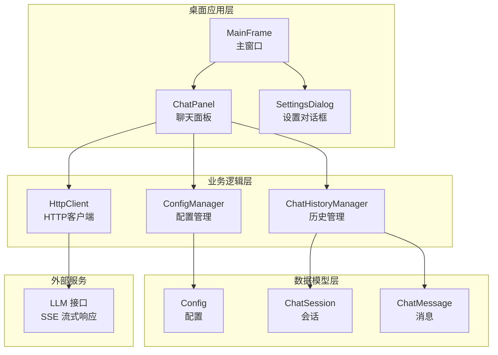
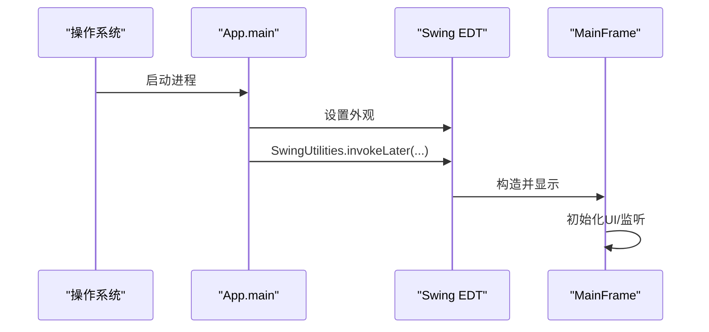
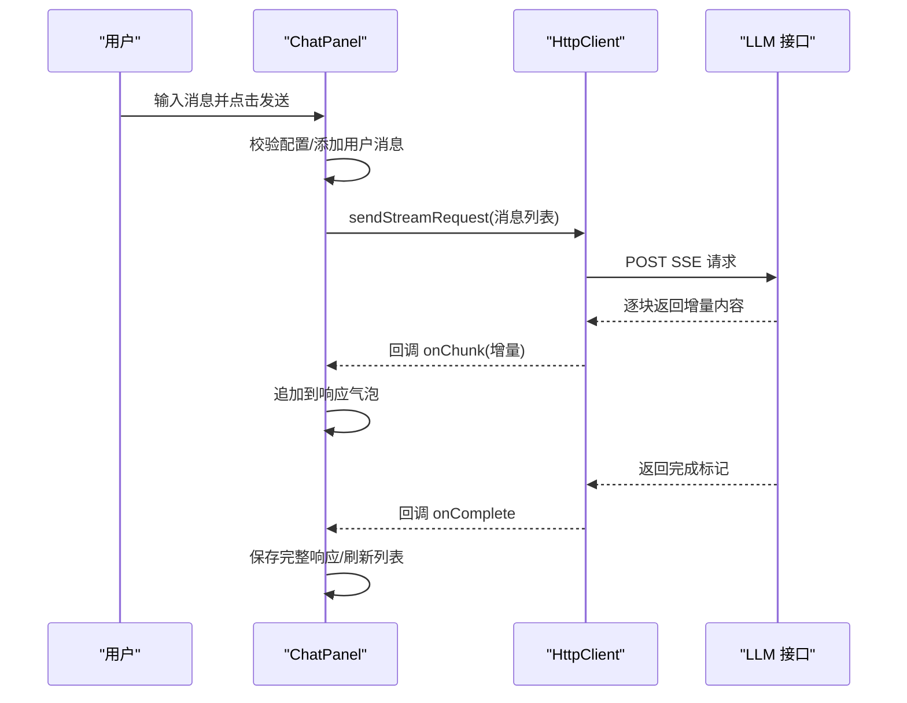
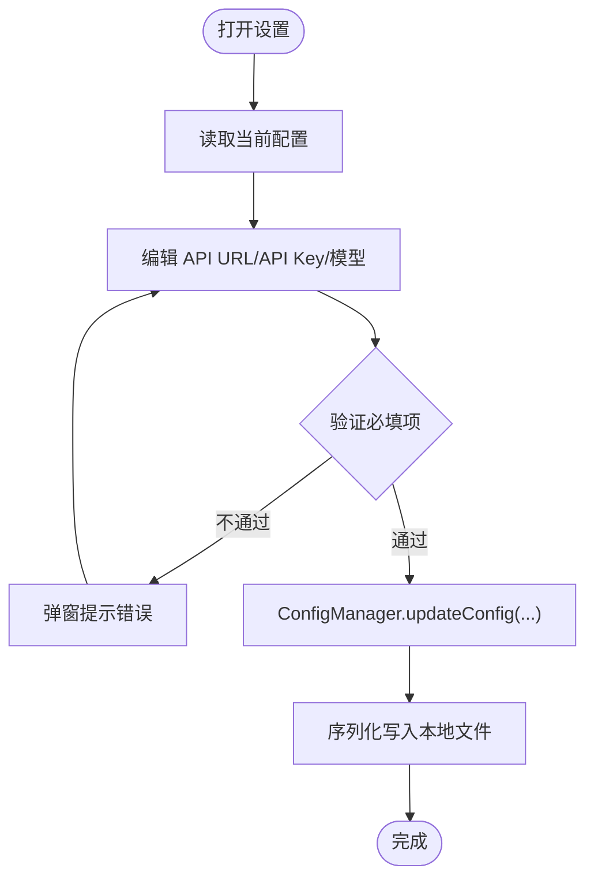
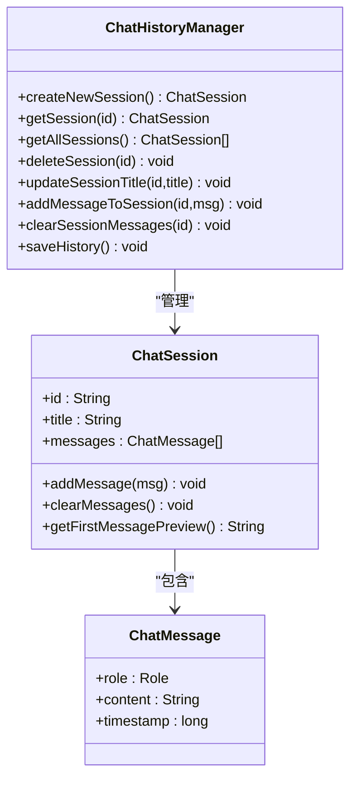
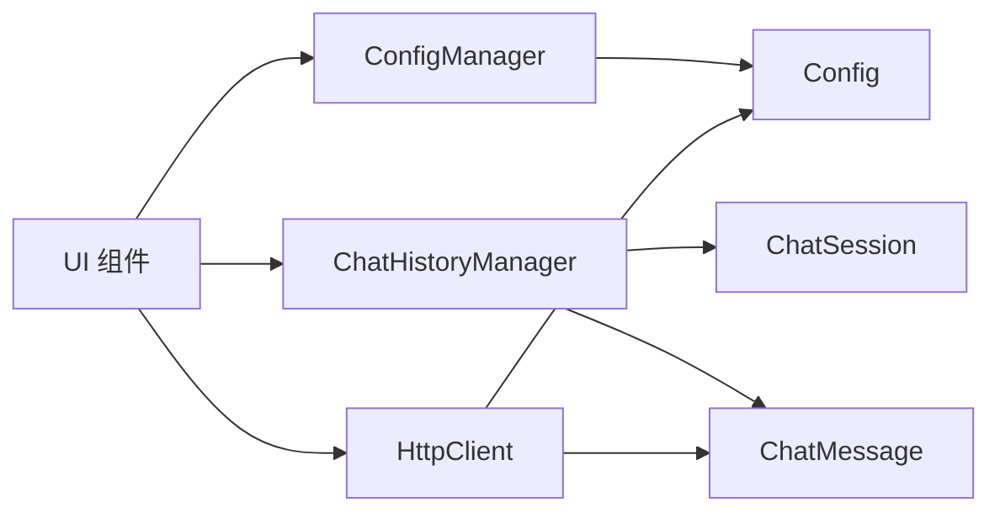

# 快速开始

<cite>
**本文引用的文件**
- [App.java](file://src/com/llmchat/App.java)
- [MainFrame.java](file://src/com/llmchat/ui/MainFrame.java)
- [ChatPanel.java](file://src/com/llmchat/ui/ChatPanel.java)
- [SettingsDialog.java](file://src/com/llmchat/ui/SettingsDialog.java)
- [HttpClient.java](file://src/com/llmchat/http/HttpClient.java)
- [Config.java](file://src/com/llmchat/model/Config.java)
- [ConfigManager.java](file://src/com/llmchat/config/ConfigManager.java)
- [ChatHistoryManager.java](file://src/com/llmchat/config/ChatHistoryManager.java)
- [ChatMessage.java](file://src/com/llmchat/model/ChatMessage.java)
- [ChatSession.java](file://src/com/llmchat/model/ChatSession.java)
- [compile.bat](file://compile.bat)
- [compile.ps1](file://compile.ps1)
- [run.bat](file://run.bat)
- [run.ps1](file://run.ps1)
</cite>

## 目录
1. [简介](#简介)
2. [项目结构](#项目结构)
3. [核心组件](#核心组件)
4. [架构总览](#架构总览)
5. [详细组件分析](#详细组件分析)
6. [依赖关系分析](#依赖关系分析)
7. [性能与可用性建议](#性能与可用性建议)
8. [首次使用全流程](#首次使用全流程)
9. [常见问题与故障排除](#常见问题与故障排除)
10. [结论](#结论)

## 简介
本指南面向初学者，帮助你在 Windows 环境下快速搭建并运行 Java LLM 聊天界面应用。你将学习如何准备 Java 开发环境、使用提供的批处理与 PowerShell 脚本完成编译与运行、完成首次配置并开始一次聊天会话。文档还提供了系统要求、前置条件、常见问题排查以及可扩展的架构概览。

## 项目结构
该工程采用按包划分的层次化组织方式：入口类位于顶层包，UI 层负责界面交互，模型层承载数据结构，配置与历史管理负责持久化，HTTP 层封装流式请求。构建脚本提供跨平台的编译与运行支持。

图表来源
- [App.java:11-26](file://src/com/llmchat/App.java#L11-L26)
- [MainFrame.java:19-101](file://src/com/llmchat/ui/MainFrame.java#L19-L101)
- [ChatPanel.java:21-55](file://src/com/llmchat/ui/ChatPanel.java#L21-L55)
- [SettingsDialog.java:15-37](file://src/com/llmchat/ui/SettingsDialog.java#L15-L37)
- [HttpClient.java:16-127](file://src/com/llmchat/http/HttpClient.java#L16-L127)
- [ConfigManager.java:14-75](file://src/com/llmchat/config/ConfigManager.java#L14-L75)
- [ChatHistoryManager.java:16-65](file://src/com/llmchat/config/ChatHistoryManager.java#L16-L65)
- [Config.java:8-51](file://src/com/llmchat/model/Config.java#L8-L51)
- [ChatSession.java:11-31](file://src/com/llmchat/model/ChatSession.java#L11-L31)
- [ChatMessage.java:8-22](file://src/com/llmchat/model/ChatMessage.java#L8-L22)

章节来源
- [App.java:11-26](file://src/com/llmchat/App.java#L11-L26)
- [compile.bat:1-21](file://compile.bat#L1-L21)
- [compile.ps1:1-25](file://compile.ps1#L1-L25)
- [run.bat:1-5](file://run.bat#L1-L5)
- [run.ps1:1-4](file://run.ps1#L1-L4)

## 核心组件
- 应用入口与UI初始化：应用入口负责设置系统外观并在事件调度线程中创建主窗口；主窗口组装头部工具栏、侧边会话列表与中央聊天面板，并在关闭时保存历史。
- 聊天面板：负责渲染消息、处理用户输入、调用 HTTP 客户端进行流式请求、更新会话历史并滚动到底部。
- 设置对话框：提供 API URL、API Key、模型名等配置项，支持预设模型与自定义模型切换。
- HTTP 客户端：以流式 SSE 方式向 LLM 接口发送请求，解析增量内容并回调 UI 更新。
- 配置与历史管理：配置管理器负责本地序列化存储与简单 Base64 加解密；历史管理器负责会话索引与持久化。

章节来源
- [App.java:11-26](file://src/com/llmchat/App.java#L11-L26)
- [MainFrame.java:19-101](file://src/com/llmchat/ui/MainFrame.java#L19-L101)
- [ChatPanel.java:21-55](file://src/com/llmchat/ui/ChatPanel.java#L21-L55)
- [SettingsDialog.java:15-37](file://src/com/llmchat/ui/SettingsDialog.java#L15-L37)
- [HttpClient.java:16-127](file://src/com/llmchat/http/HttpClient.java#L16-L127)
- [ConfigManager.java:14-75](file://src/com/llmchat/config/ConfigManager.java#L14-L75)
- [ChatHistoryManager.java:16-65](file://src/com/llmchat/config/ChatHistoryManager.java#L16-L65)

## 架构总览
应用采用典型的桌面 GUI 架构：Swing 作为 UI 框架，事件驱动的消息循环，后台线程发起网络请求，通过回调在 EDT 中刷新 UI。配置与历史通过本地文件持久化，保证重启后可恢复。

图表来源
- [MainFrame.java:19-101](file://src/com/llmchat/ui/MainFrame.java#L19-L101)
- [ChatPanel.java:21-55](file://src/com/llmchat/ui/ChatPanel.java#L21-L55)
- [SettingsDialog.java:15-37](file://src/com/llmchat/ui/SettingsDialog.java#L15-L37)
- [HttpClient.java:16-127](file://src/com/llmchat/http/HttpClient.java#L16-L127)
- [ConfigManager.java:14-75](file://src/com/llmchat/config/ConfigManager.java#L14-L75)
- [ChatHistoryManager.java:16-65](file://src/com/llmchat/config/ChatHistoryManager.java#L16-L65)
- [Config.java:8-51](file://src/com/llmchat/model/Config.java#L8-L51)
- [ChatSession.java:11-31](file://src/com/llmchat/model/ChatSession.java#L11-L31)
- [ChatMessage.java:8-22](file://src/com/llmchat/model/ChatMessage.java#L8-L22)

## 详细组件分析

### 应用入口与主窗口
- 入口类设置系统外观并在事件调度线程中创建主窗口，确保 UI 线程安全。
- 主窗口负责布局、监听窗口关闭事件并保存历史。

图表来源
- [App.java:11-26](file://src/com/llmchat/App.java#L11-L26)
- [MainFrame.java:19-101](file://src/com/llmchat/ui/MainFrame.java#L19-L101)

章节来源
- [App.java:11-26](file://src/com/llmchat/App.java#L11-L26)
- [MainFrame.java:19-101](file://src/com/llmchat/ui/MainFrame.java#L19-L101)

### 聊天面板与消息流
- 用户输入触发校验与消息追加，随后以流式方式请求 LLM 并实时拼接响应内容。
- 错误时回滚用户消息并提示；完成时保存完整响应并刷新会话列表。

图表来源
- [ChatPanel.java:189-297](file://src/com/llmchat/ui/ChatPanel.java#L189-L297)
- [HttpClient.java:66-127](file://src/com/llmchat/http/HttpClient.java#L66-L127)

章节来源
- [ChatPanel.java:189-297](file://src/com/llmchat/ui/ChatPanel.java#L189-L297)
- [HttpClient.java:66-127](file://src/com/llmchat/http/HttpClient.java#L66-L127)

### 设置与配置管理
- 设置对话框支持预设模型与自定义模型，保存前进行必填项校验。
- 配置管理器负责本地持久化与简单加解密，避免明文存储敏感信息。

图表来源
- [SettingsDialog.java:187-248](file://src/com/llmchat/ui/SettingsDialog.java#L187-L248)
- [ConfigManager.java:70-75](file://src/com/llmchat/config/ConfigManager.java#L70-L75)
- [Config.java:46-50](file://src/com/llmchat/model/Config.java#L46-L50)

章节来源
- [SettingsDialog.java:187-248](file://src/com/llmchat/ui/SettingsDialog.java#L187-L248)
- [ConfigManager.java:70-75](file://src/com/llmchat/config/ConfigManager.java#L70-L75)
- [Config.java:46-50](file://src/com/llmchat/model/Config.java#L46-L50)

### 历史与会话管理
- 历史管理器维护会话索引与文件化持久化，支持新增、删除、清空、标题更新与消息追加。
- 首次启动若无历史则自动创建默认会话。

图表来源
- [ChatHistoryManager.java:16-205](file://src/com/llmchat/config/ChatHistoryManager.java#L16-L205)
- [ChatSession.java:11-90](file://src/com/llmchat/model/ChatSession.java#L11-L90)
- [ChatMessage.java:8-43](file://src/com/llmchat/model/ChatMessage.java#L8-L43)

章节来源
- [ChatHistoryManager.java:16-205](file://src/com/llmchat/config/ChatHistoryManager.java#L16-L205)
- [ChatSession.java:11-90](file://src/com/llmchat/model/ChatSession.java#L11-L90)
- [ChatMessage.java:8-43](file://src/com/llmchat/model/ChatMessage.java#L8-L43)

## 依赖关系分析
- UI 层依赖配置与历史管理器；聊天面板依赖 HTTP 客户端；设置对话框依赖配置管理器。
- 数据模型层被历史与配置管理器共享使用。
- HTTP 客户端依赖配置模型与消息列表。

图表来源
- [ChatPanel.java:21-55](file://src/com/llmchat/ui/ChatPanel.java#L21-L55)
- [SettingsDialog.java:15-37](file://src/com/llmchat/ui/SettingsDialog.java#L15-L37)
- [HttpClient.java:16-127](file://src/com/llmchat/http/HttpClient.java#L16-L127)
- [ConfigManager.java:14-75](file://src/com/llmchat/config/ConfigManager.java#L14-L75)
- [ChatHistoryManager.java:16-65](file://src/com/llmchat/config/ChatHistoryManager.java#L16-L65)
- [Config.java:8-51](file://src/com/llmchat/model/Config.java#L8-L51)
- [ChatSession.java:11-31](file://src/com/llmchat/model/ChatSession.java#L11-L31)
- [ChatMessage.java:8-22](file://src/com/llmchat/model/ChatMessage.java#L8-L22)

章节来源
- [ChatPanel.java:21-55](file://src/com/llmchat/ui/ChatPanel.java#L21-L55)
- [SettingsDialog.java:15-37](file://src/com/llmchat/ui/SettingsDialog.java#L15-L37)
- [HttpClient.java:16-127](file://src/com/llmchat/http/HttpClient.java#L16-L127)
- [ConfigManager.java:14-75](file://src/com/llmchat/config/ConfigManager.java#L14-L75)
- [ChatHistoryManager.java:16-65](file://src/com/llmchat/config/ChatHistoryManager.java#L16-L65)
- [Config.java:8-51](file://src/com/llmchat/model/Config.java#L8-L51)
- [ChatSession.java:11-31](file://src/com/llmchat/model/ChatSession.java#L11-L31)
- [ChatMessage.java:8-22](file://src/com/llmchat/model/ChatMessage.java#L8-L22)

## 性能与可用性建议
- UI 刷新：聊天面板在回调中使用事件调度线程刷新，避免阻塞网络线程。
- 流式响应：HTTP 客户端以增量方式解析并回调，减少等待时间。
- 存储策略：配置与历史采用序列化文件存储，注意磁盘空间与权限；必要时可考虑压缩或轮转策略。
- 错误处理：网络异常与非 200 响应均通过回调统一处理，避免 UI 卡死。

[本节为通用建议，无需特定文件引用]

## 首次使用全流程
- 系统要求与前置条件
  - Java 开发工具包（JDK）：确保已正确安装并配置 PATH，以便命令行可直接使用 javac 与 java。
  - Windows 环境：支持使用批处理脚本或 PowerShell 脚本。
- 安装与环境配置
  - 将仓库克隆至本地后，确认目录包含 src、compile.bat、compile.ps1、run.bat、run.ps1。
  - 使用命令提示符或 PowerShell 进入项目根目录。
- 编译步骤
  - 批处理方式：双击 compile.bat 或在命令提示符中执行。
  - PowerShell 方式：在 PowerShell 中执行 compile.ps1。
  - 编译成功后会在根目录生成 bin 输出目录。
- 运行步骤
  - 批处理方式：双击 run.bat 或在命令提示符中执行。
  - PowerShell 方式：在 PowerShell 中执行 run.ps1。
  - 成功后将弹出主窗口。
- 配置 API 设置
  - 在主窗口顶部点击“设置”，打开设置对话框。
  - 填写 API URL、API Key、模型名称（可选预设或自定义）。
  - 点击“保存”后关闭对话框。
- 开始一次聊天会话
  - 在聊天面板底部输入框中输入消息，按回车键发送（Shift+回车换行）。
  - 观察右侧出现的响应气泡，内容随流式响应逐步显示。
  - 关闭窗口时将自动保存历史记录。

章节来源
- [compile.bat:1-21](file://compile.bat#L1-L21)
- [compile.ps1:1-25](file://compile.ps1#L1-L25)
- [run.bat:1-5](file://run.bat#L1-L5)
- [run.ps1:1-4](file://run.ps1#L1-L4)
- [MainFrame.java:117-125](file://src/com/llmchat/ui/MainFrame.java#L117-L125)
- [SettingsDialog.java:175-183](file://src/com/llmchat/ui/SettingsDialog.java#L175-L183)
- [ChatPanel.java:93-101](file://src/com/llmchat/ui/ChatPanel.java#L93-L101)
- [ChatPanel.java:189-297](file://src/com/llmchat/ui/ChatPanel.java#L189-L297)

## 常见问题与故障排除
- 编译失败
  - 症状：编译脚本报错或提示找不到 javac。
  - 排查：确认 JDK 已安装且 JAVA_HOME 与 PATH 配置正确；重新打开终端后重试。
  - 参考路径：[compile.bat:10](file://compile.bat#L10)、[compile.ps1:17](file://compile.ps1#L17)
- 运行失败
  - 症状：提示无法找到主类或类路径错误。
  - 排查：确认已成功编译并在 bin 目录生成对应类文件；检查运行脚本中的类路径参数。
  - 参考路径：[run.bat:4](file://run.bat#L4)、[run.ps1:3](file://run.ps1#L3)
- 无法连接 LLM 接口
  - 症状：发送消息后立即报错或长时间无响应。
  - 排查：检查 API URL 与 API Key 是否正确；确认网络连通性；查看设置对话框中的错误提示。
  - 参考路径：[SettingsDialog.java:216-248](file://src/com/llmchat/ui/SettingsDialog.java#L216-L248)、[ChatPanel.java:275-295](file://src/com/llmchat/ui/ChatPanel.java#L275-L295)
- 响应内容为空或异常
  - 症状：未收到任何增量内容或出现解析错误。
  - 排查：检查 LLM 接口是否支持 SSE 流式返回；确认 Authorization 头与 Content-Type 设置正确。
  - 参考路径：[HttpClient.java:72-78](file://src/com/llmchat/http/HttpClient.java#L72-L78)、[HttpClient.java:132-163](file://src/com/llmchat/http/HttpClient.java#L132-L163)
- 历史记录丢失或损坏
  - 症状：重启后会话列表为空或部分会话缺失。
  - 排查：检查用户目录下的历史文件夹是否存在与权限是否足够；必要时手动备份与修复。
  - 参考路径：[ChatHistoryManager.java:32-65](file://src/com/llmchat/config/ChatHistoryManager.java#L32-L65)

## 结论
通过本指南，你可以在 Windows 上快速完成 Java LLM 聊天界面的编译与运行，完成首次配置并开始一次完整的聊天会话。项目采用清晰的分层设计与本地持久化机制，具备良好的可扩展性与可维护性。遇到问题时，可依据“常见问题与故障排除”章节进行定位与修复。