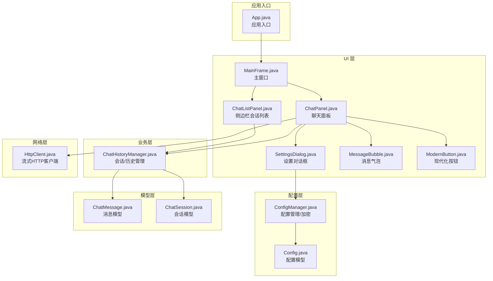
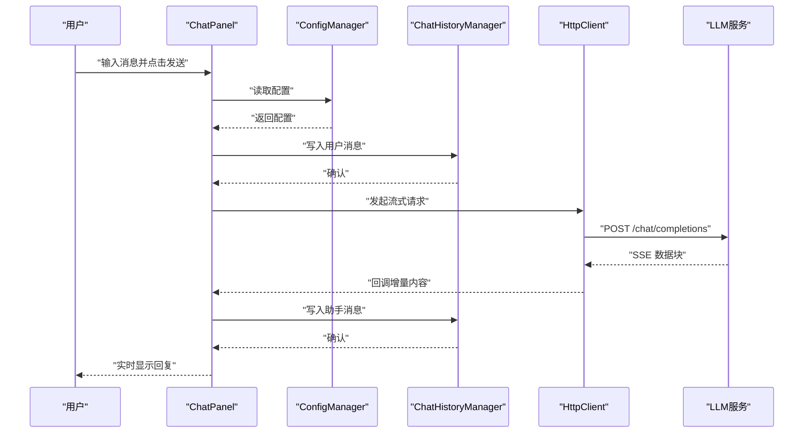
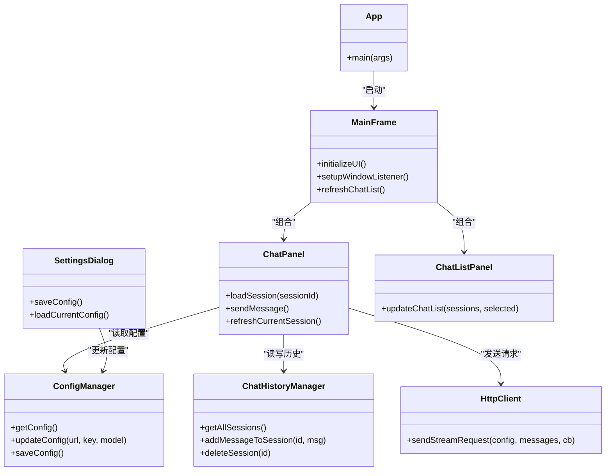

# 故障排除

<cite>
**本文引用的文件**
- [App.java](file://src/com/llmchat/App.java)
- [ConfigManager.java](file://src/com/llmchat/config/ConfigManager.java)
- [Config.java](file://src/com/llmchat/model/Config.java)
- [HttpClient.java](file://src/com/llmchat/http/HttpClient.java)
- [ChatHistoryManager.java](file://src/com/llmchat/config/ChatHistoryManager.java)
- [ChatMessage.java](file://src/com/llmchat/model/ChatMessage.java)
- [ChatSession.java](file://src/com/llmchat/model/ChatSession.java)
- [ChatPanel.java](file://src/com/llmchat/ui/ChatPanel.java)
- [MainFrame.java](file://src/com/llmchat/ui/MainFrame.java)
- [SettingsDialog.java](file://src/com/llmchat/ui/SettingsDialog.java)
- [ChatListPanel.java](file://src/com/llmchat/ui/components/ChatListPanel.java)
- [MessageBubble.java](file://src/com/llmchat/ui/components/MessageBubble.java)
- [ModernButton.java](file://src/com/llmchat/ui/components/ModernButton.java)
- [compile.bat](file://compile.bat)
- [run.bat](file://run.bat)
</cite>

## 目录
1. [简介](#简介)
2. [项目结构](#项目结构)
3. [核心组件](#核心组件)
4. [架构总览](#架构总览)
5. [详细组件分析与故障排除](#详细组件分析与故障排除)
6. [依赖关系分析](#依赖关系分析)
7. [性能考虑与优化](#性能考虑与优化)
8. [故障排除指南](#故障排除指南)
9. [结论](#结论)
10. [附录：日志与错误追踪最佳实践](#附录日志与错误追踪最佳实践)

## 简介
本指南面向使用 Java LLM 聊天界面应用的用户与维护者，聚焦于常见问题的定位与解决，涵盖网络连接、配置错误、界面显示异常、性能问题、日志与错误追踪、跨平台兼容性、网络通信与文件权限问题、以及内存泄漏排查与用户反馈流程。文档基于仓库中的源码进行分析，提供可操作的诊断步骤与修复建议。

## 项目结构
应用采用模块化组织：UI 层负责界面交互；业务层负责会话与历史管理；配置层负责本地配置与加密；HTTP 层负责与大模型服务的流式通信；模型层提供消息与会话的数据结构。

**图示来源**
- [App.java:11-26](file://src/com/llmchat/App.java#L11-L26)
- [MainFrame.java:30-101](file://src/com/llmchat/ui/MainFrame.java#L30-L101)
- [ChatPanel.java:44-55](file://src/com/llmchat/ui/ChatPanel.java#L44-L55)
- [SettingsDialog.java:27-37](file://src/com/llmchat/ui/SettingsDialog.java#L27-L37)
- [ChatListPanel.java:34-84](file://src/com/llmchat/ui/components/ChatListPanel.java#L34-L84)
- [MessageBubble.java:24-58](file://src/com/llmchat/ui/components/MessageBubble.java#L24-L58)
- [ModernButton.java:31-40](file://src/com/llmchat/ui/components/ModernButton.java#L31-L40)
- [ChatHistoryManager.java:23-65](file://src/com/llmchat/config/ChatHistoryManager.java#L23-L65)
- [ConfigManager.java:20-22](file://src/com/llmchat/config/ConfigManager.java#L20-L22)
- [Config.java:15-20](file://src/com/llmchat/model/Config.java#L15-L20)
- [HttpClient.java:66-127](file://src/com/llmchat/http/HttpClient.java#L66-L127)
- [ChatMessage.java:18-22](file://src/com/llmchat/model/ChatMessage.java#L18-L22)
- [ChatSession.java:20-26](file://src/com/llmchat/model/ChatSession.java#L20-L26)

**章节来源**
- [App.java:11-26](file://src/com/llmchat/App.java#L11-L26)
- [compile.bat:1-21](file://compile.bat#L1-L21)
- [run.bat:1-5](file://run.bat#L1-L5)

## 核心组件
- 应用入口与外观初始化：设置系统外观并在事件调度线程中启动主窗体。
- 配置管理：负责配置的读取、保存、默认值与简单 Base64 加密/解密。
- 会话与历史：负责会话列表、消息持久化、索引重建与并发安全。
- HTTP 客户端：构建请求体、设置请求头、超时控制、流式 SSE 响应解析。
- UI 组件：聊天面板、消息气泡、侧边栏、设置对话框、现代化按钮。
- 模型：消息与会话的数据结构，含角色枚举与预览标题生成。

**章节来源**
- [App.java:14-24](file://src/com/llmchat/App.java#L14-L24)
- [ConfigManager.java:27-39](file://src/com/llmchat/config/ConfigManager.java#L27-L39)
- [ChatHistoryManager.java:32-65](file://src/com/llmchat/config/ChatHistoryManager.java#L32-L65)
- [HttpClient.java:30-49](file://src/com/llmchat/http/HttpClient.java#L30-L49)
- [ChatPanel.java:44-55](file://src/com/llmchat/ui/ChatPanel.java#L44-L55)
- [ChatMessage.java:10-12](file://src/com/llmchat/model/ChatMessage.java#L10-L12)
- [ChatSession.java:11-12](file://src/com/llmchat/model/ChatSession.java#L11-L12)

## 架构总览
应用采用“UI-业务-配置-网络-模型”的分层架构。UI 通过 ChatPanel 发起请求，ConfigManager 提供配置，ChatHistoryManager 管理会话与历史，HttpClient 负责与外部服务的流式通信。

**图示来源**
- [ChatPanel.java:189-297](file://src/com/llmchat/ui/ChatPanel.java#L189-L297)
- [ConfigManager.java:63-75](file://src/com/llmchat/config/ConfigManager.java#L63-L75)
- [ChatHistoryManager.java:170-182](file://src/com/llmchat/config/ChatHistoryManager.java#L170-L182)
- [HttpClient.java:66-127](file://src/com/llmchat/http/HttpClient.java#L66-L127)

## 详细组件分析与故障排除

### 配置与设置（ConfigManager、SettingsDialog、Config）
- 常见问题
  - 配置未保存或丢失：检查配置目录是否存在与可写；确认保存流程是否被中断。
  - API Key 显示为空：确认密码字段正确读取与保存；注意加密/解密逻辑。
  - 模型名无效：确认下拉框或自定义输入非空。
- 排查步骤
  - 确认配置目录路径存在且可写；默认位于工作目录下的隐藏文件夹。
  - 在设置对话框中验证各字段，保存后检查配置文件是否生成。
  - 若出现异常，查看配置加载与保存过程中的异常处理与打印信息。
- 关键实现要点
  - 配置加载/保存：对象序列化与目录创建。
  - 加密/解密：Base64 简单编码，用于本地存储保护。
  - 配置校验：提供有效性判断，避免空值导致请求失败。

**章节来源**
- [ConfigManager.java:27-58](file://src/com/llmchat/config/ConfigManager.java#L27-L58)
- [ConfigManager.java:80-99](file://src/com/llmchat/config/ConfigManager.java#L80-L99)
- [SettingsDialog.java:187-248](file://src/com/llmchat/ui/SettingsDialog.java#L187-L248)
- [Config.java:46-50](file://src/com/llmchat/model/Config.java#L46-L50)

### 会话与历史（ChatHistoryManager、ChatSession、ChatMessage）
- 常见问题
  - 历史无法加载：索引文件损坏或会话文件缺失。
  - 会话删除后空白：确认删除流程与索引更新。
  - 并发访问冲突：多线程场景下的读写一致性。
- 排查步骤
  - 检查历史目录结构与文件完整性；必要时重建默认会话。
  - 观察保存/加载过程中的异常日志，定位具体失败文件。
  - 使用最小化会话复现问题，逐步缩小范围。
- 关键实现要点
  - 索引文件记录会话顺序，逐个加载会话并容错处理。
  - 会话标题根据首条用户消息生成，便于识别。
  - 提供清空消息、更新标题、删除会话等操作。

**章节来源**
- [ChatHistoryManager.java:32-99](file://src/com/llmchat/config/ChatHistoryManager.java#L32-L99)
- [ChatHistoryManager.java:136-154](file://src/com/llmchat/config/ChatHistoryManager.java#L136-L154)
- [ChatSession.java:78-89](file://src/com/llmchat/model/ChatSession.java#L78-L89)
- [ChatMessage.java:18-22](file://src/com/llmchat/model/ChatMessage.java#L18-L22)

### 界面与交互（MainFrame、ChatPanel、ChatListPanel、MessageBubble、ModernButton）
- 常见问题
  - 界面不显示或卡顿：Swing 组件重绘与滚动条滚动未在事件线程执行。
  - 按钮加载态异常：加载动画定时器未停止或状态未同步。
  - 消息气泡换行与尺寸异常：文本宽度计算与重绘链路。
- 排查步骤
  - 确保 UI 更新均通过事件调度线程执行。
  - 检查按钮加载状态切换与计时器生命周期。
  - 验证消息气泡的尺寸计算与重绘链路，确保父容器也同步更新。
- 关键实现要点
  - 事件线程更新：大量 UI 更新使用事件调度线程包装。
  - 滚动到底部：通过滚动条最大值实现自动滚动。
  - 按钮加载动画：定时器驱动的点状动画，禁用交互。

**章节来源**
- [ChatPanel.java:246-271](file://src/com/llmchat/ui/ChatPanel.java#L246-L271)
- [ChatPanel.java:314-319](file://src/com/llmchat/ui/ChatPanel.java#L314-L319)
- [ModernButton.java:78-98](file://src/com/llmchat/ui/components/ModernButton.java#L78-L98)
- [MessageBubble.java:89-121](file://src/com/llmchat/ui/components/MessageBubble.java#L89-L121)

### 网络通信（HttpClient）
- 常见问题
  - 请求超时：连接/读取超时设置过短或网络不稳定。
  - 流式响应解析失败：SSE 数据格式不符合预期。
  - 错误响应未展示：错误流读取与错误提示未触发。
- 排查步骤
  - 检查请求头与请求体构造是否符合目标服务要求。
  - 观察调试输出与错误流读取，确认错误码与错误信息。
  - 调整超时参数，测试稳定网络环境下的行为。
- 关键实现要点
  - 超时控制：连接与读取超时分别设置。
  - 流式解析：逐行读取并解析 data: 块，提取 content 字段。
  - 错误处理：统一回调 onError，确保 UI 线程中弹窗提示。

**章节来源**
- [HttpClient.java:77-78](file://src/com/llmchat/http/HttpClient.java#L77-L78)
- [HttpClient.java:100-114](file://src/com/llmchat/http/HttpClient.java#L100-L114)
- [HttpClient.java:193-206](file://src/com/llmchat/http/HttpClient.java#L193-L206)

### 主窗口与生命周期（MainFrame）
- 常见问题
  - 退出确认与历史保存：关闭窗口时未保存或二次确认逻辑异常。
- 排查步骤
  - 确认窗口监听器与确认对话框逻辑。
  - 检查历史保存调用与进程退出时机。
- 关键实现要点
  - 自定义关闭行为：确认后保存历史并退出。

**章节来源**
- [MainFrame.java:148-166](file://src/com/llmchat/ui/MainFrame.java#L148-L166)

## 依赖关系分析
- 组件耦合
  - ChatPanel 依赖 ConfigManager、ChatHistoryManager、HttpClient。
  - MainFrame 依赖 ChatPanel 与 ChatListPanel，并协调会话刷新。
  - SettingsDialog 依赖 ConfigManager，负责配置输入与校验。
- 外部依赖
  - Java Swing（UI）、Java IO/NIO（文件与序列化）。
- 潜在风险
  - UI 更新未在事件线程执行可能导致界面异常。
  - 文件读写异常未捕获可能造成数据不一致。

**图示来源**
- [App.java:21-24](file://src/com/llmchat/App.java#L21-L24)
- [MainFrame.java:30-101](file://src/com/llmchat/ui/MainFrame.java#L30-L101)
- [ChatPanel.java:44-55](file://src/com/llmchat/ui/ChatPanel.java#L44-L55)
- [SettingsDialog.java:27-37](file://src/com/llmchat/ui/SettingsDialog.java#L27-L37)
- [ChatListPanel.java:34-84](file://src/com/llmchat/ui/components/ChatListPanel.java#L34-L84)
- [ConfigManager.java:63-75](file://src/com/llmchat/config/ConfigManager.java#L63-L75)
- [ChatHistoryManager.java:122-131](file://src/com/llmchat/config/ChatHistoryManager.java#L122-L131)
- [HttpClient.java:66-127](file://src/com/llmchat/http/HttpClient.java#L66-L127)

**章节来源**
- [App.java:11-26](file://src/com/llmchat/App.java#L11-L26)
- [MainFrame.java:30-101](file://src/com/llmchat/ui/MainFrame.java#L30-L101)
- [ChatPanel.java:44-55](file://src/com/llmchat/ui/ChatPanel.java#L44-L55)
- [SettingsDialog.java:27-37](file://src/com/llmchat/ui/SettingsDialog.java#L27-L37)
- [ChatListPanel.java:34-84](file://src/com/llmchat/ui/components/ChatListPanel.java#L34-L84)
- [ConfigManager.java:63-75](file://src/com/llmchat/config/ConfigManager.java#L63-L75)
- [ChatHistoryManager.java:122-131](file://src/com/llmchat/config/ChatHistoryManager.java#L122-L131)
- [HttpClient.java:66-127](file://src/com/llmchat/http/HttpClient.java#L66-L127)

## 性能考虑与优化
- UI 更新与渲染
  - 使用事件调度线程更新 UI，避免跨线程修改 Swing 组件。
  - 合理使用 revalidate()/repaint()，减少不必要的全量重绘。
- 网络请求
  - 合理设置连接与读取超时，避免长时间阻塞。
  - 流式响应按块处理，及时回调 UI，避免累积延迟。
- 文件读写
  - 对历史与配置文件采用对象序列化，注意磁盘 I/O 开销。
  - 在批量写入时合并写操作，减少频繁落盘。
- 内存管理
  - 避免在消息气泡中持有过长字符串引用，及时释放临时缓冲。
  - 控制会话消息数量，定期清理旧会话以降低内存占用。

[本节为通用性能建议，无需特定文件引用]

## 故障排除指南

### 一、网络连接问题
- 现象
  - 发送消息后无响应或报错。
  - 弹出“请求错误”对话框，显示错误码或错误信息。
- 诊断步骤
  - 确认网络连通性与代理设置。
  - 检查 API URL 与模型名是否正确。
  - 查看错误流读取与回调，确认服务端返回状态。
  - 调整超时参数，观察在弱网环境下的表现。
- 修复建议
  - 更换稳定的网络环境或配置代理。
  - 校验 API Key 与服务端授权策略。
  - 如为第三方服务，核对请求头与请求体格式。

**章节来源**
- [ChatPanel.java:275-295](file://src/com/llmchat/ui/ChatPanel.java#L275-L295)
- [HttpClient.java:88-93](file://src/com/llmchat/http/HttpClient.java#L88-L93)
- [HttpClient.java:193-206](file://src/com/llmchat/http/HttpClient.java#L193-L206)

### 二、配置错误
- 现象
  - “请先配置API设置”提示弹出。
  - 设置对话框保存时报错或未生效。
- 诊断步骤
  - 打开设置对话框，检查各字段是否为空。
  - 查看配置保存流程与异常日志。
  - 确认配置文件存在且可读写。
- 修复建议
  - 在设置中填写正确的 API URL、API Key 与模型名。
  - 重新保存配置并重启应用以确保生效。

**章节来源**
- [ChatPanel.java:196-202](file://src/com/llmchat/ui/ChatPanel.java#L196-L202)
- [SettingsDialog.java:228-241](file://src/com/llmchat/ui/SettingsDialog.java#L228-L241)
- [ConfigManager.java:44-58](file://src/com/llmchat/config/ConfigManager.java#L44-L58)

### 三、界面显示异常
- 现象
  - 消息气泡不换行或尺寸异常。
  - 按钮加载动画不显示或卡住。
  - 滚动条无法自动滚动到底部。
- 诊断步骤
  - 检查消息气泡的尺寸计算与重绘链路。
  - 确认按钮加载状态切换与计时器生命周期。
  - 验证滚动条更新是否在事件线程中执行。
- 修复建议
  - 确保 appendContent 后触发 revalidate/repaint 并向上级传播。
  - 在完成回调中停止计时器并恢复按钮状态。
  - 使用事件调度线程更新滚动条最大值。

**章节来源**
- [MessageBubble.java:89-121](file://src/com/llmchat/ui/components/MessageBubble.java#L89-L121)
- [ModernButton.java:78-98](file://src/com/llmchat/ui/components/ModernButton.java#L78-L98)
- [ChatPanel.java:314-319](file://src/com/llmchat/ui/ChatPanel.java#L314-L319)

### 四、文件权限与路径问题
- 现象
  - 配置或历史保存失败，抛出异常。
  - 应用启动后历史为空或加载异常。
- 诊断步骤
  - 检查配置与历史目录是否存在与可写。
  - 确认用户主目录权限与磁盘空间。
  - 观察异常堆栈中的文件 I/O 错误。
- 修复建议
  - 以管理员权限运行或调整目录权限。
  - 将应用目录移动至有写权限的位置。
  - 清理损坏的索引文件并重建默认会话。

**章节来源**
- [ConfigManager.java:46-58](file://src/com/llmchat/config/ConfigManager.java#L46-L58)
- [ChatHistoryManager.java:70-99](file://src/com/llmchat/config/ChatHistoryManager.java#L70-L99)

### 五、内存泄漏排查
- 现象
  - 应用运行一段时间后内存持续增长。
  - UI 组件未释放或事件监听器未注销。
- 诊断步骤
  - 使用内存分析工具观察对象存活情况。
  - 检查按钮计时器、HTTP 线程与 Swing 组件引用。
  - 关注长字符串缓冲区与消息集合的增长。
- 修复建议
  - 确保计时器在停止后不再回调。
  - 避免在消息气泡中持有过长引用链。
  - 控制会话消息上限，定期清理旧会话。

**章节来源**
- [ModernButton.java:42-45](file://src/com/llmchat/ui/components/ModernButton.java#L42-L45)
- [ChatPanel.java:246-271](file://src/com/llmchat/ui/ChatPanel.java#L246-L271)

### 六、跨平台与Java版本兼容性
- 现象
  - 字体显示异常（emoji 或中文）。
  - 启动失败或类找不到。
- 诊断步骤
  - 检查系统字体支持与可用性。
  - 确认 Java 版本与编译选项匹配。
  - 验证运行脚本的类路径与编码设置。
- 修复建议
  - 使用系统自带字体回退方案。
  - 使用与项目一致的 JDK 版本编译与运行。
  - 确保脚本中设置 UTF-8 编码与正确的类路径。

**章节来源**
- [MessageBubble.java:63-84](file://src/com/llmchat/ui/components/MessageBubble.java#L63-L84)
- [compile.bat:10](file://compile.bat#L10)
- [run.bat:4](file://run.bat#L4)

### 七、日志与错误追踪最佳实践
- 建议
  - 在关键流程添加日志（配置读写、历史保存、网络请求）。
  - 区分错误级别：警告（配置缺失）、错误（I/O/网络异常）、致命（不可恢复）。
  - 记录上下文信息：请求参数、响应状态、异常堆栈。
  - 在 UI 中提供“复制日志”功能以便用户反馈。
- 实践
  - 当前代码中部分调试输出可用于问题定位，建议统一到日志框架。

**章节来源**
- [ConfigManager.java:55-57](file://src/com/llmchat/config/ConfigManager.java#L55-L57)
- [ChatHistoryManager.java:96-98](file://src/com/llmchat/config/ChatHistoryManager.java#L96-L98)
- [HttpClient.java:107-113](file://src/com/llmchat/http/HttpClient.java#L107-L113)

### 八、用户反馈与问题报告模板
- 建议用户提供以下信息
  - 操作系统与 Java 版本。
  - 配置截图（API URL、模型名）。
  - 复现步骤与期望/实际结果。
  - 日志片段（含时间戳与错误信息）。
  - 是否在代理/防火墙环境下使用。
- 便于快速定位与复现问题。

[本节为通用指导，无需特定文件引用]

## 结论
本指南围绕配置、网络、UI、文件与性能等方面提供了系统化的故障排除方法。建议在日常使用中关注日志与错误提示，结合本文提供的诊断步骤与修复建议，快速定位并解决问题。对于复杂问题，可按“最小化复现—逐步加压—日志分析—修复验证”的流程推进。

## 附录：日志与错误追踪最佳实践
- 日志记录
  - 使用统一的日志框架输出关键事件与异常。
  - 对网络请求与文件操作增加上下文标签。
- 错误追踪
  - 捕获异常并记录堆栈，避免静默失败。
  - 在 UI 中提供“复制错误信息”能力，提升反馈效率。
- 性能观测
  - 在关键路径埋点耗时统计，辅助性能优化。

[本节为通用指导，无需特定文件引用]