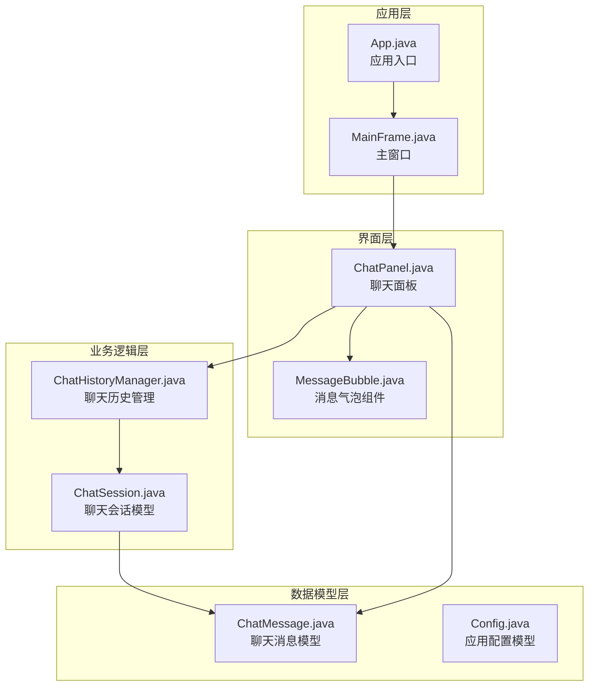
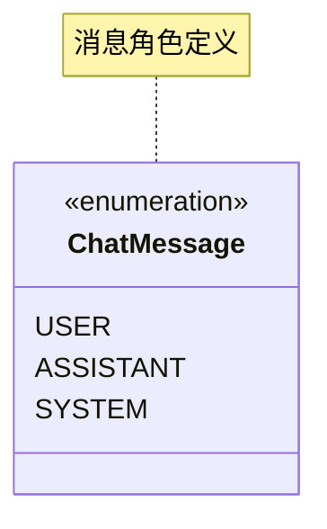
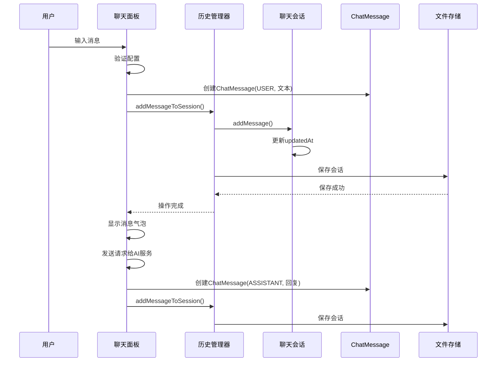
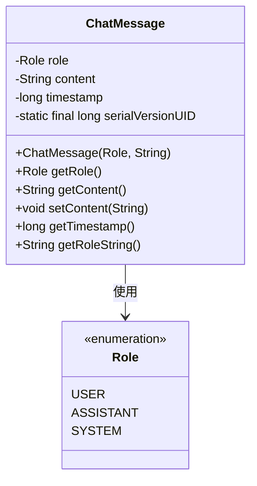
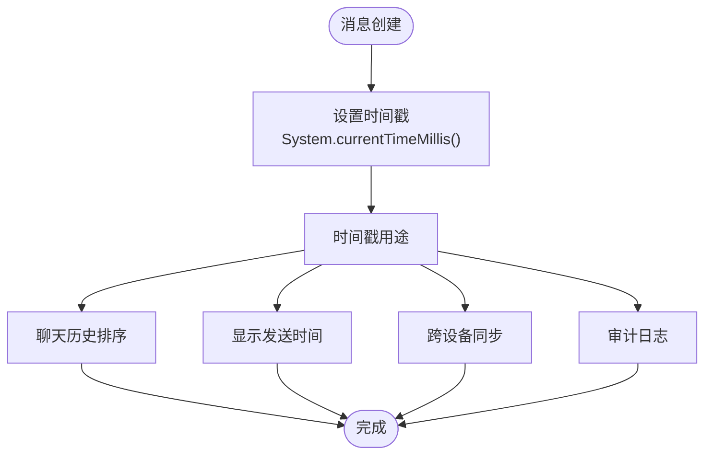
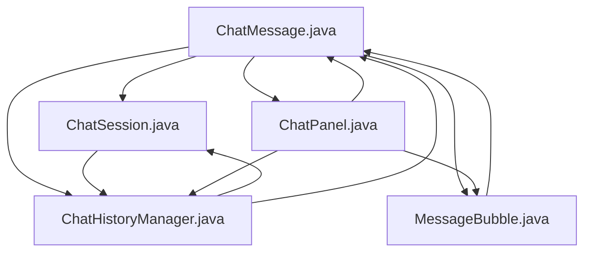

# ChatMessage消息模型

<cite>
**本文档引用的文件**
- [ChatMessage.java](file://src/com/llmchat/model/ChatMessage.java)
- [ChatSession.java](file://src/com/llmchat/model/ChatSession.java)
- [ChatHistoryManager.java](file://src/com/llmchat/config/ChatHistoryManager.java)
- [ChatPanel.java](file://src/com/llmchat/ui/ChatPanel.java)
- [MessageBubble.java](file://src/com/llmchat/ui/components/MessageBubble.java)
- [App.java](file://src/com/llmchat/App.java)
</cite>

## 目录
1. [简介](#简介)
2. [项目结构](#项目结构)
3. [核心组件](#核心组件)
4. [架构概览](#架构概览)
5. [详细组件分析](#详细组件分析)
6. [依赖关系分析](#依赖关系分析)
7. [性能考虑](#性能考虑)
8. [故障排除指南](#故障排除指南)
9. [结论](#结论)

## 简介

ChatMessage是Java LLM Interface项目中的核心消息模型类，负责封装聊天对话中的单条消息数据。该模型实现了Serializable接口，支持消息的序列化和持久化存储，是整个聊天应用数据层的基础组件。

## 项目结构

该项目采用经典的分层架构设计，主要包含以下模块：



**图表来源**
- [App.java:1-27](file://src/com/llmchat/App.java#L1-L27)
- [ChatPanel.java:109-224](file://src/com/llmchat/ui/ChatPanel.java#L109-L224)
- [ChatHistoryManager.java:16-206](file://src/com/llmchat/config/ChatHistoryManager.java#L16-L206)

**章节来源**
- [App.java:1-27](file://src/com/llmchat/App.java#L1-L27)
- [ChatPanel.java:109-224](file://src/com/llmchat/ui/ChatPanel.java#L109-L224)

## 核心组件

### ChatMessage类结构

ChatMessage类是整个聊天系统的数据载体，包含以下核心属性：

| 属性名称 | 类型 | 描述 | 默认值 |
|---------|------|------|--------|
| role | Role枚举 | 消息发送者角色 | 无（必需） |
| content | String | 消息内容文本 | 无（必需） |
| timestamp | long | 时间戳（毫秒） | 当前系统时间 |

### Role枚举类型



**图表来源**
- [ChatMessage.java:10-12](file://src/com/llmchat/model/ChatMessage.java#L10-L12)

**章节来源**
- [ChatMessage.java:8-43](file://src/com/llmchat/model/ChatMessage.java#L8-L43)

## 架构概览

ChatMessage在整个系统中的工作流程如下：



**图表来源**
- [ChatPanel.java:189-297](file://src/com/llmchat/ui/ChatPanel.java#L189-L297)
- [ChatHistoryManager.java:169-182](file://src/com/llmchat/config/ChatHistoryManager.java#L169-L182)
- [ChatSession.java:61-64](file://src/com/llmchat/model/ChatSession.java#L61-L64)

## 详细组件分析

### ChatMessage类详细分析

#### 数据结构设计

ChatMessage采用了简洁而高效的数据结构设计：



**图表来源**
- [ChatMessage.java:8-43](file://src/com/llmchat/model/ChatMessage.java#L8-L43)

#### 构造函数详解

ChatMessage提供了专门的构造函数用于创建消息实例：

**构造函数签名：**
```java
public ChatMessage(Role role, String content)
```

**参数说明：**
- `role`: 消息发送者角色，必须为USER、ASSISTANT或SYSTEM之一
- `content`: 消息内容文本，不能为空字符串

**初始化过程：**
1. 设置消息角色
2. 设置消息内容
3. 自动设置时间戳为当前系统时间

**章节来源**
- [ChatMessage.java:18-22](file://src/com/llmchat/model/ChatMessage.java#L18-L22)

#### 方法功能说明

| 方法名 | 返回类型 | 功能描述 | 使用场景 |
|-------|----------|----------|----------|
| getRole() | Role | 获取消息发送者角色 | UI渲染判断 |
| getContent() | String | 获取消息内容 | 显示消息文本 |
| setContent(String) | void | 修改消息内容 | 编辑功能 |
| getTimestamp() | long | 获取时间戳 | 排序和显示 |
| getRoleString() | String | 获取小写角色名 | API通信 |

**章节来源**
- [ChatMessage.java:24-42](file://src/com/llmchat/model/ChatMessage.java#L24-L42)

### 消息角色语义

#### USER角色
- **含义**：用户发送的消息
- **使用场景**：用户输入的所有问题和指令
- **特点**：每条会话通常以USER消息开始

#### ASSISTANT角色  
- **含义**：AI助手回复的消息
- **使用场景**：AI对用户问题的回答和处理结果
- **特点**：由系统自动生成，可能包含流式输出

#### SYSTEM角色
- **含义**：系统级消息或上下文信息
- **使用场景**：系统提示、错误信息或特殊指令
- **特点**：较少使用，主要用于特殊场景

### 时间戳机制

ChatMessage中的timestamp字段具有以下重要作用：



**图表来源**
- [ChatMessage.java:21](file://src/com/llmchat/model/ChatMessage.java#L21)

**章节来源**
- [ChatMessage.java:36-38](file://src/com/llmchat/model/ChatMessage.java#L36-L38)

### 序列化与版本控制

#### Serializable接口实现

ChatMessage实现了Serializable接口，支持对象的序列化和反序列化：

**序列化特性：**
- `serialVersionUID = 1L`：固定版本号，确保兼容性
- 支持网络传输和文件存储
- 自动处理基本类型和字符串的序列化

**版本控制机制：**
- 固定的serialVersionUID确保不同版本间的兼容性
- 当类结构发生变化时，需要谨慎更新版本号

**章节来源**
- [ChatMessage.java:3](file://src/com/llmchat/model/ChatMessage.java#L3)
- [ChatMessage.java:9](file://src/com/llmchat/model/ChatMessage.java#L9)

### 消息创建、获取和修改API

#### 创建消息API

**创建用户消息：**
```java
ChatMessage userMessage = new ChatMessage(ChatMessage.Role.USER, "用户输入的问题");
```

**创建AI回复消息：**
```java
ChatMessage aiMessage = new ChatMessage(ChatMessage.Role.ASSISTANT, "AI的回复内容");
```

**获取消息信息：**
```java
String content = message.getContent();
ChatMessage.Role role = message.getRole();
long timestamp = message.getTimestamp();
String roleStr = message.getRoleString();
```

**修改消息内容：**
```java
message.setContent("新的消息内容");
```

**章节来源**
- [ChatMessage.java:18-42](file://src/com/llmchat/model/ChatMessage.java#L18-L42)

### 消息格式验证规则

#### 内容验证规则

虽然ChatMessage类本身没有内置验证逻辑，但在实际使用中应遵循以下规则：

**必填字段验证：**
- `role`：必须为USER、ASSISTANT或SYSTEM之一
- `content`：不能为空字符串，长度应大于0

**内容格式建议：**
- 支持Unicode字符，包括emoji表情符号
- 建议限制单条消息的最大长度（如10000字符）
- 避免包含敏感信息或恶意代码

**时间戳验证：**
- 确保时间戳为正数
- 避免时间戳回拨（系统时间倒退）

### 最佳实践建议

#### 消息创建最佳实践

1. **及时设置内容**：创建消息后立即设置content，避免空内容
2. **合理使用角色**：严格区分USER和ASSISTANT消息
3. **时间戳一致性**：使用系统时间戳，避免手动设置

#### 消息存储最佳实践

1. **批量操作**：大量消息操作时使用批量处理
2. **内存管理**：定期清理不需要的历史消息
3. **并发安全**：在多线程环境下注意消息对象的不可变性

#### UI显示最佳实践

1. **异步更新**：使用SwingUtilities.invokeLater进行UI更新
2. **滚动定位**：新消息到达时自动滚动到底部
3. **错误处理**：妥善处理消息显示异常

## 依赖关系分析

### 组件间依赖关系



**图表来源**
- [ChatMessage.java:8](file://src/com/llmchat/model/ChatMessage.java#L8)
- [ChatSession.java:18](file://src/com/llmchat/model/ChatSession.java#L18)
- [ChatHistoryManager.java:3](file://src/com/llmchat/config/ChatHistoryManager.java#L3)

### 关键依赖点

1. **ChatSession依赖**：会话管理器通过ChatMessage列表维护聊天历史
2. **ChatHistoryManager依赖**：历史管理器负责ChatMessage的持久化存储
3. **UI组件依赖**：MessageBubble和ChatPanel直接使用ChatMessage进行显示

**章节来源**
- [ChatSession.java:57-59](file://src/com/llmchat/model/ChatSession.java#L57-L59)
- [ChatHistoryManager.java:170-182](file://src/com/llmchat/config/ChatHistoryManager.java#L170-L182)

## 性能考虑

### 内存使用优化

1. **对象池模式**：对于频繁创建的小消息对象，可考虑使用对象池减少GC压力
2. **延迟加载**：对于长消息内容，可采用延迟加载策略
3. **弱引用**：在UI层使用弱引用避免内存泄漏

### 序列化性能

1. **增量序列化**：只序列化变化的消息，而非整个会话
2. **压缩存储**：对消息内容进行压缩后再存储
3. **缓存策略**：热点消息缓存在内存中避免重复反序列化

### 并发访问优化

1. **不可变设计**：ChatMessage设计为不可变对象，天然支持并发读取
2. **读写分离**：使用CopyOnWriteArrayList处理消息列表的并发访问
3. **锁粒度优化**：最小化锁的持有时间，避免阻塞其他操作

## 故障排除指南

### 常见问题及解决方案

#### 消息显示异常

**问题现象**：消息无法正确显示或显示乱码

**可能原因：**
- 字符编码问题
- 字体不支持emoji字符
- UI线程更新时机不当

**解决方法：**
1. 确保使用UTF-8编码
2. 检查emoji字体支持情况
3. 使用SwingUtilities.invokeLater进行UI更新

#### 消息丢失问题

**问题现象**：重启应用后聊天记录消失

**可能原因：**
- 文件权限问题
- 序列化版本不匹配
- 存储路径不存在

**解决方法：**
1. 检查用户目录权限
2. 验证serialVersionUID设置
3. 确认历史文件夹存在

#### 性能问题

**问题现象**：大量消息时应用响应缓慢

**可能原因：**
- UI组件过多导致重绘开销大
- 序列化/反序列化频繁
- 内存泄漏

**解决方法：**
1. 实现虚拟滚动显示
2. 优化序列化策略
3. 定期清理内存中的历史消息

**章节来源**
- [MessageBubble.java:63-84](file://src/com/llmchat/ui/components/MessageBubble.java#L63-L84)
- [ChatHistoryManager.java:32-65](file://src/com/llmchat/config/ChatHistoryManager.java#L32-L65)

## 结论

ChatMessage消息模型作为Java LLM Interface项目的核心数据结构，展现了良好的设计原则：

1. **简洁性**：仅包含必要的字段，避免过度设计
2. **可扩展性**：通过Role枚举支持未来角色扩展
3. **持久化支持**：实现Serializable接口便于数据存储
4. **线程安全**：不可变设计支持并发访问
5. **用户体验**：配合UI组件提供流畅的消息显示体验

该模型为整个聊天应用提供了稳定可靠的数据基础，通过合理的架构设计和最佳实践指导，能够满足现代聊天应用的各种需求。在未来的发展中，可以考虑添加消息类型扩展、内容加密等高级功能，但需要在保持向后兼容性的前提下进行。