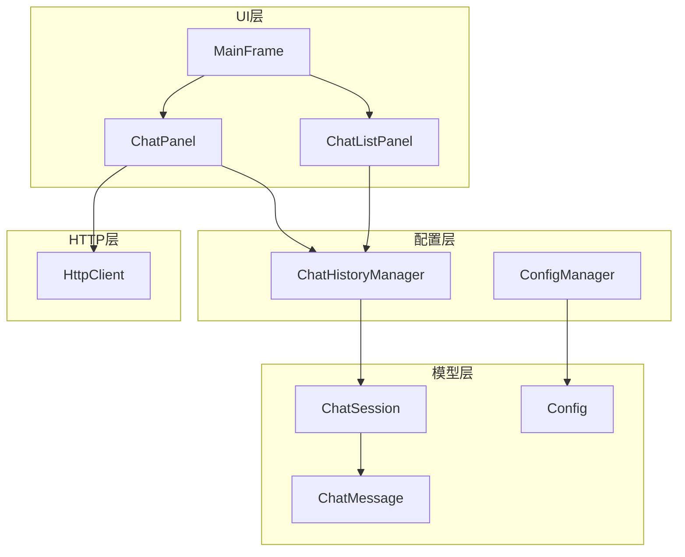
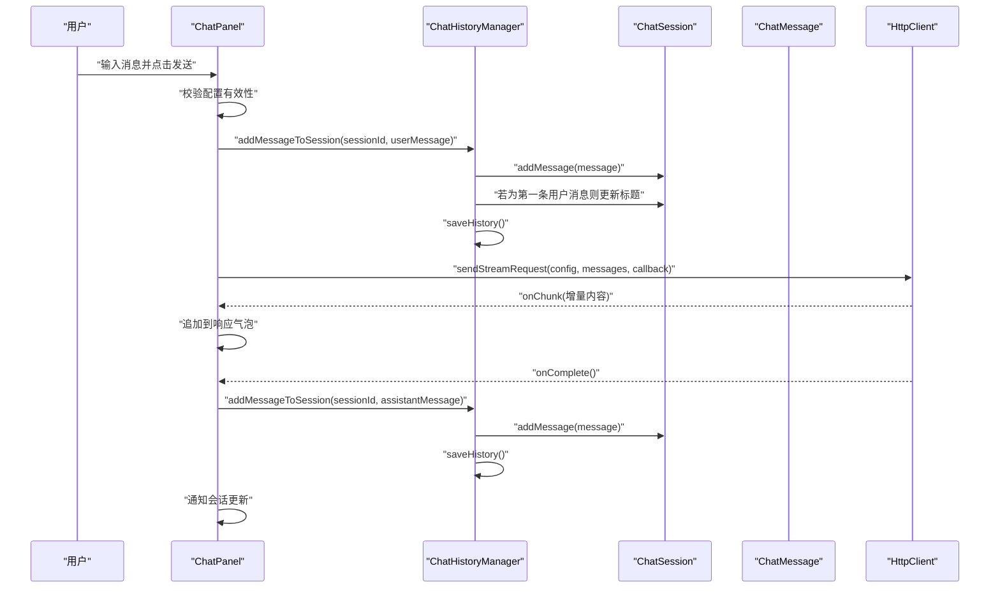
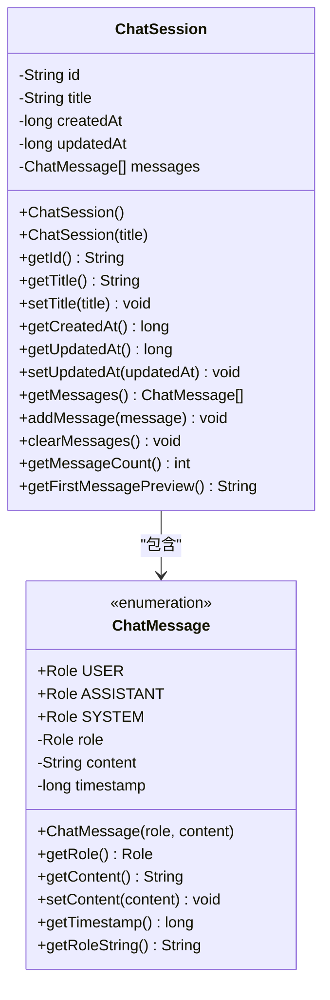
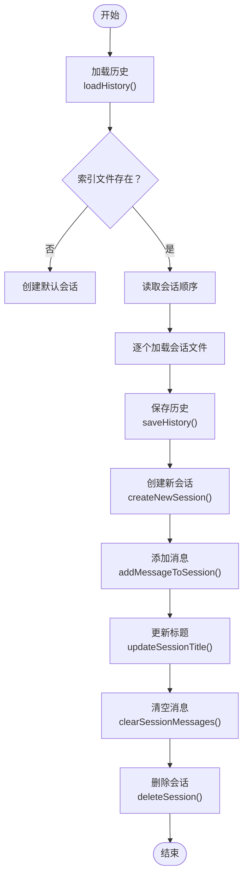
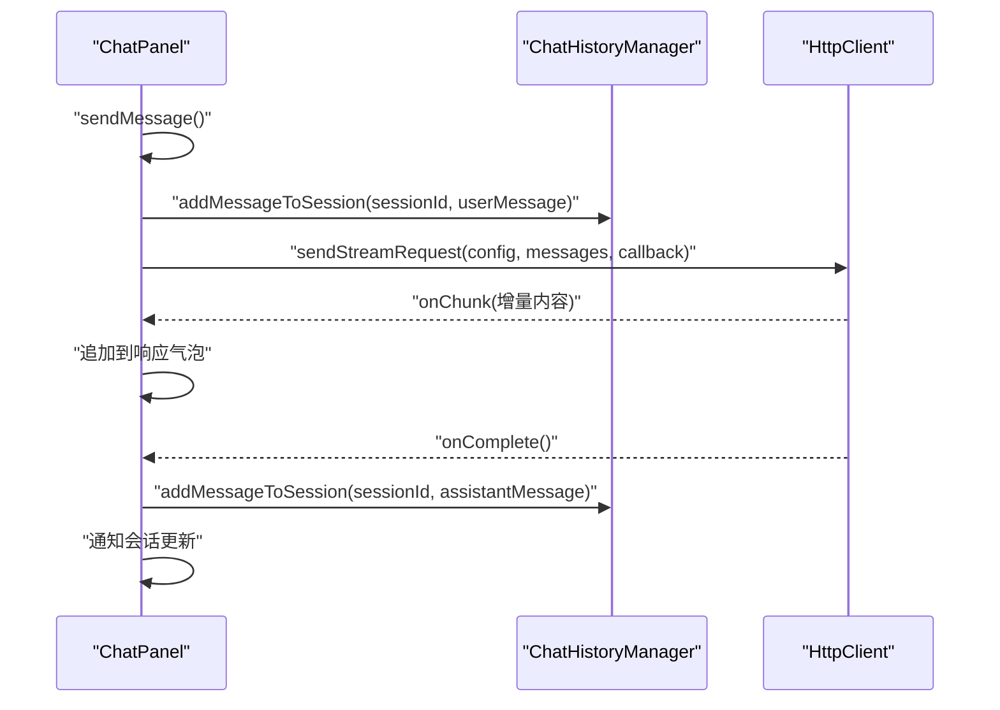
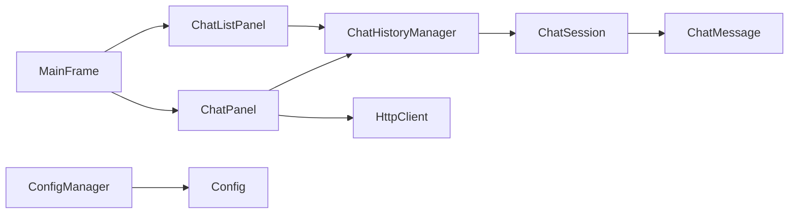

# ChatSession会话模型

<cite>
**本文档引用的文件**
- [ChatSession.java](file://src/com/llmchat/model/ChatSession.java)
- [ChatMessage.java](file://src/com/llmchat/model/ChatMessage.java)
- [ChatHistoryManager.java](file://src/com/llmchat/config/ChatHistoryManager.java)
- [ChatPanel.java](file://src/com/llmchat/ui/ChatPanel.java)
- [MainFrame.java](file://src/com/llmchat/ui/MainFrame.java)
- [ChatListPanel.java](file://src/com/llmchat/ui/components/ChatListPanel.java)
- [HttpClient.java](file://src/com/llmchat/http/HttpClient.java)
- [ConfigManager.java](file://src/com/llmchat/config/ConfigManager.java)
- [Config.java](file://src/com/llmchat/model/Config.java)
</cite>

## 目录
1. [简介](#简介)
2. [项目结构](#项目结构)
3. [核心组件](#核心组件)
4. [架构总览](#架构总览)
5. [详细组件分析](#详细组件分析)
6. [依赖关系分析](#依赖关系分析)
7. [性能考虑](#性能考虑)
8. [故障排除指南](#故障排除指南)
9. [结论](#结论)
10. [附录](#附录)

## 简介
本文件为ChatSession会话模型的全面技术文档，围绕会话实体的设计与实现进行深入剖析。内容涵盖：
- 会话标识符、消息列表、标题生成逻辑与时间戳管理
- 会话生命周期：从创建到销毁的完整流程
- 会话标题自动生成规则与命名策略
- 会话操作API：消息添加、会话切换、清空与删除
- 会话状态管理与持久化机制
- 会话数据的序列化与反序列化实现细节
- 最佳实践与性能优化建议

## 项目结构
该项目采用分层架构，主要分为模型层、配置层、UI层与HTTP通信层：
- 模型层：ChatSession、ChatMessage、Config
- 配置层：ConfigManager、ChatHistoryManager
- UI层：MainFrame、ChatPanel、ChatListPanel及其子组件
- HTTP层：HttpClient（支持流式响应）

图表来源
- [ChatSession.java:1-91](file://src/com/llmchat/model/ChatSession.java#L1-L91)
- [ChatMessage.java:1-44](file://src/com/llmchat/model/ChatMessage.java#L1-L44)
- [ChatHistoryManager.java:1-206](file://src/com/llmchat/config/ChatHistoryManager.java#L1-L206)
- [ChatPanel.java:1-335](file://src/com/llmchat/ui/ChatPanel.java#L1-L335)
- [MainFrame.java:1-177](file://src/com/llmchat/ui/MainFrame.java#L1-L177)
- [ChatListPanel.java:1-241](file://src/com/llmchat/ui/components/ChatListPanel.java#L1-L241)
- [HttpClient.java:1-208](file://src/com/llmchat/http/HttpClient.java#L1-L208)
- [ConfigManager.java:1-101](file://src/com/llmchat/config/ConfigManager.java#L1-L101)
- [Config.java:1-52](file://src/com/llmchat/model/Config.java#L1-L52)

章节来源
- [ChatSession.java:1-91](file://src/com/llmchat/model/ChatSession.java#L1-L91)
- [ChatHistoryManager.java:1-206](file://src/com/llmchat/config/ChatHistoryManager.java#L1-L206)
- [ChatPanel.java:1-335](file://src/com/llmchat/ui/ChatPanel.java#L1-L335)
- [MainFrame.java:1-177](file://src/com/llmchat/ui/MainFrame.java#L1-L177)
- [ChatListPanel.java:1-241](file://src/com/llmchat/ui/components/ChatListPanel.java#L1-L241)
- [HttpClient.java:1-208](file://src/com/llmchat/http/HttpClient.java#L1-L208)
- [ConfigManager.java:1-101](file://src/com/llmchat/config/ConfigManager.java#L1-L101)
- [Config.java:1-52](file://src/com/llmchat/model/Config.java#L1-L52)

## 核心组件
- ChatSession：会话实体，包含会话ID、标题、创建/更新时间戳以及消息列表；提供消息添加、清空、获取首条用户消息预览等方法。
- ChatMessage：消息实体，包含角色（USER、ASSISTANT、SYSTEM）、内容与时间戳。
- ChatHistoryManager：会话持久化管理器，负责会话的加载、保存、创建、删除、标题更新、消息添加与清空，并维护会话顺序。
- ChatPanel：聊天界面核心，负责消息展示、输入处理、与HTTP服务交互、触发会话更新。
- HttpClient：HTTP客户端，支持流式响应，解析SSE格式的数据块。
- Config/ConfigManager：应用配置与持久化，包含API地址、密钥与模型名。

章节来源
- [ChatSession.java:11-91](file://src/com/llmchat/model/ChatSession.java#L11-L91)
- [ChatMessage.java:8-44](file://src/com/llmchat/model/ChatMessage.java#L8-L44)
- [ChatHistoryManager.java:16-206](file://src/com/llmchat/config/ChatHistoryManager.java#L16-L206)
- [ChatPanel.java:21-335](file://src/com/llmchat/ui/ChatPanel.java#L21-L335)
- [HttpClient.java:16-208](file://src/com/llmchat/http/HttpClient.java#L16-L208)
- [Config.java:8-52](file://src/com/llmchat/model/Config.java#L8-L52)
- [ConfigManager.java:14-101](file://src/com/llmchat/config/ConfigManager.java#L14-L101)

## 架构总览
下图展示了从用户输入到会话持久化的端到端流程，包括UI交互、消息构建、HTTP流式响应与会话状态更新。

图表来源
- [ChatPanel.java:189-297](file://src/com/llmchat/ui/ChatPanel.java#L189-L297)
- [ChatHistoryManager.java:169-182](file://src/com/llmchat/config/ChatHistoryManager.java#L169-L182)
- [ChatSession.java:61-69](file://src/com/llmchat/model/ChatSession.java#L61-L69)
- [HttpClient.java:66-127](file://src/com/llmchat/http/HttpClient.java#L66-L127)

## 详细组件分析

### ChatSession会话实体
- 设计要点
  - 标识符：使用UUID生成唯一ID，构造时初始化。
  - 时间戳：createdAt在创建时赋值；updatedAt在消息添加或清空时更新。
  - 标题：默认“新对话”，可通过API更新；也可通过首条用户消息自动推导标题。
  - 消息列表：内部使用ArrayList存储，提供添加、清空与计数方法。
- 标题生成逻辑
  - getFirstMessagePreview：遍历消息，找到第一条用户消息，截取前20字符作为预览；若无用户消息则返回默认标题。
- 生命周期
  - 创建：构造函数初始化ID、标题、时间戳与消息列表。
  - 使用：添加消息、清空消息、查询信息。
  - 销毁：由ChatHistoryManager删除对应文件与索引，不直接在ChatSession中执行。

图表来源
- [ChatSession.java:11-91](file://src/com/llmchat/model/ChatSession.java#L11-L91)
- [ChatMessage.java:8-44](file://src/com/llmchat/model/ChatMessage.java#L8-L44)

章节来源
- [ChatSession.java:11-91](file://src/com/llmchat/model/ChatSession.java#L11-L91)

### ChatHistoryManager会话持久化管理器
- 职责
  - 会话加载与保存：基于索引文件与会话文件的二进制序列化。
  - 会话管理：创建、获取、删除、更新标题、添加消息、清空消息。
  - 顺序维护：使用ConcurrentHashMap与同步列表维护会话顺序。
- 关键流程
  - loadHistory：读取索引文件恢复顺序，逐个加载会话文件；若索引损坏则重建默认会话。
  - saveHistory：写入索引与各会话文件。
  - addMessageToSession：添加消息并在第一条用户消息时自动更新标题。
  - deleteSession：删除文件与索引，确保至少保留一个会话。
- 文件位置
  - 历史目录：用户主目录下的隐藏路径，索引文件与会话文件均为二进制序列化。

图表来源
- [ChatHistoryManager.java:32-65](file://src/com/llmchat/config/ChatHistoryManager.java#L32-L65)
- [ChatHistoryManager.java:70-99](file://src/com/llmchat/config/ChatHistoryManager.java#L70-L99)
- [ChatHistoryManager.java:104-110](file://src/com/llmchat/config/ChatHistoryManager.java#L104-L110)
- [ChatHistoryManager.java:169-182](file://src/com/llmchat/config/ChatHistoryManager.java#L169-L182)
- [ChatHistoryManager.java:187-194](file://src/com/llmchat/config/ChatHistoryManager.java#L187-L194)
- [ChatHistoryManager.java:136-154](file://src/com/llmchat/config/ChatHistoryManager.java#L136-L154)

章节来源
- [ChatHistoryManager.java:16-206](file://src/com/llmchat/config/ChatHistoryManager.java#L16-L206)

### ChatPanel聊天界面与消息处理
- 功能
  - 加载会话：根据当前会话ID从历史管理器获取消息并渲染。
  - 发送消息：构建用户消息，调用历史管理器添加；显示加载状态；发起HTTP流式请求；接收增量内容并追加到响应气泡；完成后保存完整助手消息。
  - 错误处理：请求失败时移除空响应气泡并提示错误。
- 与历史管理器协作
  - sendMessage：调用addMessageToSession；完成后通知会话更新。
  - loadSession：从历史管理器获取消息并刷新UI。
- 与HTTP客户端协作
  - sendStreamRequest：以SSE流方式接收增量内容，回调onChunk追加显示。

图表来源
- [ChatPanel.java:189-297](file://src/com/llmchat/ui/ChatPanel.java#L189-L297)
- [ChatHistoryManager.java:169-182](file://src/com/llmchat/config/ChatHistoryManager.java#L169-L182)
- [HttpClient.java:66-127](file://src/com/llmchat/http/HttpClient.java#L66-L127)

章节来源
- [ChatPanel.java:21-335](file://src/com/llmchat/ui/ChatPanel.java#L21-L335)

### ChatListPanel会话列表组件
- 功能
  - 展示所有会话：标题、消息数量与时间信息。
  - 交互：选择会话、删除会话、新建会话。
  - 回调：通过监听器向父组件(MainFrame)传递事件。
- 与历史管理器协作
  - 列表更新：根据getAllSessions()与当前选中ID刷新UI。
  - 删除确认：弹窗确认后调用deleteSession并刷新。

章节来源
- [ChatListPanel.java:15-241](file://src/com/llmchat/ui/components/ChatListPanel.java#L15-L241)
- [ChatHistoryManager.java:122-131](file://src/com/llmchat/config/ChatHistoryManager.java#L122-L131)
- [ChatHistoryManager.java:136-154](file://src/com/llmchat/config/ChatHistoryManager.java#L136-L154)

### HttpClient流式HTTP客户端
- 功能
  - 构建请求体：将消息列表转换为JSON，包含模型名与消息数组。
  - 发送请求：设置请求头、超时、Authorization与Accept。
  - 流式解析：逐行读取SSE数据，提取content字段并回调onChunk。
  - 错误处理：读取错误流并回调onError。
- 与ChatPanel协作
  - ChatPanel在发送成功后追加完整助手消息并保存至历史。

章节来源
- [HttpClient.java:16-208](file://src/com/llmchat/http/HttpClient.java#L16-L208)

## 依赖关系分析
- 组件耦合
  - ChatPanel依赖ChatHistoryManager与HttpClient，用于会话管理与网络请求。
  - ChatListPanel依赖ChatHistoryManager用于会话列表展示与交互。
  - ChatHistoryManager依赖ChatSession与ChatMessage进行持久化与状态管理。
  - ConfigManager与Config提供配置读写与验证。
- 外部依赖
  - Java标准库（IO、NIO、Swing、网络）。
  - 用户主目录下的历史文件与配置文件。

图表来源
- [ChatPanel.java:44-55](file://src/com/llmchat/ui/ChatPanel.java#L44-L55)
- [ChatListPanel.java:57-79](file://src/com/llmchat/ui/components/ChatListPanel.java#L57-L79)
- [ChatHistoryManager.java:104-110](file://src/com/llmchat/config/ChatHistoryManager.java#L104-L110)
- [ChatSession.java:11-18](file://src/com/llmchat/model/ChatSession.java#L11-L18)
- [ConfigManager.java:20-22](file://src/com/llmchat/config/ConfigManager.java#L20-L22)
- [Config.java:8-13](file://src/com/llmchat/model/Config.java#L8-L13)

章节来源
- [ChatPanel.java:44-55](file://src/com/llmchat/ui/ChatPanel.java#L44-L55)
- [ChatListPanel.java:57-79](file://src/com/llmchat/ui/components/ChatListPanel.java#L57-L79)
- [ChatHistoryManager.java:104-110](file://src/com/llmchat/config/ChatHistoryManager.java#L104-L110)
- [ChatSession.java:11-18](file://src/com/llmchat/model/ChatSession.java#L11-L18)
- [ConfigManager.java:20-22](file://src/com/llmchat/config/ConfigManager.java#L20-L22)
- [Config.java:8-13](file://src/com/llmchat/model/Config.java#L8-L13)

## 性能考虑
- IO与并发
  - 使用ConcurrentHashMap与同步列表维护会话顺序，降低锁竞争。
  - 会话文件与索引文件采用二进制序列化，读写效率高。
- UI渲染
  - 消息滚动：每次新增消息后滚动到底部，避免频繁重绘。
  - 流式显示：增量内容逐块追加，减少一次性大对象渲染。
- 网络请求
  - SSE流式响应：边接收边显示，降低等待时间。
  - 超时设置：连接与读取超时合理配置，避免阻塞。
- 数据结构
  - 消息列表使用ArrayList，适合频繁追加与顺序访问。
- 建议
  - 大量会话场景下可考虑延迟加载与缓存最近会话。
  - 对于长对话，可在UI层限制显示的消息数量以提升性能。

[本节为通用性能建议，无需特定文件引用]

## 故障排除指南
- 会话无法加载
  - 检查历史目录是否存在与权限是否正确。
  - 若索引文件损坏，系统会自动重建默认会话。
- 保存失败
  - 查看控制台错误日志，确认磁盘空间与权限。
- 请求失败
  - 检查配置中的API地址、密钥与模型名是否有效。
  - 网络异常或API返回非200状态码时，客户端会回调错误并提示。
- 删除会话后无会话
  - 删除最后一个会话时会自动创建新会话，确保始终有可用会话。

章节来源
- [ChatHistoryManager.java:32-65](file://src/com/llmchat/config/ChatHistoryManager.java#L32-L65)
- [ChatHistoryManager.java:95-99](file://src/com/llmchat/config/ChatHistoryManager.java#L95-L99)
- [ChatPanel.java:195-202](file://src/com/llmchat/ui/ChatPanel.java#L195-L202)
- [HttpClient.java:88-93](file://src/com/llmchat/http/HttpClient.java#L88-L93)

## 结论
ChatSession会话模型通过清晰的实体设计与完善的持久化机制，实现了从创建、使用到销毁的完整生命周期管理。结合ChatHistoryManager的有序存储与ChatPanel的流式交互，系统在易用性与性能之间取得了良好平衡。遵循本文档的最佳实践与优化建议，可进一步提升系统的稳定性与用户体验。

[本节为总结性内容，无需特定文件引用]

## 附录

### 会话标题自动生成规则与命名策略
- 自动生成条件：当第一条消息为用户消息时，标题自动设为首条用户消息的前20个字符（含省略号）。
- 默认标题：若无用户消息，则标题为“新对话”。
- 手动更新：通过历史管理器的标题更新接口可手动修改标题。

章节来源
- [ChatSession.java:75-89](file://src/com/llmchat/model/ChatSession.java#L75-L89)
- [ChatHistoryManager.java:159-165](file://src/com/llmchat/config/ChatHistoryManager.java#L159-L165)

### 会话操作API说明
- 创建会话
  - 接口：createNewSession()
  - 行为：创建新会话并置于顺序首位，保存历史。
- 获取会话
  - 接口：getSession(sessionId)
  - 行为：根据ID获取会话对象。
- 获取全部会话
  - 接口：getAllSessions()
  - 行为：按顺序返回会话列表。
- 删除会话
  - 接口：deleteSession(sessionId)
  - 行为：删除对应文件与索引，若无会话则创建默认会话。
- 更新标题
  - 接口：updateSessionTitle(sessionId, title)
  - 行为：更新会话标题并保存历史。
- 添加消息
  - 接口：addMessageToSession(sessionId, message)
  - 行为：添加消息并自动更新标题（第一条用户消息时）。
- 清空消息
  - 接口：clearSessionMessages(sessionId)
  - 行为：清空消息并重置标题为“新对话”。

章节来源
- [ChatHistoryManager.java:104-110](file://src/com/llmchat/config/ChatHistoryManager.java#L104-L110)
- [ChatHistoryManager.java:115-117](file://src/com/llmchat/config/ChatHistoryManager.java#L115-L117)
- [ChatHistoryManager.java:122-131](file://src/com/llmchat/config/ChatHistoryManager.java#L122-L131)
- [ChatHistoryManager.java:136-154](file://src/com/llmchat/config/ChatHistoryManager.java#L136-L154)
- [ChatHistoryManager.java:159-165](file://src/com/llmchat/config/ChatHistoryManager.java#L159-L165)
- [ChatHistoryManager.java:169-182](file://src/com/llmchat/config/ChatHistoryManager.java#L169-L182)
- [ChatHistoryManager.java:187-194](file://src/com/llmchat/config/ChatHistoryManager.java#L187-L194)

### 会话状态管理与持久化机制
- 状态字段
  - ID：唯一标识符
  - 标题：用户可见名称
  - 时间戳：创建与最后更新时间
  - 消息列表：会话内容
- 持久化策略
  - 索引文件：记录会话ID顺序
  - 会话文件：每个会话独立文件，包含完整会话对象
  - 保存时机：创建、删除、标题更新、消息添加/清空后自动保存
- 并发与一致性
  - 使用ConcurrentHashMap与同步列表保证多线程安全
  - 单个会话文件读写采用对象序列化，保证原子性

章节来源
- [ChatHistoryManager.java:17-27](file://src/com/llmchat/config/ChatHistoryManager.java#L17-L27)
- [ChatHistoryManager.java:70-99](file://src/com/llmchat/config/ChatHistoryManager.java#L70-L99)
- [ChatSession.java:14-18](file://src/com/llmchat/model/ChatSession.java#L14-L18)

### 会话数据的序列化与反序列化实现细节
- 序列化目标
  - ChatSession与ChatMessage均实现Serializable接口
  - Config与ConfigManager同样实现Serializable，用于配置持久化
- 实现方式
  - 使用ObjectOutputStream/ObjectInputStream进行二进制序列化
  - 索引文件保存会话ID顺序列表，会话文件保存完整会话对象
- 容错处理
  - 单个会话加载失败时跳过该会话并更新顺序
  - 索引文件损坏时重建默认会话

章节来源
- [ChatSession.java:3-6](file://src/com/llmchat/model/ChatSession.java#L3-L6)
- [ChatMessage.java:3-4](file://src/com/llmchat/model/ChatMessage.java#L3-L4)
- [Config.java:3-4](file://src/com/llmchat/model/Config.java#L3-L4)
- [ConfigManager.java:20-39](file://src/com/llmchat/config/ConfigManager.java#L20-L39)
- [ChatHistoryManager.java:35-59](file://src/com/llmchat/config/ChatHistoryManager.java#L35-L59)

### 最佳实践与性能优化建议
- UI层面
  - 控制消息数量上限，避免过多渲染导致卡顿
  - 使用增量渲染与滚动定位，提升交互体验
- 存储层面
  - 合理安排保存频率，避免频繁IO
  - 大会话建议定期备份索引与会话文件
- 网络层面
  - 合理设置超时参数，避免长时间阻塞
  - 对错误进行分类处理，提供明确的用户反馈
- 代码层面
  - 将业务逻辑集中在ChatHistoryManager中，保持UI简洁
  - 使用回调与监听器解耦UI与业务层

[本节为通用最佳实践建议，无需特定文件引用]