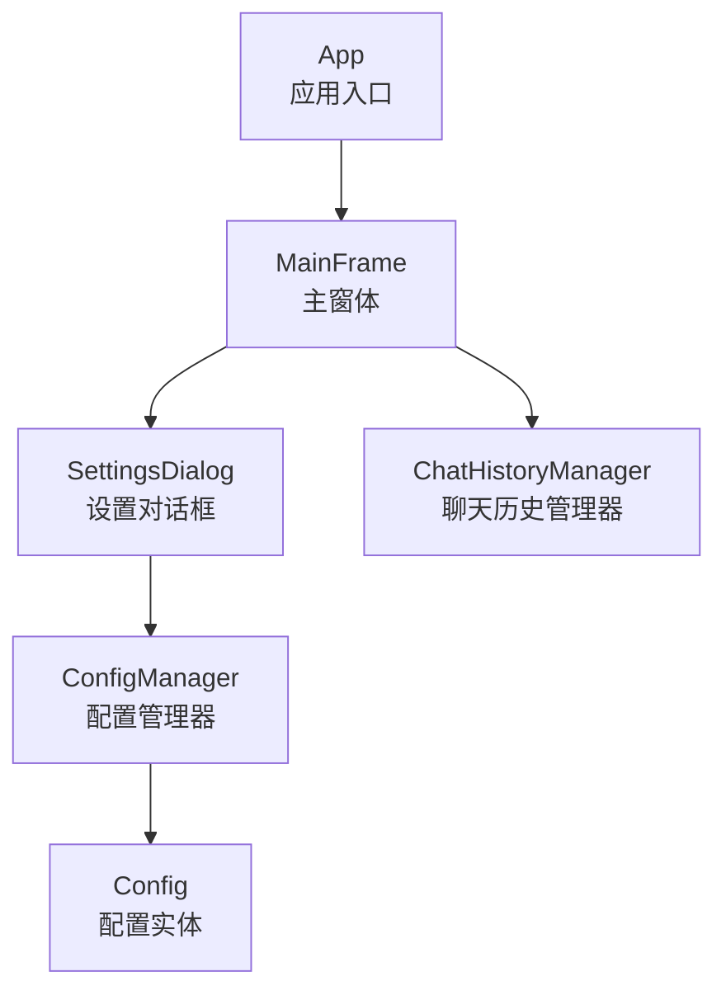
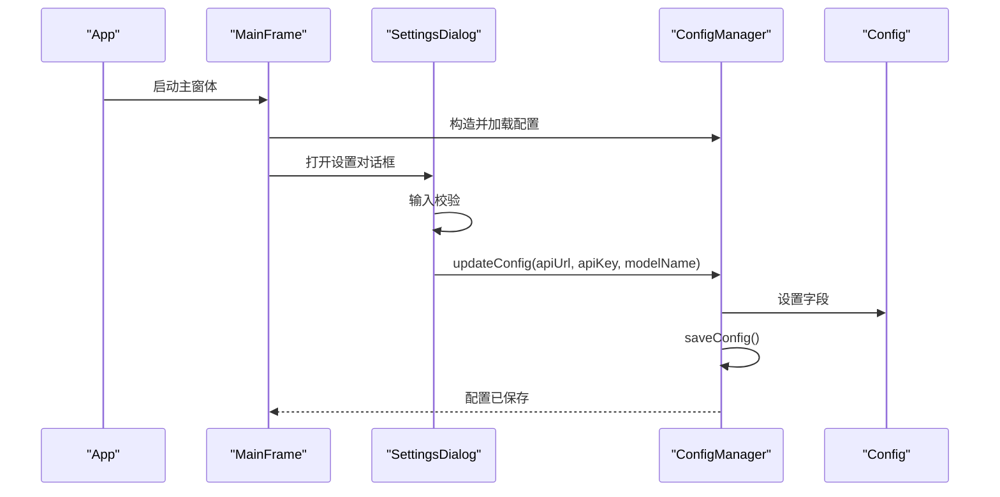
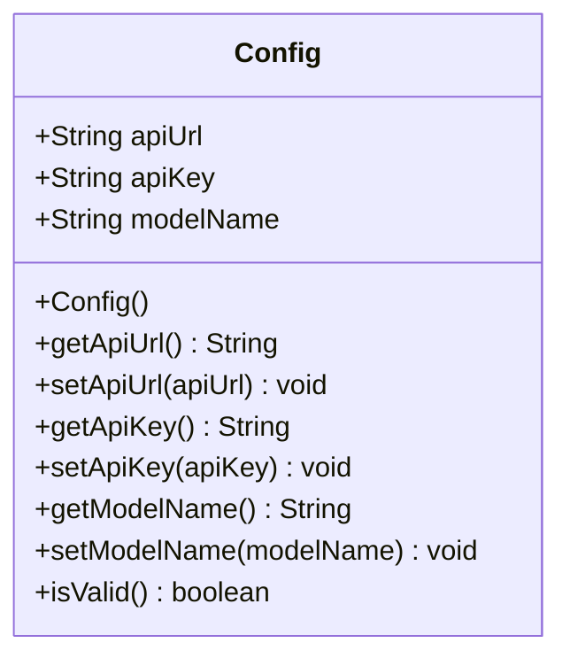
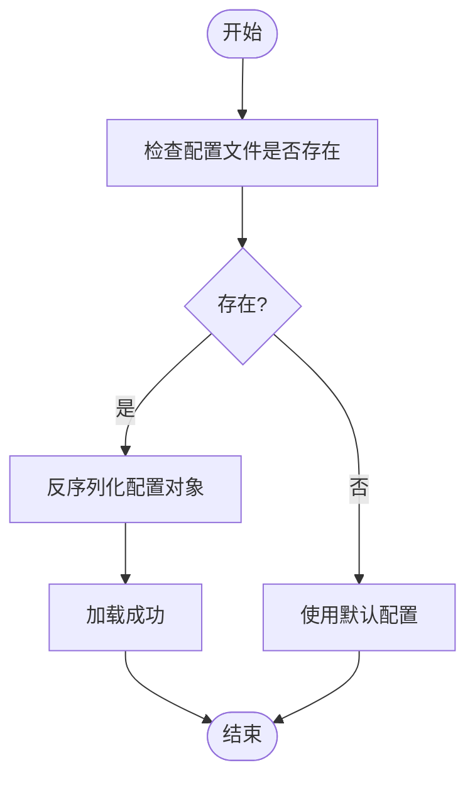
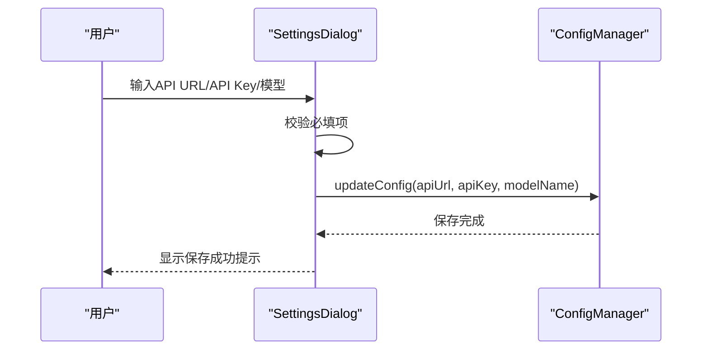
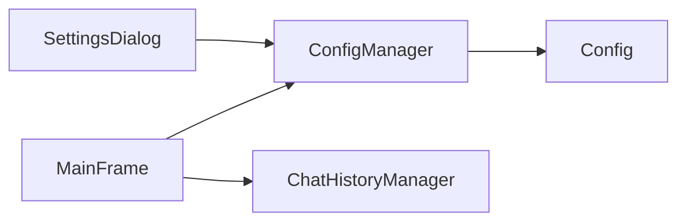

# Config配置模型

<cite>
**本文引用的文件**
- [Config.java](file://src/com/llmchat/model/Config.java)
- [ConfigManager.java](file://src/com/llmchat/config/ConfigManager.java)
- [SettingsDialog.java](file://src/com/llmchat/ui/SettingsDialog.java)
- [MainFrame.java](file://src/com/llmchat/ui/MainFrame.java)
- [App.java](file://src/com/llmchat/App.java)
- [ChatHistoryManager.java](file://src/com/llmchat/config/ChatHistoryManager.java)
</cite>

## 目录
1. [简介](#简介)
2. [项目结构](#项目结构)
3. [核心组件](#核心组件)
4. [架构总览](#架构总览)
5. [详细组件分析](#详细组件分析)
6. [依赖分析](#依赖分析)
7. [性能考量](#性能考量)
8. [故障排查指南](#故障排查指南)
9. [结论](#结论)
10. [附录](#附录)

## 简介
本文件面向“Config配置模型”的使用者与维护者，系统性说明配置实体的字段定义、默认值与校验规则；文档化配置的加载与保存机制（文件格式、存储位置）；提供配置更新与修改的完整API说明；解释安全存储与敏感信息保护措施；给出配置迁移与版本兼容策略建议；并提供配置模板与示例，帮助用户正确设置各项参数及理解配置变更对应用行为的影响与重启需求。

## 项目结构
围绕配置模型的关键模块如下：
- 配置数据模型：Config
- 配置管理器：ConfigManager（负责加载/保存/更新配置）
- 用户界面：SettingsDialog（图形化配置编辑）
- 应用入口：App（启动流程）
- 主窗体：MainFrame（承载设置入口）
- 历史记录管理：ChatHistoryManager（独立持久化，与配置同属本地存储）

图表来源
- [App.java:12-25](file://src/com/llmchat/App.java#L12-L25)
- [MainFrame.java:118-125](file://src/com/llmchat/ui/MainFrame.java#L118-L125)
- [SettingsDialog.java:27-37](file://src/com/llmchat/ui/SettingsDialog.java#L27-L37)
- [ConfigManager.java:14-22](file://src/com/llmchat/config/ConfigManager.java#L14-L22)
- [Config.java:8-51](file://src/com/llmchat/model/Config.java#L8-L51)
- [ChatHistoryManager.java:16-27](file://src/com/llmchat/config/ChatHistoryManager.java#L16-L27)

章节来源
- [App.java:12-25](file://src/com/llmchat/App.java#L12-L25)
- [MainFrame.java:30-36](file://src/com/llmchat/ui/MainFrame.java#L30-L36)
- [SettingsDialog.java:27-37](file://src/com/llmchat/ui/SettingsDialog.java#L27-L37)
- [ConfigManager.java:14-22](file://src/com/llmchat/config/ConfigManager.java#L14-L22)
- [Config.java:8-51](file://src/com/llmchat/model/Config.java#L8-L51)
- [ChatHistoryManager.java:16-27](file://src/com/llmchat/config/ChatHistoryManager.java#L16-L27)

## 核心组件
- 配置实体（Config）
  - 字段：API端点URL、API密钥、模型名称
  - 默认值：API端点URL指向OpenAI官方地址；API密钥为空字符串；模型名称为常用模型标识
  - 校验：提供isValid方法，要求三者均非空
- 配置管理器（ConfigManager）
  - 存储位置：当前工作目录下的隐藏文件夹内，配置文件名为固定名
  - 文件格式：Java序列化对象（二进制）
  - 加载/保存：构造时自动加载；saveConfig显式保存；updateConfig原子性地更新并保存
  - 安全：提供API Key的简单Base64编解码辅助方法（非强加密）
- 设置对话框（SettingsDialog）
  - UI：输入API URL、密码域输入API Key、下拉选择或自定义模型名称
  - 校验：保存前进行必填校验，提示错误
  - 交互：调用ConfigManager.updateConfig完成持久化

章节来源
- [Config.java:15-50](file://src/com/llmchat/model/Config.java#L15-L50)
- [ConfigManager.java:15-58](file://src/com/llmchat/config/ConfigManager.java#L15-L58)
- [ConfigManager.java:70-75](file://src/com/llmchat/config/ConfigManager.java#L70-L75)
- [SettingsDialog.java:216-248](file://src/com/llmchat/ui/SettingsDialog.java#L216-L248)

## 架构总览
配置在应用生命周期中的流转如下：
- 应用启动：App初始化UI，MainFrame创建ConfigManager并加载配置
- 用户操作：MainFrame显示设置入口，打开SettingsDialog
- 配置编辑：SettingsDialog收集输入，执行本地校验，调用ConfigManager.updateConfig
- 持久化：ConfigManager保存到本地文件
- 生效：后续业务逻辑读取ConfigManager.getConfig()获取最新配置

图表来源
- [App.java:21-24](file://src/com/llmchat/App.java#L21-L24)
- [MainFrame.java:122-125](file://src/com/llmchat/ui/MainFrame.java#L122-L125)
- [SettingsDialog.java:216-248](file://src/com/llmchat/ui/SettingsDialog.java#L216-L248)
- [ConfigManager.java:70-75](file://src/com/llmchat/config/ConfigManager.java#L70-L75)
- [ConfigManager.java:44-58](file://src/com/llmchat/config/ConfigManager.java#L44-L58)

## 详细组件分析

### 配置实体（Config）
- 字段定义
  - API端点URL：用于请求大模型服务的HTTP接口地址
  - API密钥：访问令牌，用于鉴权
  - 模型名称：请求时使用的模型标识
- 默认值
  - API端点URL：指向OpenAI官方Chat Completions接口
  - API密钥：空字符串（需用户填写）
  - 模型名称：常用模型标识
- 校验规则
  - isValid要求三者均非空，否则视为不完整配置
- 典型用途
  - 作为ConfigManager内部持有的不可变配置快照
  - 供上层业务组件读取以决定请求目标与参数

图表来源
- [Config.java:11-44](file://src/com/llmchat/model/Config.java#L11-L44)

章节来源
- [Config.java:15-50](file://src/com/llmchat/model/Config.java#L15-L50)

### 配置管理器（ConfigManager）
- 存储位置与文件格式
  - 目录：当前工作目录下的隐藏文件夹
  - 文件：固定文件名，采用Java序列化（二进制）
- 加载机制
  - 若存在配置文件则反序列化；否则使用默认配置
  - 异常兜底：加载失败时回退到默认配置
- 保存机制
  - 保证目录存在；写入序列化对象
  - 异常捕获并打印堆栈（便于定位问题）
- 更新API
  - updateConfig：批量更新并立即保存
- 安全与敏感信息
  - 提供API Key的Base64编解码辅助方法（仅简单编码/解码，非强加密）
  - 建议：在更高安全场景下应采用更强的加密方案与密钥管理服务

图表来源
- [ConfigManager.java:27-39](file://src/com/llmchat/config/ConfigManager.java#L27-L39)

章节来源
- [ConfigManager.java:15-58](file://src/com/llmchat/config/ConfigManager.java#L15-L58)
- [ConfigManager.java:70-75](file://src/com/llmchat/config/ConfigManager.java#L70-L75)
- [ConfigManager.java:80-99](file://src/com/llmchat/config/ConfigManager.java#L80-L99)

### 设置对话框（SettingsDialog）
- 功能要点
  - 图形化输入API URL、API Key、模型名称
  - 下拉预设模型列表，支持“自定义”模式
  - 本地必填校验：API URL、API Key、模型名称均不能为空
  - 保存后通过ConfigManager.updateConfig持久化
- 用户体验
  - 使用密码域输入API Key，避免明文显示
  - 成功保存后弹出确认提示

图表来源
- [SettingsDialog.java:216-248](file://src/com/llmchat/ui/SettingsDialog.java#L216-L248)
- [ConfigManager.java:70-75](file://src/com/llmchat/config/ConfigManager.java#L70-L75)

章节来源
- [SettingsDialog.java:67-103](file://src/com/llmchat/ui/SettingsDialog.java#L67-L103)
- [SettingsDialog.java:120-169](file://src/com/llmchat/ui/SettingsDialog.java#L120-L169)
- [SettingsDialog.java:187-214](file://src/com/llmchat/ui/SettingsDialog.java#L187-L214)
- [SettingsDialog.java:216-248](file://src/com/llmchat/ui/SettingsDialog.java#L216-L248)

### 主窗体与入口（MainFrame/App）
- 主窗体负责创建ConfigManager并将其注入到需要的组件
- 设置按钮触发SettingsDialog展示与配置更新
- 应用入口设置系统外观并启动主窗体

章节来源
- [MainFrame.java:30-36](file://src/com/llmchat/ui/MainFrame.java#L30-L36)
- [MainFrame.java:118-125](file://src/com/llmchat/ui/MainFrame.java#L118-L125)
- [App.java:12-25](file://src/com/llmchat/App.java#L12-L25)

## 依赖分析
- ConfigManager依赖Config（组合关系）
- SettingsDialog依赖ConfigManager（依赖关系）
- MainFrame依赖ConfigManager（组合关系），并作为UI入口
- ChatHistoryManager独立于ConfigManager，但同属本地持久化组件

图表来源
- [ConfigManager.java:3](file://src/com/llmchat/config/ConfigManager.java#L3)
- [SettingsDialog.java:3-4](file://src/com/llmchat/ui/SettingsDialog.java#L3-L4)
- [MainFrame.java:24-25](file://src/com/llmchat/ui/MainFrame.java#L24-L25)
- [ChatHistoryManager.java:1](file://src/com/llmchat/config/ChatHistoryManager.java#L1)

章节来源
- [ConfigManager.java:3](file://src/com/llmchat/config/ConfigManager.java#L3)
- [SettingsDialog.java:3-4](file://src/com/llmchat/ui/SettingsDialog.java#L3-L4)
- [MainFrame.java:24-25](file://src/com/llmchat/ui/MainFrame.java#L24-L25)
- [ChatHistoryManager.java:1](file://src/com/llmchat/config/ChatHistoryManager.java#L1)

## 性能考量
- 配置加载/保存采用Java序列化，I/O开销较小，适合轻量配置
- 读取路径为内存对象，访问成本低
- 若未来配置体量增大或需要跨平台/跨语言互通，可考虑改用JSON/YAML等文本格式，并引入Schema校验与版本控制

## 故障排查指南
- 配置无法加载
  - 检查配置文件是否存在且可读
  - 查看异常日志（保存时会打印堆栈）
  - 若文件损坏，将回退到默认配置
- 保存失败
  - 检查当前工作目录权限
  - 确认磁盘空间充足
- API Key无效
  - 确认输入是否为空
  - 若使用外部服务，请确保密钥未过期
- 配置未生效
  - 确认已点击“保存”
  - 应用重启后生效（当前实现为进程内配置，重启后重新加载）

章节来源
- [ConfigManager.java:33-35](file://src/com/llmchat/config/ConfigManager.java#L33-L35)
- [ConfigManager.java:55-57](file://src/com/llmchat/config/ConfigManager.java#L55-L57)
- [SettingsDialog.java:228-241](file://src/com/llmchat/ui/SettingsDialog.java#L228-L241)

## 结论
Config配置模型提供了简洁明确的字段与默认值，配合ConfigManager的本地持久化能力，满足基本的配置管理需求。SettingsDialog提供了直观的图形化编辑体验。当前实现以Java序列化为基础，具备易用性与可维护性，但在安全性与跨平台兼容方面有进一步优化空间。建议在生产环境中增强密钥保护与配置格式标准化，并建立版本迁移策略。

## 附录

### 配置字段定义与默认值
- 字段
  - API端点URL：字符串，用于请求大模型服务
  - API密钥：字符串，用于鉴权
  - 模型名称：字符串，用于指定模型标识
- 默认值
  - API端点URL：指向OpenAI官方Chat Completions接口
  - API密钥：空字符串
  - 模型名称：常用模型标识

章节来源
- [Config.java:17-19](file://src/com/llmchat/model/Config.java#L17-L19)

### 配置校验规则
- 必填校验：API端点URL、API密钥、模型名称均不能为空
- 实体级校验：isValid返回三者均非空时为有效

章节来源
- [SettingsDialog.java:228-241](file://src/com/llmchat/ui/SettingsDialog.java#L228-L241)
- [Config.java:46-50](file://src/com/llmchat/model/Config.java#L46-L50)

### 配置加载与保存机制
- 加载
  - 构造ConfigManager时自动尝试从本地文件加载
  - 加载失败或文件不存在时回退到默认配置
- 保存
  - saveConfig确保目录存在并写入序列化对象
  - updateConfig在更新后立即保存

章节来源
- [ConfigManager.java:27-39](file://src/com/llmchat/config/ConfigManager.java#L27-L39)
- [ConfigManager.java:44-58](file://src/com/llmchat/config/ConfigManager.java#L44-L58)
- [ConfigManager.java:70-75](file://src/com/llmchat/config/ConfigManager.java#L70-L75)

### 配置更新与修改API
- 获取配置：getConfig()
- 更新配置：updateConfig(apiUrl, apiKey, modelName)
- 保存配置：saveConfig()

章节来源
- [ConfigManager.java:63-65](file://src/com/llmchat/config/ConfigManager.java#L63-L65)
- [ConfigManager.java:70-75](file://src/com/llmchat/config/ConfigManager.java#L70-L75)
- [ConfigManager.java:44-58](file://src/com/llmchat/config/ConfigManager.java#L44-L58)

### 安全存储与敏感信息保护
- 当前实现
  - API Key提供Base64编解码辅助方法（仅为简单编码）
- 建议
  - 在高安全场景下采用强加密算法与密钥管理系统
  - 避免将敏感信息长期驻留内存或明文落盘
  - 对配置文件设置最小权限访问

章节来源
- [ConfigManager.java:80-99](file://src/com/llmchat/config/ConfigManager.java#L80-L99)

### 配置迁移与版本兼容
- 当前实现
  - 采用Java序列化，版本升级可能带来兼容风险
- 建议
  - 迁移到JSON/YAML等文本格式，增加Schema校验
  - 引入版本号字段与迁移脚本，逐步升级旧配置
  - 保留向后兼容的字段映射与默认值

### 配置模板与示例
- 示例模板（字段与含义）
  - api端点URL：用于请求大模型服务的HTTP接口地址
  - API密钥：访问令牌，用于鉴权
  - 模型名称：请求时使用的模型标识
- 示例值
  - api端点URL：指向OpenAI官方Chat Completions接口
  - API密钥：用户自有密钥
  - 模型名称：常用模型标识

章节来源
- [Config.java:17-19](file://src/com/llmchat/model/Config.java#L17-L19)
- [SettingsDialog.java:130-137](file://src/com/llmchat/ui/SettingsDialog.java#L130-L137)

### 配置变更对应用行为的影响与重启需求
- 行为影响
  - 更改API端点URL会影响请求路由
  - 更改API密钥会影响鉴权结果
  - 更改模型名称会影响请求参数
- 重启需求
  - 当前实现为进程内配置，重启后重新加载
  - 建议在设置对话框保存后提示用户重启以确保完全生效

章节来源
- [SettingsDialog.java:246-247](file://src/com/llmchat/ui/SettingsDialog.java#L246-L247)
- [ConfigManager.java:20-22](file://src/com/llmchat/config/ConfigManager.java#L20-L22)