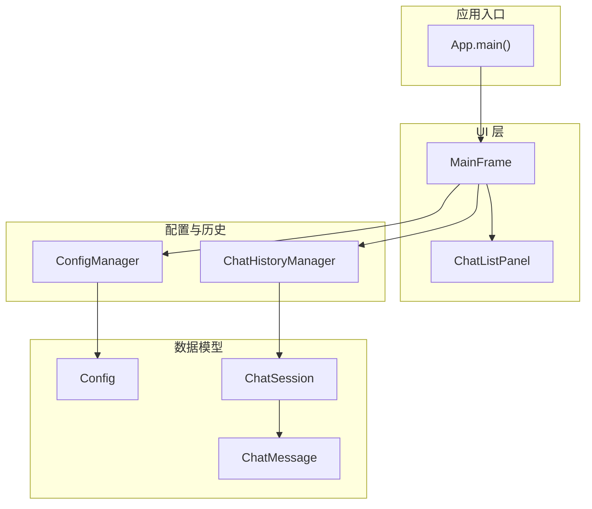
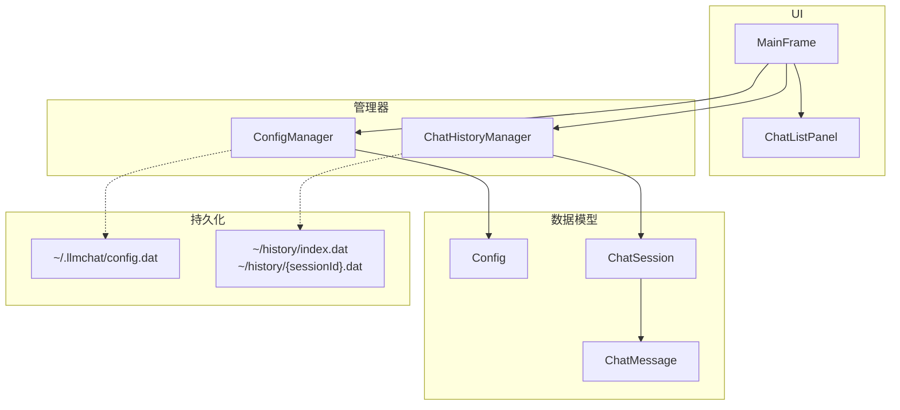
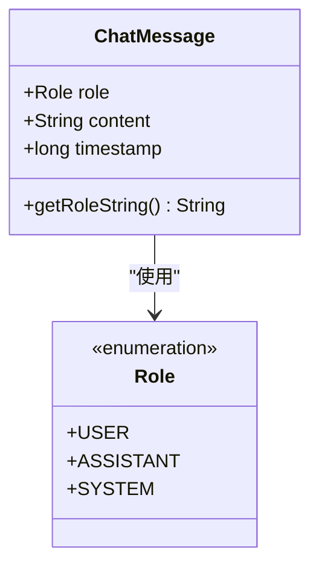
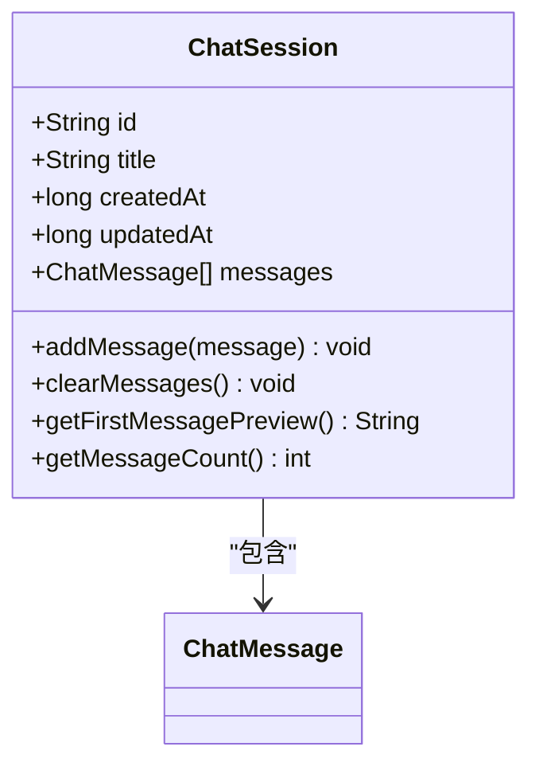
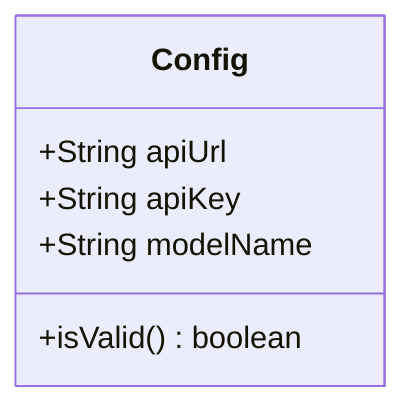
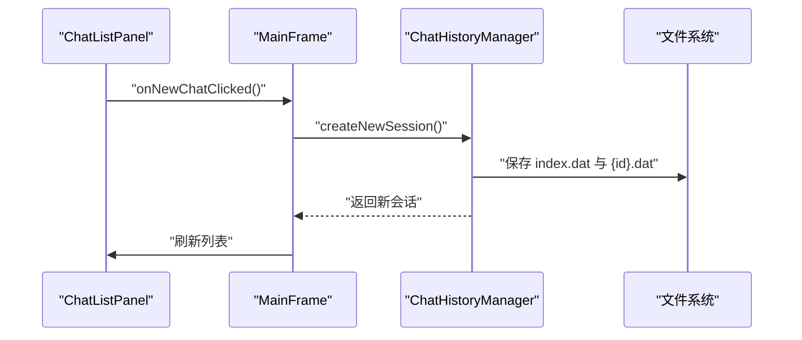
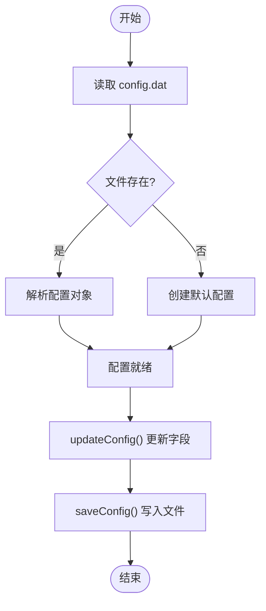
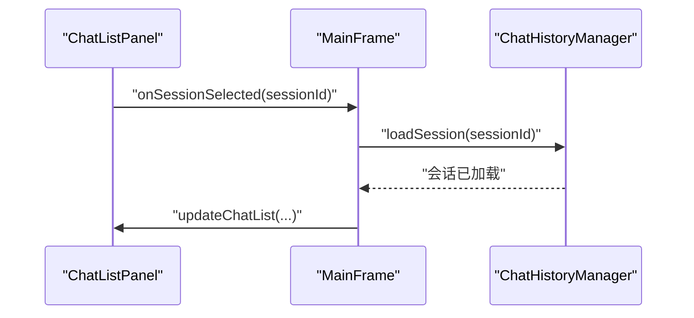
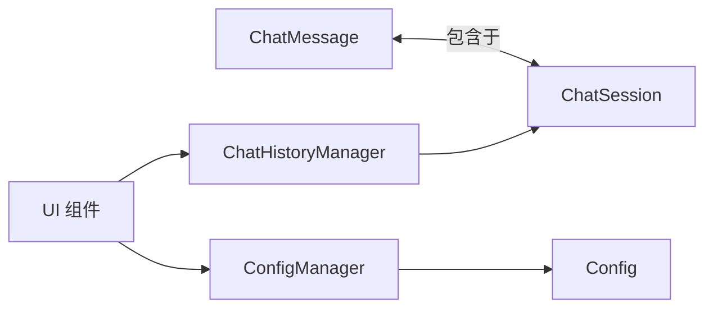

# 数据模型

<cite>
**本文引用的文件**
- [ChatMessage.java](file://src/com/llmchat/model/ChatMessage.java)
- [ChatSession.java](file://src/com/llmchat/model/ChatSession.java)
- [Config.java](file://src/com/llmchat/model/Config.java)
- [ChatHistoryManager.java](file://src/com/llmchat/config/ChatHistoryManager.java)
- [ConfigManager.java](file://src/com/llmchat/config/ConfigManager.java)
- [ChatListPanel.java](file://src/com/llmchat/ui/components/ChatListPanel.java)
- [MainFrame.java](file://src/com/llmchat/ui/MainFrame.java)
- [App.java](file://src/com/llmchat/App.java)
</cite>

## 目录
1. [简介](#简介)
2. [项目结构](#项目结构)
3. [核心数据模型](#核心数据模型)
4. [架构总览](#架构总览)
5. [详细组件分析](#详细组件分析)
6. [依赖关系分析](#依赖关系分析)
7. [性能与缓存策略](#性能与缓存策略)
8. [数据生命周期与保留策略](#数据生命周期与保留策略)
9. [迁移与版本管理](#迁移与版本管理)
10. [数据安全与隐私](#数据安全与隐私)
11. [序列化与反序列化](#序列化与反序列化)
12. [故障排查指南](#故障排查指南)
13. [结论](#结论)

## 简介
本文件面向 Java LLM 聊天界面项目的“数据模型”主题，系统性梳理并文档化以下核心数据模型：ChatMessage、ChatSession、Config；阐明它们之间的实体关系、字段定义与数据类型；说明主键/外键、索引与约束；解释数据验证与业务规则；给出数据库模式图与示例数据；覆盖数据访问模式、缓存策略与性能考量；明确数据生命周期、保留策略与归档规则；提供迁移路径与版本管理建议；落实数据安全、隐私与访问控制；最后给出序列化与反序列化的实现细节。

## 项目结构
该项目采用基于包的模块化组织方式，数据模型位于 model 包，配置与历史管理位于 config 包，UI 组件位于 ui 包及子包 components。应用入口在 App 类，主窗口 MainFrame 聚合配置与历史管理器，并驱动 UI 展示与交互。

图表来源
- [App.java:12-25](file://src/com/llmchat/App.java#L12-L25)
- [MainFrame.java:30-36](file://src/com/llmchat/ui/MainFrame.java#L30-L36)
- [ChatHistoryManager.java:16-27](file://src/com/llmchat/config/ChatHistoryManager.java#L16-L27)
- [ConfigManager.java:14-22](file://src/com/llmchat/config/ConfigManager.java#L14-L22)
- [ChatSession.java:11-26](file://src/com/llmchat/model/ChatSession.java#L11-L26)
- [ChatMessage.java:8-22](file://src/com/llmchat/model/ChatMessage.java#L8-L22)
- [Config.java:8-20](file://src/com/llmchat/model/Config.java#L8-L20)

章节来源
- [App.java:12-25](file://src/com/llmchat/App.java#L12-L25)
- [MainFrame.java:30-36](file://src/com/llmchat/ui/MainFrame.java#L30-L36)

## 核心数据模型
本节对三个核心数据模型进行字段定义、数据类型、验证规则与业务规则的说明。

- ChatMessage
  - 字段与类型
    - role: 枚举，取值范围为 USER、ASSISTANT、SYSTEM
    - content: 字符串
    - timestamp: 长整型（毫秒时间戳）
  - 关键方法
    - getRoleString(): 返回小写的 role 名称字符串
  - 验证与业务规则
    - content 不应为空或仅空白字符（由上层调用保证）
    - timestamp 由构造函数自动填充，表示消息创建时间
  - 序列化
    - 实现 Serializable 接口，支持对象序列化

- ChatSession
  - 字段与类型
    - id: 字符串（UUID）
    - title: 字符串
    - createdAt: 长整型（毫秒时间戳）
    - updatedAt: 长整型（毫秒时间戳）
    - messages: 列表，元素类型为 ChatMessage
  - 关键方法
    - addMessage(message): 追加消息并更新 updatedAt
    - clearMessages(): 清空消息并更新 updatedAt
    - getFirstMessagePreview(): 从第一条用户消息提取预览文本作为标题
    - getMessageCount(): 返回消息数量
  - 验证与业务规则
    - id 由构造函数生成，确保唯一性
    - title 默认值为“新对话”，当第一条用户消息到达时可被替换为预览
    - createdAt/updatedAt 由构造与变更操作维护
  - 序列化
    - 实现 Serializable 接口，支持对象序列化

- Config
  - 字段与类型
    - apiUrl: 字符串
    - apiKey: 字符串
    - modelName: 字符串
  - 关键方法
    - isValid(): 当 apiUrl、apiKey、modelName 均非空且非空字符串时返回真
  - 验证与业务规则
    - isValid() 用于校验配置完整性
    - 提供默认值（构造函数），便于首次使用
  - 序列化
    - 实现 Serializable 接口，支持对象序列化

章节来源
- [ChatMessage.java:8-43](file://src/com/llmchat/model/ChatMessage.java#L8-L43)
- [ChatSession.java:11-90](file://src/com/llmchat/model/ChatSession.java#L11-L90)
- [Config.java:8-51](file://src/com/llmchat/model/Config.java#L8-L51)

## 架构总览
下图展示数据模型与管理器、UI 的整体交互关系，以及持久化存储位置。

图表来源
- [ChatHistoryManager.java:17-18](file://src/com/llmchat/config/ChatHistoryManager.java#L17-L18)
- [ConfigManager.java:15-16](file://src/com/llmchat/config/ConfigManager.java#L15-L16)
- [ChatListPanel.java:57-61](file://src/com/llmchat/ui/components/ChatListPanel.java#L57-L61)
- [MainFrame.java:74-78](file://src/com/llmchat/ui/MainFrame.java#L74-L78)

## 详细组件分析

### ChatMessage 模型
- 设计要点
  - 使用枚举角色区分用户、助手与系统消息
  - 自动时间戳，便于排序与审计
- 关键流程
  - 构造时设置时间戳
  - 提供 role 的小写字符串形式，便于序列化/传输层使用

图表来源
- [ChatMessage.java:10-42](file://src/com/llmchat/model/ChatMessage.java#L10-L42)

章节来源
- [ChatMessage.java:8-43](file://src/com/llmchat/model/ChatMessage.java#L8-L43)

### ChatSession 模型
- 设计要点
  - 以 UUID 作为主键标识
  - 维护创建与更新时间，便于排序与清理
  - 内聚消息集合，提供便捷的消息增删与预览
- 关键流程
  - 构造函数初始化 id、title、时间戳与消息列表
  - addMessage/clearMessages 更新 updatedAt
  - getFirstMessagePreview 用于自动生成标题

图表来源
- [ChatSession.java:14-89](file://src/com/llmchat/model/ChatSession.java#L14-L89)

章节来源
- [ChatSession.java:11-90](file://src/com/llmchat/model/ChatSession.java#L11-L90)

### Config 模型
- 设计要点
  - 封装 LLM 访问所需的 API 地址、密钥与模型名
  - 提供默认值与有效性检查
- 关键流程
  - isValid() 用于运行前校验
  - 支持通过 ConfigManager 更新与持久化

图表来源
- [Config.java:11-50](file://src/com/llmchat/model/Config.java#L11-L50)

章节来源
- [Config.java:8-51](file://src/com/llmchat/model/Config.java#L8-L51)

### ChatHistoryManager 管理器
- 职责
  - 会话的创建、读取、更新、删除与持久化
  - 维护会话顺序与索引
- 存储位置
  - 历史目录：用户主目录下的 .llmchat/history
  - 索引文件：index.dat，保存会话 ID 列表
  - 会话文件：每个会话一个 .dat 文件
- 关键流程
  - loadHistory(): 读取索引与各会话文件，容错处理
  - saveHistory(): 保存索引与所有会话
  - addMessageToSession()/clearSessionMessages()：更新会话并持久化
  - deleteSession(): 删除会话文件并更新索引
  - getFirstSessionId(): 保证至少存在一个会话

图表来源
- [ChatListPanel.java:57-61](file://src/com/llmchat/ui/components/ChatListPanel.java#L57-L61)
- [MainFrame.java:74-78](file://src/com/llmchat/ui/MainFrame.java#L74-L78)
- [ChatHistoryManager.java:104-110](file://src/com/llmchat/config/ChatHistoryManager.java#L104-L110)

章节来源
- [ChatHistoryManager.java:16-206](file://src/com/llmchat/config/ChatHistoryManager.java#L16-L206)

### ConfigManager 管理器
- 职责
  - 配置的加载、保存与更新
  - 提供简单的 API Key 加解密（Base64）
- 存储位置
  - 配置目录：当前工作目录下的 .llmchat
  - 配置文件：config.dat
- 关键流程
  - loadConfig(): 读取配置或回退到默认值
  - saveConfig(): 保存配置
  - updateConfig(): 更新并保存
  - encryptApiKey()/decryptApiKey(): 对 API Key 进行简单编码/解码

图表来源
- [ConfigManager.java:27-58](file://src/com/llmchat/config/ConfigManager.java#L27-L58)
- [ConfigManager.java:70-75](file://src/com/llmchat/config/ConfigManager.java#L70-L75)
- [ConfigManager.java:80-99](file://src/com/llmchat/config/ConfigManager.java#L80-L99)

章节来源
- [ConfigManager.java:14-101](file://src/com/llmchat/config/ConfigManager.java#L14-L101)

### UI 组件与数据模型交互
- ChatListPanel
  - 展示会话列表，支持新建、选择与删除
  - 通过 ChatListPanel.ChatListListener 回调与主窗口交互
- MainFrame
  - 聚合 ConfigManager 与 ChatHistoryManager
  - 响应窗口关闭事件，触发历史保存

图表来源
- [ChatListPanel.java:146-151](file://src/com/llmchat/ui/components/ChatListPanel.java#L146-L151)
- [MainFrame.java:58-71](file://src/com/llmchat/ui/MainFrame.java#L58-L71)

章节来源
- [ChatListPanel.java:15-241](file://src/com/llmchat/ui/components/ChatListPanel.java#L15-L241)
- [MainFrame.java:19-177](file://src/com/llmchat/ui/MainFrame.java#L19-L177)

## 依赖关系分析
- ChatSession 依赖 ChatMessage（聚合关系）
- ChatHistoryManager 管理 ChatSession 的生命周期与持久化
- ConfigManager 管理 Config 的生命周期与持久化
- UI 组件通过管理器间接依赖数据模型
- 不存在显式数据库 ORM 或 JPA 注解，采用本地文件对象序列化

图表来源
- [ChatSession.java:18](file://src/com/llmchat/model/ChatSession.java#L18)
- [ChatHistoryManager.java:46](file://src/com/llmchat/config/ChatHistoryManager.java#L46)
- [ConfigManager.java:32](file://src/com/llmchat/config/ConfigManager.java#L32)

章节来源
- [ChatSession.java:11-90](file://src/com/llmchat/model/ChatSession.java#L11-L90)
- [ChatHistoryManager.java:16-206](file://src/com/llmchat/config/ChatHistoryManager.java#L16-L206)
- [ConfigManager.java:14-101](file://src/com/llmchat/config/ConfigManager.java#L14-L101)

## 性能与缓存策略
- 内存缓存
  - ChatHistoryManager 使用并发映射与同步列表维护会话与顺序，提升读写并发能力
- I/O 策略
  - 批量保存：saveHistory() 同步保存索引与所有会话文件
  - 容错：单个会话文件读写异常不影响整体流程
- UI 刷新
  - 列表刷新采用增量更新，避免全量重建
- 建议优化
  - 大会话分页/懒加载
  - 异步保存与合并写入
  - 增加内存中最近会话的 LRU 缓存

章节来源
- [ChatHistoryManager.java:20-27](file://src/com/llmchat/config/ChatHistoryManager.java#L20-L27)
- [ChatHistoryManager.java:70-99](file://src/com/llmchat/config/ChatHistoryManager.java#L70-L99)
- [ChatListPanel.java:96-125](file://src/com/llmchat/ui/components/ChatListPanel.java#L96-L125)

## 数据生命周期与保留策略
- 生命周期阶段
  - 创建：createNewSession() 生成新会话
  - 使用：addMessageToSession() 追加消息，更新 updatedAt
  - 清理：clearSessionMessages() 清空消息并重置标题
  - 删除：deleteSession() 删除文件与索引条目
  - 归档：当前未实现，建议按时间阈值将旧会话移动至归档目录
- 保留策略
  - 建议：最多保留 N 个最近会话；超过阈值的会话可归档或删除
  - 可配置：通过设置对话数上限与时间阈值
- 归档规则
  - 建议：将超过保留期的会话文件移至 ~/history/archive/ 并压缩
  - 元数据：索引文件中可增加归档标记字段

章节来源
- [ChatHistoryManager.java:104-154](file://src/com/llmchat/config/ChatHistoryManager.java#L104-L154)
- [ChatSession.java:61-69](file://src/com/llmchat/model/ChatSession.java#L61-L69)

## 迁移与版本管理
- 版本演进
  - v1：对象序列化，无数据库
  - v2：引入索引文件与会话文件分离，增强容错
  - v3：可选引入数据库（见后续建议）
- 迁移路径
  - 从 v1 到 v2：扫描历史目录，生成 index.dat；逐个会话文件反序列化并写回
  - 从 v2 到 v3：将对象序列化内容导入数据库表，建立主键/索引，删除旧文件
- 版本控制
  - 在配置中加入 schemaVersion 字段，迁移时比对并执行相应脚本

章节来源
- [ChatHistoryManager.java:32-65](file://src/com/llmchat/config/ChatHistoryManager.java#L32-L65)

## 数据安全与隐私
- 敏感信息
  - API Key：ConfigManager 提供 Base64 编码/解码，属于弱保护
- 建议强化措施
  - 使用对称加密（如 AES）替代 Base64
  - 限制文件权限（仅当前用户可读写）
  - 本地日志不记录敏感字段
  - 提供“安全删除”：覆盖写入后再删除文件
- 访问控制
  - 仅本地用户可访问历史目录
  - UI 中提供“清空历史”与“删除会话”等可控操作

章节来源
- [ConfigManager.java:80-99](file://src/com/llmchat/config/ConfigManager.java#L80-L99)
- [ChatHistoryManager.java:140-147](file://src/com/llmchat/config/ChatHistoryManager.java#L140-L147)

## 序列化与反序列化
- 序列化机制
  - 所有模型实现 Serializable 接口
  - 使用 Java 标准对象流进行读写
- 文件布局
  - 配置：~/.llmchat/config.dat
  - 历史：~/history/index.dat（索引）+ ~/history/{sessionId}.dat（会话）
- 错误处理
  - 单个文件读写异常被捕获并记录，不影响整体流程
  - 索引文件损坏时回退到默认状态并创建新会话
- 建议
  - 引入校验和或 CRC 校验位
  - 未来可迁移到 JSON/Protobuf 以提升跨平台兼容性

章节来源
- [ConfigManager.java:27-58](file://src/com/llmchat/config/ConfigManager.java#L27-L58)
- [ChatHistoryManager.java:32-65](file://src/com/llmchat/config/ChatHistoryManager.java#L32-L65)
- [ChatHistoryManager.java:70-99](file://src/com/llmchat/config/ChatHistoryManager.java#L70-L99)

## 故障排查指南
- 常见问题
  - 历史文件损坏：loadHistory() 会捕获异常并回退到默认状态
  - 单个会话保存失败：saveHistory() 捕获异常并继续保存其他会话
  - API Key 解码失败：decryptApiKey() 返回空字符串，需重新输入
- 排查步骤
  - 检查 ~/.llmchat 与 ~/history 目录是否存在与权限
  - 查看控制台输出的异常堆栈
  - 验证 Config.isValid() 是否返回真
- 修复建议
  - 删除损坏文件后重启应用，系统会自动重建默认状态
  - 重新设置配置并通过 ConfigManager.saveConfig() 保存

章节来源
- [ChatHistoryManager.java:48-58](file://src/com/llmchat/config/ChatHistoryManager.java#L48-L58)
- [ChatHistoryManager.java:89-98](file://src/com/llmchat/config/ChatHistoryManager.java#L89-L98)
- [ConfigManager.java:94-99](file://src/com/llmchat/config/ConfigManager.java#L94-L99)

## 结论
本项目以轻量级对象序列化为核心，实现了聊天消息与会话的本地持久化，配合 UI 组件提供了良好的用户体验。数据模型设计清晰，职责边界明确。建议在未来版本中引入数据库与更强的安全机制，并完善归档与迁移策略，以满足更复杂场景下的数据管理需求。