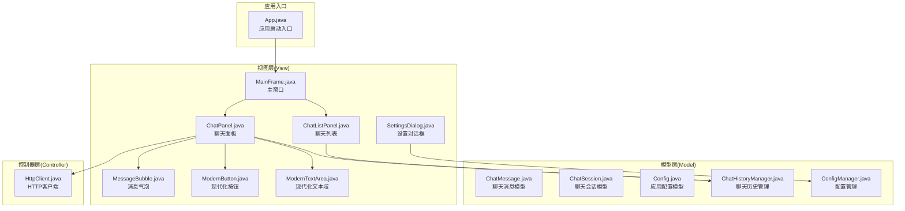
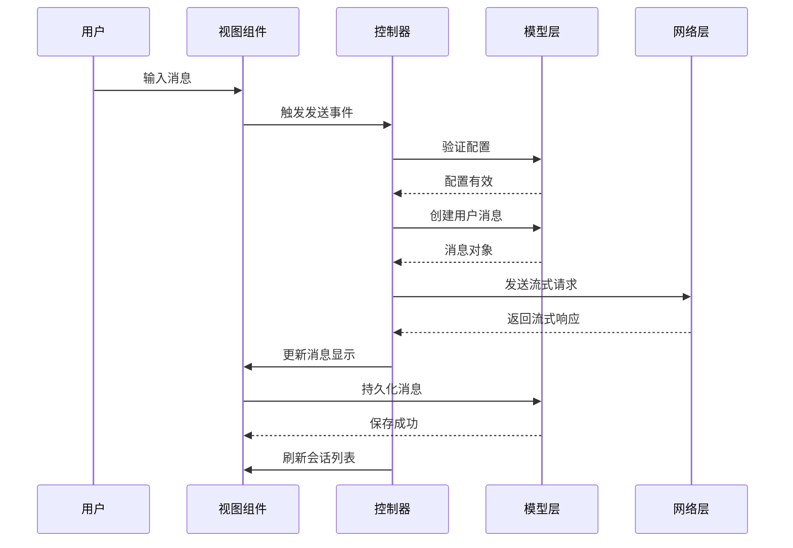
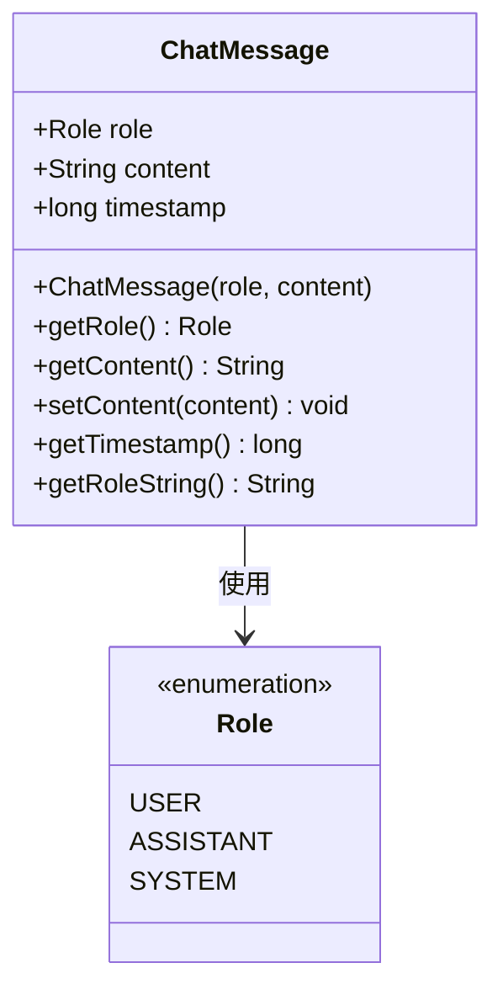
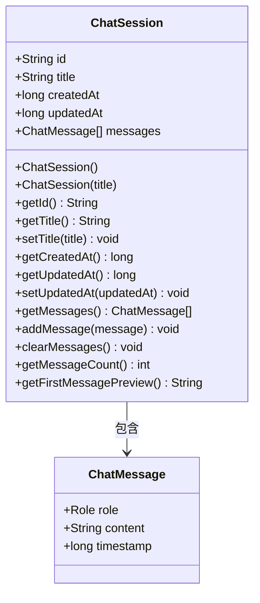
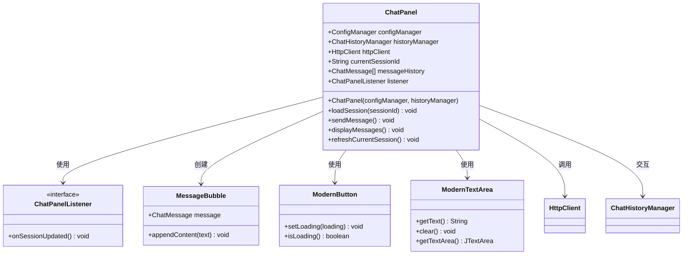
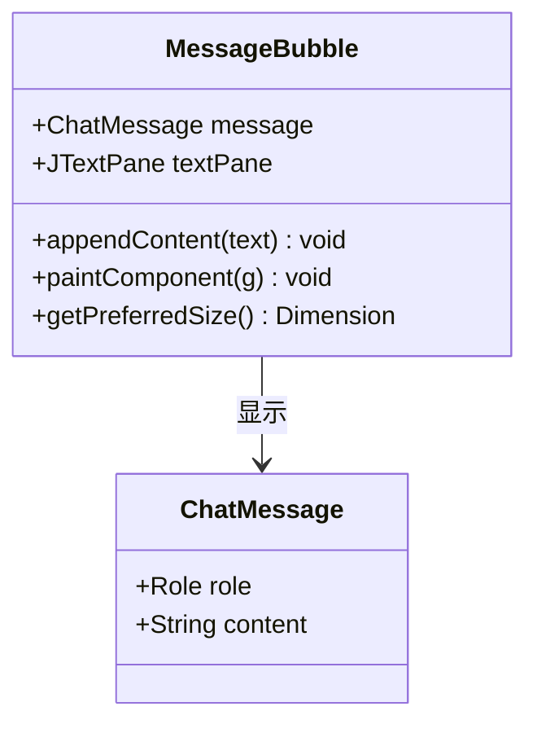
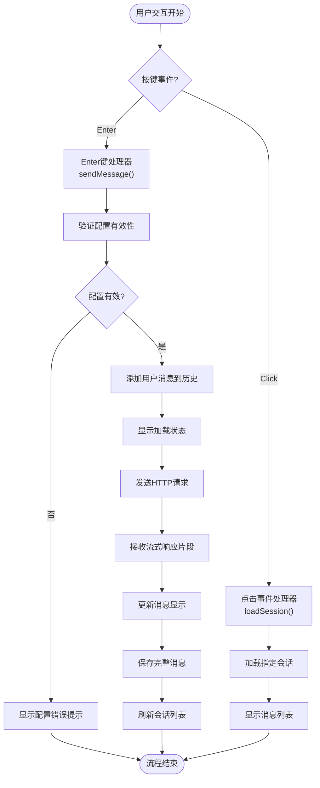
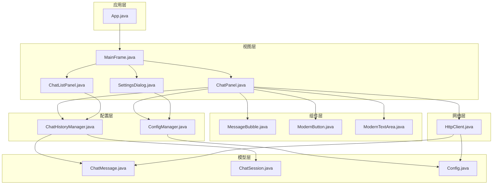

# MVC模式实现

<cite>
**本文档引用的文件**
- [App.java](file://src/com/llmchat/App.java)
- [ChatMessage.java](file://src/com/llmchat/model/ChatMessage.java)
- [ChatSession.java](file://src/com/llmchat/model/ChatSession.java)
- [Config.java](file://src/com/llmchat/model/Config.java)
- [MainFrame.java](file://src/com/llmchat/ui/MainFrame.java)
- [ChatPanel.java](file://src/com/llmchat/ui/ChatPanel.java)
- [ChatListPanel.java](file://src/com/llmchat/ui/components/ChatListPanel.java)
- [MessageBubble.java](file://src/com/llmchat/ui/components/MessageBubble.java)
- [ModernButton.java](file://src/com/llmchat/ui/components/ModernButton.java)
- [ModernTextArea.java](file://src/com/llmchat/ui/components/ModernTextArea.java)
- [ChatHistoryManager.java](file://src/com/llmchat/config/ChatHistoryManager.java)
- [ConfigManager.java](file://src/com/llmchat/config/ConfigManager.java)
- [HttpClient.java](file://src/com/llmchat/http/HttpClient.java)
- [SettingsDialog.java](file://src/com/llmchat/ui/SettingsDialog.java)
</cite>

## 目录
1. [简介](#简介)
2. [项目结构](#项目结构)
3. [核心组件](#核心组件)
4. [架构总览](#架构总览)
5. [详细组件分析](#详细组件分析)
6. [依赖关系分析](#依赖关系分析)
7. [性能考虑](#性能考虑)
8. [故障排除指南](#故障排除指南)
9. [结论](#结论)

## 简介
本项目采用经典的MVC（Model-View-Controller）架构模式实现了一个Java LLM聊天界面。通过清晰的三层分离，实现了数据与界面的解耦、业务逻辑的集中化管理以及事件驱动的更新流程。该架构使得代码具有良好的可维护性、可测试性和扩展性。

## 项目结构
项目采用按功能模块组织的目录结构，遵循MVC分层原则：

**图表来源**
- [App.java:11-26](file://src/com/llmchat/App.java#L11-L26)
- [MainFrame.java:19-36](file://src/com/llmchat/ui/MainFrame.java#L19-L36)
- [ChatPanel.java:21-55](file://src/com/llmchat/ui/ChatPanel.java#L21-L55)

**章节来源**
- [App.java:1-27](file://src/com/llmchat/App.java#L1-L27)
- [ChatMessage.java:1-44](file://src/com/llmchat/model/ChatMessage.java#L1-L44)
- [ChatSession.java:1-91](file://src/com/llmchat/model/ChatSession.java#L1-L91)

## 核心组件
本节详细介绍MVC架构中三个核心层次的职责和实现。

### Model层（数据封装与业务逻辑）
Model层负责封装应用程序的数据结构和业务规则，提供数据访问和操作方法。

#### 数据模型
- **ChatMessage**: 封装单条聊天消息，包含角色、内容和时间戳
- **ChatSession**: 管理整个对话会话，维护消息列表和元数据
- **Config**: 存储API配置信息，提供验证功能

#### 业务逻辑
- 会话生命周期管理：创建、更新、删除
- 消息持久化：序列化存储到文件系统
- 自动标题生成：基于第一条用户消息生成会话标题

**章节来源**
- [ChatMessage.java:8-43](file://src/com/llmchat/model/ChatMessage.java#L8-L43)
- [ChatSession.java:11-90](file://src/com/llmchat/model/ChatSession.java#L11-L90)
- [Config.java:8-51](file://src/com/llmchat/model/Config.java#L8-L51)

### View层（用户界面展示）
View层负责用户界面的渲染和用户交互，通过组件组合实现复杂的UI效果。

#### 核心UI组件
- **MainFrame**: 主窗口框架，协调各个子组件
- **ChatPanel**: 核心聊天界面，处理消息显示和输入
- **ChatListPanel**: 侧边栏聊天列表，管理多个会话
- **MessageBubble**: 消息气泡组件，支持emoji和自动换行
- **ModernButton**: 自定义按钮，支持加载动画状态

#### 设计特点
- 现代化UI设计：圆角矩形、渐变色彩、阴影效果
- 响应式布局：根据内容自动调整尺寸
- 事件驱动：通过回调接口实现组件间通信

**章节来源**
- [MainFrame.java:19-176](file://src/com/llmchat/ui/MainFrame.java#L19-L176)
- [ChatPanel.java:21-334](file://src/com/llmchat/ui/ChatPanel.java#L21-L334)
- [ChatListPanel.java:15-240](file://src/com/llmchat/ui/components/ChatListPanel.java#L15-L240)

### Controller层（事件协调与业务协调）
Controller层协调Model和View之间的交互，处理用户输入并驱动业务逻辑执行。

#### 关键控制器
- **事件监听器**: 各种组件的ActionListener、MouseListener等
- **回调接口**: StreamCallback、ChatPanelListener等异步回调
- **业务协调**: 组合多个Model和View组件完成复杂操作

#### 控制流程
- 用户输入捕获：键盘事件、鼠标点击
- 业务逻辑执行：配置验证、网络请求
- 界面状态更新：异步回调驱动UI刷新

**章节来源**
- [ChatPanel.java:44-59](file://src/com/llmchat/ui/ChatPanel.java#L44-L59)
- [ChatListPanel.java:28-32](file://src/com/llmchat/ui/components/ChatListPanel.java#L28-L32)
- [HttpClient.java:16-25](file://src/com/llmchat/http/HttpClient.java#L16-L25)

## 架构总览
MVC架构在本项目中的实现体现了清晰的职责分离和松耦合设计：

**图表来源**
- [ChatPanel.java:189-297](file://src/com/llmchat/ui/ChatPanel.java#L189-L297)
- [HttpClient.java:66-127](file://src/com/llmchat/http/HttpClient.java#L66-L127)
- [ChatHistoryManager.java:170-182](file://src/com/llmchat/config/ChatHistoryManager.java#L170-L182)

## 详细组件分析

### Model层深度分析

#### ChatMessage类分析
ChatMessage类实现了聊天消息的完整数据封装：

**图表来源**
- [ChatMessage.java:8-43](file://src/com/llmchat/model/ChatMessage.java#L8-L43)

**实现要点**：
- 枚举类型确保角色值的有效性
- 时间戳自动记录消息创建时间
- 序列化支持持久化存储

#### ChatSession类分析
ChatSession类管理整个对话会话的生命周期：

**图表来源**
- [ChatSession.java:11-90](file://src/com/llmchat/model/ChatSession.java#L11-L90)

**业务逻辑**：
- 自动更新时间戳：每次消息添加或清空都会更新updatedAt
- 智能标题生成：基于第一条用户消息内容生成标题预览
- UUID唯一标识：确保每个会话的唯一性

**章节来源**
- [ChatMessage.java:1-44](file://src/com/llmchat/model/ChatMessage.java#L1-L44)
- [ChatSession.java:1-91](file://src/com/llmchat/model/ChatSession.java#L1-L91)

### View层深度分析

#### ChatPanel组件分析
ChatPanel是核心聊天界面组件，负责消息显示和用户交互：

**图表来源**
- [ChatPanel.java:21-59](file://src/com/llmchat/ui/ChatPanel.java#L21-L59)
- [ChatPanel.java:40-42](file://src/com/llmchat/ui/ChatPanel.java#L40-L42)

**核心功能**：
- 实时消息流显示：支持服务器推送的增量内容
- 异步网络请求：非阻塞的HTTP通信
- 动态UI更新：SwingUtilities.invokeLater确保线程安全

#### MessageBubble组件分析
MessageBubble实现了现代化的消息气泡显示：

**图表来源**
- [MessageBubble.java:14-58](file://src/com/llmchat/ui/components/MessageBubble.java#L14-L58)

**设计特性**：
- 自适应宽度：根据内容自动调整气泡大小
- emoji支持：动态选择最佳字体支持emoji显示
- 圆角设计：美观的视觉效果

**章节来源**
- [ChatPanel.java:1-335](file://src/com/llmchat/ui/ChatPanel.java#L1-L335)
- [MessageBubble.java:1-170](file://src/com/llmchat/ui/components/MessageBubble.java#L1-L170)

### Controller层深度分析

#### 事件驱动流程
控制器层通过事件驱动的方式协调各个组件：

**图表来源**
- [ChatPanel.java:93-101](file://src/com/llmchat/ui/ChatPanel.java#L93-L101)
- [ChatPanel.java:243-296](file://src/com/llmchat/ui/ChatPanel.java#L243-L296)

**异步处理机制**：
- SwingUtilities.invokeLater确保UI更新在EDT中执行
- 回调接口处理网络请求的异步响应
- 线程池管理后台任务执行

**章节来源**
- [ChatPanel.java:189-297](file://src/com/llmchat/ui/ChatPanel.java#L189-L297)
- [HttpClient.java:66-127](file://src/com/llmchat/http/HttpClient.java#L66-L127)

## 依赖关系分析

### 组件依赖图
项目中各组件之间的依赖关系体现了清晰的分层架构：

**图表来源**
- [App.java:3-6](file://src/com/llmchat/App.java#L3-L6)
- [MainFrame.java:3-7](file://src/com/llmchat/ui/MainFrame.java#L3-L7)
- [ChatPanel.java:3-9](file://src/com/llmchat/ui/ChatPanel.java#L3-L9)

### 依赖注入与接口设计
项目采用了良好的接口设计，支持松耦合的组件交互：

- **回调接口**: ChatPanelListener、StreamCallback等定义明确的契约
- **监听器模式**: ChatListPanel使用ChatListListener处理会话事件
- **工厂模式**: ConfigManager负责配置对象的创建和管理

**章节来源**
- [ChatPanel.java:40-42](file://src/com/llmchat/ui/ChatPanel.java#L40-L42)
- [ChatListPanel.java:28-32](file://src/com/llmchat/ui/components/ChatListPanel.java#L28-L32)
- [ConfigManager.java:14-22](file://src/com/llmchat/config/ConfigManager.java#L14-L22)

## 性能考虑
MVC架构在本项目中带来了显著的性能优势：

### 线程安全与并发处理
- **Swing EDT隔离**: 所有UI更新都在事件调度线程中执行
- **异步网络请求**: 避免阻塞主线程，提升用户体验
- **流式响应处理**: 实时显示AI回复，无需等待完整响应

### 内存管理优化
- **对象池模式**: 重用MessageBubble组件减少内存分配
- **延迟加载**: 仅在需要时创建和显示组件
- **垃圾回收友好**: 短生命周期对象及时释放

### I/O性能优化
- **批量持久化**: 定期保存聊天历史，避免频繁磁盘I/O
- **缓存策略**: 内存中维护会话列表，减少文件系统访问
- **连接复用**: HTTP客户端支持连接池复用

## 故障排除指南

### 常见问题诊断
1. **配置无效错误**
   - 检查ConfigManager配置加载是否成功
   - 验证API URL格式和可达性
   - 确认API Key格式正确

2. **网络请求失败**
   - 检查网络连接状态
   - 验证代理设置和防火墙配置
   - 查看HTTP客户端错误日志

3. **UI更新异常**
   - 确保回调在SwingUtilities.invokeLater中执行
   - 检查组件状态同步问题
   - 验证事件监听器注册完整性

### 调试建议
- 启用详细日志输出，跟踪MVC各层交互
- 使用单元测试验证Model层数据一致性
- 通过集成测试验证View层渲染正确性
- 监控内存使用情况，避免内存泄漏

**章节来源**
- [ChatPanel.java:195-202](file://src/com/llmchat/ui/ChatPanel.java#L195-L202)
- [HttpClient.java:119-126](file://src/com/llmchat/http/HttpClient.java#L119-L126)

## 结论
本Java LLM聊天界面项目成功实现了MVC架构模式，通过清晰的职责分离和事件驱动机制，构建了一个功能完整、性能优良的聊天应用。MVC模式的主要优势体现在：

### 架构优势
- **代码可维护性**: 层次清晰，职责明确，便于代码维护和扩展
- **可测试性**: 各层独立，支持单元测试和集成测试
- **可扩展性**: 插件化设计，易于添加新功能和组件
- **可移植性**: 抽象层设计，降低平台依赖

### 技术亮点
- **事件驱动架构**: 通过回调接口实现松耦合的组件通信
- **异步处理**: 非阻塞的网络请求和UI更新
- **现代UI设计**: 现代化的组件库和视觉效果
- **数据持久化**: 完善的会话管理和配置存储

该架构模式为类似的应用开发提供了优秀的参考模板，既保证了功能的完整性，又确保了代码的质量和可维护性。