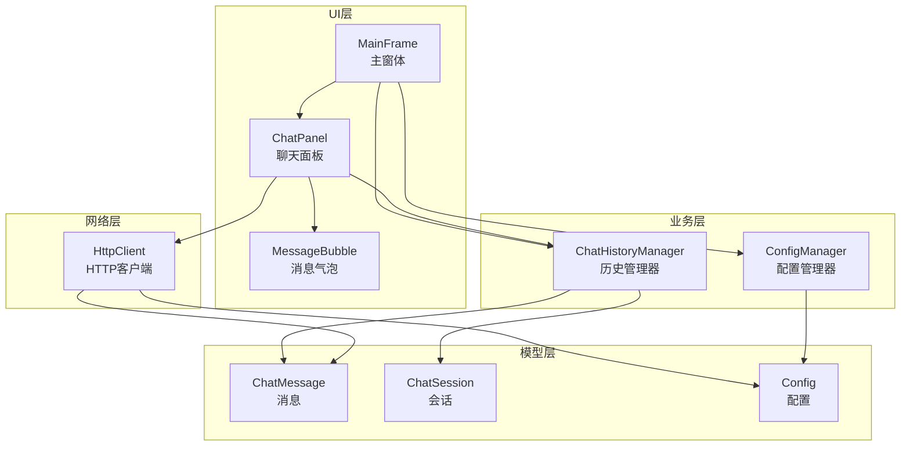
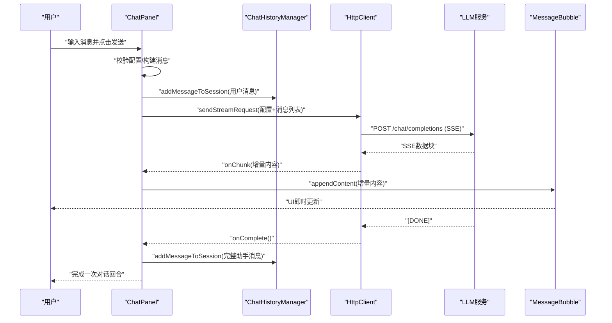
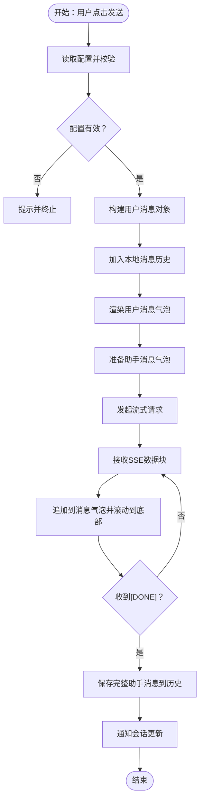
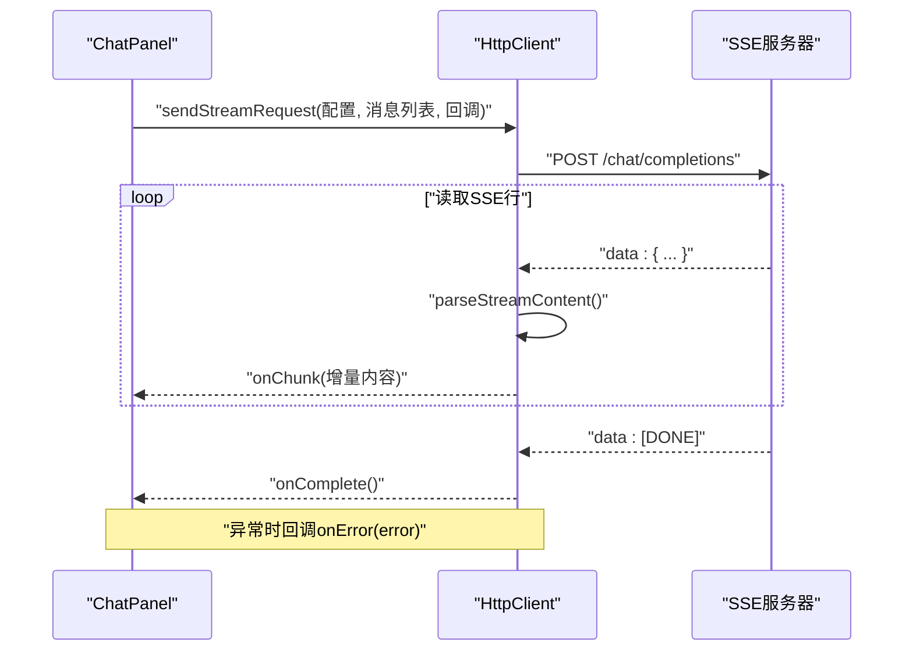
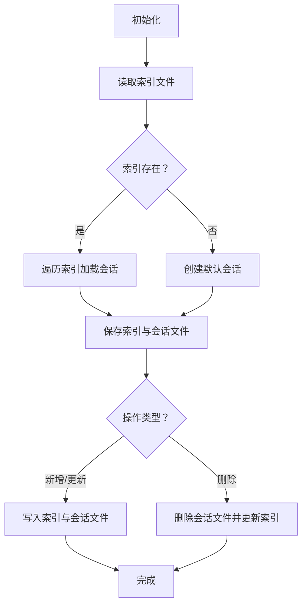
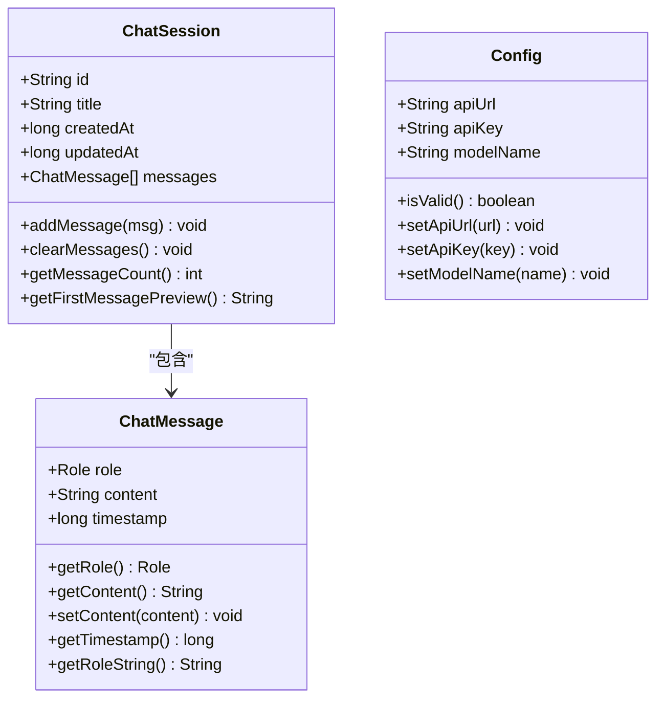
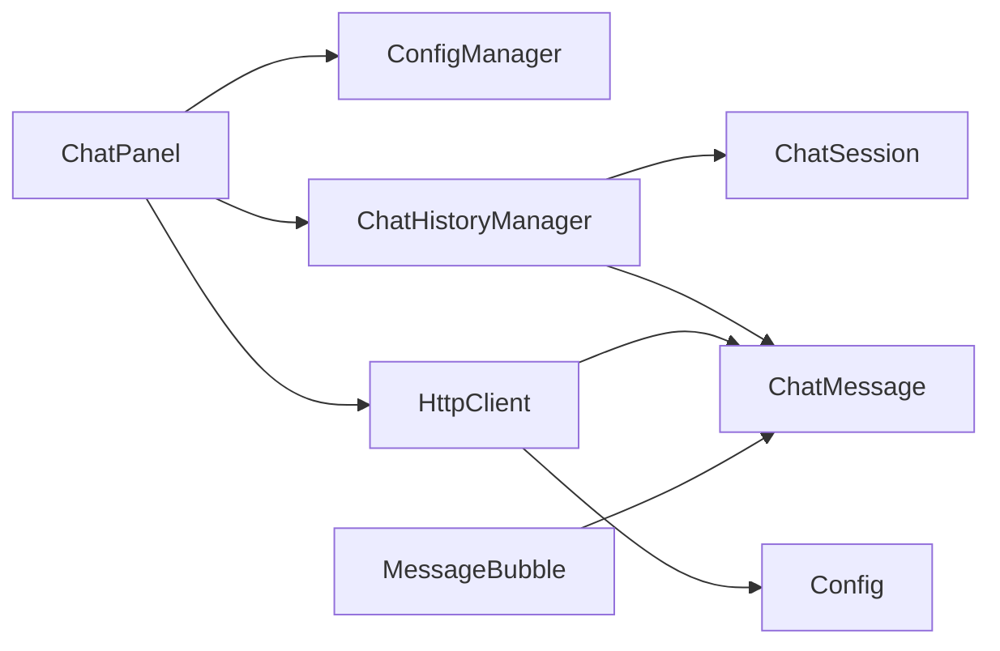

# 数据流设计

<cite>
**本文引用的文件**
- [App.java](file://src/com/llmchat/App.java)
- [MainFrame.java](file://src/com/llmchat/ui/MainFrame.java)
- [ChatPanel.java](file://src/com/llmchat/ui/ChatPanel.java)
- [HttpClient.java](file://src/com/llmchat/http/HttpClient.java)
- [ChatHistoryManager.java](file://src/com/llmchat/config/ChatHistoryManager.java)
- [ChatMessage.java](file://src/com/llmchat/model/ChatMessage.java)
- [ChatSession.java](file://src/com/llmchat/model/ChatSession.java)
- [Config.java](file://src/com/llmchat/model/Config.java)
- [ConfigManager.java](file://src/com/llmchat/config/ConfigManager.java)
- [MessageBubble.java](file://src/com/llmchat/ui/components/MessageBubble.java)
</cite>

## 目录
1. [简介](#简介)
2. [项目结构](#项目结构)
3. [核心组件](#核心组件)
4. [架构总览](#架构总览)
5. [详细组件分析](#详细组件分析)
6. [依赖关系分析](#依赖关系分析)
7. [性能考量](#性能考量)
8. [故障排查指南](#故障排查指南)
9. [结论](#结论)

## 简介
本文件面向Java LLM聊天界面项目，聚焦“数据流设计”。文档系统性阐述以下内容：
- 用户输入数据流：从用户在输入框输入到构建请求消息、加入会话历史、发起HTTP请求的全过程。
- LLM响应数据流：从HTTP连接建立、SSE流式响应解析、增量渲染到最终完整消息落盘的全过程。
- 历史数据持久化流程：会话与消息的内存模型、索引与文件组织、读写与并发安全策略。
- 异步数据处理机制：线程模型、回调驱动、Swing线程更新与UI同步策略。
- 数据在组件间传输格式与状态变化：消息对象的创建、更新与序列化过程。
- 提供数据流图与状态转换图，帮助开发者快速理解复杂数据处理逻辑。

## 项目结构
项目采用按职责分层的模块化组织：
- ui 层：负责用户交互与界面展示，包含主窗体、聊天面板、消息气泡等组件。
- http 层：封装HTTP请求与SSE流式响应处理。
- config 层：负责应用配置与聊天历史的持久化管理。
- model 层：定义消息、会话与配置的领域模型，并实现序列化。

图表来源
- [MainFrame.java:30-101](file://src/com/llmchat/ui/MainFrame.java#L30-L101)
- [ChatPanel.java:44-55](file://src/com/llmchat/ui/ChatPanel.java#L44-L55)
- [ChatHistoryManager.java:16-27](file://src/com/llmchat/config/ChatHistoryManager.java#L16-L27)
- [HttpClient.java:16-25](file://src/com/llmchat/http/HttpClient.java#L16-L25)
- [ChatMessage.java:8-43](file://src/com/llmchat/model/ChatMessage.java#L8-L43)
- [ChatSession.java:11-90](file://src/com/llmchat/model/ChatSession.java#L11-L90)
- [Config.java:8-51](file://src/com/llmchat/model/Config.java#L8-L51)
- [ConfigManager.java:14-22](file://src/com/llmchat/config/ConfigManager.java#L14-L22)
- [MessageBubble.java:14-58](file://src/com/llmchat/ui/components/MessageBubble.java#L14-L58)

章节来源
- [App.java:11-26](file://src/com/llmchat/App.java#L11-L26)
- [MainFrame.java:30-101](file://src/com/llmchat/ui/MainFrame.java#L30-L101)

## 核心组件
- ChatPanel：负责收集用户输入、构建请求消息、发起流式请求、实时渲染响应、维护本地消息历史与UI状态。
- HttpClient：负责构造请求体、发送HTTP POST、解析SSE流式响应、回调驱动UI更新。
- ChatHistoryManager：负责会话与消息的内存模型、索引与文件持久化、并发安全与容错。
- ChatMessage/ChatSession：消息与会话的领域模型，支持序列化与时间戳维护。
- Config/ConfigManager：应用配置与API密钥的持久化与简单加密。
- MessageBubble：消息气泡组件，支持增量追加文本与自适应换行。

章节来源
- [ChatPanel.java:21-55](file://src/com/llmchat/ui/ChatPanel.java#L21-L55)
- [HttpClient.java:16-25](file://src/com/llmchat/http/HttpClient.java#L16-L25)
- [ChatHistoryManager.java:16-27](file://src/com/llmchat/config/ChatHistoryManager.java#L16-L27)
- [ChatMessage.java:8-43](file://src/com/llmchat/model/ChatMessage.java#L8-L43)
- [ChatSession.java:11-90](file://src/com/llmchat/model/ChatSession.java#L11-L90)
- [Config.java:8-51](file://src/com/llmchat/model/Config.java#L8-L51)
- [ConfigManager.java:14-22](file://src/com/llmchat/config/ConfigManager.java#L14-L22)
- [MessageBubble.java:14-58](file://src/com/llmchat/ui/components/MessageBubble.java#L14-L58)

## 架构总览
下图展示了从用户输入到响应落盘的端到端数据流，以及各组件之间的交互关系。

图表来源
- [ChatPanel.java:189-297](file://src/com/llmchat/ui/ChatPanel.java#L189-L297)
- [HttpClient.java:66-127](file://src/com/llmchat/http/HttpClient.java#L66-L127)
- [ChatHistoryManager.java:170-182](file://src/com/llmchat/config/ChatHistoryManager.java#L170-L182)
- [MessageBubble.java:89-121](file://src/com/llmchat/ui/components/MessageBubble.java#L89-L121)

## 详细组件分析

### 用户输入数据流（ChatPanel）
- 输入收集与校验
  - 用户在输入框按键或点击发送按钮触发发送流程。
  - ChatPanel读取当前配置，若配置无效则弹出提示并终止。
- 消息构建与本地展示
  - 构造用户消息对象，加入本地消息历史，立即在UI中渲染用户消息气泡。
  - 同时准备一个空的助手消息气泡用于接收流式响应。
- 请求准备与发起
  - 将当前会话的消息列表复制为请求体，交由HttpClient发起流式请求。
  - 使用回调接收SSE数据块，通过SwingUtilities.invokeLater保证UI线程更新。
- 完成与持久化
  - 收到完成信号后，将完整助手消息加入本地历史并持久化；同时通知会话更新。

图表来源
- [ChatPanel.java:189-297](file://src/com/llmchat/ui/ChatPanel.java#L189-L297)

章节来源
- [ChatPanel.java:189-297](file://src/com/llmchat/ui/ChatPanel.java#L189-L297)

### LLM响应数据流（HttpClient）
- 请求构建
  - 构造JSON请求体，包含模型名、启用流式、消息数组。
  - 对消息内容进行JSON转义，避免特殊字符破坏结构。
- 请求发送
  - 设置请求头（Content-Type、Authorization、Accept），超时参数合理配置。
  - 发送请求体，等待响应码。
- SSE流式解析
  - 逐行读取SSE响应，过滤"data: "前缀，识别"[DONE]"结束标记。
  - 解析每条数据中的content字段，进行反斜杠转义还原。
  - 通过回调将增量内容传递给调用方（ChatPanel）。
- 错误处理
  - 非200响应读取错误流并回调错误信息。
  - 异常捕获统一回调错误，确保UI线程安全。

图表来源
- [HttpClient.java:66-127](file://src/com/llmchat/http/HttpClient.java#L66-L127)
- [HttpClient.java:132-163](file://src/com/llmchat/http/HttpClient.java#L132-L163)
- [HttpClient.java:193-206](file://src/com/llmchat/http/HttpClient.java#L193-L206)

章节来源
- [HttpClient.java:30-61](file://src/com/llmchat/http/HttpClient.java#L30-L61)
- [HttpClient.java:66-127](file://src/com/llmchat/http/HttpClient.java#L66-L127)
- [HttpClient.java:132-163](file://src/com/llmchat/http/HttpClient.java#L132-L163)
- [HttpClient.java:193-206](file://src/com/llmchat/http/HttpClient.java#L193-L206)

### 历史数据持久化流程（ChatHistoryManager）
- 存储位置与结构
  - 历史目录位于用户主目录下的隐藏路径，包含索引文件与多个会话文件。
  - 索引文件记录会话ID顺序，会话文件保存对应ChatSession对象。
- 加载与容错
  - 若索引文件存在且可读，则按顺序加载会话；单个会话加载失败则跳过并修正索引。
  - 若无会话，自动创建默认会话。
- 写入与并发
  - 并发Map保存会话，有序列表维护顺序；写入时先写索引再写各会话文件。
  - 单个会话写入失败仅记录错误并继续，不影响整体持久化。
- 会话管理
  - 新建会话、删除会话、清空消息、更新标题（基于首条用户消息预览）。
  - 添加消息时若为第一条用户消息则更新标题，随后持久化。

图表来源
- [ChatHistoryManager.java:32-65](file://src/com/llmchat/config/ChatHistoryManager.java#L32-L65)
- [ChatHistoryManager.java:70-99](file://src/com/llmchat/config/ChatHistoryManager.java#L70-L99)
- [ChatHistoryManager.java:104-110](file://src/com/llmchat/config/ChatHistoryManager.java#L104-L110)
- [ChatHistoryManager.java:136-154](file://src/com/llmchat/config/ChatHistoryManager.java#L136-L154)
- [ChatHistoryManager.java:170-182](file://src/com/llmchat/config/ChatHistoryManager.java#L170-L182)

章节来源
- [ChatHistoryManager.java:16-27](file://src/com/llmchat/config/ChatHistoryManager.java#L16-L27)
- [ChatHistoryManager.java:32-65](file://src/com/llmchat/config/ChatHistoryManager.java#L32-L65)
- [ChatHistoryManager.java:70-99](file://src/com/llmchat/config/ChatHistoryManager.java#L70-L99)
- [ChatHistoryManager.java:104-110](file://src/com/llmchat/config/ChatHistoryManager.java#L104-L110)
- [ChatHistoryManager.java:136-154](file://src/com/llmchat/config/ChatHistoryManager.java#L136-L154)
- [ChatHistoryManager.java:170-182](file://src/com/llmchat/config/ChatHistoryManager.java#L170-L182)

### 数据模型与序列化（ChatMessage/ChatSession/Config）
- ChatMessage
  - 字段：角色枚举、内容、时间戳。
  - 方法：角色字符串化、内容访问器、时间戳访问器。
- ChatSession
  - 字段：唯一ID、标题、创建/更新时间、消息列表。
  - 方法：添加消息、清空消息、获取消息数、首条用户消息预览。
- Config
  - 字段：API地址、API Key、模型名。
  - 方法：有效性校验、更新器、默认值初始化。

图表来源
- [ChatMessage.java:8-43](file://src/com/llmchat/model/ChatMessage.java#L8-L43)
- [ChatSession.java:11-90](file://src/com/llmchat/model/ChatSession.java#L11-L90)
- [Config.java:8-51](file://src/com/llmchat/model/Config.java#L8-L51)

章节来源
- [ChatMessage.java:8-43](file://src/com/llmchat/model/ChatMessage.java#L8-L43)
- [ChatSession.java:11-90](file://src/com/llmchat/model/ChatSession.java#L11-L90)
- [Config.java:8-51](file://src/com/llmchat/model/Config.java#L8-L51)

### 异步数据处理与UI同步
- 线程模型
  - HttpClient在独立线程中执行网络I/O与SSE解析，避免阻塞UI线程。
  - ChatPanel在回调中使用SwingUtilities.invokeLater确保UI更新在EDT中执行。
- 实时更新策略
  - 每收到一条SSE数据块，即刻拼接到当前响应缓存并追加到消息气泡组件。
  - 消息气泡组件内部通过JTextPane增量插入文本，触发布局重算与重绘。
- 错误处理
  - 网络异常或非200响应统一回调错误，移除空的响应气泡，回滚用户消息，并弹出错误提示。

章节来源
- [ChatPanel.java:243-296](file://src/com/llmchat/ui/ChatPanel.java#L243-L296)
- [MessageBubble.java:89-121](file://src/com/llmchat/ui/components/MessageBubble.java#L89-L121)
- [HttpClient.java:119-126](file://src/com/llmchat/http/HttpClient.java#L119-L126)

## 依赖关系分析
- 组件耦合
  - ChatPanel依赖ConfigManager与ChatHistoryManager，同时依赖HttpClient进行网络请求。
  - ChatHistoryManager与模型层（ChatMessage/ChatSession）紧密耦合，负责其生命周期与持久化。
  - HttpClient依赖模型层（ChatMessage/Config）进行请求体构建与配置读取。
  - UI组件（MessageBubble）与模型层解耦，通过ChatMessage对象渲染。
- 外部依赖
  - Java标准库（IO、网络、Swing、并发集合）。
  - 无第三方框架依赖，便于部署与维护。

图表来源
- [ChatPanel.java:24-47](file://src/com/llmchat/ui/ChatPanel.java#L24-L47)
- [ChatHistoryManager.java:16-27](file://src/com/llmchat/config/ChatHistoryManager.java#L16-L27)
- [HttpClient.java:16-25](file://src/com/llmchat/http/HttpClient.java#L16-L25)
- [MessageBubble.java:24-54](file://src/com/llmchat/ui/components/MessageBubble.java#L24-L54)

章节来源
- [ChatPanel.java:24-47](file://src/com/llmchat/ui/ChatPanel.java#L24-L47)
- [ChatHistoryManager.java:16-27](file://src/com/llmchat/config/ChatHistoryManager.java#L16-L27)
- [HttpClient.java:16-25](file://src/com/llmchat/http/HttpClient.java#L16-L25)
- [MessageBubble.java:24-54](file://src/com/llmchat/ui/components/MessageBubble.java#L24-L54)

## 性能考量
- 网络与I/O
  - SSE流式读取逐行解析，避免一次性缓冲大块数据，降低内存峰值。
  - 合理设置连接与读取超时，防止长时间阻塞。
- UI渲染
  - 增量追加文本，减少全量重绘；消息气泡组件内部触发revalidate/repaint，确保换行正确。
- 持久化
  - 并发Map与有序列表分离，读写分离优化；单文件失败不阻塞整体写入。
- 序列化
  - 使用JDK序列化，简洁可靠；注意字段变更时版本兼容性。

## 故障排查指南
- 配置未设置
  - 现象：发送按钮被禁用或提示配置错误。
  - 排查：检查ConfigManager是否成功加载配置，确认API地址、Key、模型名均有效。
- 请求失败
  - 现象：回调onError，弹出错误提示。
  - 排查：查看响应码与错误流内容；确认网络连通、授权头正确、模型可用。
- 响应为空或中断
  - 现象：助手消息气泡未显示或中途消失。
  - 排查：检查SSE数据块是否包含content字段；确认回调onChunk是否被调用；查看异常分支。
- 历史丢失
  - 现象：重启后会话不一致或缺失。
  - 排查：检查索引文件与会话文件是否存在；确认写入异常日志；必要时重建默认会话。

章节来源
- [ChatPanel.java:195-202](file://src/com/llmchat/ui/ChatPanel.java#L195-L202)
- [HttpClient.java:88-93](file://src/com/llmchat/http/HttpClient.java#L88-L93)
- [HttpClient.java:119-126](file://src/com/llmchat/http/HttpClient.java#L119-L126)
- [ChatHistoryManager.java:48-58](file://src/com/llmchat/config/ChatHistoryManager.java#L48-L58)

## 结论
本项目通过清晰的分层与职责划分，实现了从用户输入到LLM响应的完整数据流闭环。ChatPanel承担前端交互与状态协调，HttpClient专注网络与SSE解析，ChatHistoryManager保障历史数据的可靠持久化。消息对象在内存与磁盘之间稳定流转，配合Swing线程模型实现流畅的实时更新体验。建议后续可考虑引入更完善的错误恢复与重试机制、日志系统与配置热更新能力，以进一步提升稳定性与可观测性。