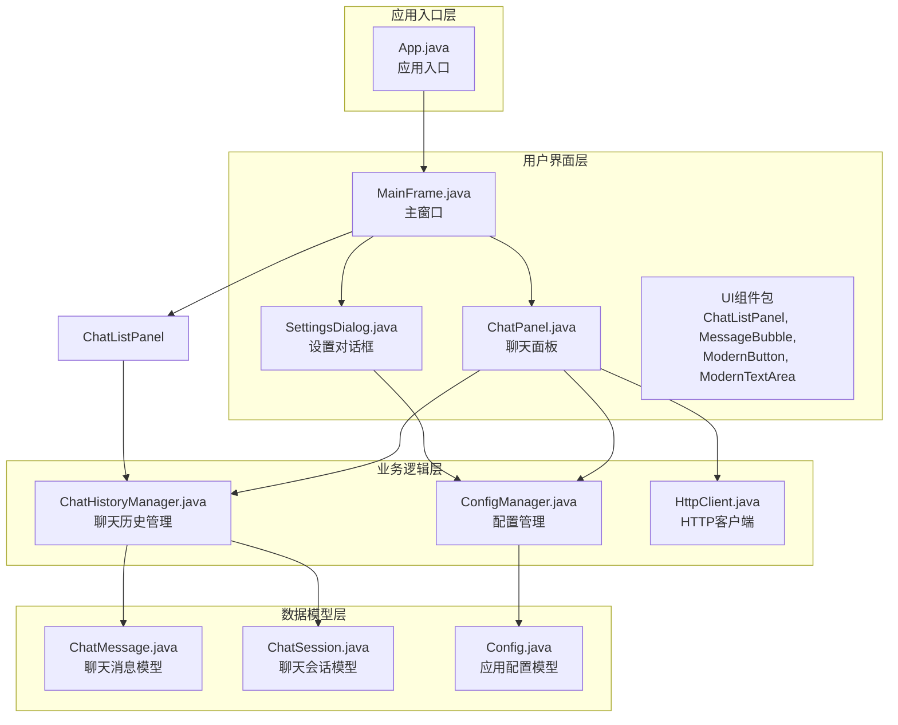
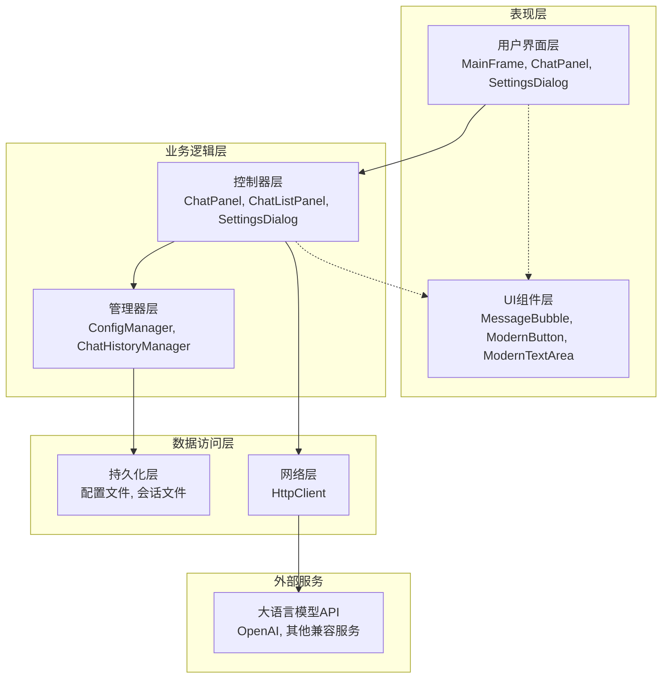
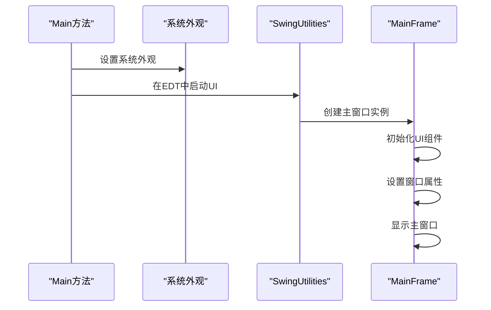
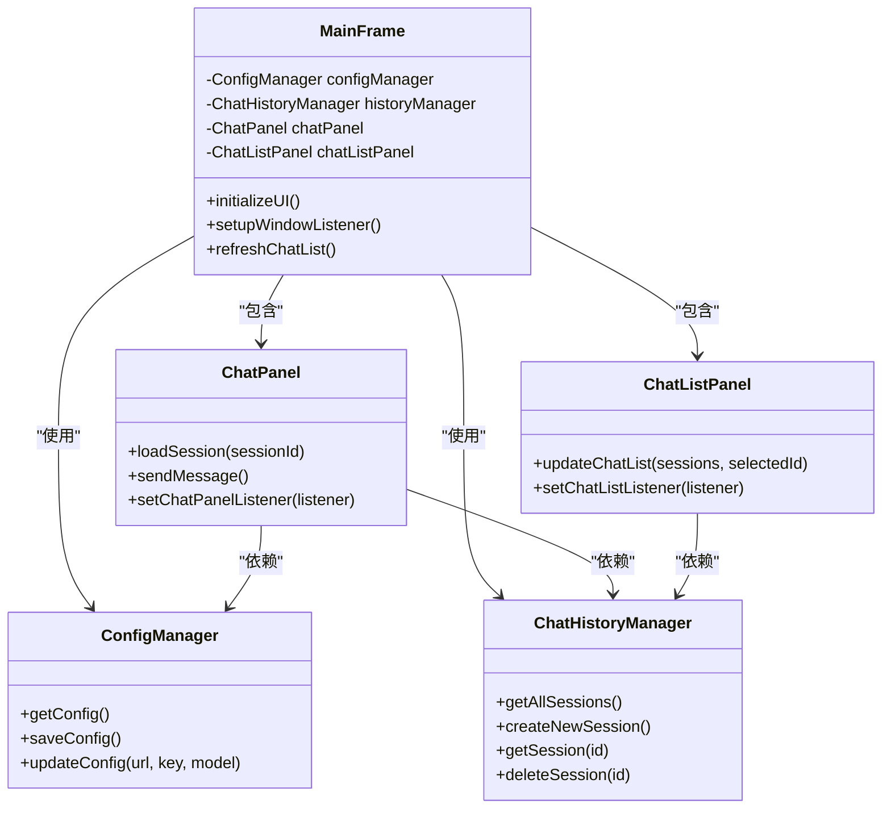
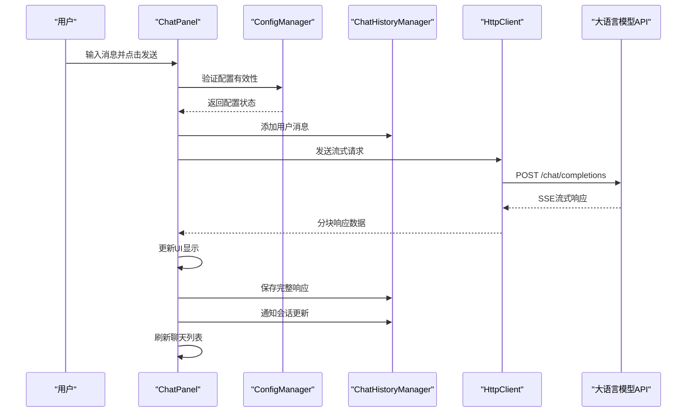
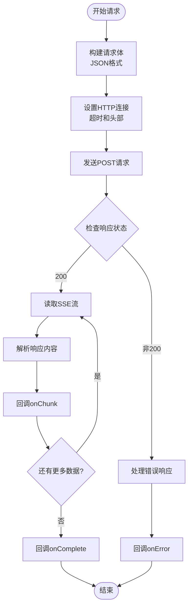
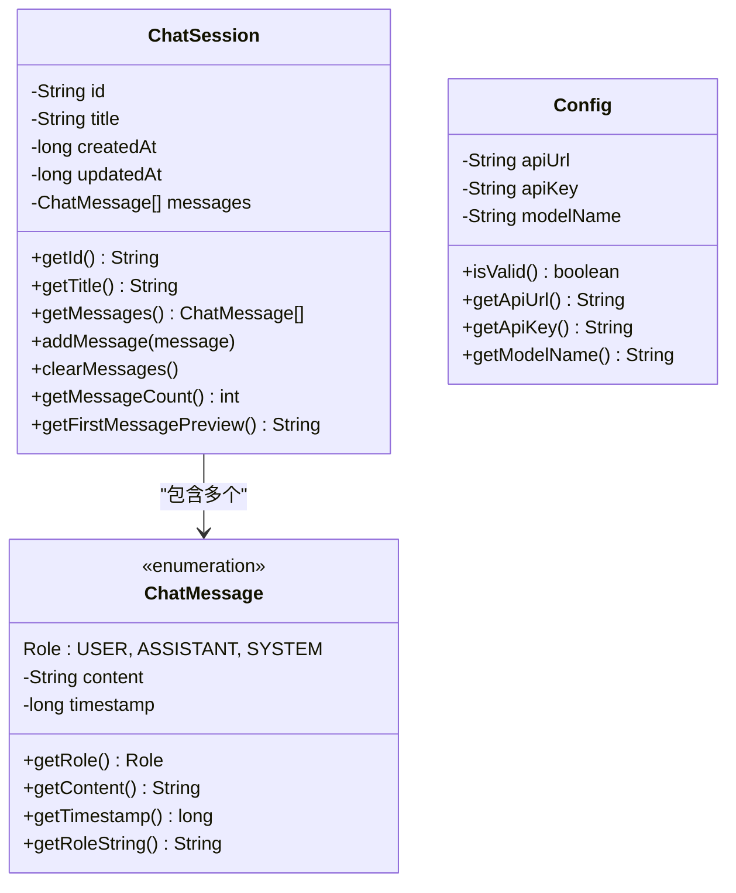
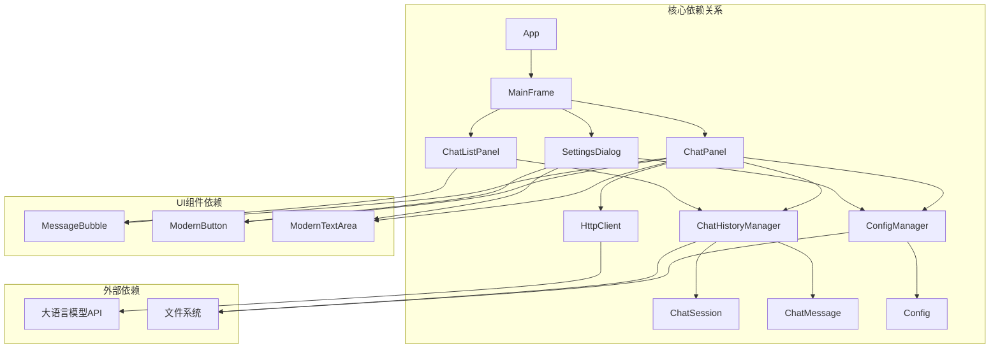

# 架构设计

<cite>
**本文档引用的文件**
- [App.java](file://src/com/llmchat/App.java)
- [MainFrame.java](file://src/com/llmchat/ui/MainFrame.java)
- [ChatPanel.java](file://src/com/llmchat/ui/ChatPanel.java)
- [ChatListPanel.java](file://src/com/llmchat/ui/components/ChatListPanel.java)
- [SettingsDialog.java](file://src/com/llmchat/ui/SettingsDialog.java)
- [ChatMessage.java](file://src/com/llmchat/model/ChatMessage.java)
- [ChatSession.java](file://src/com/llmchat/model/ChatSession.java)
- [Config.java](file://src/com/llmchat/model/Config.java)
- [ConfigManager.java](file://src/com/llmchat/config/ConfigManager.java)
- [ChatHistoryManager.java](file://src/com/llmchat/config/ChatHistoryManager.java)
- [HttpClient.java](file://src/com/llmchat/http/HttpClient.java)
- [MessageBubble.java](file://src/com/llmchat/ui/components/MessageBubble.java)
- [ModernButton.java](file://src/com/llmchat/ui/components/ModernButton.java)
- [ModernTextArea.java](file://src/com/llmchat/ui/components/ModernTextArea.java)
</cite>

## 目录
1. [简介](#简介)
2. [项目结构](#项目结构)
3. [核心组件](#核心组件)
4. [架构概览](#架构概览)
5. [详细组件分析](#详细组件分析)
6. [依赖关系分析](#依赖关系分析)
7. [性能考虑](#性能考虑)
8. [故障排除指南](#故障排除指南)
9. [结论](#结论)
10. [附录](#附录)

## 简介

本项目是一个基于Java Swing开发的大语言模型聊天界面应用程序。该应用采用经典的MVC（Model-View-Controller）架构模式，实现了现代化的桌面聊天界面，支持与各种大语言模型API进行交互，具备多会话管理、实时流式响应、配置管理等功能。

系统的核心设计理念是通过清晰的职责分离实现高内聚、低耦合的软件架构，为用户提供流畅的聊天体验，同时保证代码的可维护性和可扩展性。

## 项目结构

项目采用分层的包结构组织，按照功能域进行模块化设计：

**图表来源**
- [App.java:1-27](file://src/com/llmchat/App.java#L1-L27)
- [MainFrame.java:1-177](file://src/com/llmchat/ui/MainFrame.java#L1-L177)
- [ChatPanel.java:1-335](file://src/com/llmchat/ui/ChatPanel.java#L1-L335)

**章节来源**
- [App.java:1-27](file://src/com/llmchat/App.java#L1-L27)
- [MainFrame.java:1-177](file://src/com/llmchat/ui/MainFrame.java#L1-L177)

## 核心组件

### MVC架构模式实现

系统严格遵循MVC架构模式，实现了清晰的关注点分离：

**Model层（模型层）**
- `ChatMessage`: 聊天消息的数据模型，包含角色、内容和时间戳
- `ChatSession`: 聊天会话的数据模型，管理消息集合和会话元数据
- `Config`: 应用配置数据模型，存储API设置

**View层（视图层）**
- `MainFrame`: 主窗口，负责整体界面布局和组件协调
- `ChatPanel`: 核心聊天界面，处理用户交互和消息显示
- `ChatListPanel`: 侧边栏聊天列表，显示会话历史
- `SettingsDialog`: 设置对话框，管理API配置
- UI组件：`MessageBubble`、`ModernButton`、`ModernTextArea`等

**Controller层（控制器层）**
- `ChatPanel`: 聊天面板控制器，处理用户输入和业务逻辑
- `ChatListPanel`: 列表控制器，管理会话选择和操作
- `SettingsDialog`: 设置控制器，处理配置更新
- `ConfigManager`: 配置控制器，管理配置持久化
- `ChatHistoryManager`: 历史控制器，管理会话持久化

**章节来源**
- [ChatMessage.java:1-44](file://src/com/llmchat/model/ChatMessage.java#L1-L44)
- [ChatSession.java:1-91](file://src/com/llmchat/model/ChatSession.java#L1-L91)
- [Config.java:1-52](file://src/com/llmchat/model/Config.java#L1-L52)
- [ChatPanel.java:1-335](file://src/com/llmchat/ui/ChatPanel.java#L1-L335)

## 架构概览

系统采用分层架构设计，各层之间通过明确定义的接口进行通信：

**图表来源**
- [App.java:11-25](file://src/com/llmchat/App.java#L11-L25)
- [MainFrame.java:24-36](file://src/com/llmchat/ui/MainFrame.java#L24-L36)
- [ChatPanel.java:24-49](file://src/com/llmchat/ui/ChatPanel.java#L24-L49)

### 系统边界和模块划分

系统边界清晰，主要模块包括：

**核心模块**
- 用户界面模块：负责所有用户交互和显示
- 业务逻辑模块：处理聊天流程和业务规则
- 数据管理模块：管理配置和会话数据
- 网络通信模块：处理与大语言模型API的通信

**跨领域关注点**
- 安全性：API密钥的简单加密存储
- 性能：异步网络请求和流式响应处理
- 可靠性：异常处理和错误恢复机制
- 可扩展性：插件化的组件设计

## 详细组件分析

### 应用入口类（App）

应用入口类负责初始化系统环境和启动主界面：

**图表来源**
- [App.java:12-24](file://src/com/llmchat/App.java#L12-L24)

**章节来源**
- [App.java:1-27](file://src/com/llmchat/App.java#L1-L27)

### 主窗口（MainFrame）

主窗口作为系统的顶层容器，协调各个子组件：

**图表来源**
- [MainFrame.java:19-36](file://src/com/llmchat/ui/MainFrame.java#L19-L36)
- [ChatPanel.java:21-55](file://src/com/llmchat/ui/ChatPanel.java#L21-L55)
- [ChatListPanel.java:15-40](file://src/com/llmchat/ui/components/ChatListPanel.java#L15-L40)

**章节来源**
- [MainFrame.java:1-177](file://src/com/llmchat/ui/MainFrame.java#L1-L177)

### 聊天面板（ChatPanel）

聊天面板是系统的核心交互组件，处理用户的所有聊天操作：

**图表来源**
- [ChatPanel.java:189-297](file://src/com/llmchat/ui/ChatPanel.java#L189-L297)
- [HttpClient.java:66-127](file://src/com/llmchat/http/HttpClient.java#L66-L127)

**章节来源**
- [ChatPanel.java:1-335](file://src/com/llmchat/ui/ChatPanel.java#L1-L335)

### HTTP客户端（HttpClient）

HTTP客户端专门处理与大语言模型API的网络通信：

**图表来源**
- [HttpClient.java:66-127](file://src/com/llmchat/http/HttpClient.java#L66-L127)
- [HttpClient.java:132-163](file://src/com/llmchat/http/HttpClient.java#L132-L163)

**章节来源**
- [HttpClient.java:1-208](file://src/com/llmchat/http/HttpClient.java#L1-L208)

### 数据模型

系统使用轻量级的数据模型来表示核心业务实体：

**图表来源**
- [ChatMessage.java:8-43](file://src/com/llmchat/model/ChatMessage.java#L8-L43)
- [ChatSession.java:11-90](file://src/com/llmchat/model/ChatSession.java#L11-L90)
- [Config.java:8-51](file://src/com/llmchat/model/Config.java#L8-L51)

**章节来源**
- [ChatMessage.java:1-44](file://src/com/llmchat/model/ChatMessage.java#L1-L44)
- [ChatSession.java:1-91](file://src/com/llmchat/model/ChatSession.java#L1-L91)
- [Config.java:1-52](file://src/com/llmchat/model/Config.java#L1-L52)

## 依赖关系分析

系统采用松耦合的设计，通过接口和抽象类实现组件间的解耦：

**图表来源**
- [App.java:3](file://src/com/llmchat/App.java#L3)
- [MainFrame.java:3-7](file://src/com/llmchat/ui/MainFrame.java#L3-L7)
- [ChatPanel.java:3-9](file://src/com/llmchat/ui/ChatPanel.java#L3-L9)

### 技术选型分析

**Java Swing作为GUI框架的选择原因：**

1. **跨平台兼容性**：Swing提供统一的跨平台GUI解决方案，确保应用在Windows、macOS和Linux上的一致性表现

2. **成熟的生态系统**：Swing拥有丰富的组件库和完善的文档支持，降低了开发复杂度

3. **内存效率**：相比Web技术栈，Swing应用占用更少的系统资源

4. **本地集成能力**：能够更好地集成操作系统特性和本地功能

5. **开发效率**：对于桌面应用开发，Swing提供了直观的可视化设计工具

**章节来源**
- [App.java:14-18](file://src/com/llmchat/App.java#L14-L18)

## 性能考虑

### 异步处理策略

系统采用异步编程模式来避免UI阻塞：

1. **网络请求异步化**：HTTP请求在独立线程中执行，避免阻塞主线程
2. **流式响应处理**：支持Server-Sent Events的实时数据流
3. **UI更新同步化**：使用SwingUtilities.invokeLater确保UI更新在EDT中执行

### 内存管理

1. **对象池化**：消息气泡组件支持动态重用，减少GC压力
2. **延迟加载**：聊天列表采用延迟加载策略，只在需要时创建组件
3. **资源清理**：及时释放网络连接和文件句柄

### 缓存策略

1. **配置缓存**：配置信息在内存中缓存，减少磁盘I/O
2. **会话缓存**：最近使用的会话在内存中保持活跃状态

## 故障排除指南

### 常见问题及解决方案

**网络连接问题**
- 检查API URL和网络连通性
- 验证API密钥的有效性
- 查看防火墙和代理设置

**UI响应缓慢**
- 确认没有长时间运行的操作阻塞EDT
- 检查是否有过多的组件重绘
- 验证消息气泡的渲染性能

**数据持久化失败**
- 检查用户目录的写入权限
- 验证磁盘空间充足
- 确认文件系统完整性

**章节来源**
- [ChatPanel.java:275-295](file://src/com/llmchat/ui/ChatPanel.java#L275-L295)
- [HttpClient.java:119-126](file://src/com/llmchat/http/HttpClient.java#L119-L126)

## 结论

本Java LLM聊天界面项目成功实现了MVC架构模式，通过清晰的层次分离和模块化设计，构建了一个功能完整、性能优良的桌面聊天应用。系统的主要优势包括：

1. **架构清晰**：严格的MVC分离确保了代码的可维护性和可测试性
2. **用户体验优秀**：现代化的UI设计和流畅的交互体验
3. **技术选型合理**：Java Swing的选择符合桌面应用的需求
4. **扩展性强**：模块化设计为未来的功能扩展奠定了基础

通过合理的依赖管理和异步处理策略，系统能够在保证性能的同时提供稳定的用户体验。建议在未来版本中进一步增强安全性和监控能力，以满足生产环境的更高要求。

## 附录

### 基础设施要求

**硬件要求**
- CPU：1 GHz以上
- 内存：至少512 MB RAM
- 存储：至少100 MB 可用空间

**软件要求**
- Java Runtime Environment 8或更高版本
- 支持Swing的图形环境

**网络要求**
- 稳定的互联网连接
- 支持HTTPS协议
- 允许访问目标API服务

### 可扩展性考虑

1. **插件架构**：未来可以引入插件机制支持第三方API
2. **主题系统**：扩展UI主题和外观定制功能
3. **国际化**：支持多语言界面和内容
4. **云同步**：添加云端会话同步功能
5. **批处理**：支持批量消息处理和导出功能