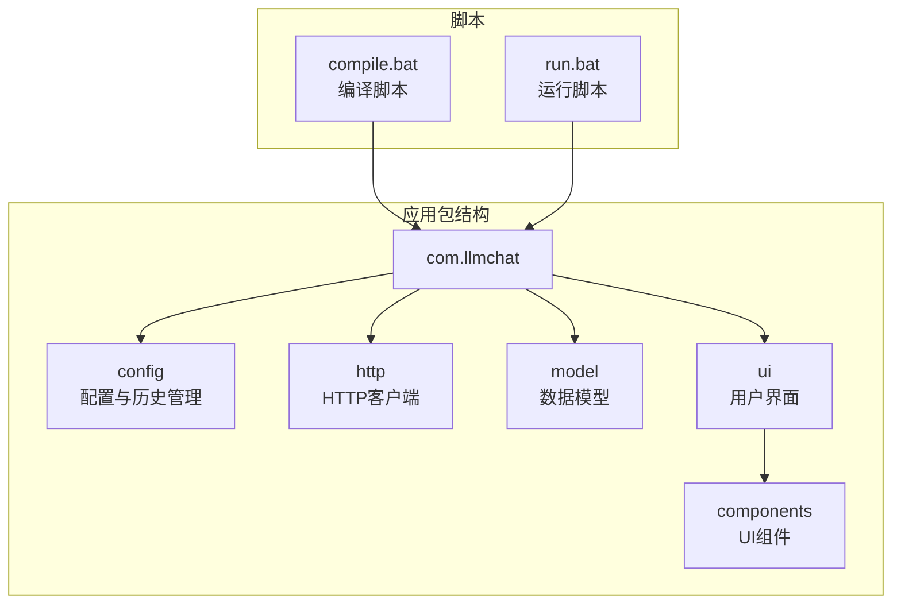
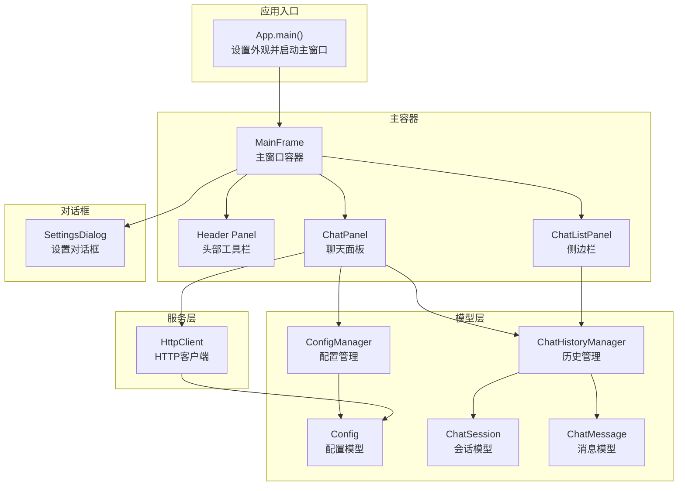
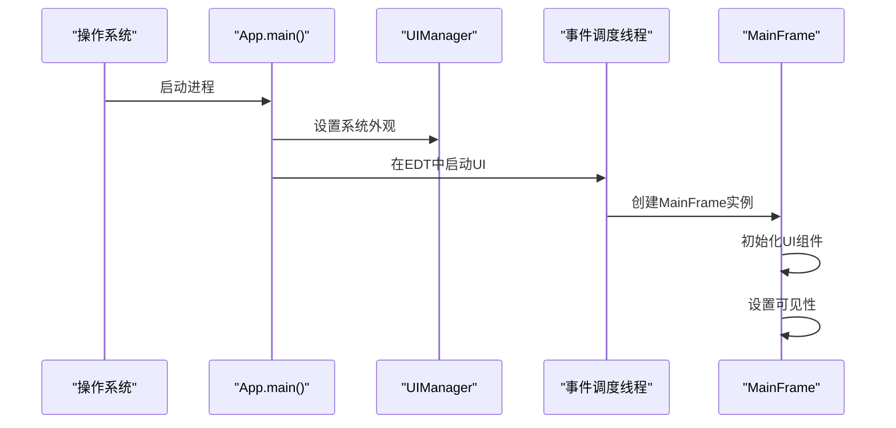
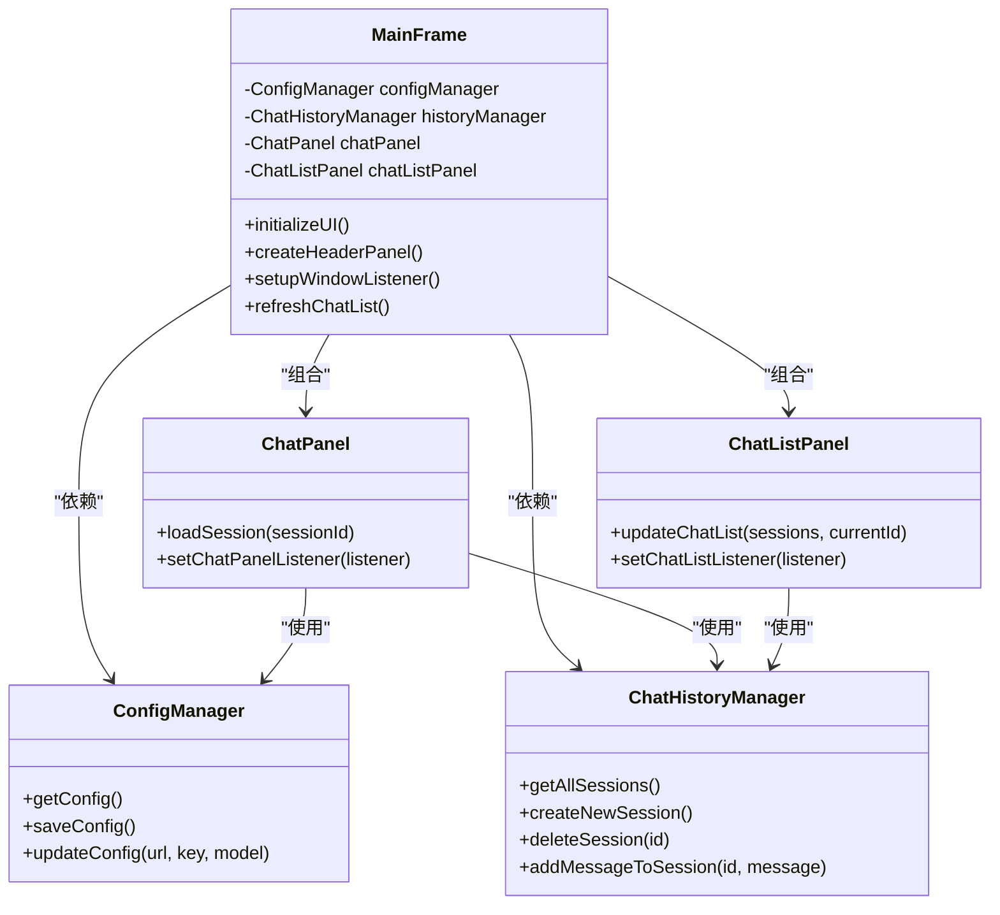
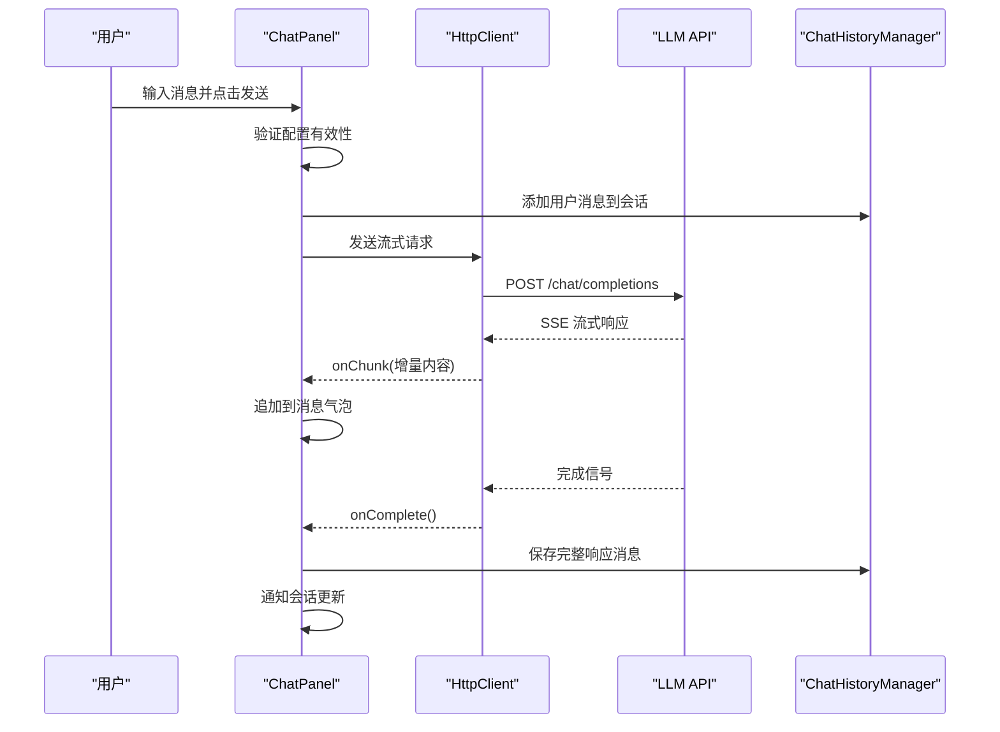
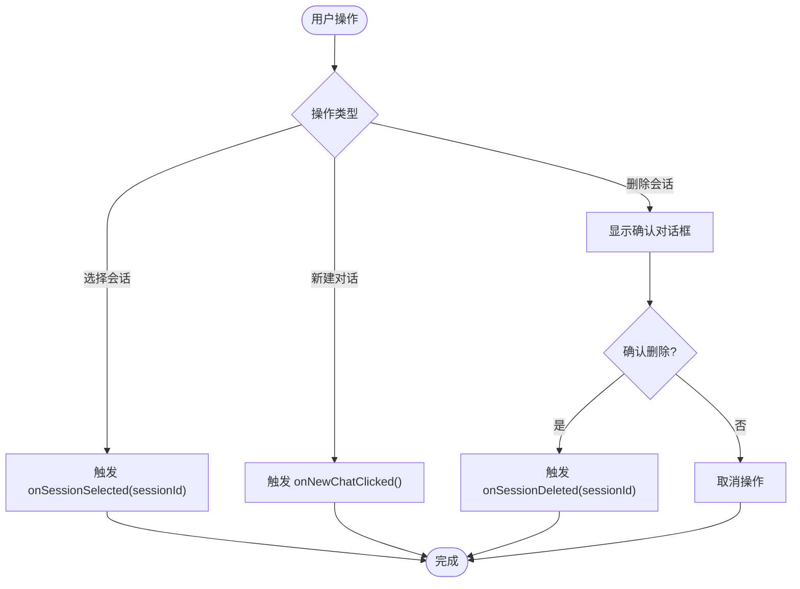
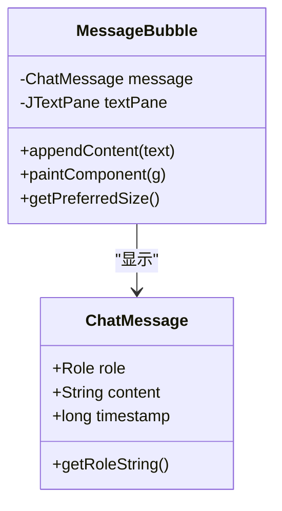
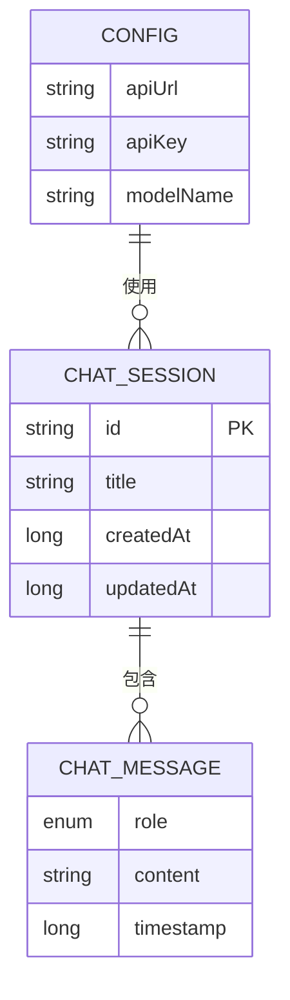
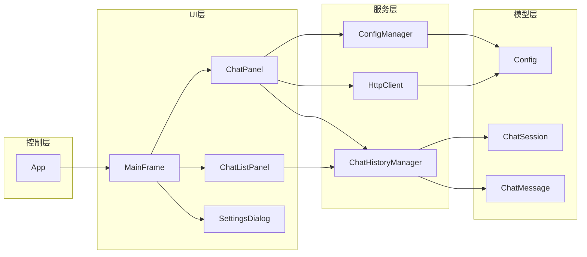

# 系统架构

<cite>
**本文档引用的文件**
- [App.java](file://src/com/llmchat/App.java)
- [MainFrame.java](file://src/com/llmchat/ui/MainFrame.java)
- [ChatPanel.java](file://src/com/llmchat/ui/ChatPanel.java)
- [ChatListPanel.java](file://src/com/llmchat/ui/components/ChatListPanel.java)
- [MessageBubble.java](file://src/com/llmchat/ui/components/MessageBubble.java)
- [SettingsDialog.java](file://src/com/llmchat/ui/SettingsDialog.java)
- [ConfigManager.java](file://src/com/llmchat/config/ConfigManager.java)
- [ChatHistoryManager.java](file://src/com/llmchat/config/ChatHistoryManager.java)
- [Config.java](file://src/com/llmchat/model/Config.java)
- [ChatMessage.java](file://src/com/llmchat/model/ChatMessage.java)
- [ChatSession.java](file://src/com/llmchat/model/ChatSession.java)
- [HttpClient.java](file://src/com/llmchat/http/HttpClient.java)
- [compile.bat](file://compile.bat)
- [run.bat](file://run.bat)
</cite>

## 目录
1. [简介](#简介)
2. [项目结构](#项目结构)
3. [核心组件](#核心组件)
4. [架构总览](#架构总览)
5. [详细组件分析](#详细组件分析)
6. [依赖关系分析](#依赖关系分析)
7. [性能考虑](#性能考虑)
8. [故障排除指南](#故障排除指南)
9. [结论](#结论)

## 简介
本项目是一个基于 Java Swing 的大语言模型（LLM）聊天界面应用，采用 MVC 架构模式组织代码。系统通过 App 入口类初始化系统外观并启动主窗口 MainFrame，MainFrame 作为系统主容器协调各个子组件，包括聊天面板、侧边栏会话列表、设置对话框等。应用通过 ConfigManager 和 ChatHistoryManager 管理配置与会话历史，通过 HttpClient 与外部 LLM API 进行交互，支持流式响应显示。

## 项目结构
项目采用按功能域划分的包结构：
- com.llmchat：应用主包
  - config：配置与历史管理
  - http：HTTP 客户端
  - model：数据模型
  - ui：用户界面组件
    - components：可复用 UI 组件
- 批处理脚本：compile.bat、run.bat

**图表来源**
- [App.java:1-27](file://src/com/llmchat/App.java#L1-L27)
- [compile.bat:1-21](file://compile.bat#L1-L21)
- [run.bat:1-5](file://run.bat#L1-L5)

**章节来源**
- [App.java:1-27](file://src/com/llmchat/App.java#L1-L27)
- [compile.bat:1-21](file://compile.bat#L1-L21)
- [run.bat:1-5](file://run.bat#L1-L5)

## 核心组件
系统的核心组件围绕 MVC 模式构建：
- Model 层：ChatMessage、ChatSession、Config 提供数据结构与业务逻辑
- View 层：MainFrame、ChatPanel、ChatListPanel、MessageBubble、SettingsDialog 等 UI 组件
- Controller 层：App、ConfigManager、ChatHistoryManager、HttpClient 协调业务流程

关键职责分配：
- App：应用入口，负责设置系统外观并在事件调度线程中启动主窗口
- MainFrame：主容器，组织头部工具栏、侧边栏、聊天面板，处理窗口关闭事件
- ChatPanel：核心聊天界面，负责消息显示、输入处理、与 LLM API 的交互
- ChatListPanel：侧边栏会话列表，提供会话选择、新建、删除功能
- ConfigManager：配置管理，负责 API URL、API Key、模型名的持久化
- ChatHistoryManager：会话历史管理，负责会话的创建、加载、保存、删除
- HttpClient：HTTP 客户端，支持流式响应处理

**章节来源**
- [App.java:11-26](file://src/com/llmchat/App.java#L11-L26)
- [MainFrame.java:19-177](file://src/com/llmchat/ui/MainFrame.java#L19-L177)
- [ChatPanel.java:21-335](file://src/com/llmchat/ui/ChatPanel.java#L21-L335)
- [ChatListPanel.java:15-241](file://src/com/llmchat/ui/components/ChatListPanel.java#L15-L241)
- [ConfigManager.java:14-101](file://src/com/llmchat/config/ConfigManager.java#L14-L101)
- [ChatHistoryManager.java:16-206](file://src/com/llmchat/config/ChatHistoryManager.java#L16-L206)
- [HttpClient.java:16-208](file://src/com/llmchat/http/HttpClient.java#L16-L208)

## 架构总览
系统采用经典的 MVC 架构，结合事件驱动的 GUI 设计：
- App 入口初始化系统外观并启动 MainFrame
- MainFrame 作为视图控制器，协调各子视图组件
- ChatPanel 作为聊天视图，处理用户输入并通过 HttpClient 与 LLM API 通信
- ConfigManager 和 ChatHistoryManager 作为模型层，提供数据持久化能力
- SettingsDialog 作为配置视图，允许用户修改 API 设置

**图表来源**
- [App.java:12-24](file://src/com/llmchat/App.java#L12-L24)
- [MainFrame.java:30-101](file://src/com/llmchat/ui/MainFrame.java#L30-L101)
- [ChatPanel.java:44-55](file://src/com/llmchat/ui/ChatPanel.java#L44-L55)
- [ChatListPanel.java:34-91](file://src/com/llmchat/ui/components/ChatListPanel.java#L34-L91)
- [ConfigManager.java:20-22](file://src/com/llmchat/config/ConfigManager.java#L20-L22)
- [ChatHistoryManager.java:23-27](file://src/com/llmchat/config/ChatHistoryManager.java#L23-L27)
- [HttpClient.java:66-127](file://src/com/llmchat/http/HttpClient.java#L66-L127)

## 详细组件分析

### App 入口类
App 类是应用的唯一入口点，负责：
- 设置系统外观（UIManager.setLookAndFeel）
- 在事件调度线程（SwingUtilities.invokeLater）中创建并显示主窗口
- 确保 UI 初始化在正确的线程上下文中执行

**图表来源**
- [App.java:12-24](file://src/com/llmchat/App.java#L12-L24)

**章节来源**
- [App.java:11-26](file://src/com/llmchat/App.java#L11-L26)

### MainFrame 主容器
MainFrame 作为系统的主窗口容器，承担以下职责：
- 初始化主界面布局（头部工具栏 + 内容面板）
- 创建并管理 ChatListPanel 和 ChatPanel
- 处理窗口关闭事件（退出确认、历史保存）
- 刷新聊天列表显示

**图表来源**
- [MainFrame.java:24-36](file://src/com/llmchat/ui/MainFrame.java#L24-L36)
- [ChatPanel.java:44-55](file://src/com/llmchat/ui/ChatPanel.java#L44-L55)
- [ChatListPanel.java:89-91](file://src/com/llmchat/ui/components/ChatListPanel.java#L89-L91)
- [ConfigManager.java:63-75](file://src/com/llmchat/config/ConfigManager.java#L63-L75)
- [ChatHistoryManager.java:122-131](file://src/com/llmchat/config/ChatHistoryManager.java#L122-L131)

**章节来源**
- [MainFrame.java:19-177](file://src/com/llmchat/ui/MainFrame.java#L19-L177)

### ChatPanel 核心聊天界面
ChatPanel 是系统的核心交互组件，负责：
- 消息显示区域的构建与滚动控制
- 用户输入处理（回车发送、Shift+Enter换行）
- 与 LLM API 的交互（通过 HttpClient）
- 实时流式响应的显示与拼接
- 会话状态变更的通知机制

**图表来源**
- [ChatPanel.java:189-297](file://src/com/llmchat/ui/ChatPanel.java#L189-L297)
- [HttpClient.java:66-127](file://src/com/llmchat/http/HttpClient.java#L66-L127)
- [ChatHistoryManager.java:170-182](file://src/com/llmchat/config/ChatHistoryManager.java#L170-L182)

**章节来源**
- [ChatPanel.java:21-335](file://src/com/llmchat/ui/ChatPanel.java#L21-L335)

### ChatListPanel 会话列表
ChatListPanel 提供侧边栏会话管理功能：
- 显示所有聊天会话（标题、消息数量）
- 支持会话选择、新建对话、删除对话
- 高亮当前选中的会话
- 鼠标悬停效果与交互反馈

**图表来源**
- [ChatListPanel.java:57-201](file://src/com/llmchat/ui/components/ChatListPanel.java#L57-L201)

**章节来源**
- [ChatListPanel.java:15-241](file://src/com/llmchat/ui/components/ChatListPanel.java#L15-L241)

### MessageBubble 消息气泡
MessageBubble 实现现代化的消息显示组件：
- 支持用户消息（蓝色气泡）与助手消息（灰色气泡）
- 自适应文本换行与最大宽度限制
- 支持 emoji 字体渲染
- 动态追加内容并触发重绘

**图表来源**
- [MessageBubble.java:14-170](file://src/com/llmchat/ui/components/MessageBubble.java#L14-L170)
- [ChatMessage.java:8-44](file://src/com/llmchat/model/ChatMessage.java#L8-L44)

**章节来源**
- [MessageBubble.java:14-170](file://src/com/llmchat/ui/components/MessageBubble.java#L14-L170)

### SettingsDialog 设置对话框
SettingsDialog 提供 API 配置界面：
- 支持 API URL、API Key、模型名称的编辑
- 预设模型选择与自定义模型输入
- 配置验证与保存机制
- 模态对话框确保配置完整性

**章节来源**
- [SettingsDialog.java:15-250](file://src/com/llmchat/ui/SettingsDialog.java#L15-L250)

### 数据模型层
系统使用简洁的数据模型支撑业务逻辑：
- Config：封装 API 配置信息（URL、Key、模型名）
- ChatMessage：表示单条消息（角色、内容、时间戳）
- ChatSession：表示一次聊天会话（ID、标题、消息列表）

**图表来源**
- [Config.java:8-52](file://src/com/llmchat/model/Config.java#L8-L52)
- [ChatSession.java:11-91](file://src/com/llmchat/model/ChatSession.java#L11-L91)
- [ChatMessage.java:8-44](file://src/com/llmchat/model/ChatMessage.java#L8-L44)

**章节来源**
- [Config.java:8-52](file://src/com/llmchat/model/Config.java#L8-L52)
- [ChatMessage.java:8-44](file://src/com/llmchat/model/ChatMessage.java#L8-L44)
- [ChatSession.java:11-91](file://src/com/llmchat/model/ChatSession.java#L11-L91)

### 配置与历史管理
- ConfigManager：负责配置的序列化存储，支持 Base64 加密 API Key
- ChatHistoryManager：负责会话历史的持久化，支持并发访问与顺序维护

**章节来源**
- [ConfigManager.java:14-101](file://src/com/llmchat/config/ConfigManager.java#L14-L101)
- [ChatHistoryManager.java:16-206](file://src/com/llmchat/config/ChatHistoryManager.java#L16-L206)

## 依赖关系分析
系统采用清晰的分层依赖关系：
- UI 层依赖于 Model 层（数据模型）
- 控制器层（App、MainFrame、ChatPanel）协调 UI 与 Model
- ConfigManager 与 ChatHistoryManager 作为独立的服务层
- HttpClient 作为外部服务集成点

**图表来源**
- [App.java:3-5](file://src/com/llmchat/App.java#L3-L5)
- [MainFrame.java:3-7](file://src/com/llmchat/ui/MainFrame.java#L3-L7)
- [ChatPanel.java:3-8](file://src/com/llmchat/ui/ChatPanel.java#L3-L8)
- [ConfigManager.java](file://src/com/llmchat/config/ConfigManager.java#L3)
- [ChatHistoryManager.java:3-4](file://src/com/llmchat/config/ChatHistoryManager.java#L3-L4)
- [HttpClient.java:3-4](file://src/com/llmchat/http/HttpClient.java#L3-L4)

**章节来源**
- [App.java:1-27](file://src/com/llmchat/App.java#L1-L27)
- [MainFrame.java:1-177](file://src/com/llmchat/ui/MainFrame.java#L1-L177)
- [ChatPanel.java:1-335](file://src/com/llmchat/ui/ChatPanel.java#L1-L335)

## 性能考虑
- 线程模型：UI 操作严格在事件调度线程（EDT）中执行，网络请求在独立线程中进行，避免阻塞 UI
- 流式响应：通过 SSE 流式传输实现实时内容显示，减少等待时间
- 内存管理：使用 StringBuilder 构建响应内容，及时释放临时对象
- 文件 I/O：配置与历史文件采用对象序列化，注意磁盘空间与访问性能
- 组件重绘：消息气泡采用增量更新策略，最小化重绘开销

## 故障排除指南
常见问题与解决方案：
- UI 初始化异常：检查 App.main() 中的外观设置是否正确
- 网络请求失败：验证 ConfigManager 中的 API 配置，检查网络连接
- 会话加载失败：查看 ChatHistoryManager 的日志输出，确认文件权限
- 消息显示异常：检查 MessageBubble 的字体配置与 emoji 支持
- 设置对话框无法保存：确认输入验证通过且文件写入权限正常

**章节来源**
- [App.java:14-18](file://src/com/llmchat/App.java#L14-L18)
- [ChatPanel.java:275-295](file://src/com/llmchat/ui/ChatPanel.java#L275-L295)
- [ChatHistoryManager.java:48-52](file://src/com/llmchat/config/ChatHistoryManager.java#L48-L52)

## 结论
本项目成功实现了基于 Java Swing 的 LLM 聊天界面，采用清晰的 MVC 架构模式，将关注点分离到不同的层次。通过合理的组件划分与依赖管理，系统具备良好的可维护性与扩展性。选择 Java Swing 作为 GUI 框架的优势在于其成熟稳定、跨平台兼容性好，适合桌面应用开发；限制在于现代 Web 技术栈相比，生态与性能优化方面存在差距。系统通过流式响应与现代化 UI 组件，提供了流畅的用户体验。