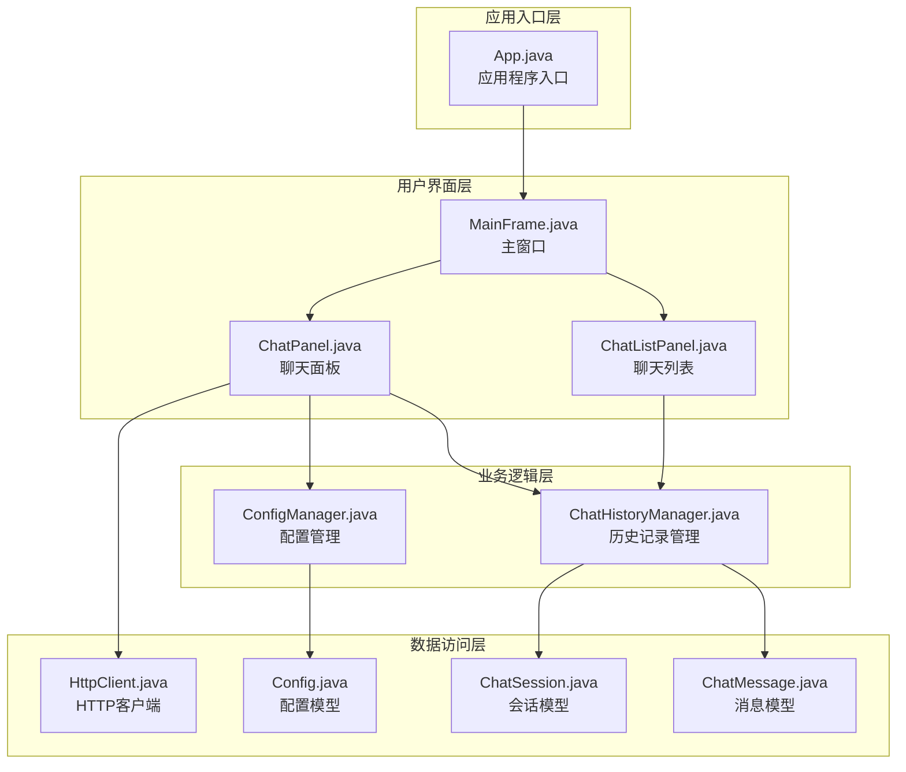
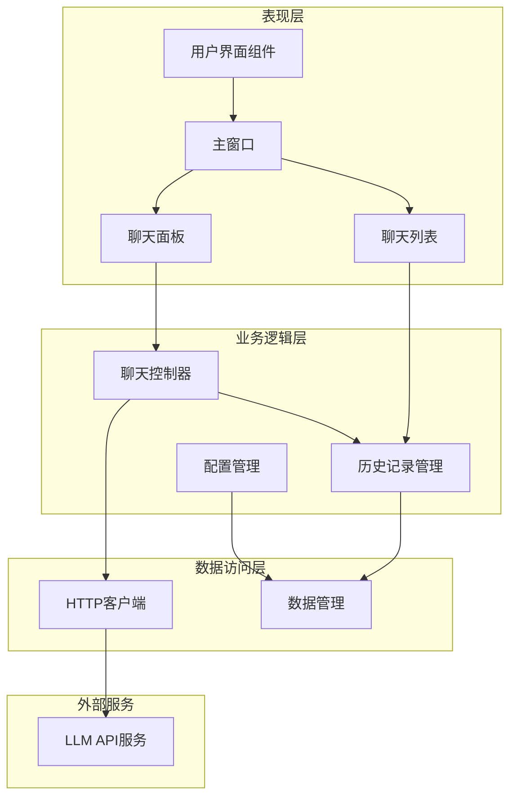
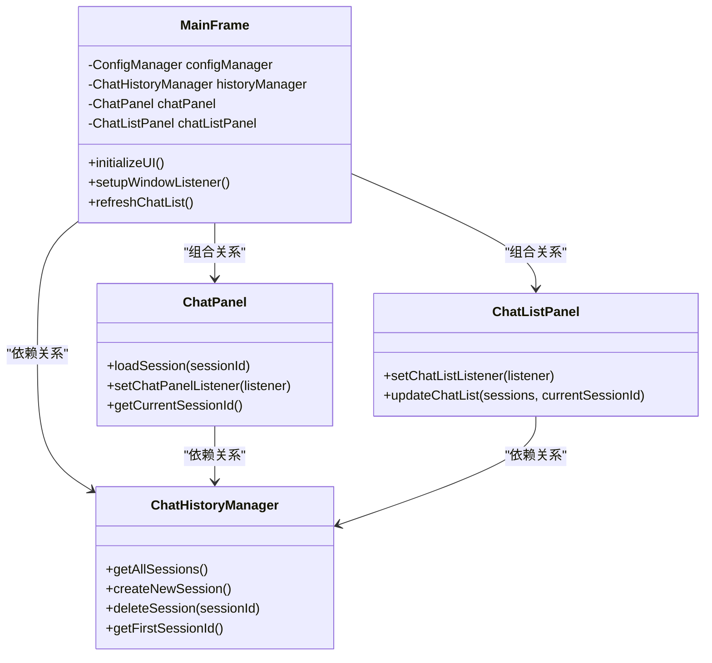
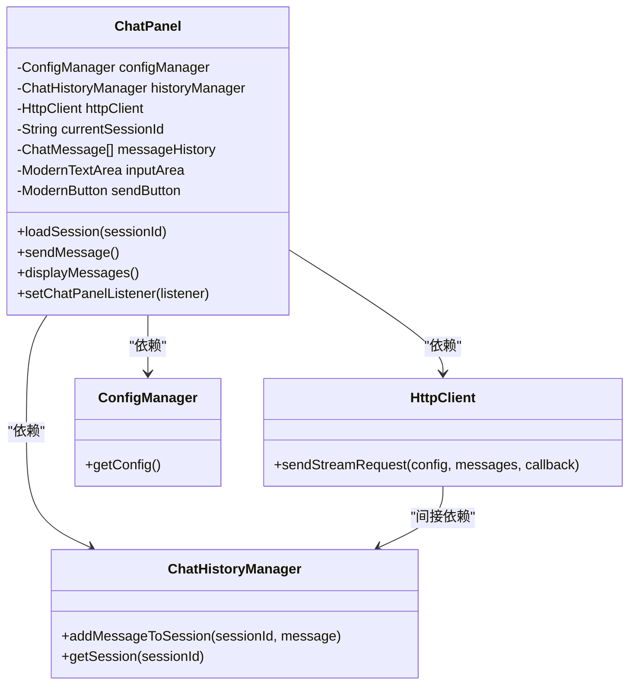
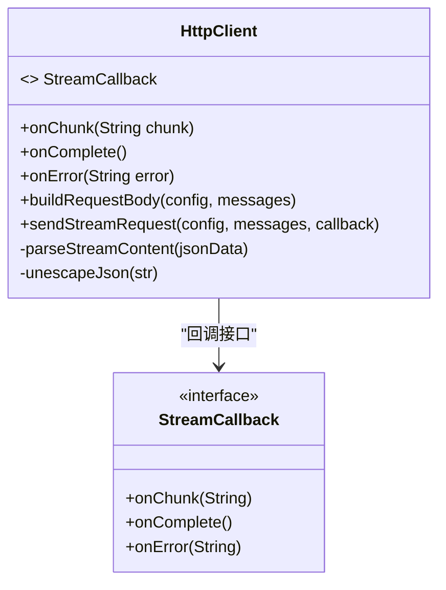
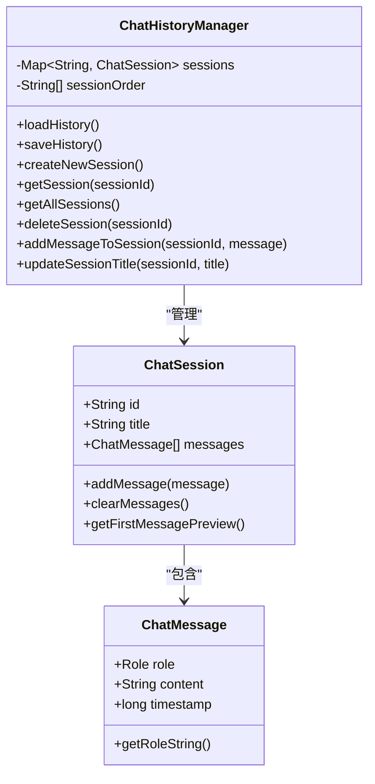
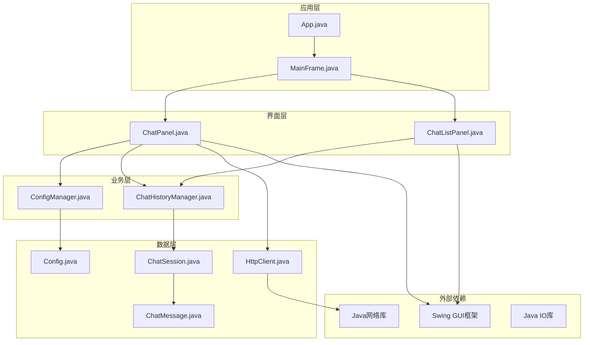
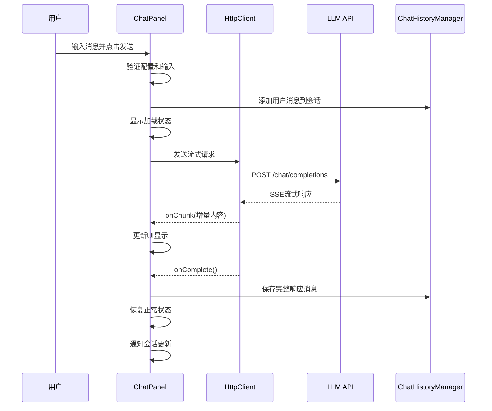
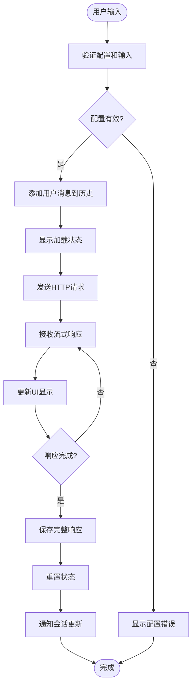

# 组件交互关系

<cite>
**本文档引用的文件**
- [App.java](file://src/com/llmchat/App.java)
- [MainFrame.java](file://src/com/llmchat/ui/MainFrame.java)
- [ChatPanel.java](file://src/com/llmchat/ui/ChatPanel.java)
- [HttpClient.java](file://src/com/llmchat/http/HttpClient.java)
- [ChatHistoryManager.java](file://src/com/llmchat/config/ChatHistoryManager.java)
- [ConfigManager.java](file://src/com/llmchat/config/ConfigManager.java)
- [ChatMessage.java](file://src/com/llmchat/model/ChatMessage.java)
- [ChatSession.java](file://src/com/llmchat/model/ChatSession.java)
- [Config.java](file://src/com/llmchat/model/Config.java)
- [ChatListPanel.java](file://src/com/llmchat/ui/components/ChatListPanel.java)
</cite>

## 目录
1. [简介](#简介)
2. [项目结构](#项目结构)
3. [核心组件](#核心组件)
4. [架构概览](#架构概览)
5. [详细组件分析](#详细组件分析)
6. [依赖关系分析](#依赖关系分析)
7. [性能考虑](#性能考虑)
8. [故障排除指南](#故障排除指南)
9. [结论](#结论)

## 简介

本项目是一个基于Java的大型语言模型聊天界面应用程序，采用Swing图形界面框架构建。该系统实现了完整的聊天功能，包括实时消息流式传输、会话管理和持久化存储。本文档详细分析了各个核心组件之间的交互关系和依赖关系，重点说明了MainFrame与ChatPanel的组合关系、ChatPanel与HttpClient的通信机制，以及ChatPanel与ChatHistoryManager的数据持久化交互。

## 项目结构

该项目采用模块化的分层架构设计，按照功能职责清晰地组织代码结构：

**图表来源**
- [App.java:11-25](file://src/com/llmchat/App.java#L11-L25)
- [MainFrame.java:19-36](file://src/com/llmchat/ui/MainFrame.java#L19-L36)
- [ChatPanel.java:21-55](file://src/com/llmchat/ui/ChatPanel.java#L21-L55)

**章节来源**
- [App.java:1-27](file://src/com/llmchat/App.java#L1-L27)
- [MainFrame.java:1-177](file://src/com/llmchat/ui/MainFrame.java#L1-L177)

## 核心组件

### 组件职责概述

系统包含以下核心组件，每个组件都有明确的职责边界：

1. **App类** - 应用程序入口点，负责设置系统外观并启动主窗口
2. **MainFrame类** - 主窗口控制器，管理整个应用程序的布局和组件协调
3. **ChatPanel类** - 核心聊天界面，处理用户交互、消息展示和LLM通信
4. **HttpClient类** - HTTP客户端，专门处理与LLM API的流式通信
5. **ChatHistoryManager类** - 历史记录管理器，负责会话数据的持久化存储
6. **ConfigManager类** - 配置管理器，维护应用程序配置信息
7. **ChatListPanel类** - 侧边栏聊天列表组件，提供会话选择和管理功能

**章节来源**
- [App.java:8-25](file://src/com/llmchat/App.java#L8-L25)
- [MainFrame.java:16-36](file://src/com/llmchat/ui/MainFrame.java#L16-L36)
- [ChatPanel.java:18-55](file://src/com/llmchat/ui/ChatPanel.java#L18-L55)

## 架构概览

系统采用分层架构设计，通过清晰的接口抽象实现组件间的松耦合：

**图表来源**
- [MainFrame.java:56-83](file://src/com/llmchat/ui/MainFrame.java#L56-L83)
- [ChatPanel.java:44-55](file://src/com/llmchat/ui/ChatPanel.java#L44-L55)

## 详细组件分析

### MainFrame组件分析

MainFrame作为应用程序的主容器，实现了组件间的协调和控制：

**图表来源**
- [MainFrame.java:24-32](file://src/com/llmchat/ui/MainFrame.java#L24-L32)
- [ChatPanel.java:24-26](file://src/com/llmchat/ui/ChatPanel.java#L24-L26)
- [ChatListPanel.java:23-26](file://src/com/llmchat/ui/components/ChatListPanel.java#L23-L26)

MainFrame的核心特性包括：
- **组合关系**：直接持有ChatPanel和ChatListPanel实例
- **事件监听**：通过ChatListPanel的回调接口实现会话切换
- **生命周期管理**：在窗口关闭时保存历史记录

**章节来源**
- [MainFrame.java:19-101](file://src/com/llmchat/ui/MainFrame.java#L19-L101)

### ChatPanel组件分析

ChatPanel是系统的核心交互组件，负责处理用户的所有操作：

**图表来源**
- [ChatPanel.java:21-55](file://src/com/llmchat/ui/ChatPanel.java#L21-L55)
- [HttpClient.java:16-25](file://src/com/llmchat/http/HttpClient.java#L16-L25)

ChatPanel的关键功能：
- **消息处理**：添加用户消息到历史记录并更新UI
- **流式响应**：实时接收和显示LLM的流式响应
- **状态管理**：管理发送按钮的加载状态和滚动位置
- **事件通知**：通过回调接口通知会话更新

**章节来源**
- [ChatPanel.java:86-297](file://src/com/llmchat/ui/ChatPanel.java#L86-L297)

### HttpClient组件分析

HttpClient专门处理与LLM API的HTTP通信，支持流式响应：

**图表来源**
- [HttpClient.java:16-25](file://src/com/llmchat/http/HttpClient.java#L16-L25)

HttpClient的设计特点：
- **异步处理**：在独立线程中执行网络请求
- **流式解析**：逐块解析SSE格式的响应数据
- **错误处理**：提供详细的错误回调机制
- **JSON处理**：内置JSON字符串的转义和反转义

**章节来源**
- [HttpClient.java:66-127](file://src/com/llmchat/http/HttpClient.java#L66-L127)

### ChatHistoryManager组件分析

ChatHistoryManager负责所有会话数据的持久化存储：

**图表来源**
- [ChatHistoryManager.java:16-27](file://src/com/llmchat/config/ChatHistoryManager.java#L16-L27)
- [ChatSession.java:11-26](file://src/com/llmchat/model/ChatSession.java#L11-L26)

数据持久化策略：
- **文件存储**：使用对象序列化将数据保存到文件系统
- **索引管理**：维护会话ID列表确保正确的显示顺序
- **并发安全**：使用ConcurrentHashMap保证多线程环境下的数据一致性
- **容错处理**：在文件损坏时自动重建默认会话

**章节来源**
- [ChatHistoryManager.java:32-99](file://src/com/llmchat/config/ChatHistoryManager.java#L32-L99)

## 依赖关系分析

系统采用清晰的依赖层次结构，实现了良好的解耦设计：

**图表来源**
- [App.java:3-7](file://src/com/llmchat/App.java#L3-L7)
- [ChatPanel.java:3-9](file://src/com/llmchat/ui/ChatPanel.java#L3-L9)

### 组件间调用链路

系统中的主要调用链路如下：

**图表来源**
- [ChatPanel.java:189-297](file://src/com/llmchat/ui/ChatPanel.java#L189-L297)
- [HttpClient.java:66-127](file://src/com/llmchat/http/HttpClient.java#L66-L127)

### 数据流向分析

消息在系统中的完整流转过程：

**图表来源**
- [ChatPanel.java:243-296](file://src/com/llmchat/ui/ChatPanel.java#L243-L296)

**章节来源**
- [ChatPanel.java:189-297](file://src/com/llmchat/ui/ChatPanel.java#L189-L297)
- [HttpClient.java:66-127](file://src/com/llmchat/http/HttpClient.java#L66-L127)

## 性能考虑

### 异步处理优化

系统采用了多线程异步处理来避免UI阻塞：

- **网络请求分离**：HTTP请求在独立线程中执行
- **UI更新同步**：使用SwingUtilities.invokeLater确保UI更新在EDT中执行
- **流式处理**：实时流式响应避免了大响应的内存占用

### 内存管理策略

- **增量显示**：流式响应逐块显示，减少内存峰值
- **及时释放**：响应完成后及时清理StringBuilder对象
- **对象池化**：复用MessageBubble组件避免频繁创建销毁

### 缓存和持久化

- **会话缓存**：内存中维护活跃会话的引用
- **文件I/O优化**：批量保存会话数据，减少磁盘写入次数
- **索引文件**：快速定位和加载会话列表

## 故障排除指南

### 常见问题及解决方案

1. **配置无效错误**
   - 检查API URL、API Key和模型名称是否正确设置
   - 验证网络连接和代理设置
   - 确认API Key具有相应的权限

2. **消息发送失败**
   - 检查网络连接状态
   - 验证LLM API服务可用性
   - 查看错误日志获取详细错误信息

3. **历史记录丢失**
   - 检查用户目录的.llmchat文件夹权限
   - 验证磁盘空间充足
   - 检查文件系统完整性

4. **UI响应缓慢**
   - 检查是否有大量并发请求
   - 验证系统资源使用情况
   - 考虑增加JVM堆内存

**章节来源**
- [ChatPanel.java:195-202](file://src/com/llmchat/ui/ChatPanel.java#L195-L202)
- [HttpClient.java:119-126](file://src/com/llmchat/http/HttpClient.java#L119-L126)

## 结论

本Java LLM聊天界面项目展现了良好的软件架构设计，通过清晰的分层结构和接口抽象实现了组件间的松耦合。系统的主要优势包括：

1. **模块化设计**：各组件职责明确，便于维护和扩展
2. **异步处理**：采用多线程和流式处理提升用户体验
3. **持久化存储**：完整的会话数据管理机制
4. **错误处理**：完善的异常捕获和用户反馈机制

通过本文档的分析，开发者可以深入理解系统的组件交互关系和数据流向，为后续的功能扩展和性能优化提供坚实的基础。