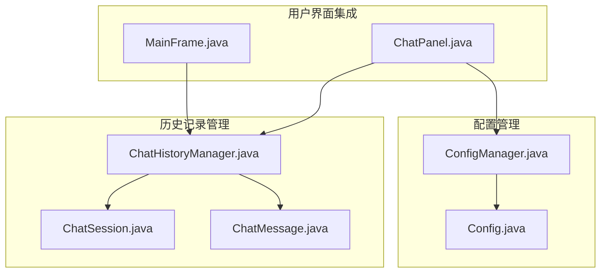
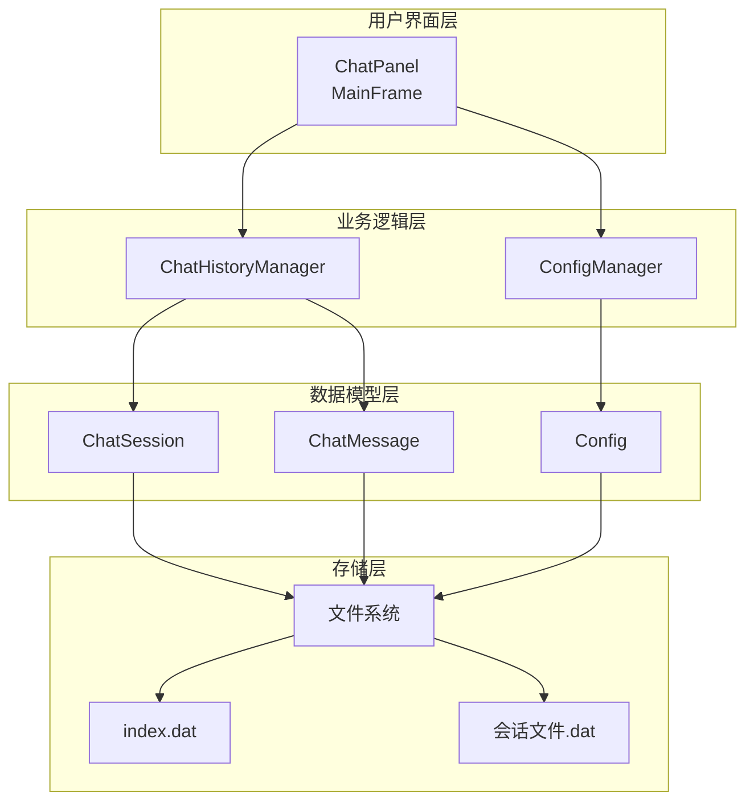
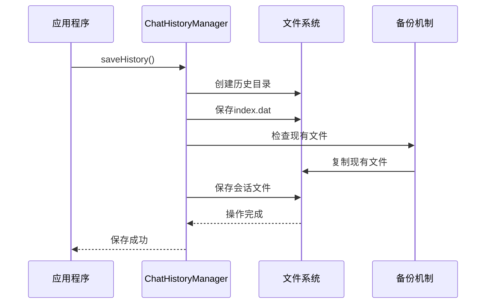
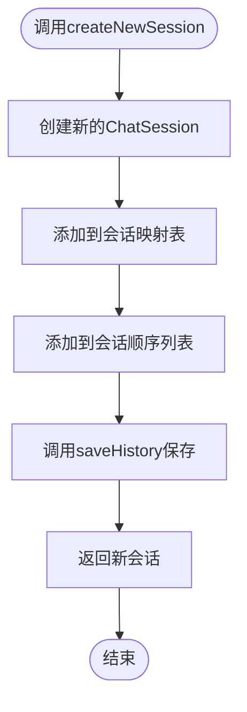
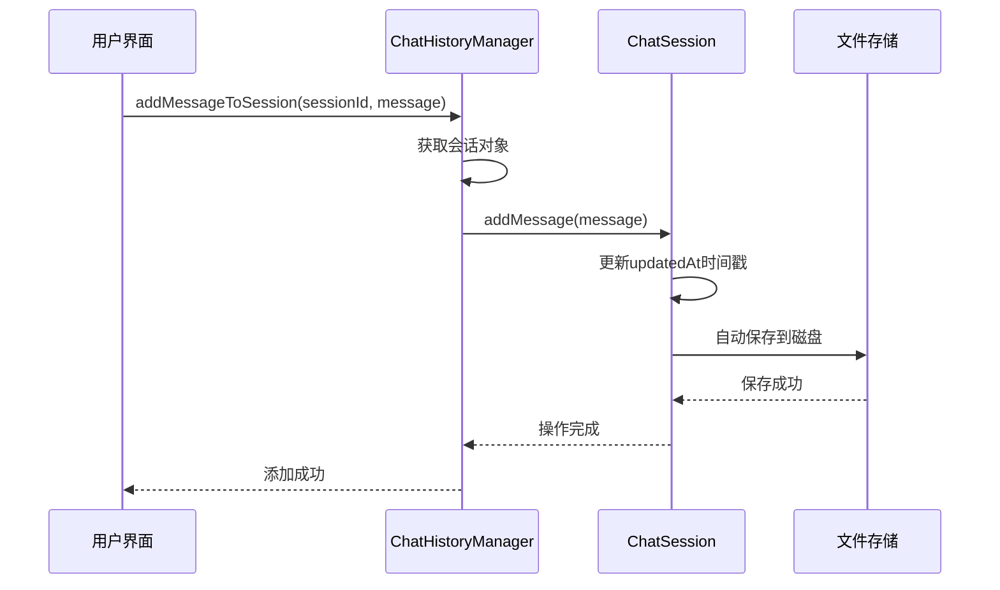
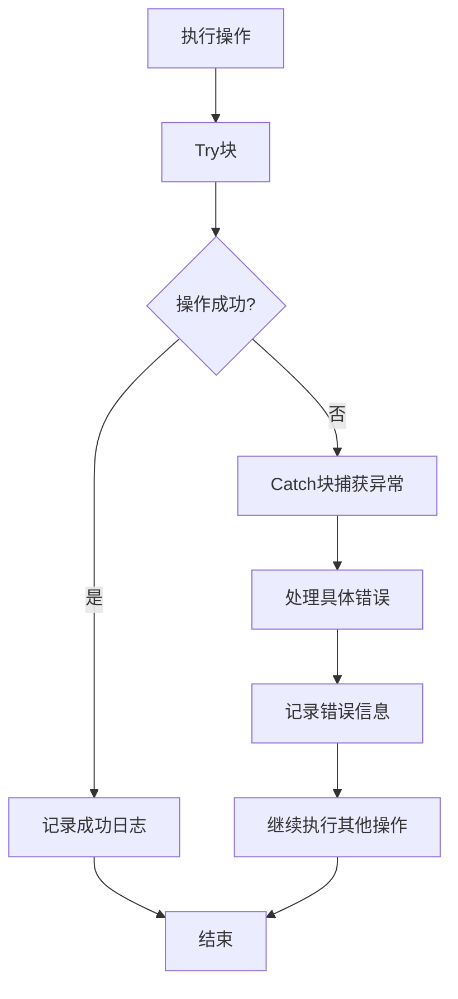
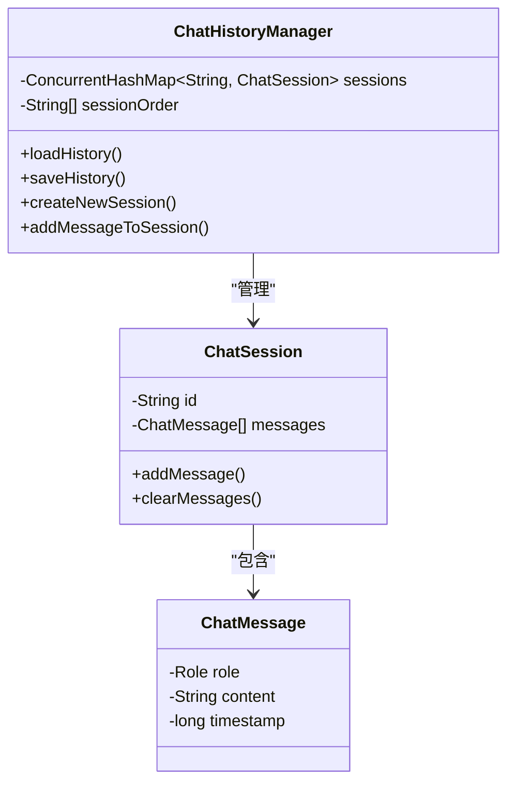
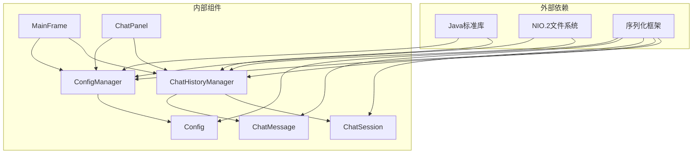
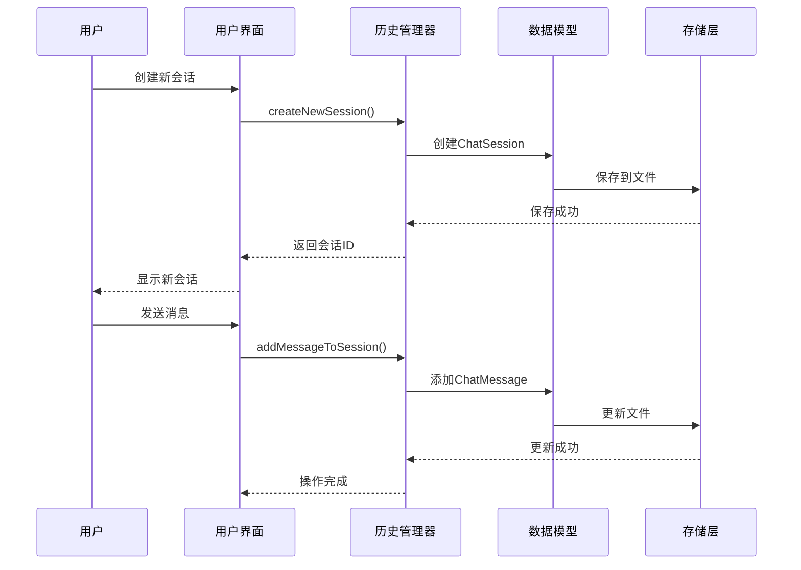

# 数据持久化模块

<cite>
**本文档引用的文件**
- [ChatHistoryManager.java](file://src/com/llmchat/config/ChatHistoryManager.java)
- [ChatSession.java](file://src/com/llmchat/model/ChatSession.java)
- [ChatMessage.java](file://src/com/llmchat/model/ChatMessage.java)
- [ConfigManager.java](file://src/com/llmchat/config/ConfigManager.java)
- [Config.java](file://src/com/llmchat/model/Config.java)
- [MainFrame.java](file://src/com/llmchat/ui/MainFrame.java)
- [ChatPanel.java](file://src/com/llmchat/ui/ChatPanel.java)
</cite>

## 目录
1. [简介](#简介)
2. [项目结构](#项目结构)
3. [核心组件](#核心组件)
4. [架构概览](#架构概览)
5. [详细组件分析](#详细组件分析)
6. [依赖关系分析](#依赖关系分析)
7. [性能考虑](#性能考虑)
8. [故障排除指南](#故障排除指南)
9. [结论](#结论)

## 简介

数据持久化模块是Java LLM Chat应用程序的核心组件之一，负责管理聊天会话的历史记录和消息数据的持久化存储。该模块实现了完整的会话生命周期管理，包括会话创建、消息存储、历史查询和数据清理等功能。通过对象序列化机制，模块能够可靠地保存和恢复复杂的聊天数据结构。

## 项目结构

数据持久化模块主要位于以下目录结构中：



**图表来源**
- [ChatHistoryManager.java:1-206](file://src/com/llmchat/config/ChatHistoryManager.java#L1-L206)
- [ConfigManager.java:1-101](file://src/com/llmchat/config/ConfigManager.java#L1-L101)

**章节来源**
- [ChatHistoryManager.java:1-206](file://src/com/llmchat/config/ChatHistoryManager.java#L1-L206)
- [ConfigManager.java:1-101](file://src/com/llmchat/config/ConfigManager.java#L1-L101)

## 核心组件

### ChatHistoryManager类

ChatHistoryManager是数据持久化模块的核心控制器，负责管理所有聊天会话的生命周期和数据持久化。该类采用单例模式设计，确保整个应用程序只有一个历史记录管理器实例。

#### 主要职责
- 会话管理：创建、删除、更新和查询聊天会话
- 数据持久化：将会话数据序列化到文件系统
- 历史记录加载：从磁盘恢复之前保存的会话数据
- 并发控制：支持多线程环境下的安全访问

#### 关键特性
- **自动恢复**：应用启动时自动加载已存在的会话数据
- **实时保存**：每次数据变更后立即保存到磁盘
- **错误容错**：单个会话损坏不影响其他会话的正常加载
- **内存优化**：使用ConcurrentHashMap保证高性能并发访问

**章节来源**
- [ChatHistoryManager.java:13-27](file://src/com/llmchat/config/ChatHistoryManager.java#L13-L27)

### 数据模型设计

#### ChatSession数据模型

ChatSession代表一个独立的聊天会话，包含完整的会话元数据和消息历史。

**核心字段**
- `id`: 唯一标识符，使用UUID生成
- `title`: 会话标题，支持动态更新
- `createdAt`: 创建时间戳
- `updatedAt`: 最后更新时间戳
- `messages`: 消息列表，存储ChatMessage对象

**时间戳管理**
- 创建时自动设置`createdAt`和`updatedAt`
- 每次消息添加或清空时更新`updatedAt`
- 支持精确到毫秒的时间记录

**章节来源**
- [ChatSession.java:8-26](file://src/com/llmchat/model/ChatSession.java#L8-L26)

#### ChatMessage数据模型

ChatMessage表示单条聊天消息，支持三种消息角色。

**消息角色分类**
- `USER`: 用户发送的消息
- `ASSISTANT`: AI助手回复的消息  
- `SYSTEM`: 系统级消息（如提示词）

**字段设计**
- `role`: 消息角色枚举
- `content`: 消息内容字符串
- `timestamp`: 消息发送时间戳

**章节来源**
- [ChatMessage.java:5-12](file://src/com/llmchat/model/ChatMessage.java#L5-L12)

## 架构概览

数据持久化模块采用分层架构设计，清晰分离了数据模型、业务逻辑和用户界面层。



**图表来源**
- [ChatHistoryManager.java:16-27](file://src/com/llmchat/config/ChatHistoryManager.java#L16-L27)
- [ConfigManager.java:14-22](file://src/com/llmchat/config/ConfigManager.java#L14-L22)

## 详细组件分析

### 文件存储架构

#### 存储位置和格式

数据持久化模块采用文件系统存储方案，所有数据统一存储在用户主目录下的`.llmchat`隐藏文件夹中。

**存储路径结构**
```
~/.llmchat/
├── history/           # 历史记录目录
│   ├── index.dat      # 索引文件
│   ├── session1.dat   # 会话1数据
│   ├── session2.dat   # 会话2数据
│   └── ...
└── config.dat         # 应用配置文件
```

**存储格式**
- 使用Java原生对象序列化机制
- 每个会话独立存储为`.dat`文件
- 索引文件记录会话ID列表和加载顺序

#### 数据备份策略

模块实现了自动备份机制，确保数据安全性和可靠性：



**图表来源**
- [ChatHistoryManager.java:70-99](file://src/com/llmchat/config/ChatHistoryManager.java#L70-L99)

**章节来源**
- [ChatHistoryManager.java:17-18](file://src/com/llmchat/config/ChatHistoryManager.java#L17-L18)

### 会话管理功能

#### 会话创建流程



**图表来源**
- [ChatHistoryManager.java:104-110](file://src/com/llmchat/config/ChatHistoryManager.java#L104-L110)

#### 会话删除机制

会话删除操作包含多个步骤，确保数据完整性和一致性：

1. **内存清理**：从会话映射表和顺序列表中移除
2. **文件删除**：删除对应的会话数据文件
3. **自动重建**：如果删除后没有会话，自动创建新会话
4. **持久化**：保存更新后的索引信息

**章节来源**
- [ChatHistoryManager.java:136-154](file://src/com/llmchat/config/ChatHistoryManager.java#L136-L154)

### 消息持久化机制

#### 消息添加流程



**图表来源**
- [ChatHistoryManager.java:170-182](file://src/com/llmchat/config/ChatHistoryManager.java#L170-L182)

#### 时间戳管理策略

消息持久化过程中实现了精确的时间戳管理：

- **消息创建时间**：由ChatMessage构造函数自动设置
- **会话更新时间**：每次消息添加或清空时更新
- **标题预览生成**：基于第一条用户消息内容自动生成

**章节来源**
- [ChatMessage.java:20-22](file://src/com/llmchat/model/ChatMessage.java#L20-L22)
- [ChatSession.java:61-69](file://src/com/llmchat/model/ChatSession.java#L61-L69)

### 错误处理机制

#### 异常处理策略

数据持久化模块实现了多层次的错误处理机制：



**图表来源**
- [ChatHistoryManager.java:48-58](file://src/com/llmchat/config/ChatHistoryManager.java#L48-L58)

#### 具体错误场景

1. **索引文件损坏**：自动创建新的会话列表
2. **单个会话文件丢失**：跳过该会话，继续加载其他会话
3. **磁盘写入失败**：记录错误但不中断应用程序运行
4. **文件权限问题**：优雅降级到内存模式运行

**章节来源**
- [ChatHistoryManager.java:48-58](file://src/com/llmchat/config/ChatHistoryManager.java#L48-L58)

### 并发访问控制

#### 线程安全设计

模块采用了多种技术确保线程安全性：



**图表来源**
- [ChatHistoryManager.java:20-26](file://src/com/llmchat/config/ChatHistoryManager.java#L20-L26)
- [ChatSession.java:18](file://src/com/llmchat/model/ChatSession.java#L18)

**章节来源**
- [ChatHistoryManager.java:20-26](file://src/com/llmchat/config/ChatHistoryManager.java#L20-L26)

## 依赖关系分析

### 组件间依赖关系



**图表来源**
- [ChatHistoryManager.java:3-11](file://src/com/llmchat/config/ChatHistoryManager.java#L3-L11)
- [ConfigManager.java:3-9](file://src/com/llmchat/config/ConfigManager.java#L3-L9)

### 数据流分析

#### 会话数据流



**图表来源**
- [ChatPanel.java:213](file://src/com/llmchat/ui/ChatPanel.java#L213)
- [ChatHistoryManager.java:170-182](file://src/com/llmchat/config/ChatHistoryManager.java#L170-L182)

**章节来源**
- [ChatPanel.java:213](file://src/com/llmchat/ui/ChatPanel.java#L213)

## 性能考虑

### 存储性能优化

#### 内存管理策略

1. **延迟加载**：仅在需要时加载会话数据
2. **缓存机制**：在内存中维护活跃会话的缓存
3. **批量操作**：支持批量保存减少磁盘I/O操作

#### I/O操作优化

1. **异步保存**：保存操作在后台线程执行
2. **增量更新**：只更新发生变化的数据部分
3. **文件复用**：避免频繁创建和销毁文件句柄

### 并发性能优化

#### 线程池管理

模块使用了高效的并发数据结构：
- `ConcurrentHashMap`：支持高并发读写操作
- `Collections.synchronizedList`：保证列表操作的线程安全
- 原子性操作：关键数据更新使用原子操作

#### 内存使用优化

1. **对象重用**：避免频繁创建临时对象
2. **流式处理**：大文件读写使用流式API
3. **垃圾回收友好**：及时释放不再使用的对象引用

## 故障排除指南

### 常见问题及解决方案

#### 数据丢失问题

**症状**：重启应用后会话数据消失

**可能原因**：
1. 存储目录权限不足
2. 磁盘空间不足
3. 文件系统异常

**解决方法**：
1. 检查`~/.llmchat`目录权限
2. 确认磁盘空间充足
3. 运行文件系统检查工具

#### 启动缓慢问题

**症状**：应用启动时间过长

**可能原因**：
1. 会话数量过多
2. 会话文件过大
3. 磁盘I/O性能差

**解决方法**：
1. 清理不需要的历史会话
2. 检查磁盘性能
3. 考虑升级到SSD存储

#### 数据损坏问题

**症状**：特定会话无法加载

**可能原因**：
1. 会话文件损坏
2. 应用程序异常退出
3. 磁盘故障

**解决方法**：
1. 删除损坏的会话文件
2. 从备份恢复数据
3. 检查磁盘健康状况

### 调试技巧

#### 日志分析

模块会在保存失败时输出详细的错误信息：
- 文件路径信息
- 异常类型和堆栈跟踪
- 操作上下文信息

#### 数据验证

可以通过以下方式验证数据完整性：
1. 检查`index.dat`文件是否可读
2. 验证每个会话文件的完整性
3. 确认时间戳的一致性

**章节来源**
- [ChatHistoryManager.java:95-98](file://src/com/llmchat/config/ChatHistoryManager.java#L95-L98)

## 结论

数据持久化模块通过精心设计的架构和完善的错误处理机制，为Java LLM Chat应用程序提供了可靠的聊天数据管理能力。模块的主要优势包括：

1. **可靠性**：多重备份和错误恢复机制确保数据安全
2. **性能**：高效的并发处理和内存管理优化
3. **易用性**：简洁的API设计和自动化的数据管理
4. **扩展性**：模块化设计便于功能扩展和维护

该模块成功地平衡了数据持久化的需求与用户体验，在保证数据安全的同时提供了流畅的应用程序性能。通过合理的文件组织和存储策略，模块能够在各种环境下稳定运行，并为用户提供可靠的聊天历史管理功能。