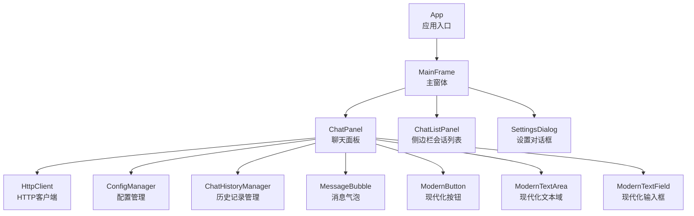
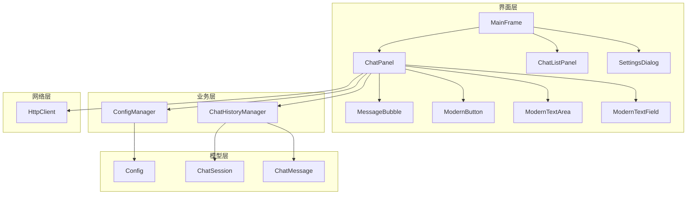
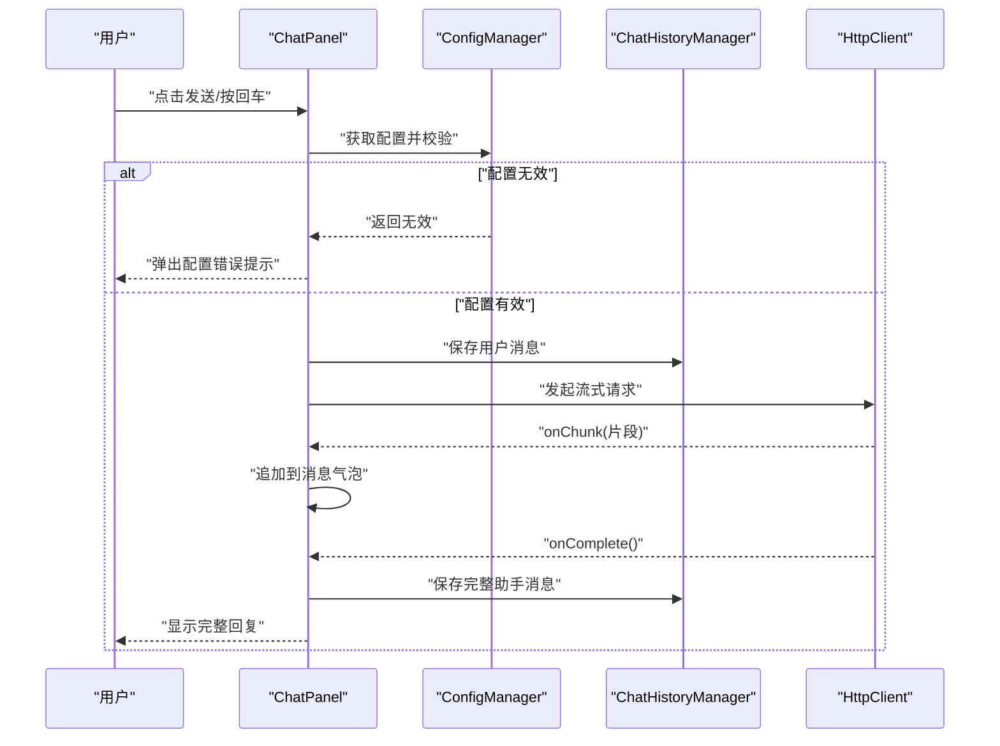
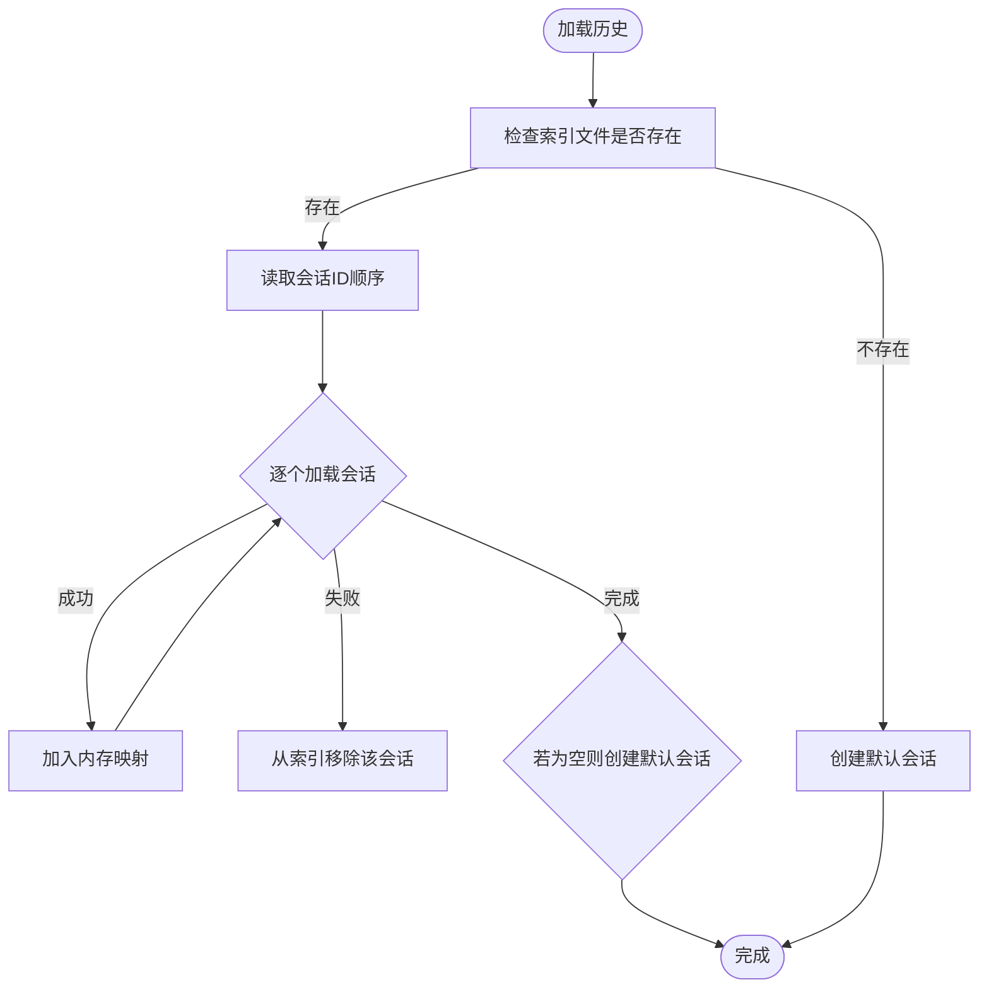
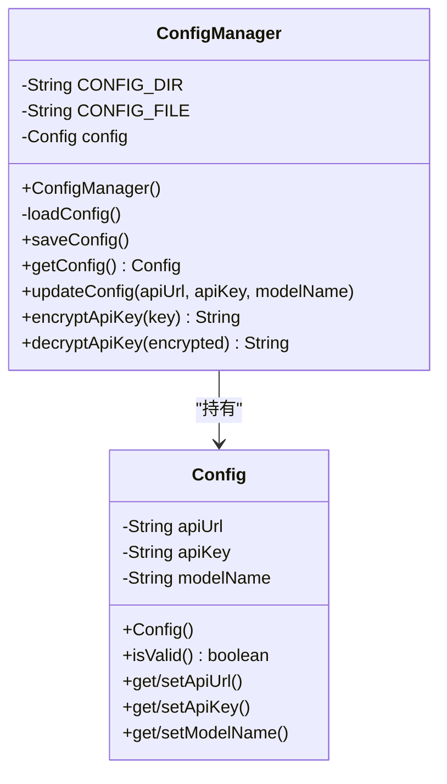
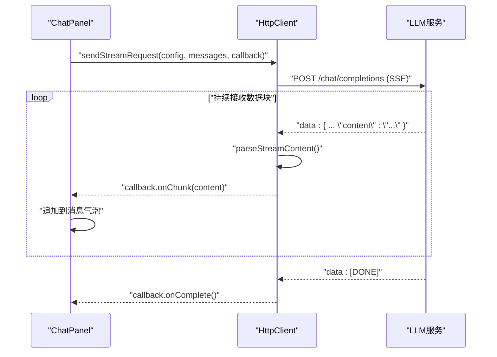
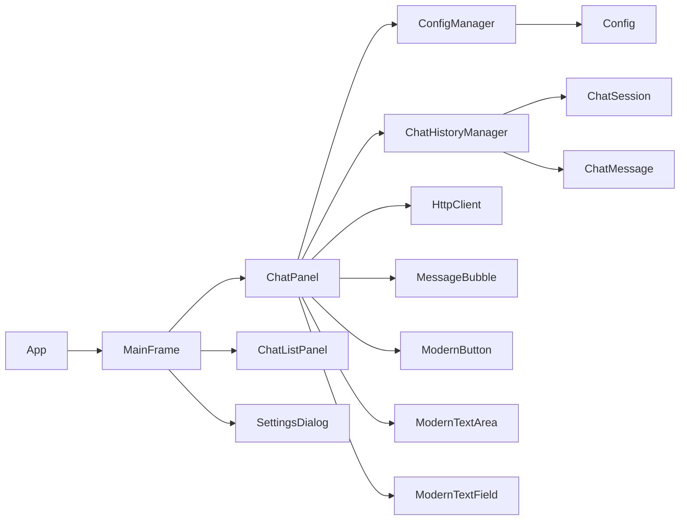

# 核心模块

<cite>
**本文引用的文件**
- [App.java](file://src/com/llmchat/App.java)
- [MainFrame.java](file://src/com/llmchat/ui/MainFrame.java)
- [ChatPanel.java](file://src/com/llmchat/ui/ChatPanel.java)
- [ChatListPanel.java](file://src/com/llmchat/ui/components/ChatListPanel.java)
- [MessageBubble.java](file://src/com/llmchat/ui/components/MessageBubble.java)
- [ModernButton.java](file://src/com/llmchat/ui/components/ModernButton.java)
- [ModernTextArea.java](file://src/com/llmchat/ui/components/ModernTextArea.java)
- [ModernTextField.java](file://src/com/llmchat/ui/components/ModernTextField.java)
- [SettingsDialog.java](file://src/com/llmchat/ui/SettingsDialog.java)
- [HttpClient.java](file://src/com/llmchat/http/HttpClient.java)
- [ConfigManager.java](file://src/com/llmchat/config/ConfigManager.java)
- [ChatHistoryManager.java](file://src/com/llmchat/config/ChatHistoryManager.java)
- [Config.java](file://src/com/llmchat/model/Config.java)
- [ChatMessage.java](file://src/com/llmchat/model/ChatMessage.java)
- [ChatSession.java](file://src/com/llmchat/model/ChatSession.java)
</cite>

## 目录
1. [简介](#简介)
2. [项目结构](#项目结构)
3. [核心组件](#核心组件)
4. [架构总览](#架构总览)
5. [详细组件分析](#详细组件分析)
6. [依赖分析](#依赖分析)
7. [性能考虑](#性能考虑)
8. [故障排查指南](#故障排查指南)
9. [结论](#结论)
10. [附录](#附录)

## 简介
本项目是一个基于 Java Swing 的大语言模型聊天界面应用，围绕“聊天核心模块、数据持久化模块、配置管理模块、网络通信模块”四大核心模块构建。应用通过主入口启动图形界面，用户在聊天面板中输入消息，经由网络通信模块向 LLM 接口发起流式请求，实时接收并展示回复；同时，所有会话与消息均通过持久化模块进行本地存储，配置模块负责 API 地址、密钥与模型名等参数的读写与加密。

## 项目结构
项目采用按功能域划分的包结构，清晰分离 UI、模型、配置与网络层：
- com.llmchat.App：应用入口，设置系统外观并启动主窗体
- com.llmchat.ui.*：主窗体与聊天界面组件
- com.llmchat.ui.components.*：可复用的现代化 UI 组件
- com.llmchat.model.*：聊天消息、会话与配置的数据模型
- com.llmchat.config.*：配置与聊天历史的持久化管理
- com.llmchat.http.*：HTTP 客户端与流式响应处理

图表来源
- [App.java:11-26](file://src/com/llmchat/App.java#L11-L26)
- [MainFrame.java:30-101](file://src/com/llmchat/ui/MainFrame.java#L30-L101)
- [ChatPanel.java:44-55](file://src/com/llmchat/ui/ChatPanel.java#L44-L55)
- [ChatListPanel.java:34-84](file://src/com/llmchat/ui/components/ChatListPanel.java#L34-L84)
- [MessageBubble.java:24-58](file://src/com/llmchat/ui/components/MessageBubble.java#L24-L58)
- [ModernButton.java:31-40](file://src/com/llmchat/ui/components/ModernButton.java#L31-L40)
- [ModernTextArea.java:18-31](file://src/com/llmchat/ui/components/ModernTextArea.java#L18-L31)
- [ModernTextField.java:17-24](file://src/com/llmchat/ui/components/ModernTextField.java#L17-L24)
- [SettingsDialog.java:27-37](file://src/com/llmchat/ui/SettingsDialog.java#L27-L37)
- [HttpClient.java:16-25](file://src/com/llmchat/http/HttpClient.java#L16-L25)
- [ConfigManager.java:14-22](file://src/com/llmchat/config/ConfigManager.java#L14-L22)
- [ChatHistoryManager.java:23-27](file://src/com/llmchat/config/ChatHistoryManager.java#L23-L27)

章节来源
- [App.java:11-26](file://src/com/llmchat/App.java#L11-L26)
- [MainFrame.java:30-101](file://src/com/llmchat/ui/MainFrame.java#L30-L101)

## 核心组件
- 聊天核心模块：负责用户交互、消息渲染、会话切换与网络请求调度
- 数据持久化模块：负责配置与聊天历史的序列化读写与索引维护
- 配置管理模块：负责 API 地址、密钥与模型名的读取、更新与简单加密
- 网络通信模块：负责构建请求体、发送流式请求、解析 SSE 响应并回调 UI

章节来源
- [ChatPanel.java:44-55](file://src/com/llmchat/ui/ChatPanel.java#L44-L55)
- [ChatHistoryManager.java:23-27](file://src/com/llmchat/config/ChatHistoryManager.java#L23-L27)
- [ConfigManager.java:14-22](file://src/com/llmchat/config/ConfigManager.java#L14-L22)
- [HttpClient.java:16-25](file://src/com/llmchat/http/HttpClient.java#L16-L25)

## 架构总览
应用采用“主窗体承载聊天面板与会话列表”的布局，聊天面板内部组合多种 UI 组件，负责与配置与历史管理器协作完成数据读写，并通过 HTTP 客户端与 LLM 服务进行流式通信。

图表来源
- [MainFrame.java:30-101](file://src/com/llmchat/ui/MainFrame.java#L30-L101)
- [ChatPanel.java:44-55](file://src/com/llmchat/ui/ChatPanel.java#L44-L55)
- [ChatListPanel.java:34-84](file://src/com/llmchat/ui/components/ChatListPanel.java#L34-L84)
- [SettingsDialog.java:27-37](file://src/com/llmchat/ui/SettingsDialog.java#L27-L37)
- [MessageBubble.java:24-58](file://src/com/llmchat/ui/components/MessageBubble.java#L24-L58)
- [ModernButton.java:31-40](file://src/com/llmchat/ui/components/ModernButton.java#L31-L40)
- [ModernTextArea.java:18-31](file://src/com/llmchat/ui/components/ModernTextArea.java#L18-L31)
- [ModernTextField.java:17-24](file://src/com/llmchat/ui/components/ModernTextField.java#L17-L24)
- [ConfigManager.java:14-22](file://src/com/llmchat/config/ConfigManager.java#L14-L22)
- [ChatHistoryManager.java:23-27](file://src/com/llmchat/config/ChatHistoryManager.java#L23-L27)
- [HttpClient.java:16-25](file://src/com/llmchat/http/HttpClient.java#L16-L25)
- [Config.java:8-20](file://src/com/llmchat/model/Config.java#L8-L20)
- [ChatSession.java:11-26](file://src/com/llmchat/model/ChatSession.java#L11-L26)
- [ChatMessage.java:8-12](file://src/com/llmchat/model/ChatMessage.java#L8-L12)

## 详细组件分析

### 聊天核心模块（ChatPanel）
职责与行为
- 负责渲染消息列表、处理用户输入、控制发送按钮状态
- 与配置管理器校验 API 配置有效性
- 与历史管理器协作加载/保存会话与消息
- 通过 HTTP 客户端发起流式请求，实时拼接并展示响应片段
- 错误时回滚用户消息并提示

关键流程（发送消息）

图表来源
- [ChatPanel.java:189-297](file://src/com/llmchat/ui/ChatPanel.java#L189-L297)
- [ConfigManager.java:63-75](file://src/com/llmchat/config/ConfigManager.java#L63-L75)
- [ChatHistoryManager.java:170-182](file://src/com/llmchat/config/ChatHistoryManager.java#L170-L182)
- [HttpClient.java:66-127](file://src/com/llmchat/http/HttpClient.java#L66-L127)

章节来源
- [ChatPanel.java:44-55](file://src/com/llmchat/ui/ChatPanel.java#L44-L55)
- [ChatPanel.java:189-297](file://src/com/llmchat/ui/ChatPanel.java#L189-L297)

### 数据持久化模块（ChatHistoryManager）
职责与行为
- 维护会话索引与目录结构，支持并发访问
- 提供创建、删除、重命名、清空、新增消息等操作
- 保证单个会话文件损坏不影响整体加载，自动修复索引

算法与复杂度
- 会话索引读写：O(n)（n 为会话数），通过对象序列化与独立文件组织
- 消息追加：O(1)，直接在内存集合中添加并延迟落盘

图表来源
- [ChatHistoryManager.java:32-65](file://src/com/llmchat/config/ChatHistoryManager.java#L32-L65)
- [ChatHistoryManager.java:104-110](file://src/com/llmchat/config/ChatHistoryManager.java#L104-L110)
- [ChatHistoryManager.java:170-182](file://src/com/llmchat/config/ChatHistoryManager.java#L170-L182)

章节来源
- [ChatHistoryManager.java:16-27](file://src/com/llmchat/config/ChatHistoryManager.java#L16-L27)
- [ChatHistoryManager.java:32-65](file://src/com/llmchat/config/ChatHistoryManager.java#L32-L65)
- [ChatHistoryManager.java:104-110](file://src/com/llmchat/config/ChatHistoryManager.java#L104-L110)
- [ChatHistoryManager.java:170-182](file://src/com/llmchat/config/ChatHistoryManager.java#L170-L182)

### 配置管理模块（ConfigManager）
职责与行为
- 负责配置文件的读取、保存与更新
- 提供 API Key 的简单 Base64 加解密能力（便于本地存储）

图表来源
- [ConfigManager.java:14-22](file://src/com/llmchat/config/ConfigManager.java#L14-L22)
- [ConfigManager.java:63-75](file://src/com/llmchat/config/ConfigManager.java#L63-L75)
- [Config.java:8-20](file://src/com/llmchat/model/Config.java#L8-L20)

章节来源
- [ConfigManager.java:14-22](file://src/com/llmchat/config/ConfigManager.java#L14-L22)
- [ConfigManager.java:63-75](file://src/com/llmchat/config/ConfigManager.java#L63-L75)
- [Config.java:8-20](file://src/com/llmchat/model/Config.java#L8-L20)

### 网络通信模块（HttpClient）
职责与行为
- 构造符合 LLM 接口规范的请求体（含模型名与消息数组）
- 发起 POST 请求并设置 Accept: text/event-stream 实现流式响应
- 解析服务器推送的事件数据，提取 content 字段并回调 UI

图表来源
- [HttpClient.java:66-127](file://src/com/llmchat/http/HttpClient.java#L66-L127)
- [HttpClient.java:132-163](file://src/com/llmchat/http/HttpClient.java#L132-L163)
- [ChatPanel.java:243-296](file://src/com/llmchat/ui/ChatPanel.java#L243-L296)

章节来源
- [HttpClient.java:16-25](file://src/com/llmchat/http/HttpClient.java#L16-L25)
- [HttpClient.java:66-127](file://src/com/llmchat/http/HttpClient.java#L66-L127)
- [HttpClient.java:132-163](file://src/com/llmchat/http/HttpClient.java#L132-L163)

### UI 组件与交互
- ChatListPanel：侧边栏会话列表，支持新建、选中与删除会话
- MessageBubble：消息气泡渲染，支持多平台 emoji 字体回退
- ModernButton/ModernTextArea/ModernTextField：现代化输入与按钮组件

章节来源
- [ChatListPanel.java:34-84](file://src/com/llmchat/ui/components/ChatListPanel.java#L34-L84)
- [MessageBubble.java:24-58](file://src/com/llmchat/ui/components/MessageBubble.java#L24-L58)
- [ModernButton.java:31-40](file://src/com/llmchat/ui/components/ModernButton.java#L31-L40)
- [ModernTextArea.java:18-31](file://src/com/llmchat/ui/components/ModernTextArea.java#L18-L31)
- [ModernTextField.java:17-24](file://src/com/llmchat/ui/components/ModernTextField.java#L17-L24)

## 依赖分析
模块间耦合与协作
- ChatPanel 依赖 ConfigManager、ChatHistoryManager、HttpClient 与 UI 组件
- MainFrame 作为装配者，协调 ChatPanel、ChatListPanel 与 SettingsDialog
- ConfigManager 仅依赖 Config 模型
- ChatHistoryManager 仅依赖 ChatSession 与 ChatMessage 模型
- HttpClient 不依赖 UI，仅依赖模型与标准库

图表来源
- [App.java:11-26](file://src/com/llmchat/App.java#L11-L26)
- [MainFrame.java:30-101](file://src/com/llmchat/ui/MainFrame.java#L30-L101)
- [ChatPanel.java:44-55](file://src/com/llmchat/ui/ChatPanel.java#L44-L55)
- [ConfigManager.java:14-22](file://src/com/llmchat/config/ConfigManager.java#L14-L22)
- [ChatHistoryManager.java:23-27](file://src/com/llmchat/config/ChatHistoryManager.java#L23-L27)
- [HttpClient.java:16-25](file://src/com/llmchat/http/HttpClient.java#L16-L25)
- [Config.java:8-20](file://src/com/llmchat/model/Config.java#L8-L20)
- [ChatSession.java:11-26](file://src/com/llmchat/model/ChatSession.java#L11-L26)
- [ChatMessage.java:8-12](file://src/com/llmchat/model/ChatMessage.java#L8-L12)

章节来源
- [App.java:11-26](file://src/com/llmchat/App.java#L11-L26)
- [MainFrame.java:30-101](file://src/com/llmchat/ui/MainFrame.java#L30-L101)
- [ChatPanel.java:44-55](file://src/com/llmchat/ui/ChatPanel.java#L44-L55)

## 性能考虑
- UI 更新与网络回调
  - 使用 SwingUtilities.invokeLater 将 UI 更新切回事件派发线程，避免跨线程访问组件引发问题
  - 流式回调中按片段增量更新，避免一次性拼接大量字符串导致卡顿
- IO 与序列化
  - 历史文件按会话拆分，索引单独保存，降低单文件体积与锁粒度
  - 会话文件损坏时仅移除对应会话，不影响其他会话加载
- 网络请求
  - 设置连接与读取超时，防止阻塞 UI 线程
  - SSE 流式读取，边到边渲染，减少首字节等待感
- 字体与渲染
  - 消息气泡根据内容动态计算尺寸，避免过度重绘
  - 按需 revalidate/repaint，减少不必要的布局刷新

章节来源
- [ChatPanel.java:243-296](file://src/com/llmchat/ui/ChatPanel.java#L243-L296)
- [ChatHistoryManager.java:70-99](file://src/com/llmchat/config/ChatHistoryManager.java#L70-L99)
- [HttpClient.java:77-78](file://src/com/llmchat/http/HttpClient.java#L77-L78)
- [MessageBubble.java:147-163](file://src/com/llmchat/ui/components/MessageBubble.java#L147-L163)

## 故障排查指南
常见问题与定位
- 配置未设置或不合法
  - 现象：发送按钮不可用或弹出配置错误提示
  - 排查：检查配置是否保存成功、字段是否为空
  - 参考路径：[ChatPanel.java:195-202](file://src/com/llmchat/ui/ChatPanel.java#L195-L202)，[Config.java:46-50](file://src/com/llmchat/model/Config.java#L46-L50)
- API 请求失败
  - 现象：回调 onError 并提示错误信息
  - 排查：检查 API URL、密钥、网络连通性与服务端返回码
  - 参考路径：[HttpClient.java:88-93](file://src/com/llmchat/http/HttpClient.java#L88-L93)，[HttpClient.java:193-206](file://src/com/llmchat/http/HttpClient.java#L193-L206)
- 历史文件损坏
  - 现象：个别会话加载失败但不影响其他会话
  - 排查：查看索引文件与对应会话文件是否存在且可读
  - 参考路径：[ChatHistoryManager.java:48-52](file://src/com/llmchat/config/ChatHistoryManager.java#L48-L52)，[ChatHistoryManager.java:54-58](file://src/com/llmchat/config/ChatHistoryManager.java#L54-L58)
- UI 卡顿或闪烁
  - 现象：消息快速涌入时界面卡顿
  - 排查：确认回调中未执行耗时操作，尽量使用增量更新
  - 参考路径：[ChatPanel.java:246-250](file://src/com/llmchat/ui/ChatPanel.java#L246-L250)，[MessageBubble.java:89-121](file://src/com/llmchat/ui/components/MessageBubble.java#L89-L121)

章节来源
- [ChatPanel.java:195-202](file://src/com/llmchat/ui/ChatPanel.java#L195-L202)
- [ChatPanel.java:275-295](file://src/com/llmchat/ui/ChatPanel.java#L275-L295)
- [HttpClient.java:88-93](file://src/com/llmchat/http/HttpClient.java#L88-L93)
- [HttpClient.java:193-206](file://src/com/llmchat/http/HttpClient.java#L193-L206)
- [ChatHistoryManager.java:48-52](file://src/com/llmchat/config/ChatHistoryManager.java#L48-L52)
- [ChatHistoryManager.java:54-58](file://src/com/llmchat/config/ChatHistoryManager.java#L54-L58)
- [MessageBubble.java:89-121](file://src/com/llmchat/ui/components/MessageBubble.java#L89-L121)

## 结论
本项目通过清晰的模块划分与稳健的数据持久化策略，实现了从 UI 交互到网络请求再到本地存储的完整闭环。聊天核心模块承担主要业务逻辑，配置与历史管理模块提供可靠的数据支撑，网络通信模块以流式方式提升用户体验。整体架构易于扩展，可在不破坏现有契约的前提下增加新的模型、优化渲染策略或引入更健壮的错误恢复机制。

## 附录
- 扩展点与定制选项
  - 新增模型：在设置对话框中扩展模型下拉列表或允许更多自定义项
  - 自定义渲染：在消息气泡组件中增加富文本、Markdown 或多媒体支持
  - 存储策略：替换为数据库或云同步方案，扩展 ChatHistoryManager 接口
  - 安全增强：将 API Key 加密存储升级为硬件安全模块或系统凭据保管
- 最佳实践
  - 严格区分 UI 线程与工作线程，所有 UI 更新必须通过 SwingUtilities.invokeLater
  - 对网络异常与服务端异常分别处理，提供明确的用户反馈
  - 对大文件与长会话采用分页或增量加载策略，避免内存峰值
  - 在关键路径增加日志与指标采集，便于问题定位与性能优化