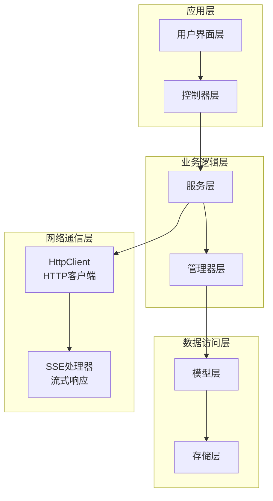
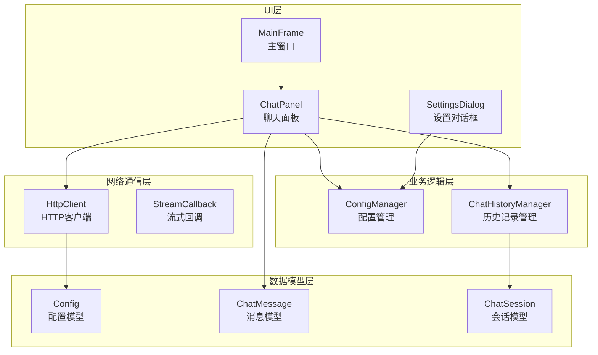
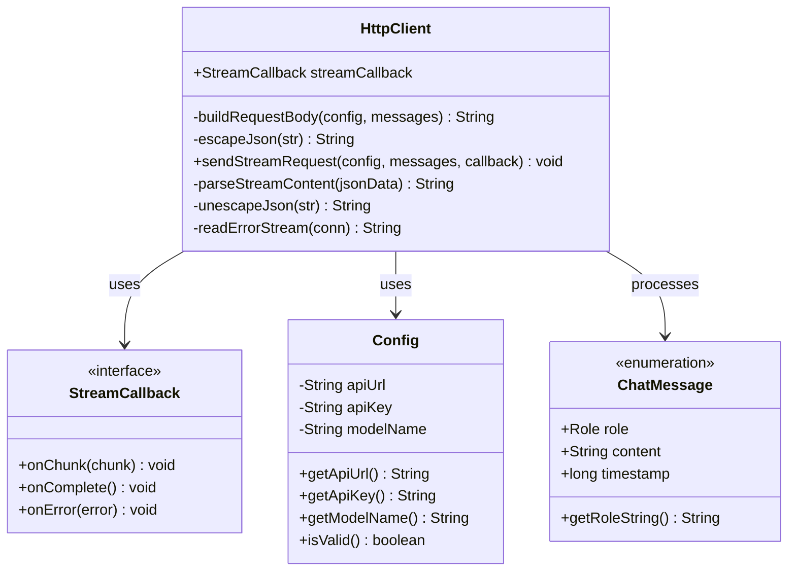
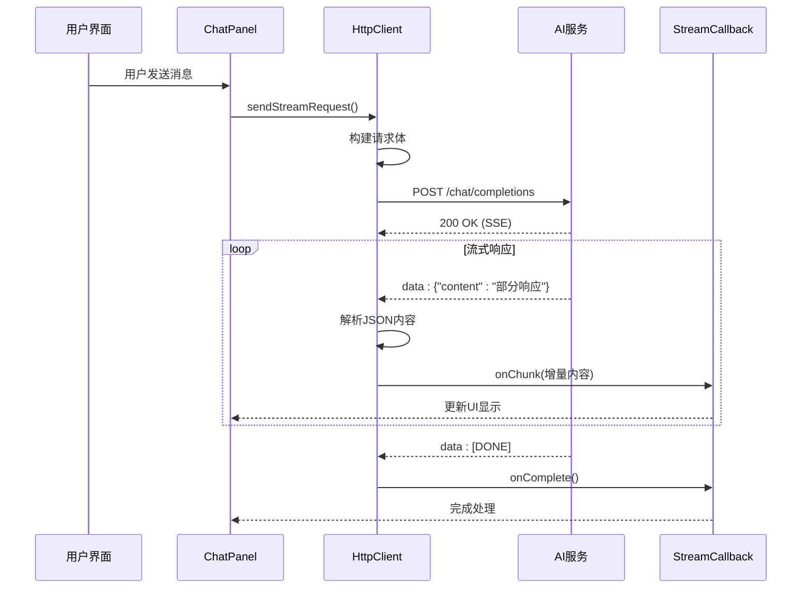
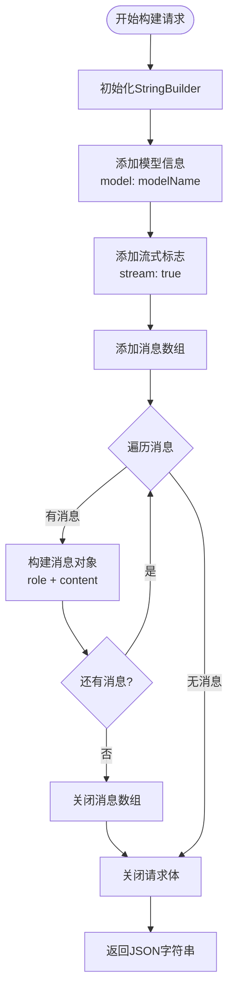
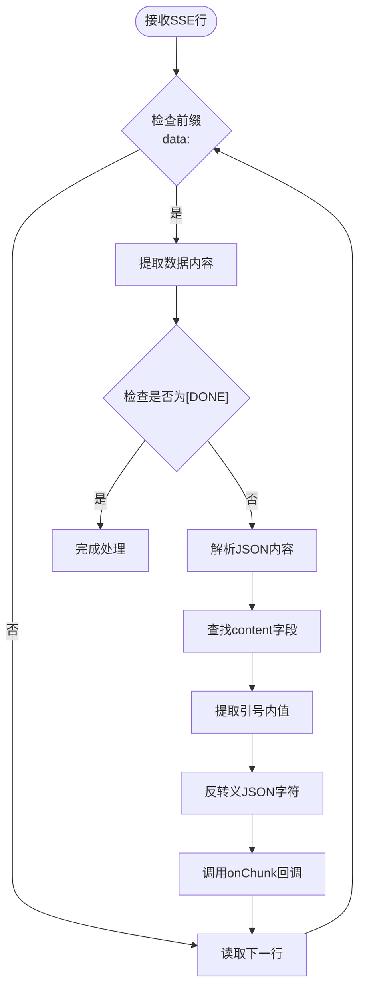
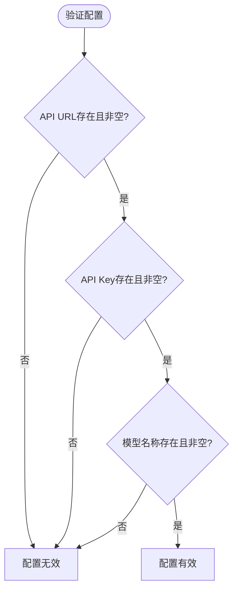
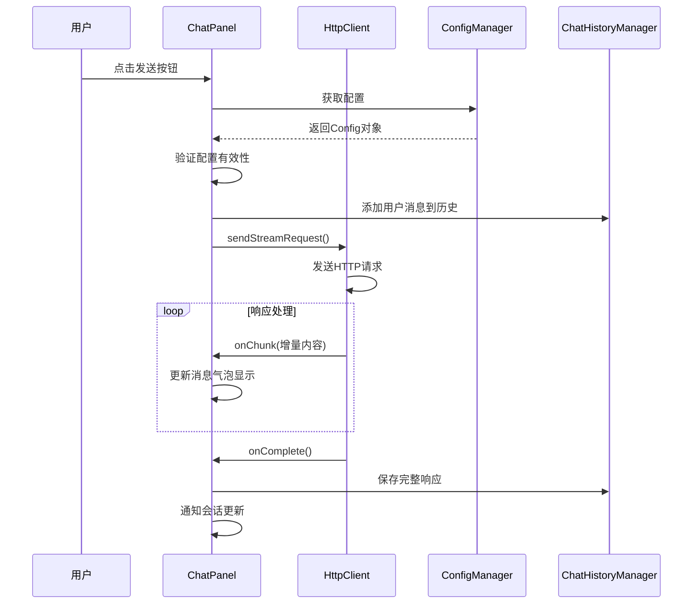
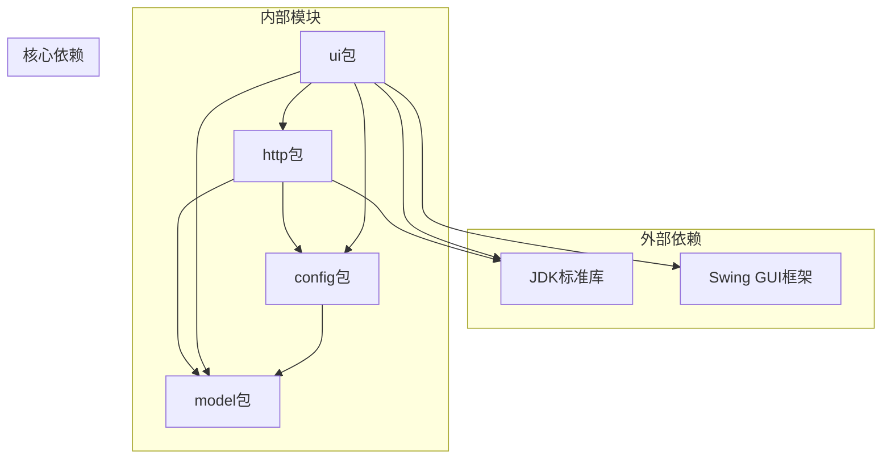
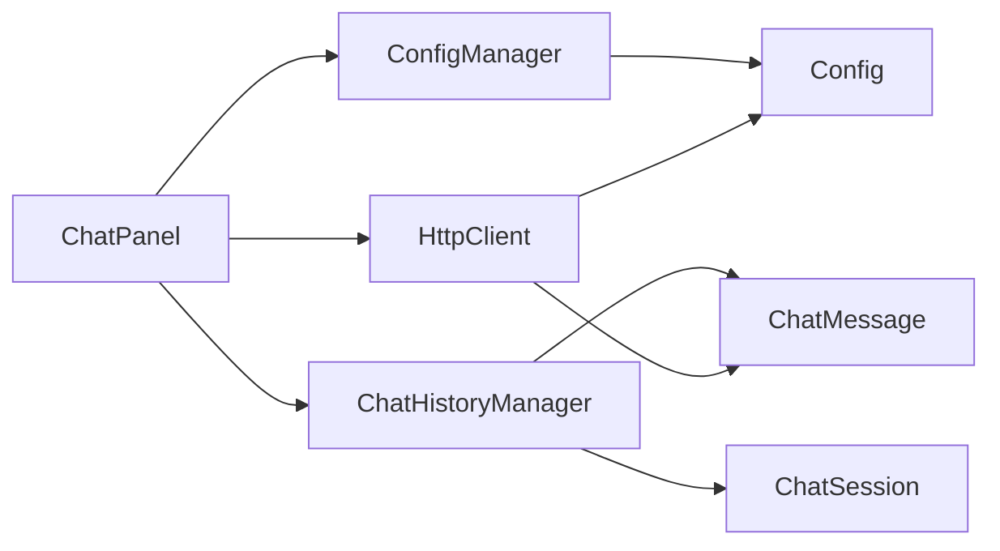

# 网络通信模块

<cite>
**本文档引用的文件**
- [HttpClient.java](file://src/com/llmchat/http/HttpClient.java)
- [App.java](file://src/com/llmchat/App.java)
- [Config.java](file://src/com/llmchat/model/Config.java)
- [ConfigManager.java](file://src/com/llmchat/config/ConfigManager.java)
- [ChatMessage.java](file://src/com/llmchat/model/ChatMessage.java)
- [ChatSession.java](file://src/com/llmchat/model/ChatSession.java)
- [ChatHistoryManager.java](file://src/com/llmchat/config/ChatHistoryManager.java)
- [ChatPanel.java](file://src/com/llmchat/ui/ChatPanel.java)
- [MainFrame.java](file://src/com/llmchat/ui/MainFrame.java)
- [SettingsDialog.java](file://src/com/llmchat/ui/SettingsDialog.java)
</cite>

## 目录
1. [简介](#简介)
2. [项目结构](#项目结构)
3. [核心组件](#核心组件)
4. [架构概览](#架构概览)
5. [详细组件分析](#详细组件分析)
6. [依赖关系分析](#依赖关系分析)
7. [性能考虑](#性能考虑)
8. [故障排除指南](#故障排除指南)
9. [结论](#结论)

## 简介

网络通信模块是Java大语言模型聊天应用的核心组件，负责处理与外部AI服务的HTTP通信。该模块实现了基于Server-Sent Events (SSE) 的流式响应处理，支持实时消息传输和增量内容显示。模块采用简洁的架构设计，通过HttpClient类封装所有网络通信逻辑，为上层UI组件提供统一的API调用接口。

## 项目结构

该项目采用分层架构设计，网络通信模块位于`src/com/llmchat/http/`目录下，主要包含以下层次：

**图表来源**
- [HttpClient.java:1-208](file://src/com/llmchat/http/HttpClient.java#L1-L208)
- [ChatPanel.java:1-335](file://src/com/llmchat/ui/ChatPanel.java#L1-L335)

**章节来源**
- [App.java:1-27](file://src/com/llmchat/App.java#L1-L27)
- [HttpClient.java:1-208](file://src/com/llmchat/http/HttpClient.java#L1-L208)

## 核心组件

### HttpClient类设计

HttpClient类是网络通信模块的核心，实现了完整的HTTP请求处理和SSE流式响应解析功能。该类采用单例模式设计，提供线程安全的网络通信能力。

#### 主要特性
- **流式响应支持**: 实现Server-Sent Events协议，支持增量数据传输
- **异步处理**: 使用独立线程处理网络请求，避免阻塞UI线程
- **错误处理**: 完善的异常捕获和错误回调机制
- **JSON解析**: 自定义JSON内容解析，提取增量响应数据

#### 关键接口
- `StreamCallback`: 流式响应回调接口，包含数据块、完成和错误回调
- `sendStreamRequest()`: 主要的流式请求发送方法
- `buildRequestBody()`: 请求体构建方法

**章节来源**
- [HttpClient.java:13-25](file://src/com/llmchat/http/HttpClient.java#L13-L25)
- [HttpClient.java:66-127](file://src/com/llmchat/http/HttpClient.java#L66-L127)

## 架构概览

网络通信模块采用分层架构，各层职责明确，耦合度低：

**图表来源**
- [ChatPanel.java:21-55](file://src/com/llmchat/ui/ChatPanel.java#L21-L55)
- [ConfigManager.java:14-75](file://src/com/llmchat/config/ConfigManager.java#L14-L75)
- [HttpClient.java:16-127](file://src/com/llmchat/http/HttpClient.java#L16-L127)

## 详细组件分析

### HttpClient类深度分析

#### 类结构设计

**图表来源**
- [HttpClient.java:16-208](file://src/com/llmchat/http/HttpClient.java#L16-L208)
- [Config.java:8-52](file://src/com/llmchat/model/Config.java#L8-L52)
- [ChatMessage.java:8-44](file://src/com/llmchat/model/ChatMessage.java#L8-L44)

#### 流式响应处理流程

**图表来源**
- [ChatPanel.java:243-296](file://src/com/llmchat/ui/ChatPanel.java#L243-L296)
- [HttpClient.java:66-127](file://src/com/llmchat/http/HttpClient.java#L66-L127)

#### 请求构建算法

**图表来源**
- [HttpClient.java:30-49](file://src/com/llmchat/http/HttpClient.java#L30-L49)

#### SSE响应解析流程

**图表来源**
- [HttpClient.java:100-114](file://src/com/llmchat/http/HttpClient.java#L100-L114)
- [HttpClient.java:132-163](file://src/com/llmchat/http/HttpClient.java#L132-L163)

**章节来源**
- [HttpClient.java:16-208](file://src/com/llmchat/http/HttpClient.java#L16-L208)

### 配置管理系统

#### Config类设计

Config类提供了应用的基本配置信息管理，包括API端点、认证密钥和模型名称。

##### 配置验证机制

**图表来源**
- [Config.java:46-50](file://src/com/llmchat/model/Config.java#L46-L50)

**章节来源**
- [Config.java:8-52](file://src/com/llmchat/model/Config.java#L8-L52)

### 聊天面板集成

#### ChatPanel中的网络调用

ChatPanel作为UI层的核心组件，负责协调网络请求和用户界面更新：

**图表来源**
- [ChatPanel.java:189-297](file://src/com/llmchat/ui/ChatPanel.java#L189-L297)

**章节来源**
- [ChatPanel.java:21-335](file://src/com/llmchat/ui/ChatPanel.java#L21-L335)

## 依赖关系分析

### 组件间依赖图

**图表来源**
- [HttpClient.java:3-11](file://src/com/llmchat/http/HttpClient.java#L3-L11)
- [ChatPanel.java:3-9](file://src/com/llmchat/ui/ChatPanel.java#L3-L9)

### 数据流依赖

**图表来源**
- [ConfigManager.java:18-75](file://src/com/llmchat/config/ConfigManager.java#L18-L75)
- [ChatHistoryManager.java:20-182](file://src/com/llmchat/config/ChatHistoryManager.java#L20-L182)
- [ChatPanel.java:24-47](file://src/com/llmchat/ui/ChatPanel.java#L24-L47)

**章节来源**
- [HttpClient.java:1-208](file://src/com/llmchat/http/HttpClient.java#L1-L208)
- [ChatPanel.java:1-335](file://src/com/llmchat/ui/ChatPanel.java#L1-L335)

## 性能考虑

### 线程安全设计

HttpClient采用独立线程处理网络请求，避免阻塞UI线程：

- **异步处理**: 所有网络操作在后台线程执行
- **UI更新**: 使用SwingUtilities.invokeLater确保UI更新在EDT中进行
- **资源管理**: 正确的连接关闭和流资源释放

### 内存管理

- **StringBuilder复用**: 避免频繁的对象创建
- **增量处理**: 流式响应逐块处理，减少内存占用
- **及时清理**: 完成后及时清理临时对象

### 网络优化

- **连接超时**: 合理设置连接和读取超时时间
- **错误恢复**: 完善的异常处理和错误回调
- **资源回收**: 及时释放网络连接和IO资源

## 故障排除指南

### 常见问题诊断

#### 连接问题

1. **网络连接失败**
   - 检查API URL配置
   - 验证网络连通性
   - 确认防火墙设置

2. **认证失败**
   - 验证API Key格式
   - 检查权限设置
   - 确认账户状态

#### 响应处理问题

1. **SSE连接中断**
   - 检查服务器支持情况
   - 验证请求头设置
   - 确认流式响应格式

2. **JSON解析错误**
   - 检查响应格式
   - 验证JSON结构
   - 处理特殊字符转义

#### UI同步问题

1. **UI更新延迟**
   - 确保使用SwingUtilities.invokeLater
   - 检查回调线程切换
   - 验证UI组件状态

**章节来源**
- [HttpClient.java:119-126](file://src/com/llmchat/http/HttpClient.java#L119-L126)
- [ChatPanel.java:275-295](file://src/com/llmchat/ui/ChatPanel.java#L275-L295)

### 调试工具使用

#### 日志输出

HttpClient在开发阶段包含调试输出语句：
- 原始数据接收日志
- 解析结果输出
- 错误信息记录

#### 性能监控

建议在生产环境中：
- 添加请求计时器
- 监控响应时间
- 记录错误统计

## 结论

网络通信模块展现了良好的软件工程实践，具有以下特点：

### 设计优势
- **模块化设计**: 清晰的职责分离和接口定义
- **可扩展性**: 支持多种AI服务提供商的集成
- **健壮性**: 完善的错误处理和异常恢复机制
- **用户体验**: 流式响应提供即时反馈

### 技术亮点
- **SSE协议实现**: 成功处理Server-Sent Events流式数据
- **异步架构**: 避免UI阻塞，提升响应速度
- **JSON处理**: 自定义解析器处理增量内容
- **配置管理**: 灵活的配置系统支持多服务集成

### 改进建议
- 添加重试机制和指数退避策略
- 实现连接池管理提高性能
- 增加详细的日志记录和监控
- 支持更多AI服务提供商的标准API
- 实现请求缓存机制减少重复调用

该模块为大语言模型聊天应用提供了稳定可靠的网络通信基础，通过合理的架构设计和完善的错误处理，确保了良好的用户体验和系统的稳定性。