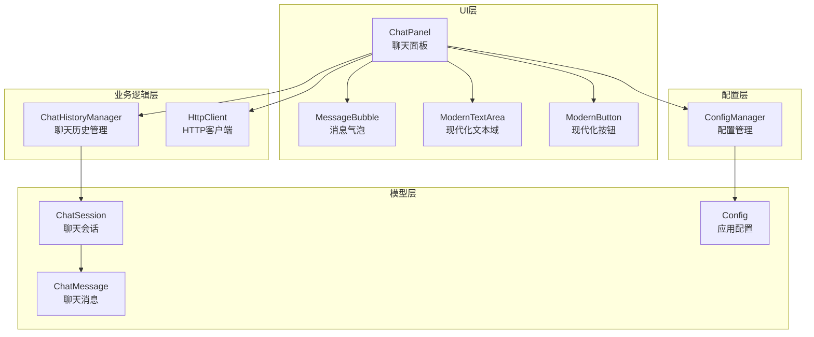
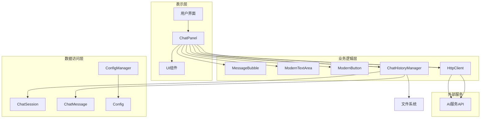
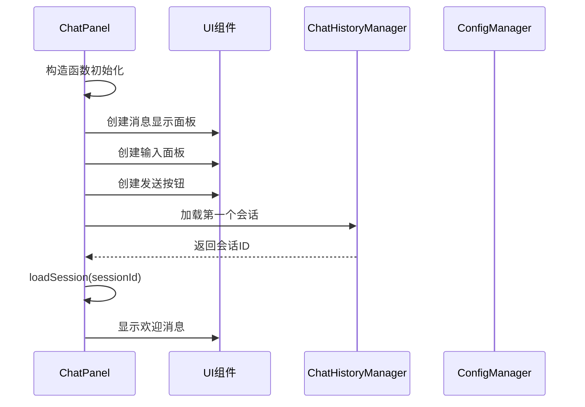
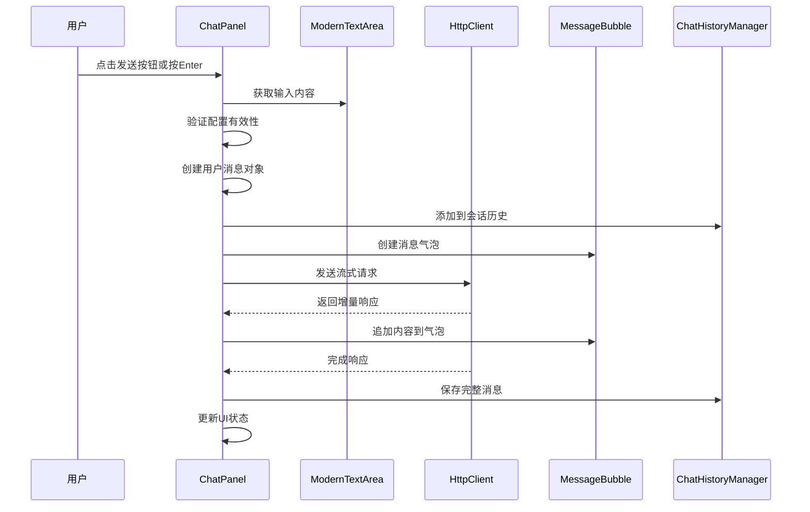
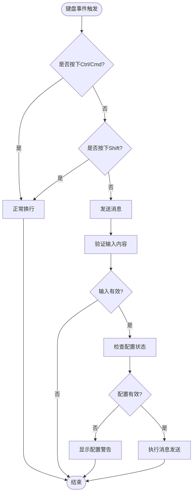
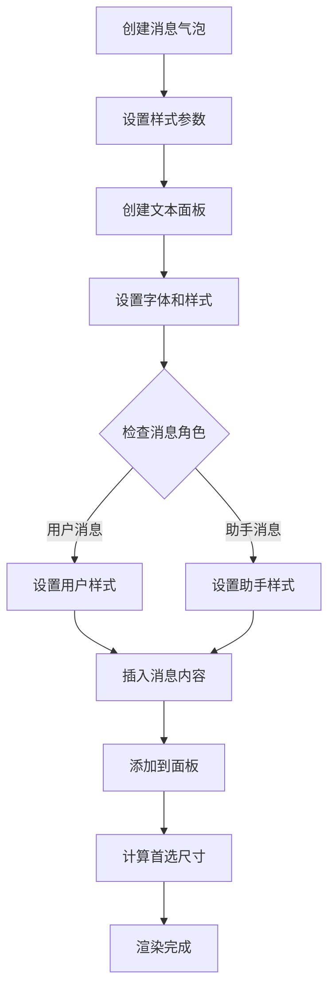
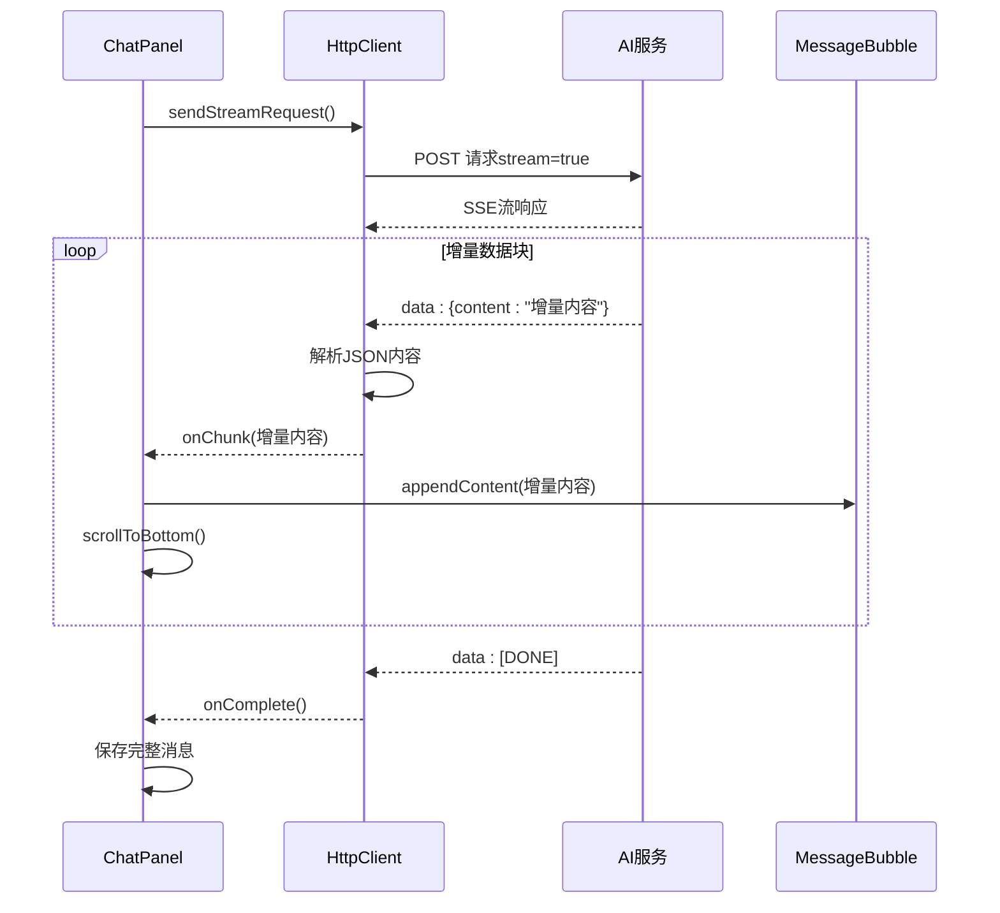
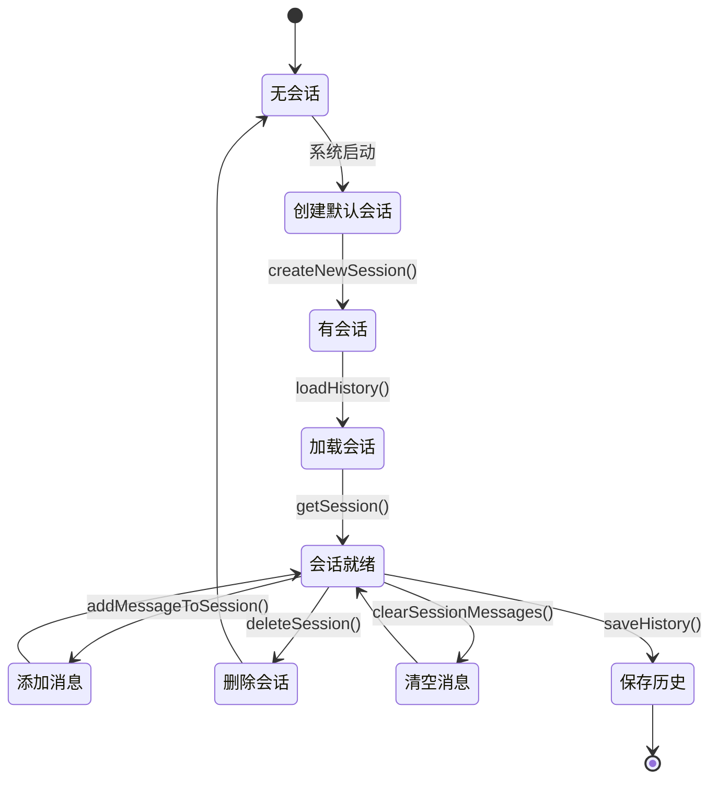
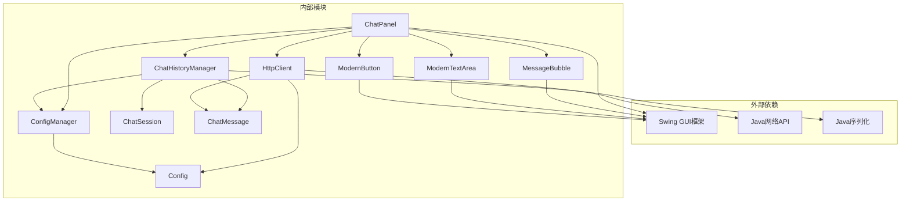
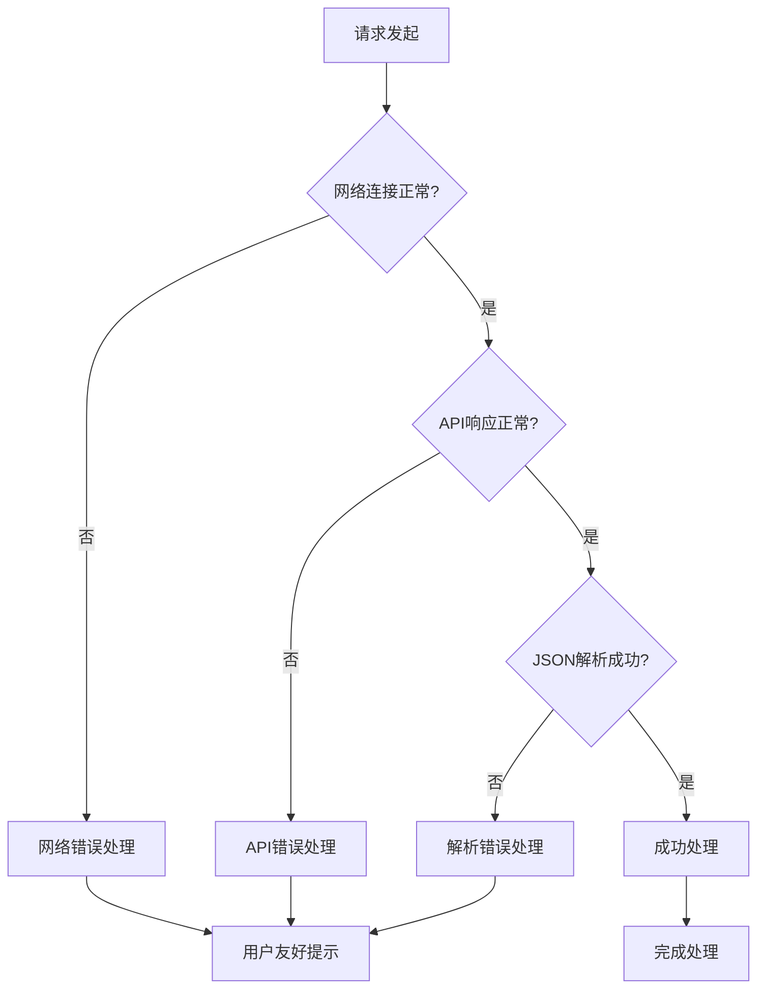

# 聊天核心模块

<cite>
**本文档引用的文件**
- [ChatPanel.java](file://src/com/llmchat/ui/ChatPanel.java)
- [MessageBubble.java](file://src/com/llmchat/ui/components/MessageBubble.java)
- [ChatMessage.java](file://src/com/llmchat/model/ChatMessage.java)
- [ChatSession.java](file://src/com/llmchat/model/ChatSession.java)
- [ChatHistoryManager.java](file://src/com/llmchat/config/ChatHistoryManager.java)
- [HttpClient.java](file://src/com/llmchat/http/HttpClient.java)
- [ModernTextArea.java](file://src/com/llmchat/ui/components/ModernTextArea.java)
- [ModernButton.java](file://src/com/llmchat/ui/components/ModernButton.java)
- [ConfigManager.java](file://src/com/llmchat/config/ConfigManager.java)
- [Config.java](file://src/com/llmchat/model/Config.java)
- [MainFrame.java](file://src/com/llmchat/ui/MainFrame.java)
</cite>

## 目录
1. [简介](#简介)
2. [项目结构](#项目结构)
3. [核心组件](#核心组件)
4. [架构概览](#架构概览)
5. [详细组件分析](#详细组件分析)
6. [依赖关系分析](#依赖关系分析)
7. [性能考虑](#性能考虑)
8. [故障排除指南](#故障排除指南)
9. [结论](#结论)

## 简介

聊天核心模块是Java LLM Interface应用的核心部分，负责实现现代化的聊天界面、消息处理和实时流式响应功能。该模块采用Swing框架构建，提供了完整的聊天体验，包括消息显示、用户输入处理、流式响应处理和会话管理等功能。

## 项目结构

聊天核心模块位于`src/com/llmchat/ui`目录下，主要包含以下核心文件：

**图表来源**
- [ChatPanel.java:1-335](file://src/com/llmchat/ui/ChatPanel.java#L1-L335)
- [MessageBubble.java:1-170](file://src/com/llmchat/ui/components/MessageBubble.java#L1-L170)
- [ChatHistoryManager.java:1-206](file://src/com/llmchat/config/ChatHistoryManager.java#L1-L206)

**章节来源**
- [ChatPanel.java:1-335](file://src/com/llmchat/ui/ChatPanel.java#L1-L335)
- [ChatHistoryManager.java:1-206](file://src/com/llmchat/config/ChatHistoryManager.java#L1-L206)

## 核心组件

### ChatPanel类 - 聊天面板核心

ChatPanel是整个聊天系统的核心控制器，负责协调所有聊天相关的功能。它继承自JPanel，实现了聊天界面的所有交互逻辑。

#### 主要职责
- **消息显示管理**：负责消息列表的渲染和更新
- **用户输入处理**：处理用户的键盘和鼠标输入
- **流式响应处理**：管理与AI服务的实时通信
- **会话管理**：维护聊天历史和会话状态
- **UI状态控制**：管理加载状态和界面反馈

#### 关键属性
- `currentSessionId`: 当前会话标识符
- `messageHistory`: 消息历史列表
- `messagesPanel`: 消息显示面板
- `inputArea`: 用户输入区域
- `sendButton`: 发送按钮组件
- `currentResponseBubble`: 当前响应气泡
- `currentResponse`: 当前响应内容缓冲区

**章节来源**
- [ChatPanel.java:21-55](file://src/com/llmchat/ui/ChatPanel.java#L21-L55)

### MessageBubble组件 - 消息气泡渲染

MessageBubble是自定义的Swing组件，专门用于渲染聊天消息气泡。它支持现代化的设计风格和emoji表情符号显示。

#### 设计特点
- **圆角矩形背景**：用户消息使用蓝色背景，助手消息使用浅灰色背景
- **动态尺寸计算**：根据内容自动调整气泡大小
- **多平台emoji支持**：通过字体回退机制支持不同操作系统的emoji
- **流式内容追加**：支持增量内容的实时更新

**章节来源**
- [MessageBubble.java:14-170](file://src/com/llmchat/ui/components/MessageBubble.java#L14-L170)

### ChatMessage模型 - 消息数据结构

ChatMessage是聊天消息的数据模型，封装了消息的基本信息和元数据。

#### 数据结构
- `role`: 消息角色（USER、ASSISTANT、SYSTEM）
- `content`: 消息内容
- `timestamp`: 时间戳

**章节来源**
- [ChatMessage.java:8-44](file://src/com/llmchat/model/ChatMessage.java#L8-L44)

## 架构概览

聊天核心模块采用分层架构设计，清晰分离了UI层、业务逻辑层和数据层：

**图表来源**
- [ChatPanel.java:3-9](file://src/com/llmchat/ui/ChatPanel.java#L3-L9)
- [ChatHistoryManager.java:16-27](file://src/com/llmchat/config/ChatHistoryManager.java#L16-L27)

## 详细组件分析

### ChatPanel类深度分析

#### 初始化流程

ChatPanel的初始化过程包括UI组件创建、事件绑定和会话加载：

**图表来源**
- [ChatPanel.java:44-55](file://src/com/llmchat/ui/ChatPanel.java#L44-L55)
- [ChatPanel.java:124-142](file://src/com/llmchat/ui/ChatPanel.java#L124-L142)

#### 消息发送处理流程

当用户发送消息时，系统执行以下完整流程：

**图表来源**
- [ChatPanel.java:189-297](file://src/com/llmchat/ui/ChatPanel.java#L189-L297)
- [HttpClient.java:66-127](file://src/com/llmchat/http/HttpClient.java#L66-L127)

#### 键盘事件处理机制

ChatPanel实现了智能的键盘事件处理，支持多种输入方式：

**图表来源**
- [ChatPanel.java:93-101](file://src/com/llmchat/ui/ChatPanel.java#L93-L101)

#### 消息气泡渲染逻辑

MessageBubble组件的渲染过程包括多个步骤：

**图表来源**
- [MessageBubble.java:24-58](file://src/com/llmchat/ui/components/MessageBubble.java#L24-L58)
- [MessageBubble.java:147-163](file://src/com/llmchat/ui/components/MessageBubble.java#L147-L163)

#### 流式响应处理机制

系统采用Server-Sent Events (SSE) 实现流式响应，支持实时增量内容传输：

**图表来源**
- [HttpClient.java:66-127](file://src/com/llmchat/http/HttpClient.java#L66-L127)
- [ChatPanel.java:243-296](file://src/com/llmchat/ui/ChatPanel.java#L243-L296)

#### 会话管理功能

ChatHistoryManager负责聊天会话的完整生命周期管理：

**图表来源**
- [ChatHistoryManager.java:104-182](file://src/com/llmchat/config/ChatHistoryManager.java#L104-L182)

**章节来源**
- [ChatPanel.java:189-297](file://src/com/llmchat/ui/ChatPanel.java#L189-L297)
- [MessageBubble.java:89-121](file://src/com/llmchat/ui/components/MessageBubble.java#L89-L121)
- [ChatHistoryManager.java:104-182](file://src/com/llmchat/config/ChatHistoryManager.java#L104-L182)

### UI组件详细分析

#### ModernTextArea组件

ModernTextArea扩展了JScrollPane，提供了现代化的文本输入体验：

- **焦点管理**：智能的颜色变化提示用户焦点状态
- **自动换行**：支持长文本的自动换行显示
- **边框美化**：动态边框颜色变化提升用户体验
- **便捷方法**：提供clear()、append()等实用方法

#### ModernButton组件

ModernButton实现了完整的按钮状态管理：

- **状态管理**：支持hover、pressed、loading等多种状态
- **动画效果**：loading状态下显示三个点的闪烁动画
- **圆角设计**：统一的18像素圆角外观
- **颜色主题**：根据状态自动切换颜色方案

**章节来源**
- [ModernTextArea.java:12-66](file://src/com/llmchat/ui/components/ModernTextArea.java#L12-L66)
- [ModernButton.java:14-159](file://src/com/llmchat/ui/components/ModernButton.java#L14-L159)

## 依赖关系分析

聊天核心模块的依赖关系体现了清晰的分层架构：

**图表来源**
- [ChatPanel.java:3-9](file://src/com/llmchat/ui/ChatPanel.java#L3-L9)
- [ChatHistoryManager.java:16-27](file://src/com/llmchat/config/ChatHistoryManager.java#L16-L27)

### 关键依赖特性

#### 线程安全设计
- 使用ConcurrentHashMap保证会话管理的线程安全
- 通过SwingUtilities.invokeLater确保UI更新的线程安全
- HttpClient使用独立线程处理网络请求

#### 异常处理策略
- 完善的try-catch机制处理各种异常情况
- 用户友好的错误提示和恢复机制
- 配置文件损坏时的自动修复功能

**章节来源**
- [ChatHistoryManager.java:20-27](file://src/com/llmchat/config/ChatHistoryManager.java#L20-L27)
- [ChatPanel.java:275-295](file://src/com/llmchat/ui/ChatPanel.java#L275-L295)

## 性能考虑

### UI渲染优化

#### 消息气泡缓存机制
- 使用StringBuilder缓存增量内容，避免频繁的字符串拼接
- 通过批量更新减少UI重绘次数
- 智能的尺寸计算避免不必要的布局重计算

#### 滚动条优化
- 使用SwingUtilities.invokeLater延迟滚动操作
- 仅在必要时更新滚动位置
- 平滑的滚动动画提升用户体验

### 网络请求优化

#### 连接池管理
- 单独的线程处理HTTP请求，避免阻塞UI线程
- 合理的超时设置（连接30秒，读取60秒）
- 自动断开连接释放资源

#### 流式处理优化
- 增量内容直接渲染，无需等待完整响应
- JSON解析采用流式处理，减少内存占用
- 错误快速检测和处理

### 内存管理

#### 对象复用
- 消息气泡组件的样式信息预分配
- 字体对象的智能缓存和回退机制
- 配置对象的懒加载策略

#### 垃圾回收优化
- 及时清理不再使用的组件引用
- 合理的生命周期管理
- 避免内存泄漏的编程实践

## 故障排除指南

### 常见问题及解决方案

#### 消息无法显示
1. **检查配置有效性**：确认API设置已正确配置
2. **验证网络连接**：确保能够访问AI服务API
3. **查看日志输出**：检查控制台是否有错误信息

#### 流式响应中断
1. **检查超时设置**：适当调整网络超时参数
2. **验证API密钥**：确认API密钥的有效性
3. **监控服务器状态**：检查AI服务的可用性

#### UI更新异常
1. **确认线程安全**：确保所有UI更新都在EDT线程中进行
2. **检查事件绑定**：验证键盘和鼠标事件的正确绑定
3. **调试布局问题**：使用Swing布局调试工具

### 错误处理机制

系统实现了多层次的错误处理：

**图表来源**
- [HttpClient.java:88-125](file://src/com/llmchat/http/HttpClient.java#L88-L125)
- [ChatPanel.java:275-295](file://src/com/llmchat/ui/ChatPanel.java#L275-L295)

**章节来源**
- [HttpClient.java:88-125](file://src/com/llmchat/http/HttpClient.java#L88-L125)
- [ChatPanel.java:275-295](file://src/com/llmchat/ui/ChatPanel.java#L275-L295)

## 结论

聊天核心模块展现了优秀的软件工程实践，通过清晰的分层架构、完善的错误处理机制和优化的性能设计，为用户提供了流畅的聊天体验。模块的主要优势包括：

### 技术亮点
- **现代化UI设计**：采用圆角气泡、渐变色彩和流畅动画
- **流式响应处理**：实时增量内容显示，提升用户体验
- **健壮的错误处理**：多层次的异常捕获和用户提示
- **性能优化**：线程安全设计和内存管理优化

### 最佳实践总结
1. **UI线程安全**：始终通过SwingUtilities.invokeLater更新UI
2. **异步处理**：网络请求和长时间操作使用独立线程
3. **资源管理**：及时释放连接和组件资源
4. **错误恢复**：提供用户友好的错误提示和自动恢复机制

该模块为类似聊天应用的开发提供了良好的参考模板，其设计理念和实现模式值得在其他项目中借鉴和应用。