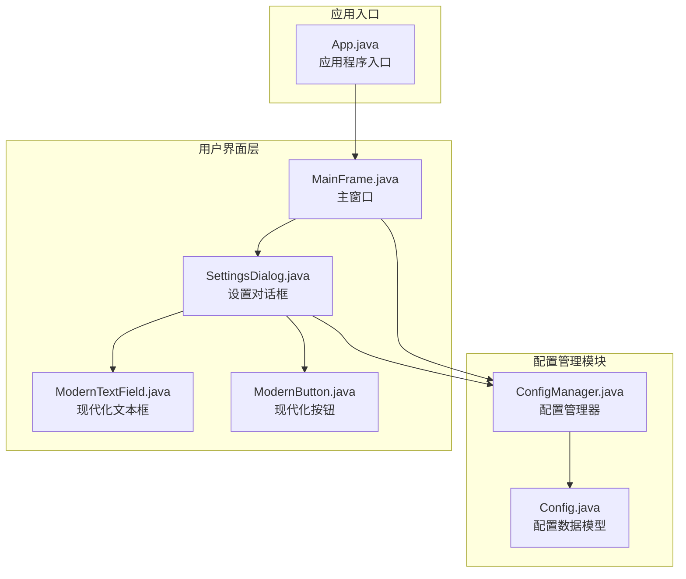
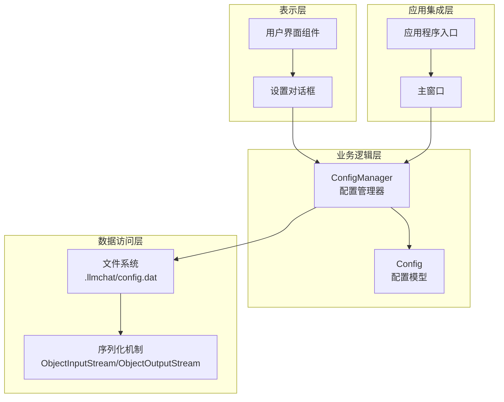
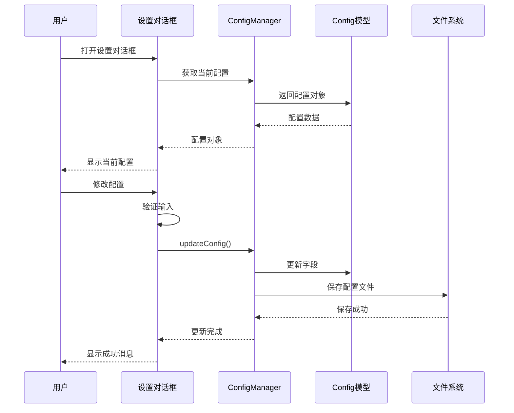
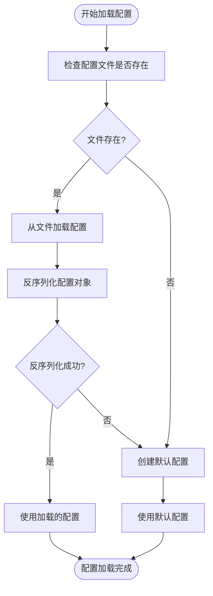
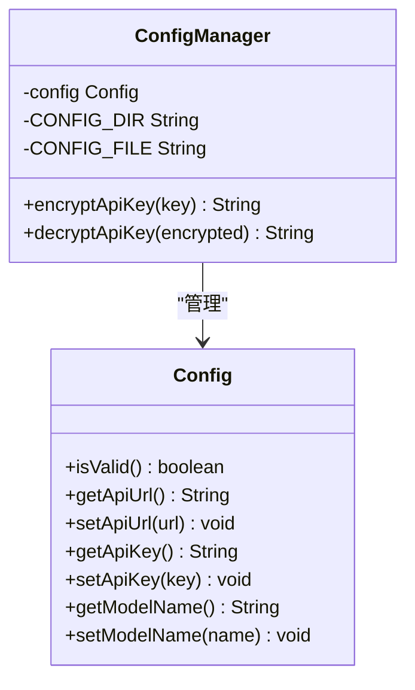
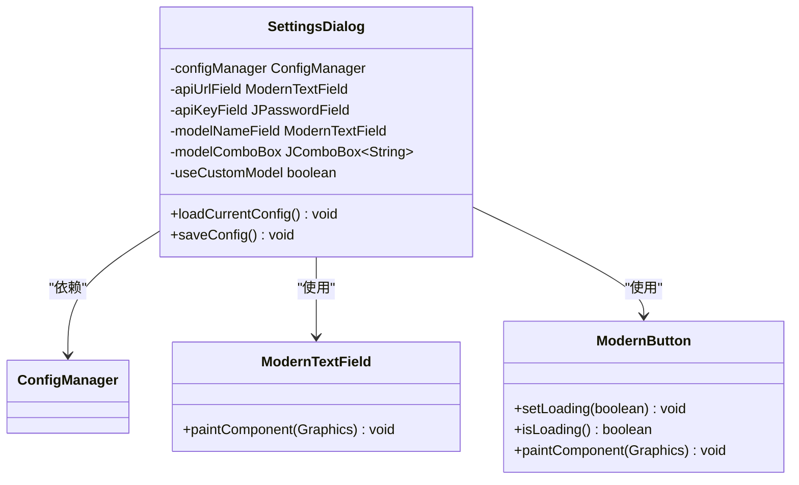
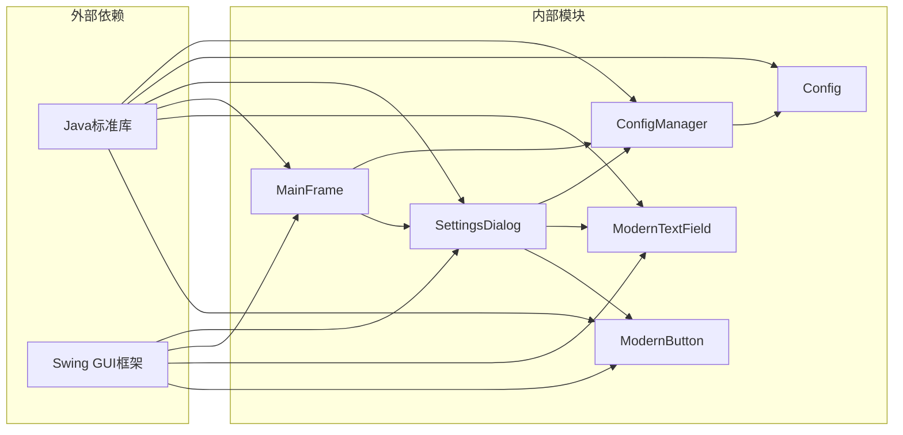

# 配置管理模块

<cite>
**本文档引用的文件**
- [ConfigManager.java](file://src/com/llmchat/config/ConfigManager.java)
- [Config.java](file://src/com/llmchat/model/Config.java)
- [SettingsDialog.java](file://src/com/llmchat/ui/SettingsDialog.java)
- [MainFrame.java](file://src/com/llmchat/ui/MainFrame.java)
- [App.java](file://src/com/llmchat/App.java)
- [ModernTextField.java](file://src/com/llmchat/ui/components/ModernTextField.java)
- [ModernButton.java](file://src/com/llmchat/ui/components/ModernButton.java)
</cite>

## 目录
1. [简介](#简介)
2. [项目结构](#项目结构)
3. [核心组件](#核心组件)
4. [架构概览](#架构概览)
5. [详细组件分析](#详细组件分析)
6. [依赖关系分析](#依赖关系分析)
7. [性能考虑](#性能考虑)
8. [故障排除指南](#故障排除指南)
9. [结论](#结论)
10. [附录](#附录)

## 简介

配置管理模块是Java LLM聊天应用程序的核心基础设施，负责管理应用程序的配置数据持久化、读取和验证。该模块实现了完整的配置生命周期管理，包括配置文件的序列化存储、用户界面交互、配置验证和安全存储机制。

本模块采用面向对象的设计模式，通过ConfigManager类统一管理配置的读取、写入和更新操作，通过Config数据模型定义配置项的结构和验证规则。系统支持基础的热重载机制，当配置文件发生变化时能够自动重新加载配置。

## 项目结构

配置管理相关的文件组织遵循标准的Java包结构，主要包含以下组件：



**图表来源**
- [ConfigManager.java:1-101](file://src/com/llmchat/config/ConfigManager.java#L1-L101)
- [Config.java:1-52](file://src/com/llmchat/model/Config.java#L1-L52)
- [SettingsDialog.java:1-250](file://src/com/llmchat/ui/SettingsDialog.java#L1-L250)

**章节来源**
- [ConfigManager.java:1-101](file://src/com/llmchat/config/ConfigManager.java#L1-L101)
- [Config.java:1-52](file://src/com/llmchat/model/Config.java#L1-L52)
- [SettingsDialog.java:1-250](file://src/com/llmchat/ui/SettingsDialog.java#L1-L250)

## 核心组件

### ConfigManager类

ConfigManager是配置管理模块的核心类，负责配置的持久化存储和管理。该类实现了以下关键功能：

- **配置文件路径管理**：使用用户目录下的`.llmchat/config.dat`作为配置存储位置
- **配置加载机制**：从二进制文件中反序列化配置对象
- **配置保存机制**：将配置对象序列化到文件系统
- **配置更新接口**：提供便捷的方法更新配置项
- **安全存储支持**：内置Base64编码的API Key加密解密功能

### Config数据模型

Config类定义了应用程序的核心配置结构，包含以下字段：

- **apiUrl**：API服务端点URL
- **apiKey**：认证API密钥
- **modelName**：使用的AI模型名称

每个字段都提供了对应的getter和setter方法，并实现了基本的配置验证逻辑。

### 用户界面组件

设置对话框提供了图形化的配置管理界面，包含：
- 文本输入框用于API URL配置
- 密码输入框用于API Key安全输入
- 下拉选择框用于预设模型选择
- 自定义模型输入支持

**章节来源**
- [ConfigManager.java:14-101](file://src/com/llmchat/config/ConfigManager.java#L14-L101)
- [Config.java:8-52](file://src/com/llmchat/model/Config.java#L8-L52)
- [SettingsDialog.java:15-250](file://src/com/llmchat/ui/SettingsDialog.java#L15-L250)

## 架构概览

配置管理模块采用分层架构设计，各层职责清晰分离：



**图表来源**
- [ConfigManager.java:14-58](file://src/com/llmchat/config/ConfigManager.java#L14-L58)
- [Config.java:8-44](file://src/com/llmchat/model/Config.java#L8-L44)
- [SettingsDialog.java:15-37](file://src/com/llmchat/ui/SettingsDialog.java#L15-L37)

### 数据流图



**图表来源**
- [SettingsDialog.java:216-248](file://src/com/llmchat/ui/SettingsDialog.java#L216-L248)
- [ConfigManager.java:70-75](file://src/com/llmchat/config/ConfigManager.java#L70-L75)
- [ConfigManager.java:44-58](file://src/com/llmchat/config/ConfigManager.java#L44-L58)

## 详细组件分析

### ConfigManager类深度分析

ConfigManager类实现了完整的配置管理生命周期：

#### 配置加载机制



**图表来源**
- [ConfigManager.java:27-39](file://src/com/llmchat/config/ConfigManager.java#L27-L39)

#### 配置保存流程

配置保存过程确保了数据的安全性和完整性：

1. **目录检查**：首先检查配置目录是否存在，不存在则创建
2. **序列化过程**：使用ObjectOutputStream将Config对象序列化
3. **异常处理**：捕获所有可能的IO异常并进行日志记录

#### 安全存储机制

系统实现了基础的API Key安全存储：



**图表来源**
- [ConfigManager.java:80-99](file://src/com/llmchat/config/ConfigManager.java#L80-L99)
- [Config.java:46-50](file://src/com/llmchat/model/Config.java#L46-L50)

**章节来源**
- [ConfigManager.java:14-101](file://src/com/llmchat/config/ConfigManager.java#L14-L101)

### Config数据模型分析

Config类提供了完整的配置数据结构和验证机制：

#### 字段定义与默认值

| 字段名 | 类型 | 默认值 | 描述 |
|--------|------|--------|------|
| apiUrl | String | "https://api.openai.com/v1/chat/completions" | API服务端点URL |
| apiKey | String | "" | 认证API密钥 |
| modelName | String | "gpt-3.5-turbo" | AI模型名称 |

#### 验证规则

配置验证采用简单而有效的规则：
- 所有字段必须非空且非空白
- 提供了isValid()方法进行整体验证
- 用户界面层还实现了额外的输入验证

**章节来源**
- [Config.java:15-20](file://src/com/llmchat/model/Config.java#L15-L20)
- [Config.java:46-50](file://src/com/llmchat/model/Config.java#L46-L50)

### 用户界面组件分析

设置对话框提供了直观的配置管理界面：

#### 组件架构



**图表来源**
- [SettingsDialog.java:15-37](file://src/com/llmchat/ui/SettingsDialog.java#L15-L37)
- [ModernTextField.java:12-49](file://src/com/llmchat/ui/components/ModernTextField.java#L12-L49)
- [ModernButton.java:14-159](file://src/com/llmchat/ui/components/ModernButton.java#L14-L159)

#### 模型选择机制

系统支持两种模型选择方式：
- **预设模型**：提供常见的OpenAI模型选项
- **自定义模型**：允许用户输入自定义模型名称

**章节来源**
- [SettingsDialog.java:120-169](file://src/com/llmchat/ui/SettingsDialog.java#L120-L169)
- [SettingsDialog.java:216-248](file://src/com/llmchat/ui/SettingsDialog.java#L216-L248)

## 依赖关系分析

配置管理模块的依赖关系相对简单，体现了良好的关注点分离：



**图表来源**
- [ConfigManager.java:3](file://src/com/llmchat/config/ConfigManager.java#L3)
- [SettingsDialog.java:3](file://src/com/llmchat/ui/SettingsDialog.java#L3)
- [MainFrame.java:4](file://src/com/llmchat/ui/MainFrame.java#L4)

### 关键依赖链

1. **ConfigManager依赖Config**：管理配置对象的生命周期
2. **SettingsDialog依赖ConfigManager**：获取和更新配置
3. **MainFrame依赖ConfigManager**：初始化配置管理器
4. **UI组件依赖Swing**：构建用户界面

**章节来源**
- [ConfigManager.java:3](file://src/com/llmchat/config/ConfigManager.java#L3)
- [SettingsDialog.java:3](file://src/com/llmchat/ui/SettingsDialog.java#L3)
- [MainFrame.java:4](file://src/com/llmchat/ui/MainFrame.java#L4)

## 性能考虑

配置管理模块在性能方面具有以下特点：

### 序列化性能
- 使用Java原生序列化机制，性能良好但不支持跨平台兼容
- 配置文件通常很小，序列化开销可忽略不计
- 支持增量更新，避免不必要的完整重写

### 内存使用
- Config对象轻量级设计，内存占用极少
- 单例式ConfigManager实例，避免重复创建
- 用户界面组件按需创建和销毁

### I/O操作优化
- 异常处理确保配置损坏时不会影响应用程序运行
- 文件操作使用try-with-resources确保资源正确释放
- 目录创建和文件写入采用原子性操作

## 故障排除指南

### 常见问题及解决方案

#### 配置文件损坏
**症状**：应用程序启动时报错或配置丢失
**原因**：配置文件被意外修改或损坏
**解决方法**：
1. 删除`.llmchat/config.dat`文件
2. 应用程序会自动创建新的默认配置
3. 重新配置必要的参数

#### 权限问题
**症状**：无法保存配置或读取失败
**原因**：用户目录权限不足
**解决方法**：
1. 检查用户目录的读写权限
2. 确保应用程序有足够权限访问配置目录
3. 尝试以管理员身份运行应用程序

#### API Key解密失败
**症状**：API Key显示为空或错误
**原因**：加密的API Key格式不正确
**解决方法**：
1. 重新输入API Key
2. 系统会自动重新加密存储
3. 检查Base64编码的有效性

### 调试技巧

1. **启用详细日志**：查看控制台输出的异常信息
2. **检查文件路径**：确认配置文件的实际存储位置
3. **验证权限**：确保配置目录可读写
4. **测试连接**：验证API URL和网络连接

**章节来源**
- [ConfigManager.java:33-35](file://src/com/llmchat/config/ConfigManager.java#L33-L35)
- [ConfigManager.java:55-57](file://src/com/llmchat/config/ConfigManager.java#L55-L57)

## 结论

配置管理模块为Java LLM聊天应用程序提供了可靠的基础设施。该模块具有以下优势：

1. **简洁高效**：采用最小必要设计，代码简洁易维护
2. **安全可靠**：内置基础的API Key加密机制
3. **用户友好**：提供直观的图形化配置界面
4. **扩展性强**：模块化设计便于功能扩展

主要改进方向包括：
- 支持JSON/YAML等更通用的配置格式
- 实现真正的热重载机制
- 增强配置验证和错误处理
- 提供配置备份和恢复功能

## 附录

### 配置文件格式规范

当前版本使用Java原生序列化格式，文件位于用户目录下的`.llmchat/config.dat`。

### 配置项说明

| 配置项 | 类型 | 必填 | 默认值 | 说明 |
|--------|------|------|--------|------|
| apiUrl | String | 是 | https://api.openai.com/v1/chat/completions | API服务端点URL |
| apiKey | String | 是 | 空字符串 | 认证API密钥 |
| modelName | String | 是 | gpt-3.5-turbo | AI模型名称 |

### 迁移指南

从旧版本迁移到新版本时：
1. 备份现有配置文件
2. 启动应用程序自动创建新格式配置
3. 重新输入必要的配置参数
4. 验证配置有效性

### 安全最佳实践

1. **API Key保护**：使用系统提供的加密机制存储敏感信息
2. **文件权限**：限制配置文件的访问权限
3. **定期备份**：定期备份重要的配置数据
4. **最小权限原则**：仅授予必要的文件系统权限

### 配置模板示例

```json
{
  "apiUrl": "https://api.openai.com/v1/chat/completions",
  "apiKey": "",
  "modelName": "gpt-3.5-turbo"
}
```