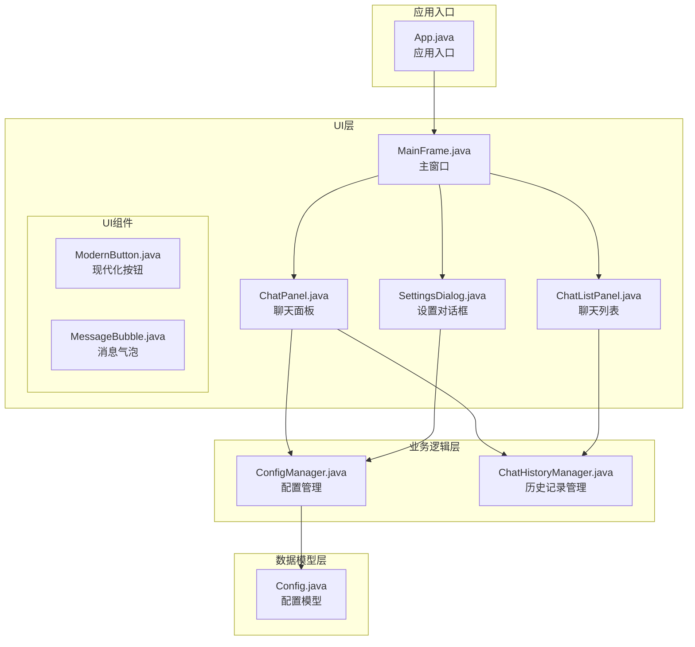
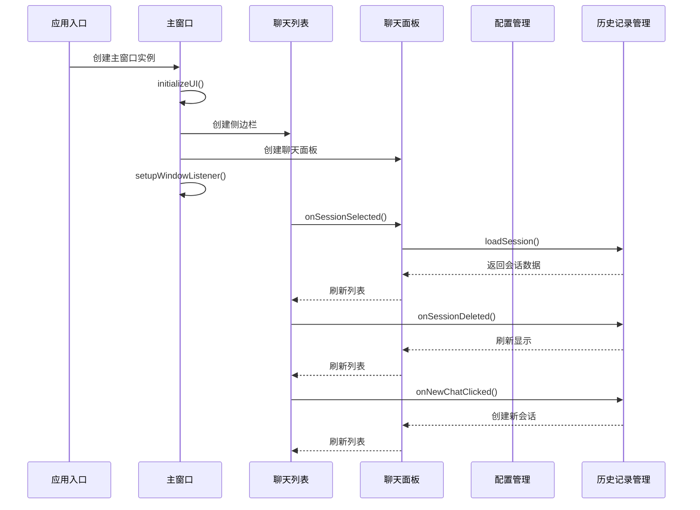
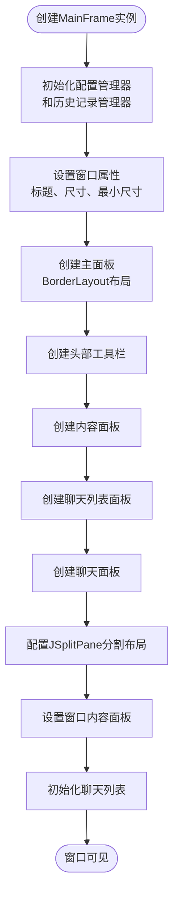
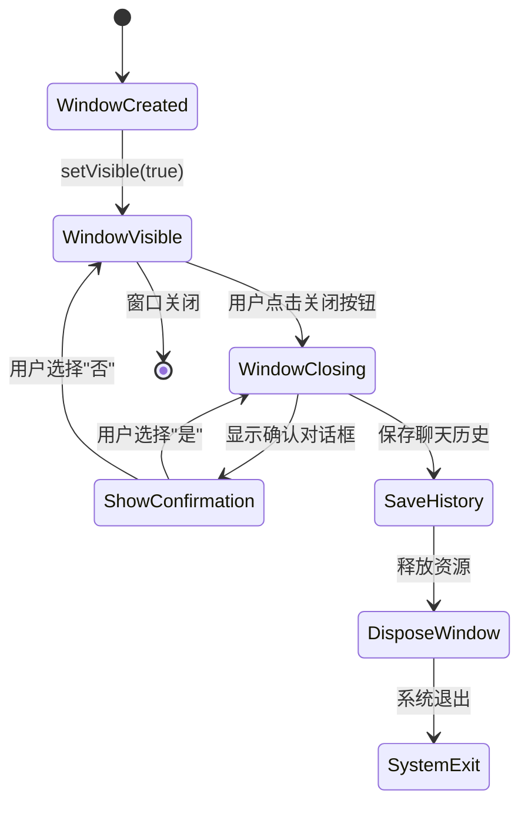
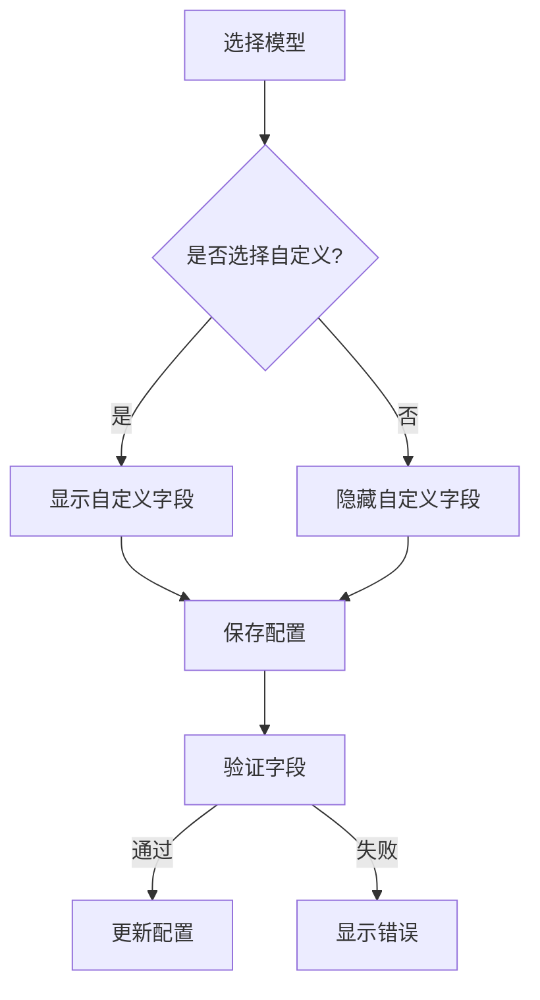
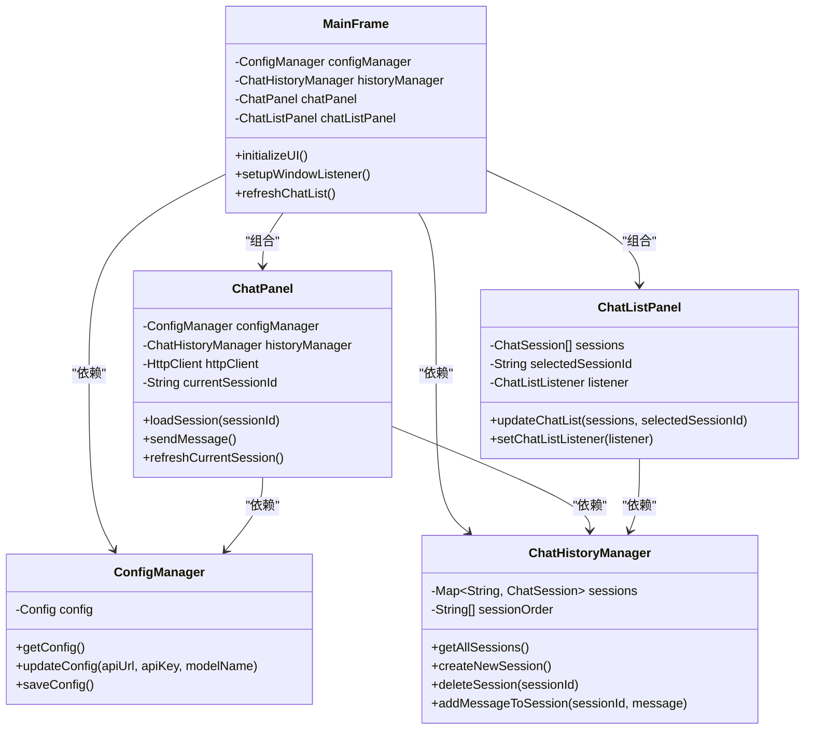

# 主窗口设计

<cite>
**本文档引用的文件**
- [MainFrame.java](file://src/com/llmchat/ui/MainFrame.java)
- [ChatPanel.java](file://src/com/llmchat/ui/ChatPanel.java)
- [ChatListPanel.java](file://src/com/llmchat/ui/components/ChatListPanel.java)
- [App.java](file://src/com/llmchat/App.java)
- [SettingsDialog.java](file://src/com/llmchat/ui/SettingsDialog.java)
- [Config.java](file://src/com/llmchat/model/Config.java)
- [ConfigManager.java](file://src/com/llmchat/config/ConfigManager.java)
- [ChatHistoryManager.java](file://src/com/llmchat/config/ChatHistoryManager.java)
- [ModernButton.java](file://src/com/llmchat/ui/components/ModernButton.java)
- [MessageBubble.java](file://src/com/llmchat/ui/components/MessageBubble.java)
</cite>

## 目录
1. [简介](#简介)
2. [项目结构](#项目结构)
3. [核心组件](#核心组件)
4. [架构概览](#架构概览)
5. [详细组件分析](#详细组件分析)
6. [依赖关系分析](#依赖关系分析)
7. [性能考虑](#性能考虑)
8. [故障排除指南](#故障排除指南)
9. [结论](#结论)

## 简介

本文件详细阐述Java LLM聊天界面项目的主窗口设计，重点分析MainFrame类的实现。该主窗口采用现代化的Swing界面设计，实现了完整的聊天应用界面，包括头部工具栏、侧边栏聊天列表、主聊天面板以及完善的窗口管理功能。

## 项目结构

该项目采用清晰的分层架构设计，主要包含以下模块：

**图表来源**
- [App.java:11-27](file://src/com/llmchat/App.java#L11-L27)
- [MainFrame.java:19-36](file://src/com/llmchat/ui/MainFrame.java#L19-L36)
- [ChatPanel.java:21-55](file://src/com/llmchat/ui/ChatPanel.java#L21-L55)

**章节来源**
- [App.java:1-27](file://src/com/llmchat/App.java#L1-L27)
- [MainFrame.java:1-177](file://src/com/llmchat/ui/MainFrame.java#L1-L177)

## 核心组件

### 主窗口框架

MainFrame类作为整个应用的主界面，继承自JFrame并实现了完整的窗口管理功能。其核心特性包括：

- **窗口属性配置**：设置标题、尺寸、最小尺寸和居中显示
- **主题色彩管理**：统一的白色头部区域和浅灰色背景
- **事件处理机制**：完善的窗口关闭确认对话框
- **组件装配**：协调各个子组件的布局和交互

### 头部工具栏设计

头部工具栏采用BorderLayout布局，包含：
- **左侧标题**：应用名称"LLM Chat"
- **右侧设置按钮**：打开设置对话框
- **分隔线装饰**：增强视觉层次感

### 内容面板组织

内容面板采用BorderLayout布局，包含：
- **顶部区域**：头部工具栏
- **中央区域**：分割布局的侧边栏和主聊天面板

### 侧边栏结构

侧边栏采用垂直BoxLayout布局，包含：
- **标题栏**：显示"聊天记录"和新建对话按钮
- **滚动列表**：显示所有聊天会话
- **交互功能**：会话选择、删除确认、新建对话

**章节来源**
- [MainFrame.java:16-177](file://src/com/llmchat/ui/MainFrame.java#L16-L177)
- [ChatListPanel.java:15-241](file://src/com/llmchat/ui/components/ChatListPanel.java#L15-L241)

## 架构概览

主窗口采用典型的MVC架构模式，通过事件驱动的方式实现组件间的解耦：

**图表来源**
- [MainFrame.java:30-101](file://src/com/llmchat/ui/MainFrame.java#L30-L101)
- [ChatPanel.java:44-55](file://src/com/llmchat/ui/ChatPanel.java#L44-L55)
- [ChatListPanel.java:57-79](file://src/com/llmchat/ui/components/ChatListPanel.java#L57-L79)

## 详细组件分析

### MainFrame类深度解析

#### 窗口初始化流程

主窗口的初始化过程遵循严格的步骤顺序：

**图表来源**
- [MainFrame.java:30-101](file://src/com/llmchat/ui/MainFrame.java#L30-L101)

#### JSplitPane分割布局实现

JSplitPane实现了水平分割布局，具有以下特点：

- **分割方向**：`JSplitPane.HORIZONTAL_SPLIT`
- **分割位置**：固定在250像素处
- **分割条宽度**：1像素
- **背景色**：浅灰色分割条
- **边框设置**：无边框装饰

分割布局将侧边栏（250px宽）和主聊天面板分离，提供良好的用户体验。

#### 颜色主题配置

主窗口采用了统一的颜色主题系统：

| 组件 | 颜色值 | 用途 |
|------|--------|------|
| 头部区域 | 白色 (#FFFFFF) | 标题栏背景 |
| 主面板背景 | 浅灰色 (#F5F5F5) | 整体背景色 |
| 分割条 | 浅灰 (#DCDCDC) | 分隔线颜色 |
| 文本颜色 | 深灰 (#323232) | 标题文字颜色 |

#### 窗口事件处理机制

主窗口实现了完善的窗口生命周期管理：

**图表来源**
- [MainFrame.java:148-166](file://src/com/llmchat/ui/MainFrame.java#L148-L166)

**章节来源**
- [MainFrame.java:19-177](file://src/com/llmchat/ui/MainFrame.java#L19-L177)

### ChatPanel组件分析

ChatPanel作为核心聊天界面，实现了完整的聊天功能：

#### 消息显示系统

消息显示采用垂直BoxLayout布局，支持：
- **用户消息**：右对齐的蓝色气泡
- **助手消息**：左对齐的浅灰色气泡
- **动态换行**：支持长文本自动换行
- **滚动定位**：自动滚动到最新消息

#### 输入交互设计

输入区域采用BorderLayout布局：
- **文本区域**：支持多行输入，Enter键发送
- **发送按钮**：现代化设计，支持加载动画
- **快捷键支持**：Shift+Enter换行，Enter发送

#### 实时流式响应

ChatPanel实现了WebSocket风格的流式响应：
- **增量显示**：服务器响应逐字显示
- **加载状态**：发送按钮显示加载动画
- **错误处理**：网络异常时的用户友好提示

**章节来源**
- [ChatPanel.java:21-335](file://src/com/llmchat/ui/ChatPanel.java#L21-L335)

### ChatListPanel组件分析

ChatListPanel实现了聊天会话的可视化管理：

#### 会话项渲染

每个会话项包含：
- **标题**：会话名称或预览
- **副标题**：消息数量统计
- **删除按钮**：×图标，带确认对话框
- **状态指示**：选中状态的高亮显示

#### 交互行为

- **鼠标悬停**：显示悬停效果
- **点击选择**：切换当前会话
- **删除确认**：二次确认防止误操作
- **新建对话**：创建新的聊天会话

#### 滚动优化

使用JScrollPane实现：
- **垂直滚动**：支持大量会话的滚动浏览
- **滚动增量**：每步16像素的平滑滚动
- **无水平滚动**：避免不必要的横向滚动条

**章节来源**
- [ChatListPanel.java:15-241](file://src/com/llmchat/ui/components/ChatListPanel.java#L15-L241)

### SettingsDialog对话框

设置对话框提供了完整的API配置功能：

#### 配置表单设计

包含以下配置项：
- **API URL**：服务端点地址
- **API Key**：认证密钥
- **模型选择**：预设模型下拉框
- **自定义模型**：支持用户自定义模型名称

#### 数据验证机制

设置对话框实现了多层次的数据验证：
- **必填字段检查**：确保所有字段都有值
- **格式验证**：API URL和模型名称的格式检查
- **用户反馈**：详细的错误提示信息

#### 模型选择逻辑

**图表来源**
- [SettingsDialog.java:146-158](file://src/com/llmchat/ui/SettingsDialog.java#L146-L158)

**章节来源**
- [SettingsDialog.java:15-250](file://src/com/llmchat/ui/SettingsDialog.java#L15-L250)

## 依赖关系分析

主窗口设计体现了良好的依赖注入和接口分离原则：

**图表来源**
- [MainFrame.java:24-28](file://src/com/llmchat/ui/MainFrame.java#L24-L28)
- [ChatPanel.java:24-26](file://src/com/llmchat/ui/ChatPanel.java#L24-L26)
- [ChatListPanel.java:23-26](file://src/com/llmchat/ui/components/ChatListPanel.java#L23-L26)

### 组件耦合度分析

- **低耦合设计**：各组件通过接口进行通信，减少直接依赖
- **依赖注入**：通过构造函数传递依赖，便于测试和维护
- **事件驱动**：使用监听器模式实现松散耦合的组件交互

**章节来源**
- [MainFrame.java:1-177](file://src/com/llmchat/ui/MainFrame.java#L1-L177)
- [ChatPanel.java:1-335](file://src/com/llmchat/ui/ChatPanel.java#L1-L335)
- [ChatListPanel.java:1-241](file://src/com/llmchat/ui/components/ChatListPanel.java#L1-L241)

## 性能考虑

### UI渲染优化

1. **延迟加载**：聊天列表采用延迟加载策略，仅在需要时创建组件
2. **批量更新**：使用`revalidate()`和`repaint()`的合理组合减少重绘开销
3. **滚动优化**：设置合适的滚动增量，提升滚动体验

### 内存管理

1. **对象池模式**：复用MessageBubble组件，减少内存分配
2. **及时释放**：窗口关闭时及时释放资源
3. **缓存策略**：配置信息和会话数据的本地缓存

### 网络通信优化

1. **异步处理**：使用SwingUtilities.invokeLater确保UI线程安全
2. **流式传输**：实时响应的增量显示，避免大块数据一次性处理
3. **错误恢复**：网络异常时的优雅降级处理

## 故障排除指南

### 常见问题及解决方案

#### 窗口无法正常关闭

**问题现象**：点击关闭按钮无响应
**可能原因**：
- 窗口监听器未正确设置
- 存储过程中发生异常
- 线程阻塞问题

**解决方法**：
1. 检查`setupWindowListener()`方法的调用
2. 确认`historyManager.saveHistory()`执行成功
3. 使用`SwingUtilities.invokeLater()`确保UI线程安全

#### 聊天消息显示异常

**问题现象**：消息无法正确显示或换行
**可能原因**：
- MessageBubble组件尺寸计算错误
- 文本面板的宽度设置不当
- 字体渲染问题

**解决方法**：
1. 检查`MAX_WIDTH`常量设置
2. 验证`getPreferredSize()`方法的实现
3. 确认emoji字体的支持情况

#### 会话切换失效

**问题现象**：选择不同会话但界面不更新
**可能原因**：
- ChatListListener回调未正确设置
- ChatHistoryManager数据同步问题
- UI刷新机制失效

**解决方法**：
1. 确认`setChatListListener()`的调用
2. 检查`refreshChatList()`方法的执行
3. 验证`updateChatList()`方法的参数传递

**章节来源**
- [MainFrame.java:148-166](file://src/com/llmchat/ui/MainFrame.java#L148-L166)
- [ChatPanel.java:189-297](file://src/com/llmchat/ui/ChatPanel.java#L189-L297)
- [ChatListPanel.java:96-125](file://src/com/llmchat/ui/components/ChatListPanel.java#L96-L125)

## 结论

MainFrame类的设计体现了现代Java桌面应用的最佳实践，通过合理的架构设计和组件分离，实现了功能完整、性能优良的聊天界面。主要优势包括：

1. **清晰的架构层次**：分层设计使得代码易于理解和维护
2. **良好的用户体验**：现代化的界面设计和流畅的交互体验
3. **完善的错误处理**：全面的异常处理和用户友好的错误提示
4. **可扩展性设计**：模块化的组件设计便于功能扩展

该设计为后续的功能扩展和维护奠定了坚实的基础，是一个值得参考的Java Swing应用开发范例。