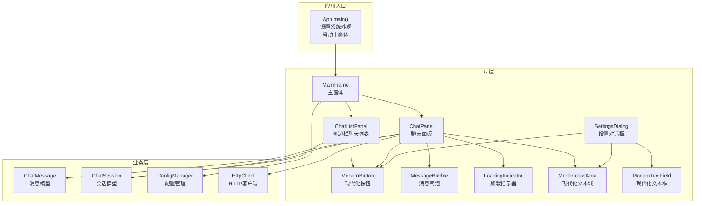
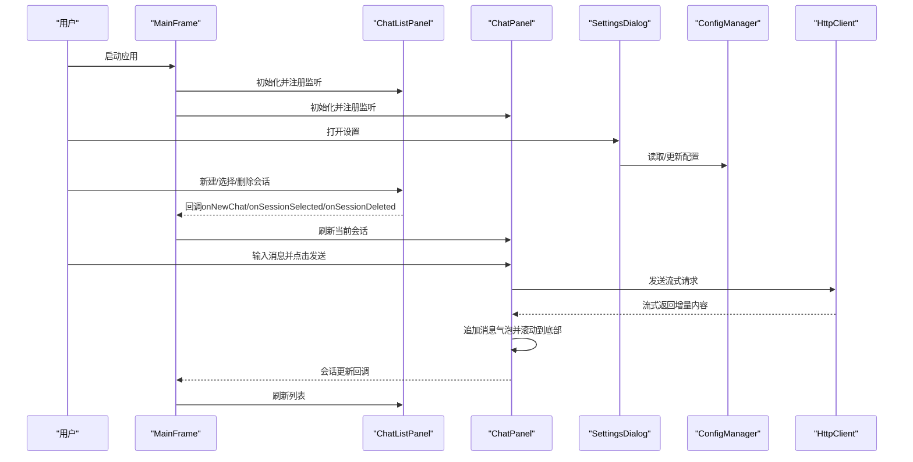
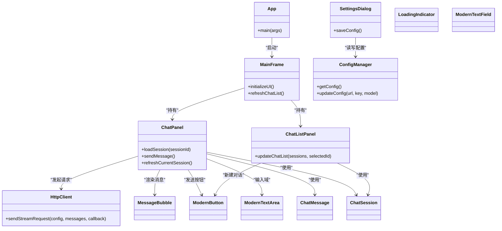

# 用户界面组件

<cite>
**本文引用的文件**
- [App.java](file://src/com/llmchat/App.java)
- [MainFrame.java](file://src/com/llmchat/ui/MainFrame.java)
- [ChatPanel.java](file://src/com/llmchat/ui/ChatPanel.java)
- [SettingsDialog.java](file://src/com/llmchat/ui/SettingsDialog.java)
- [ChatListPanel.java](file://src/com/llmchat/ui/components/ChatListPanel.java)
- [ModernButton.java](file://src/com/llmchat/ui/components/ModernButton.java)
- [MessageBubble.java](file://src/com/llmchat/ui/components/MessageBubble.java)
- [LoadingIndicator.java](file://src/com/llmchat/ui/components/LoadingIndicator.java)
- [ModernTextArea.java](file://src/com/llmchat/ui/components/ModernTextArea.java)
- [ModernTextField.java](file://src/com/llmchat/ui/components/ModernTextField.java)
- [ChatMessage.java](file://src/com/llmchat/model/ChatMessage.java)
- [ChatSession.java](file://src/com/llmchat/model/ChatSession.java)
- [ConfigManager.java](file://src/com/llmchat/config/ConfigManager.java)
- [HttpClient.java](file://src/com/llmchat/http/HttpClient.java)
</cite>

## 目录
1. [简介](#简介)
2. [项目结构](#项目结构)
3. [核心组件](#核心组件)
4. [架构总览](#架构总览)
5. [组件详解](#组件详解)
6. [依赖关系分析](#依赖关系分析)
7. [性能与可访问性](#性能与可访问性)
8. [故障排查指南](#故障排查指南)
9. [结论](#结论)
10. [附录：使用示例与最佳实践](#附录使用示例与最佳实践)

## 简介
本文件面向Java LLM聊天界面项目的用户界面组件，系统性地文档化主界面设计、设置对话框以及自定义Swing组件库（ModernButton、MessageBubble、ChatListPanel、LoadingIndicator、ModernTextArea、ModernTextField）。内容涵盖：
- 视觉外观与交互行为
- 属性、事件、回调与定制选项
- 使用示例与代码片段路径
- 响应式布局与无障碍访问建议
- 组件状态、动画与过渡效果
- 样式定制与主题支持
- 性能优化与跨平台兼容性
- 组件组合模式与集成方式

## 项目结构
该项目采用按功能域划分的目录组织，UI层位于src/com/llmchat/ui，包含主窗体、聊天面板、设置对话框及自定义组件；业务模型位于model包，配置与网络请求分别在config与http包中。

图表来源
- [App.java:12-24](file://src/com/llmchat/App.java#L12-L24)
- [MainFrame.java:30-101](file://src/com/llmchat/ui/MainFrame.java#L30-L101)
- [ChatPanel.java:44-55](file://src/com/llmchat/ui/ChatPanel.java#L44-L55)
- [SettingsDialog.java:27-37](file://src/com/llmchat/ui/SettingsDialog.java#L27-L37)
- [ChatListPanel.java:34-84](file://src/com/llmchat/ui/components/ChatListPanel.java#L34-L84)
- [ModernButton.java:31-73](file://src/com/llmchat/ui/components/ModernButton.java#L31-L73)
- [MessageBubble.java:24-58](file://src/com/llmchat/ui/components/MessageBubble.java#L24-L58)
- [LoadingIndicator.java:20-29](file://src/com/llmchat/ui/components/LoadingIndicator.java#L20-L29)
- [ModernTextArea.java:18-44](file://src/com/llmchat/ui/components/ModernTextArea.java#L18-L44)
- [ModernTextField.java:17-43](file://src/com/llmchat/ui/components/ModernTextField.java#L17-L43)
- [ChatMessage.java:8-43](file://src/com/llmchat/model/ChatMessage.java#L8-L43)
- [ChatSession.java:11-90](file://src/com/llmchat/model/ChatSession.java#L11-L90)
- [ConfigManager.java:20-75](file://src/com/llmchat/config/ConfigManager.java#L20-L75)
- [HttpClient.java:66-127](file://src/com/llmchat/http/HttpClient.java#L66-L127)

章节来源
- [App.java:12-24](file://src/com/llmchat/App.java#L12-L24)
- [MainFrame.java:30-101](file://src/com/llmchat/ui/MainFrame.java#L30-L101)

## 核心组件
本节概述关键UI组件及其职责：
- ModernButton：带悬停/按下态与加载动画的现代化按钮，支持loading状态切换。
- MessageBubble：根据消息角色渲染不同配色的圆角气泡，支持动态追加文本与自动换行。
- ChatListPanel：侧边栏聊天列表，支持新建会话、会话选择与删除，含悬停与选中态。
- LoadingIndicator：三圆点脉动加载指示器，可控制启停与透明度渐变。
- ModernTextArea/ModernTextField：现代化输入组件，具备焦点高亮边框与多行/单行输入能力。
- SettingsDialog：设置对话框，负责API配置的输入、校验与保存。
- ChatPanel：核心聊天界面，负责消息展示、输入处理、流式响应接收与滚动定位。
- MainFrame：主窗体，整合头部工具栏、侧边栏与聊天面板，协调会话列表刷新。

章节来源
- [ModernButton.java:14-98](file://src/com/llmchat/ui/components/ModernButton.java#L14-L98)
- [MessageBubble.java:14-169](file://src/com/llmchat/ui/components/MessageBubble.java#L14-L169)
- [ChatListPanel.java:15-241](file://src/com/llmchat/ui/components/ChatListPanel.java#L15-L241)
- [LoadingIndicator.java:10-94](file://src/com/llmchat/ui/components/LoadingIndicator.java#L10-L94)
- [ModernTextArea.java:12-66](file://src/com/llmchat/ui/components/ModernTextArea.java#L12-L66)
- [ModernTextField.java:12-49](file://src/com/llmchat/ui/components/ModernTextField.java#L12-L49)
- [SettingsDialog.java:15-250](file://src/com/llmchat/ui/SettingsDialog.java#L15-L250)
- [ChatPanel.java:21-335](file://src/com/llmchat/ui/ChatPanel.java#L21-L335)
- [MainFrame.java:19-177](file://src/com/llmchat/ui/MainFrame.java#L19-L177)

## 架构总览
下图展示UI组件与业务层之间的交互关系，以及事件流向。

图表来源
- [MainFrame.java:58-79](file://src/com/llmchat/ui/MainFrame.java#L58-L79)
- [ChatListPanel.java:89-125](file://src/com/llmchat/ui/components/ChatListPanel.java#L89-L125)
- [ChatPanel.java:189-297](file://src/com/llmchat/ui/ChatPanel.java#L189-L297)
- [SettingsDialog.java:171-185](file://src/com/llmchat/ui/SettingsDialog.java#L171-L185)
- [ConfigManager.java:63-75](file://src/com/llmchat/config/ConfigManager.java#L63-L75)
- [HttpClient.java:66-127](file://src/com/llmchat/http/HttpClient.java#L66-L127)

## 组件详解

### ModernButton（现代化按钮）
- 视觉外观
  - 圆角矩形背景，主色、悬停色、按下色区分。
  - 鼠标悬停/按下时颜色变化，提供即时反馈。
  - 加载状态下显示三圆点脉动动画，透明度递减形成流动感。
- 行为与交互
  - 鼠标进入/离开改变hover状态；鼠标按下/释放改变pressed状态。
  - setLoading(true/false)控制加载动画与禁用状态，内部使用定时器驱动点闪烁。
- 属性与方法
  - 构造函数：传入按钮文本。
  - 方法：setLoading(boolean)、isLoading()。
- 使用示例（代码片段路径）
  - [设置按钮监听与点击事件:117-125](file://src/com/llmchat/ui/MainFrame.java#L117-L125)
  - [设置对话框中的“保存/取消”按钮:175-182](file://src/com/llmchat/ui/SettingsDialog.java#L175-L182)
  - [聊天列表中的“新建对话”按钮:55-61](file://src/com/llmchat/ui/components/ChatListPanel.java#L55-L61)
- 定制选项
  - 颜色常量（主色、悬停色、按下色）、圆角半径、动画点数与尺寸、闪烁间隔。
- 动画与过渡
  - 通过Timer每200ms推进一次点索引，配合透明度渐变营造脉动感。
- 无障碍与响应式
  - 提供手型光标与键盘可达性；建议在高对比度主题下调整颜色。

章节来源
- [ModernButton.java:14-159](file://src/com/llmchat/ui/components/ModernButton.java#L14-L159)
- [ChatListPanel.java:55-61](file://src/com/llmchat/ui/components/ChatListPanel.java#L55-L61)
- [SettingsDialog.java:175-182](file://src/com/llmchat/ui/SettingsDialog.java#L175-L182)
- [MainFrame.java:117-125](file://src/com/llmchat/ui/MainFrame.java#L117-L125)

### MessageBubble（消息气泡）
- 视觉外观
  - 圆角矩形背景，用户消息使用蓝色系，助手消息使用浅灰系。
  - 文本支持emoji字体回退策略，优先Windows/Apple/Linux平台emoji字体。
- 行为与交互
  - 初始构造时设置样式与文本；appendContent支持增量追加并触发重排。
  - getPreferredSize基于最大宽度与文本内容动态计算，实现自动换行与尺寸适配。
- 属性与方法
  - 构造函数：传入ChatMessage。
  - 方法：appendContent(String)、getPreferredSize()、getMinimumSize()。
- 使用示例（代码片段路径）
  - [添加用户消息气泡:299-312](file://src/com/llmchat/ui/ChatPanel.java#L299-L312)
  - [添加助手响应气泡并增量追加内容:229-249](file://src/com/llmchat/ui/ChatPanel.java#L229-L249)
- 定制选项
  - 用户/助手配色、文本颜色、最大宽度、圆角半径、字体族与字号。
- 动画与过渡
  - 通过Swing异步调度与多次revalidate/repaint确保布局稳定更新。
- 无障碍与响应式
  - 建议在高对比度模式下调整前景色；对长文本启用水平滚动（当前为自动换行）。

章节来源
- [MessageBubble.java:14-170](file://src/com/llmchat/ui/components/MessageBubble.java#L14-L170)
- [ChatPanel.java:229-249](file://src/com/llmchat/ui/ChatPanel.java#L229-L249)
- [ChatPanel.java:299-312](file://src/com/llmchat/ui/ChatPanel.java#L299-L312)

### ChatListPanel（侧边栏聊天列表）
- 视觉外观
  - 顶部标题栏+新建按钮；列表项圆角背景，选中态与悬停态颜色区分。
- 行为与交互
  - 支持新建会话、选择会话、删除会话（带确认对话框）。
  - 列表滚动条单位增量设置为16，提升滚动体验。
- 属性与方法
  - 接口：ChatListListener（onSessionSelected/onSessionDeleted/onNewChatClicked）。
  - 方法：setChatListListener、updateChatList(List<ChatSession>, String)。
- 使用示例（代码片段路径）
  - [注册监听器与处理事件:58-79](file://src/com/llmchat/ui/MainFrame.java#L58-L79)
  - [刷新列表显示与空态提示:96-125](file://src/com/llmchat/ui/components/ChatListPanel.java#L96-L125)
- 定制选项
  - 背景色、选中/悬停/普通项背景色、文本颜色、子文本颜色、圆角半径。
- 动画与过渡
  - 通过paintComponent绘制圆角背景，hover/selected状态即时切换。
- 无障碍与响应式
  - 建议为删除按钮提供快捷键或右键菜单；为列表项提供键盘导航。

章节来源
- [ChatListPanel.java:15-241](file://src/com/llmchat/ui/components/ChatListPanel.java#L15-L241)
- [MainFrame.java:58-79](file://src/com/llmchat/ui/MainFrame.java#L58-L79)

### LoadingIndicator（加载指示器）
- 视觉外观
  - 三圆点脉动，透明度逐点递减，居中显示。
- 行为与交互
  - start()/stop()控制动画启停；isRunning()查询状态。
  - 内部使用Timer驱动点索引轮转。
- 属性与方法
  - 构造函数初始化尺寸与计时器。
  - 方法：start()、stop()、isRunning()。
- 使用示例（代码片段路径）
  - [按钮加载动画与禁用逻辑:78-91](file://src/com/llmchat/ui/components/ModernButton.java#L78-L91)
  - [对话框中的保存/取消按钮加载状态:175-182](file://src/com/llmchat/ui/SettingsDialog.java#L175-L182)
- 定制选项
  - 圆点数量、尺寸、间距、颜色、闪烁间隔。
- 动画与过渡
  - 通过透明度插值实现柔和的脉动感。

章节来源
- [LoadingIndicator.java:10-94](file://src/com/llmchat/ui/components/LoadingIndicator.java#L10-L94)
- [ModernButton.java:78-91](file://src/com/llmchat/ui/components/ModernButton.java#L78-L91)
- [SettingsDialog.java:175-182](file://src/com/llmchat/ui/SettingsDialog.java#L175-L182)

### ModernTextArea / ModernTextField（现代化输入组件）
- 视觉外观
  - 单行输入框：圆角边框，焦点时加粗边框与内边距微调。
  - 多行文本域：JScrollPane包裹JTextArea，支持自动换行与词边界换行。
- 行为与交互
  - 焦点获得/失去时动态调整边框颜色与粗细。
  - 文本域支持clear/append/getText/setText。
- 属性与方法
  - 构造函数：ModernTextField(int)、ModernTextArea(int,int)。
  - 方法：getText/setText/append/clear/getTextArea。
- 使用示例（代码片段路径）
  - [聊天面板输入区域与回车发送:86-119](file://src/com/llmchat/ui/ChatPanel.java#L86-L119)
  - [设置对话框中的文本字段:74-96](file://src/com/llmchat/ui/SettingsDialog.java#L74-L96)
- 定制选项
  - 边框颜色、焦点颜色、背景色、字体族与字号、滚动策略。
- 动画与过渡
  - 边框变化为即时视觉反馈，无额外动画。

章节来源
- [ModernTextField.java:12-49](file://src/com/llmchat/ui/components/ModernTextField.java#L12-L49)
- [ModernTextArea.java:12-66](file://src/com/llmchat/ui/components/ModernTextArea.java#L12-L66)
- [ChatPanel.java:86-119](file://src/com/llmchat/ui/ChatPanel.java#L86-L119)
- [SettingsDialog.java:74-96](file://src/com/llmchat/ui/SettingsDialog.java#L74-L96)

### SettingsDialog（设置对话框）
- 视觉外观
  - 白色背景，标题与表单区域清晰分层，按钮区右对齐。
- 行为与交互
  - API URL、API Key、模型选择（预设或自定义）。
  - 保存前进行必填校验；成功后提示并关闭对话框。
- 属性与方法
  - 构造函数：传入父窗体与ConfigManager。
  - 方法：loadCurrentConfig/saveConfig。
- 使用示例（代码片段路径）
  - [打开设置对话框:122-125](file://src/com/llmchat/ui/MainFrame.java#L122-L125)
  - [保存配置与模型选择逻辑:171-248](file://src/com/llmchat/ui/SettingsDialog.java#L171-L248)
- 定制选项
  - 标签颜色、背景色、字体族与字号、弹窗尺寸与位置。
- 动画与过渡
  - 无动画，对话框为模态弹出。

章节来源
- [SettingsDialog.java:15-250](file://src/com/llmchat/ui/SettingsDialog.java#L15-L250)
- [MainFrame.java:122-125](file://src/com/llmchat/ui/MainFrame.java#L122-L125)

### ChatPanel（核心聊天面板）
- 视觉外观
  - 背景色统一，消息区域垂直堆叠，输入区域右侧放置发送按钮。
- 行为与交互
  - 支持回车发送（Shift+Enter换行），发送按钮加载态防止重复提交。
  - 流式接收响应，增量追加至MessageBubble，自动滚动到底部。
  - 会话更新回调通知主窗体刷新列表。
- 属性与方法
  - 接口：ChatPanelListener（onSessionUpdated）。
  - 方法：loadSession(String)、refreshCurrentSession()、getCurrentSessionId()。
- 使用示例（代码片段路径）
  - [初始化UI与输入面板:61-119](file://src/com/llmchat/ui/ChatPanel.java#L61-L119)
  - [发送消息与流式响应处理:189-297](file://src/com/llmchat/ui/ChatPanel.java#L189-L297)
  - [滚动到底部:314-319](file://src/com/llmchat/ui/ChatPanel.java#L314-L319)
- 定制选项
  - 背景色、滚动增量、消息气泡对齐（左/右）、输入区域尺寸。
- 动画与过渡
  - 通过Swing异步调度与滚动条值变更实现平滑滚动。

章节来源
- [ChatPanel.java:21-335](file://src/com/llmchat/ui/ChatPanel.java#L21-L335)

### MainFrame（主窗体）
- 视觉外观
  - 头部工具栏+分割面板（侧边栏+聊天面板），分隔线细窄且无边框。
- 行为与交互
  - 注册ChatListPanel与ChatPanel监听器，协调会话加载与列表刷新。
  - 关闭窗口时询问并保存历史。
- 属性与方法
  - 构造函数：初始化ConfigManager/ChatHistoryManager。
  - 方法：refreshChatList()。
- 使用示例（代码片段路径）
  - [初始化UI与分割面板:38-101](file://src/com/llmchat/ui/MainFrame.java#L38-L101)
  - [窗口关闭事件与历史保存:148-166](file://src/com/llmchat/ui/MainFrame.java#L148-L166)
- 定制选项
  - 标题、最小尺寸、窗口关闭行为、分割位置与分隔线样式。
- 动画与过渡
  - 无动画，布局切换即时完成。

章节来源
- [MainFrame.java:19-177](file://src/com/llmchat/ui/MainFrame.java#L19-L177)

## 依赖关系分析

图表来源
- [App.java:12-24](file://src/com/llmchat/App.java#L12-L24)
- [MainFrame.java:58-79](file://src/com/llmchat/ui/MainFrame.java#L58-L79)
- [ChatPanel.java:189-297](file://src/com/llmchat/ui/ChatPanel.java#L189-L297)
- [SettingsDialog.java:171-248](file://src/com/llmchat/ui/SettingsDialog.java#L171-L248)
- [ChatListPanel.java:96-125](file://src/com/llmchat/ui/components/ChatListPanel.java#L96-L125)
- [ConfigManager.java:63-75](file://src/com/llmchat/config/ConfigManager.java#L63-L75)
- [HttpClient.java:66-127](file://src/com/llmchat/http/HttpClient.java#L66-L127)

## 性能与可访问性
- 性能优化
  - 消息气泡的增量追加通过SwingUtilities.invokeLater异步处理，避免阻塞UI线程。
  - ChatPanel在滚动到底部时仅更新滚动条值，减少不必要的重绘。
  - ChatListPanel与ChatPanel均使用BoxLayout/BorderLayout，布局计算轻量。
  - HttpClient使用独立线程处理网络请求，避免阻塞UI。
- 响应式设计
  - ChatPanel的消息区域使用JScrollPane，支持垂直滚动；输入区域固定尺寸，避免过度拉伸。
  - MessageBubble通过getPreferredSize动态计算尺寸，适应不同内容长度。
- 无障碍访问
  - 提供手型光标与键盘可达性；建议为按钮与列表项增加可读的辅助文本与键盘导航。
  - 对话框与确认对话框使用标准JOptionPane，便于屏幕阅读器识别。
- 跨平台兼容
  - 字体回退策略覆盖Windows/Apple/Linux平台的emoji字体；若不可用则回退到系统默认字体。
  - 设置系统外观为系统原生外观，保证跨平台一致的控件样式。

[本节为通用指导，无需特定文件引用]

## 故障排查指南
- 发送按钮无法再次点击
  - 检查按钮是否处于loading状态；确保在流式响应完成后调用setLoading(false)。
  - 参考：[按钮加载状态切换:78-91](file://src/com/llmchat/ui/components/ModernButton.java#L78-L91)
- 消息未显示或显示错位
  - 确认appendContent在Swing线程中调用；检查MessageBubble的revalidate/repaint链路。
  - 参考：[消息气泡增量追加:89-121](file://src/com/llmchat/ui/components/MessageBubble.java#L89-L121)
- 会话列表不刷新
  - 确保ChatPanel在会话更新后回调MainFrame.refreshChatList()。
  - 参考：[会话更新回调:217-219](file://src/com/llmchat/ui/ChatPanel.java#L217-L219)
- 设置保存失败
  - 检查必填字段校验与ConfigManager.updateConfig调用。
  - 参考：[设置保存流程:216-248](file://src/com/llmchat/ui/SettingsDialog.java#L216-L248)
- 网络请求异常
  - 检查ConfigManager中的API URL与Key是否正确；查看HttpClient的错误回调。
  - 参考：[流式请求与错误处理:119-126](file://src/com/llmchat/http/HttpClient.java#L119-L126)

章节来源
- [ModernButton.java:78-91](file://src/com/llmchat/ui/components/ModernButton.java#L78-L91)
- [MessageBubble.java:89-121](file://src/com/llmchat/ui/components/MessageBubble.java#L89-L121)
- [ChatPanel.java:217-219](file://src/com/llmchat/ui/ChatPanel.java#L217-L219)
- [SettingsDialog.java:216-248](file://src/com/llmchat/ui/SettingsDialog.java#L216-L248)
- [HttpClient.java:119-126](file://src/com/llmchat/http/HttpClient.java#L119-L126)

## 结论
本UI组件库围绕现代、简洁、易用的设计理念构建，通过自定义Swing组件实现了统一的视觉风格与流畅的交互体验。组件间职责清晰、耦合度低，易于扩展与维护。建议后续增强：
- 为按钮与列表项提供键盘快捷键与ARIA辅助文本。
- 优化长文本与大量消息场景下的滚动性能。
- 引入主题切换机制，支持明暗主题与高对比度模式。

[本节为总结性内容，无需特定文件引用]

## 附录：使用示例与最佳实践
- 在主窗体中集成设置对话框
  - [打开设置对话框:122-125](file://src/com/llmchat/ui/MainFrame.java#L122-L125)
- 在聊天面板中发送消息并处理流式响应
  - [发送消息与回调:189-297](file://src/com/llmchat/ui/ChatPanel.java#L189-L297)
- 在设置对话框中保存配置
  - [保存配置与模型选择:171-248](file://src/com/llmchat/ui/SettingsDialog.java#L171-L248)
- 自定义按钮加载状态
  - [按钮加载动画与禁用:78-91](file://src/com/llmchat/ui/components/ModernButton.java#L78-L91)
- 动态追加消息内容
  - [消息气泡增量追加:89-121](file://src/com/llmchat/ui/components/MessageBubble.java#L89-L121)
- 列表项交互与删除确认
  - [列表项交互与确认对话框:146-201](file://src/com/llmchat/ui/components/ChatListPanel.java#L146-L201)

章节来源
- [MainFrame.java:122-125](file://src/com/llmchat/ui/MainFrame.java#L122-L125)
- [ChatPanel.java:189-297](file://src/com/llmchat/ui/ChatPanel.java#L189-L297)
- [SettingsDialog.java:171-248](file://src/com/llmchat/ui/SettingsDialog.java#L171-L248)
- [ModernButton.java:78-91](file://src/com/llmchat/ui/components/ModernButton.java#L78-L91)
- [MessageBubble.java:89-121](file://src/com/llmchat/ui/components/MessageBubble.java#L89-L121)
- [ChatListPanel.java:146-201](file://src/com/llmchat/ui/components/ChatListPanel.java#L146-L201)