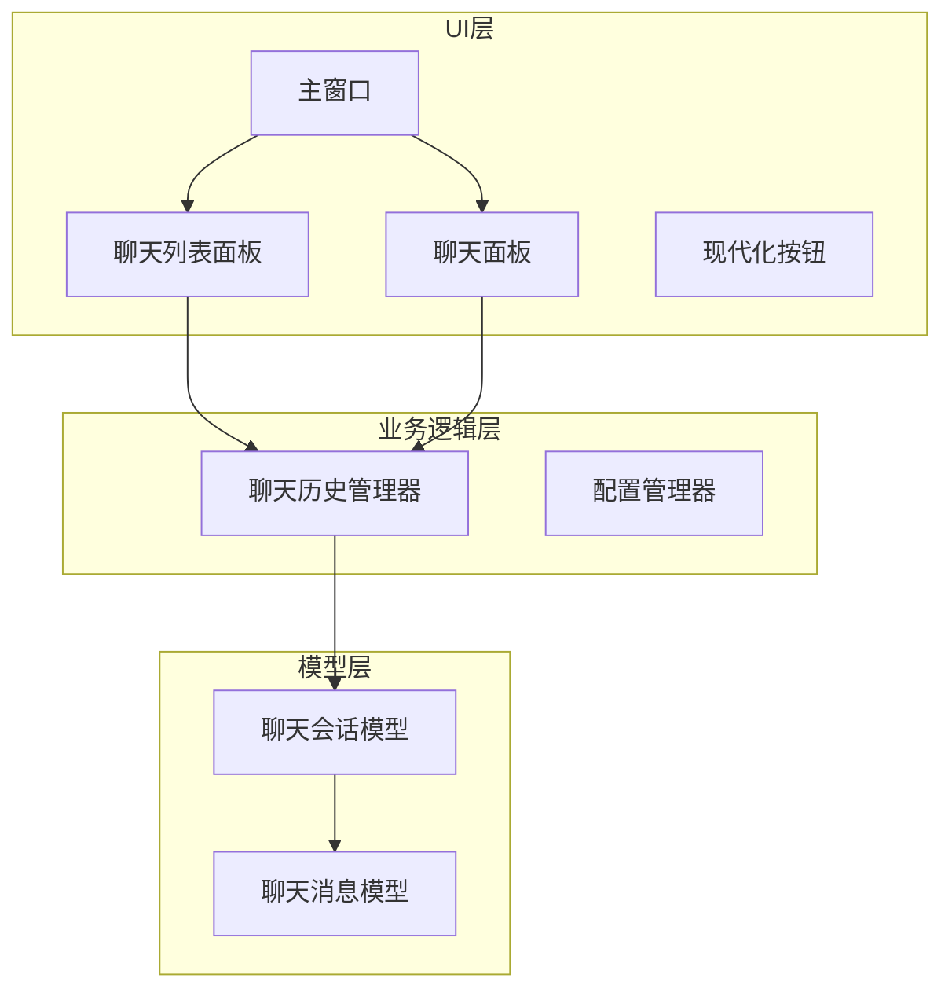
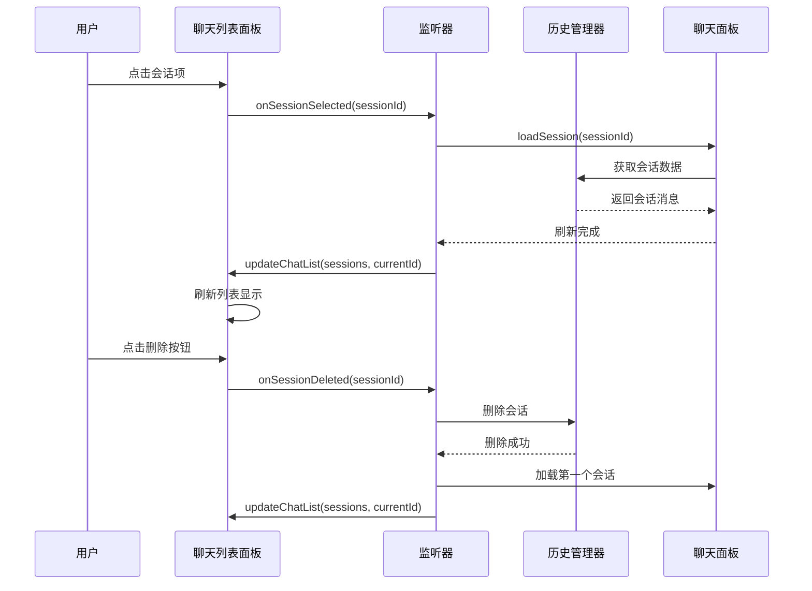
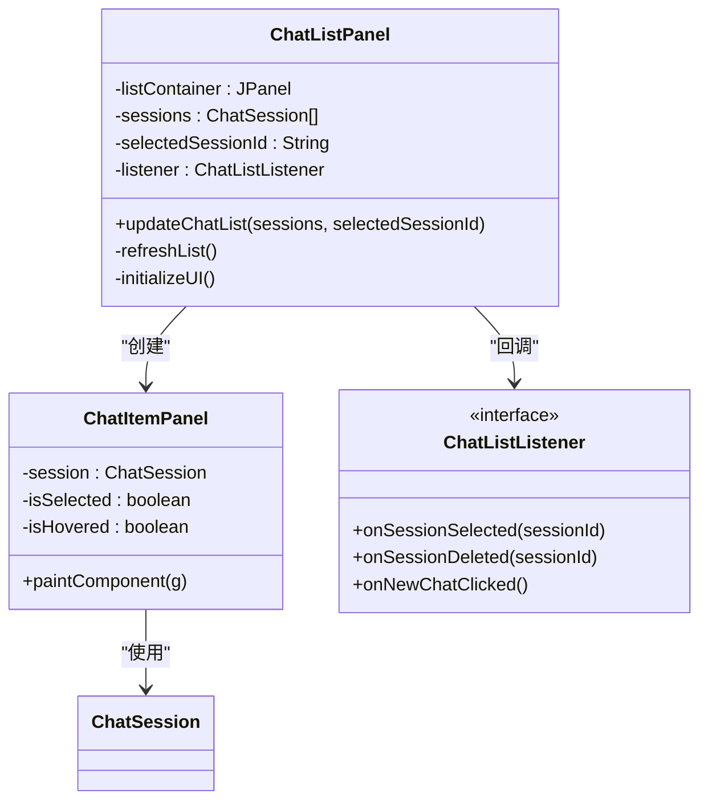
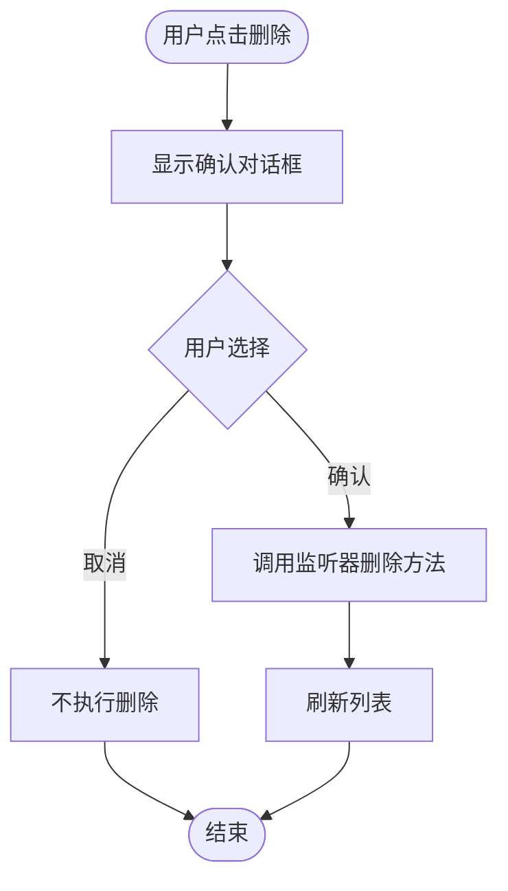
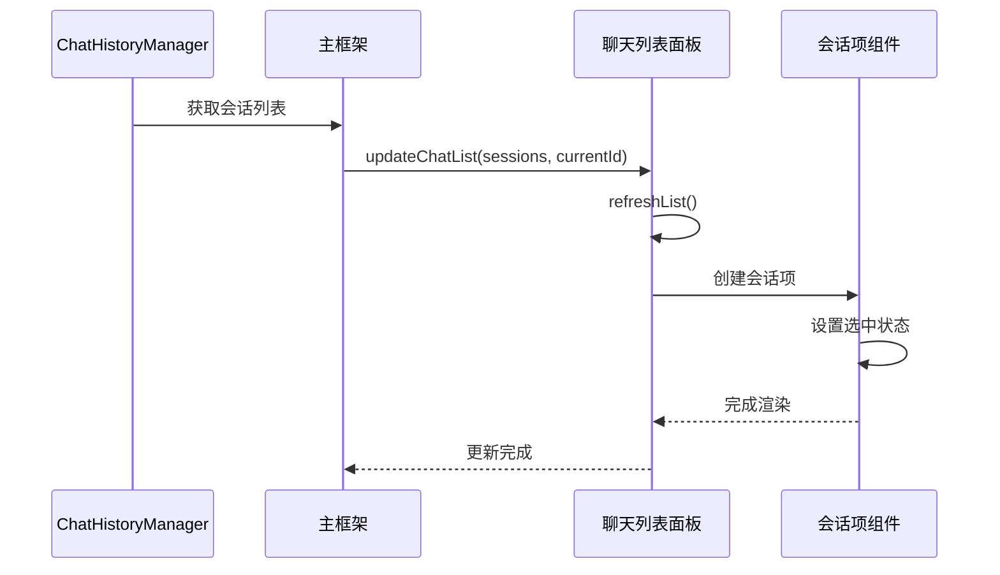
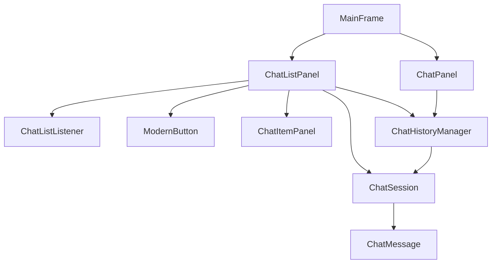
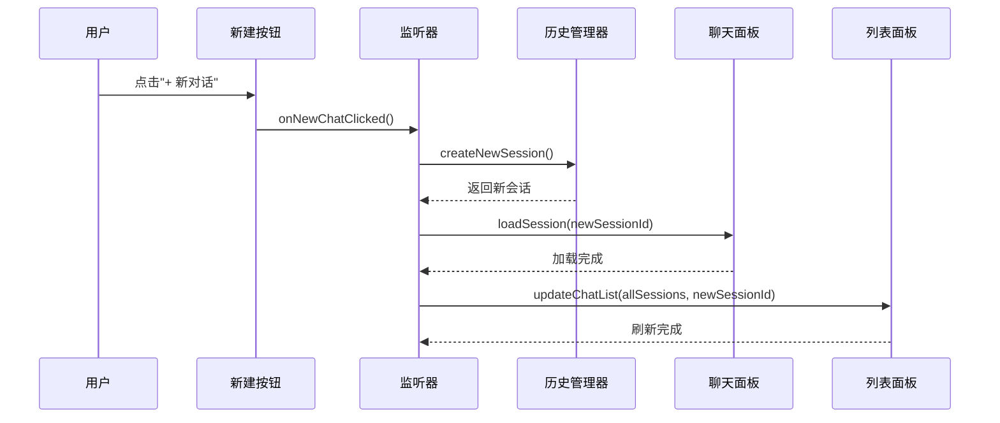

# ChatListPanel聊天列表面板

<cite>
**本文档引用的文件**
- [ChatListPanel.java](file://src/com/llmchat/ui/components/ChatListPanel.java)
- [ChatSession.java](file://src/com/llmchat/model/ChatSession.java)
- [ChatHistoryManager.java](file://src/com/llmchat/config/ChatHistoryManager.java)
- [MainFrame.java](file://src/com/llmchat/ui/MainFrame.java)
- [ChatPanel.java](file://src/com/llmchat/ui/ChatPanel.java)
- [ModernButton.java](file://src/com/llmchat/ui/components/ModernButton.java)
- [ChatMessage.java](file://src/com/llmchat/model/ChatMessage.java)
</cite>

## 目录
1. [简介](#简介)
2. [项目结构](#项目结构)
3. [核心组件](#核心组件)
4. [架构概览](#架构概览)
5. [详细组件分析](#详细组件分析)
6. [依赖关系分析](#依赖关系分析)
7. [性能考虑](#性能考虑)
8. [故障排除指南](#故障排除指南)
9. [结论](#结论)
10. [附录：使用示例](#附录使用示例)

## 简介

ChatListPanel是Java LLM Chat应用中的聊天列表面板组件，负责在侧边栏显示所有聊天会话的历史记录。该组件实现了现代化的UI设计，提供了会话项的创建、显示和管理功能，包括选中状态的视觉反馈、滚动机制和交互式操作。

该组件采用MVC架构模式，通过监听器接口与主界面进行事件通信，实现了松耦合的设计。组件支持动态刷新、状态管理和用户交互，为用户提供直观的会话管理体验。

## 项目结构

ChatListPanel位于UI组件层，与业务逻辑层通过接口进行解耦。项目的整体架构采用分层设计：



**图表来源**
- [ChatListPanel.java:15-40](file://src/com/llmchat/ui/components/ChatListPanel.java#L15-L40)
- [MainFrame.java:27-83](file://src/com/llmchat/ui/MainFrame.java#L27-L83)
- [ChatHistoryManager.java:20-27](file://src/com/llmchat/config/ChatHistoryManager.java#L20-L27)

**章节来源**
- [ChatListPanel.java:1-241](file://src/com/llmchat/ui/components/ChatListPanel.java#L1-L241)
- [MainFrame.java:19-101](file://src/com/llmchat/ui/MainFrame.java#L19-L101)

## 核心组件

### ChatListPanel类结构

ChatListPanel是一个继承自JPanel的复合组件，主要包含以下核心功能：

- **UI布局管理**：采用BorderLayout组织标题栏、新建按钮和滚动列表
- **会话列表渲染**：动态生成ChatItemPanel子组件
- **事件处理机制**：通过ChatListListener接口实现事件回调
- **状态管理**：维护当前选中会话ID和会话列表数据

### 关键属性和常量

组件定义了丰富的颜色常量用于UI状态管理：
- 背景颜色：BACKGROUND_COLOR (RGB: 245, 245, 245)
- 项目背景：ITEM_BACKGROUND (RGB: 255, 255, 255)
- 选中状态：SELECTED_BACKGROUND (RGB: 220, 230, 245)
- 悬停状态：HOVER_BACKGROUND (RGB: 235, 235, 235)
- 文本颜色：TEXT_COLOR (RGB: 50, 50, 50)
- 辅助文本：SUBTEXT_COLOR (RGB: 130, 130, 130)

**章节来源**
- [ChatListPanel.java:16-26](file://src/com/llmchat/ui/components/ChatListPanel.java#L16-L26)
- [ChatListPanel.java:34-40](file://src/com/llmchat/ui/components/ChatListPanel.java#L34-L40)

## 架构概览

ChatListPanel采用观察者模式与主界面进行通信，通过回调接口实现松耦合设计：



**图表来源**
- [ChatListPanel.java:57-61](file://src/com/llmchat/ui/components/ChatListPanel.java#L57-L61)
- [ChatListPanel.java:149-151](file://src/com/llmchat/ui/components/ChatListPanel.java#L149-L151)
- [ChatListPanel.java:189-201](file://src/com/llmchat/ui/components/ChatListPanel.java#L189-L201)
- [MainFrame.java:58-79](file://src/com/llmchat/ui/MainFrame.java#L58-L79)

## 详细组件分析

### ChatItemPanel内部类分析

ChatItemPanel是ChatListPanel的内部类，负责单个会话项的渲染和交互：



**图表来源**
- [ChatListPanel.java:130-239](file://src/com/llmchat/ui/components/ChatListPanel.java#L130-L239)
- [ChatListPanel.java:28-32](file://src/com/llmchat/ui/components/ChatListPanel.java#L28-L32)

#### 布局设计和视觉反馈

ChatItemPanel采用BorderLayout组织内容，包含三个主要部分：

1. **左侧文本区域**：显示会话标题和消息数量
2. **右侧删除按钮**：圆形×按钮，悬停时可见
3. **状态背景**：根据选中、悬停状态切换不同颜色

视觉反馈机制：
- 选中状态：蓝色背景 (RGB: 220, 230, 245)
- 悬停状态：浅灰色背景 (RGB: 235, 235, 235)
- 正常状态：白色背景 (RGB: 255, 255, 255)
- 圆角矩形设计：8像素圆角半径

#### 交互机制

鼠标事件处理：
- **点击事件**：触发会话选择回调
- **悬停事件**：更新悬停状态并重绘
- **删除确认**：弹出确认对话框

删除操作流程：



**图表来源**
- [ChatListPanel.java:189-201](file://src/com/llmchat/ui/components/ChatListPanel.java#L189-L201)

**章节来源**
- [ChatListPanel.java:130-239](file://src/com/llmchat/ui/components/ChatListPanel.java#L130-L239)

### 数据绑定和列表更新

列表更新机制采用数据驱动的方式：

1. **数据源**：ChatHistoryManager提供的会话列表
2. **选中状态**：通过当前会话ID标识
3. **动态刷新**：调用updateChatList方法重新渲染

更新流程：



**图表来源**
- [ChatListPanel.java:96-125](file://src/com/llmchat/ui/components/ChatListPanel.java#L96-L125)
- [MainFrame.java:171-175](file://src/com/llmchat/ui/MainFrame.java#L171-L175)

**章节来源**
- [ChatListPanel.java:96-125](file://src/com/llmchat/ui/components/ChatListPanel.java#L96-L125)
- [ChatHistoryManager.java:122-131](file://src/com/llmchat/config/ChatHistoryManager.java#L122-L131)

### 滚动机制和性能优化

滚动机制设计：
- **垂直滚动**：JScrollPane提供垂直滚动条
- **滚动增量**：单位增量设置为16像素
- **水平滚动**：禁用水平滚动以保持简洁

性能优化策略：
- **延迟渲染**：仅在需要时创建会话项
- **状态缓存**：缓存选中状态避免重复计算
- **组件复用**：使用removeAll()和revalidate()高效更新
- **图形优化**：启用抗锯齿渲染提升视觉效果

**章节来源**
- [ChatListPanel.java:75-84](file://src/com/llmchat/ui/components/ChatListPanel.java#L75-L84)
- [ChatListPanel.java:220-238](file://src/com/llmchat/ui/components/ChatListPanel.java#L220-L238)

## 依赖关系分析

### 组件间依赖关系



**图表来源**
- [ChatListPanel.java:3,15](file://src/com/llmchat/ui/components/ChatListPanel.java#L3,L15)
- [ChatHistoryManager.java:20-27](file://src/com/llmchat/config/ChatHistoryManager.java#L20-L27)

### 外部依赖和集成点

主要外部依赖：
- **Swing组件**：JPanel、JScrollPane、JLabel等
- **事件系统**：MouseListener、ActionListener
- **图形渲染**：Graphics2D、RoundRectangle2D
- **文件I/O**：ObjectInputStream/ObjectOutputStream

集成点：
- **监听器接口**：与主界面的事件通信
- **会话管理**：与ChatHistoryManager的数据交互
- **UI组件**：与ModernButton等组件协作

**章节来源**
- [ChatListPanel.java:1-11](file://src/com/llmchat/ui/components/ChatListPanel.java#L1-L11)
- [ChatHistoryManager.java:32-65](file://src/com/llmchat/config/ChatHistoryManager.java#L32-L65)

## 性能考虑

### 渲染性能优化

1. **组件复用策略**：
   - 使用BoxLayout管理会话项间距
   - 通过Box.createRigidArea()创建固定间距
   - 避免创建不必要的中间容器

2. **图形渲染优化**：
   - 启用抗锯齿渲染提升视觉质量
   - 使用圆角矩形减少复杂路径
   - 优化重绘区域避免全屏重绘

3. **内存管理**：
   - 使用ConcurrentHashMap存储会话数据
   - 及时释放不再使用的组件引用
   - 避免内存泄漏

### 事件处理性能

1. **事件委托**：
   - 使用单一MouseListener处理多种事件
   - 避免为每个组件创建独立监听器
   - 减少事件处理器数量

2. **异步处理**：
   - 图形更新使用SwingUtilities.invokeLater
   - 避免阻塞事件调度线程
   - 提升响应性

## 故障排除指南

### 常见问题和解决方案

1. **会话列表不显示**：
   - 检查ChatHistoryManager是否正确加载数据
   - 验证updateChatList方法的调用时机
   - 确认selectedSessionId参数正确传递

2. **删除功能异常**：
   - 检查监听器回调是否正确实现
   - 验证确认对话框的返回值处理
   - 确认会话文件删除成功

3. **样式显示问题**：
   - 检查颜色常量定义是否正确
   - 验证paintComponent方法的重绘逻辑
   - 确认组件边界和间距设置

4. **滚动行为异常**：
   - 检查JScrollPane配置参数
   - 验证滚动增量设置
   - 确认垂直滚动条策略

**章节来源**
- [ChatListPanel.java:108-121](file://src/com/llmchat/ui/components/ChatListPanel.java#L108-L121)
- [ChatListPanel.java:189-201](file://src/com/llmchat/ui/components/ChatListPanel.java#L189-L201)

## 结论

ChatListPanel作为聊天应用的核心UI组件，展现了优秀的架构设计和用户体验。组件通过清晰的职责分离、灵活的事件机制和高效的渲染策略，为用户提供了流畅的会话管理体验。

主要优势：
- **模块化设计**：良好的封装性和可扩展性
- **响应式交互**：即时的状态反馈和视觉提示
- **性能优化**：合理的渲染策略和内存管理
- **用户体验**：直观的操作流程和一致的视觉风格

未来改进建议：
- 支持会话搜索和过滤功能
- 添加会话排序选项
- 实现批量操作功能
- 增强键盘快捷键支持

## 附录：使用示例

### 在主界面中集成ChatListPanel

```java
// 创建主窗口
MainFrame frame = new MainFrame();

// 初始化聊天列表面板
chatListPanel = new ChatListPanel();
chatListPanel.setChatListListener(new ChatListPanel.ChatListListener() {
    @Override
    public void onSessionSelected(String sessionId) {
        chatPanel.loadSession(sessionId);
        refreshChatList();
    }
    
    @Override
    public void onSessionDeleted(String sessionId) {
        historyManager.deleteSession(sessionId);
        String firstSessionId = historyManager.getFirstSessionId();
        chatPanel.loadSession(firstSessionId);
        refreshChatList();
    }
    
    @Override
    public void onNewChatClicked() {
        ChatSession newSession = historyManager.createNewSession();
        chatPanel.loadSession(newSession.getId());
        refreshChatList();
    }
});

// 将列表面板添加到分割窗格
JSplitPane splitPane = new JSplitPane(JSplitPane.HORIZONTAL_SPLIT, chatListPanel, chatPanel);
```

### 处理会话选择事件

```java
// 当用户选择会话时的处理流程
private void handleSessionSelection(String sessionId) {
    // 加载选定的会话
    chatPanel.loadSession(sessionId);
    
    // 刷新列表以更新选中状态
    refreshChatList();
}

// 刷新聊天列表的方法
private void refreshChatList() {
    List<ChatSession> sessions = historyManager.getAllSessions();
    String currentSessionId = chatPanel.getCurrentSessionId();
    chatListPanel.updateChatList(sessions, currentSessionId);
}
```

### 添加新会话的完整流程



**图表来源**
- [ChatListPanel.java:57-61](file://src/com/llmchat/ui/components/ChatListPanel.java#L57-L61)
- [MainFrame.java:74-79](file://src/com/llmchat/ui/MainFrame.java#L74-L79)