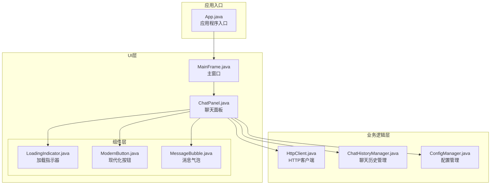
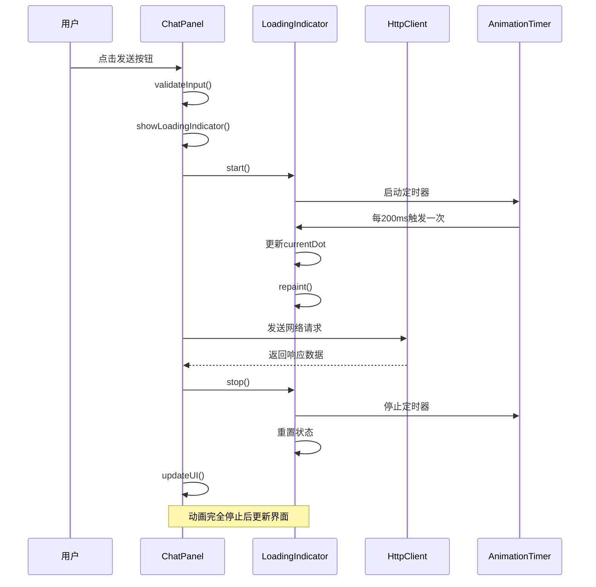
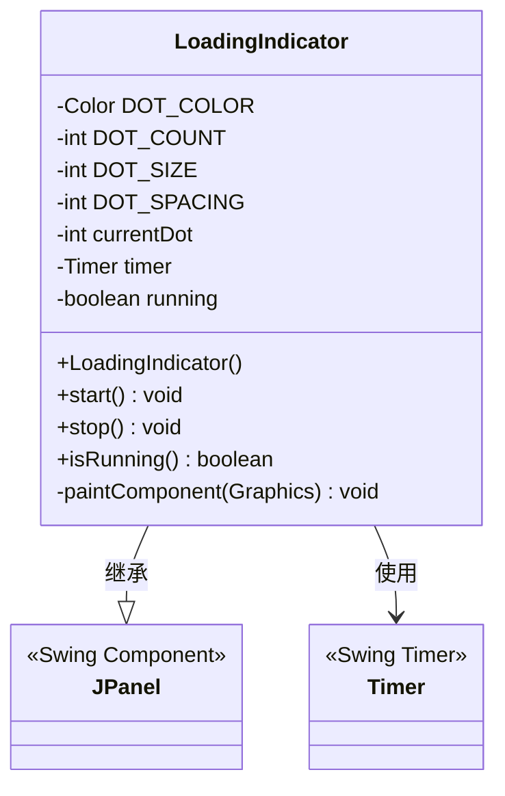
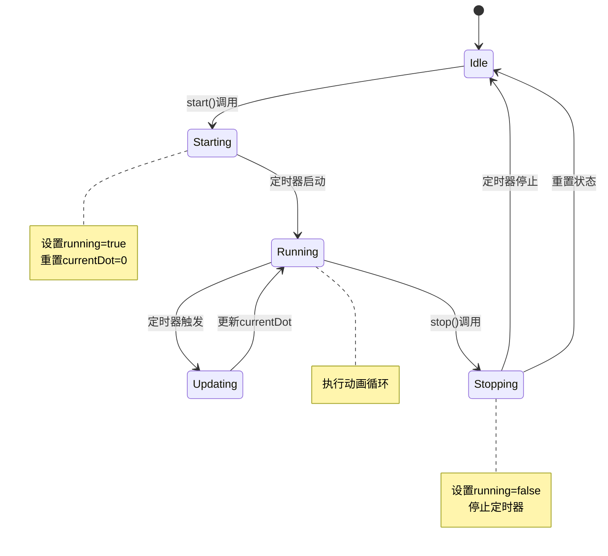
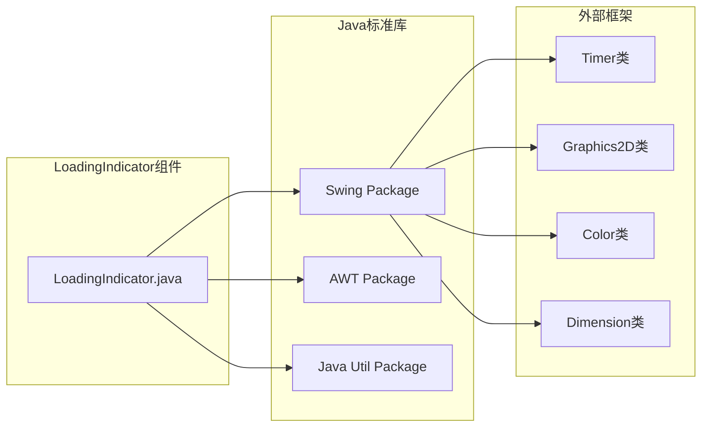

# LoadingIndicator加载指示器

<cite>
**本文档引用的文件**
- [LoadingIndicator.java](file://src/com/llmchat/ui/components/LoadingIndicator.java)
- [ChatPanel.java](file://src/com/llmchat/ui/ChatPanel.java)
- [ModernButton.java](file://src/com/llmchat/ui/components/ModernButton.java)
- [App.java](file://src/com/llmchat/App.java)
</cite>

## 目录
1. [简介](#简介)
2. [项目结构](#项目结构)
3. [核心组件](#核心组件)
4. [架构概览](#架构概览)
5. [详细组件分析](#详细组件分析)
6. [依赖关系分析](#依赖关系分析)
7. [性能考虑](#性能考虑)
8. [故障排除指南](#故障排除指南)
9. [结论](#结论)

## 简介

LoadingIndicator是一个现代化的Java Swing加载指示器组件，采用三点脉冲动画效果。该组件通过定时器驱动的动画系统实现流畅的视觉反馈，广泛应用于聊天应用的消息发送过程中，为用户提供清晰的加载状态指示。

该组件具有以下特点：
- 基于Swing的自定义绘图实现
- 支持透明度渐变的脉冲动画效果
- 线程安全的动画控制机制
- 可配置的颜色和尺寸参数
- 完整的状态管理（开始/停止/查询）

## 项目结构

项目采用模块化的包结构组织，UI组件位于`src/com/llmchat/ui/components/`目录下，核心业务逻辑分布在相应的包中。

**图表来源**
- [App.java:11-25](file://src/com/llmchat/App.java#L11-L25)
- [ChatPanel.java:21-55](file://src/com/llmchat/ui/ChatPanel.java#L21-L55)

**章节来源**
- [App.java:1-27](file://src/com/llmchat/App.java#L1-L27)
- [ChatPanel.java:1-335](file://src/com/llmchat/ui/ChatPanel.java#L1-L335)

## 核心组件

LoadingIndicator组件是本项目中最关键的UI元素之一，负责向用户展示异步操作的执行状态。该组件实现了完整的动画生命周期管理，包括初始化、启动、停止和状态查询功能。

### 主要特性

- **动画系统**：基于Java Swing Timer的定时器驱动动画
- **视觉效果**：三个圆形点的脉冲渐变效果，营造现代感
- **状态管理**：完整的运行状态跟踪和控制机制
- **渲染优化**：启用抗锯齿渲染提升视觉质量
- **内存管理**：正确处理图形资源的创建和释放

### 关键属性

| 属性名称 | 默认值 | 描述 |
|---------|--------|------|
| DOT_COLOR | RGB(0, 122, 255) | 指示器点的颜色（蓝色） |
| DOT_COUNT | 3 | 指示器点的数量 |
| DOT_SIZE | 8px | 每个点的直径 |
| DOT_SPACING | 16px | 点之间的间距 |
| 动画间隔 | 200ms | 动画帧切换的时间间隔 |

**章节来源**
- [LoadingIndicator.java:10-29](file://src/com/llmchat/ui/components/LoadingIndicator.java#L10-L29)

## 架构概览

LoadingIndicator在应用架构中扮演着重要的状态指示角色，特别是在网络请求处理流程中提供实时的用户反馈。

**图表来源**
- [ChatPanel.java:243-296](file://src/com/llmchat/ui/ChatPanel.java#L243-L296)
- [LoadingIndicator.java:34-50](file://src/com/llmchat/ui/components/LoadingIndicator.java#L34-L50)

## 详细组件分析

### LoadingIndicator类结构

**图表来源**
- [LoadingIndicator.java:10-94](file://src/com/llmchat/ui/components/LoadingIndicator.java#L10-L94)

### 动画实现机制

LoadingIndicator的核心动画系统基于以下设计原则：

#### 1. 时间驱动的动画循环

组件内部维护一个200毫秒间隔的定时器，每次触发时更新当前激活的点索引并触发重绘。

#### 2. 透明度渐变算法

通过计算每个点相对于当前激活点的位置关系，动态调整透明度值：
- 当前点：100%不透明度
- 前一个点：60%不透明度  
- 其他点：30%不透明度

#### 3. 布局计算

自动计算组件的首选尺寸，确保三点指示器在容器中居中显示。

### 状态同步机制

**图表来源**
- [LoadingIndicator.java:34-57](file://src/com/llmchat/ui/components/LoadingIndicator.java#L34-L57)

### 与ModernButton的协作

虽然LoadingIndicator本身独立存在，但其设计理念与ModernButton中的加载动画系统保持一致，都采用了相同的三点脉冲动画模式。

**章节来源**
- [LoadingIndicator.java:10-94](file://src/com/llmchat/ui/components/LoadingIndicator.java#L10-L94)
- [ModernButton.java:14-159](file://src/com/llmchat/ui/components/ModernButton.java#L14-L159)

## 依赖关系分析

LoadingIndicator组件具有最小的外部依赖，仅依赖Java标准库中的Swing和AWT包。

**图表来源**
- [LoadingIndicator.java:1-94](file://src/com/llmchat/ui/components/LoadingIndicator.java#L1-L94)

### 外部依赖关系

| 依赖类型 | 类名 | 用途 | 版本要求 |
|---------|------|------|----------|
| Swing组件 | JPanel | 基础UI组件 | Java 8+ |
| 图形API | Graphics2D | 2D图形渲染 | Java 8+ |
| 定时器 | Timer | 动画控制 | Java 8+ |
| 颜色系统 | Color | 颜色管理 | Java 8+ |
| 几何图形 | Ellipse2D | 圆形绘制 | Java 8+ |
| 尺寸定义 | Dimension | 组件尺寸 | Java 8+ |

**章节来源**
- [LoadingIndicator.java:1-94](file://src/com/llmchat/ui/components/LoadingIndicator.java#L1-L94)

## 性能考虑

### 渲染性能优化

1. **抗锯齿渲染**：启用高质量的抗锯齿渲染，确保动画边缘平滑
2. **增量重绘**：仅在动画状态变化时触发重绘，避免不必要的重绘操作
3. **图形资源管理**：正确创建和销毁Graphics2D实例，防止内存泄漏

### 内存管理

- 定时器资源：确保在停止动画时正确停止定时器
- 图形上下文：及时释放Graphics2D对象
- 颜色对象：复用Color对象而非频繁创建新实例

### 线程安全性

- 所有UI更新都在Swing事件调度线程中执行
- 动画状态访问采用原子性保证
- 避免在动画过程中进行耗时操作

## 故障排除指南

### 常见问题及解决方案

#### 1. 动画不显示或显示异常

**症状**：指示器完全不可见或显示不完整

**可能原因**：
- 组件未正确添加到容器中
- 父容器的可见性设置问题
- 组件尺寸过小导致点被裁剪

**解决方法**：
- 确保组件已添加到有效的容器中
- 检查父容器的可见性和布局管理器
- 验证组件的preferredSize设置

#### 2. 动画卡顿或不流畅

**症状**：动画出现跳帧或不连续

**可能原因**：
- 定时器间隔设置不当
- 系统资源不足
- 其他UI组件的重绘竞争

**解决方法**：
- 调整定时器间隔至200ms
- 检查系统性能和资源使用情况
- 优化其他UI组件的重绘频率

#### 3. 内存泄漏问题

**症状**：长时间使用后内存占用持续增长

**可能原因**：
- 定时器未正确停止
- Graphics2D对象未正确释放
- 回调函数持有组件引用

**解决方法**：
- 确保在组件销毁时停止动画
- 检查图形资源的生命周期管理
- 避免在回调中持有长生命周期引用

### 调试技巧

1. **状态检查**：使用`isRunning()`方法验证动画状态
2. **日志输出**：在关键方法中添加调试信息
3. **性能监控**：使用Java性能分析工具监控内存和CPU使用

**章节来源**
- [LoadingIndicator.java:34-57](file://src/com/llmchat/ui/components/LoadingIndicator.java#L34-L57)

## 结论

LoadingIndicator组件成功实现了现代化的加载指示器功能，具有以下优势：

1. **简洁高效**：代码结构清晰，功能实现简洁
2. **用户体验友好**：提供直观的视觉反馈，改善用户交互体验
3. **可扩展性强**：良好的架构设计便于功能扩展和定制
4. **性能稳定**：优化的渲染和内存管理确保长期稳定运行

该组件在聊天应用的网络请求处理流程中发挥着重要作用，为用户提供即时的状态反馈，提升了整体应用的专业性和用户体验。通过与其他UI组件的协同工作，形成了完整的现代化桌面应用界面体系。

未来可以考虑的功能增强包括：
- 支持自定义颜色和尺寸配置
- 添加更多动画效果选项
- 提供更灵活的配置接口
- 增强主题适配能力