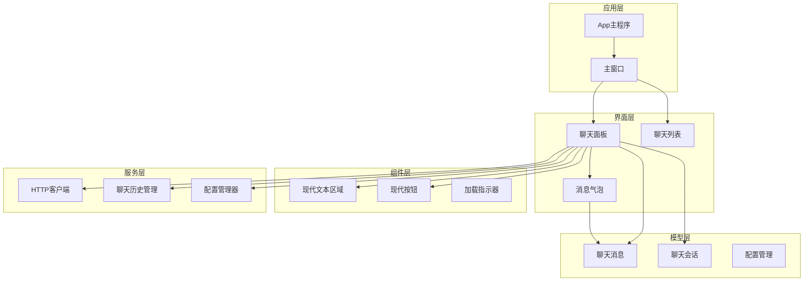
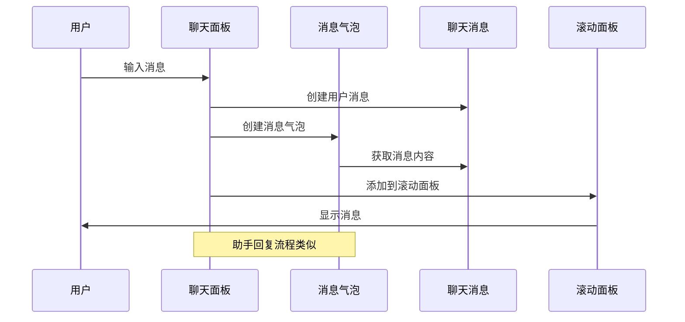
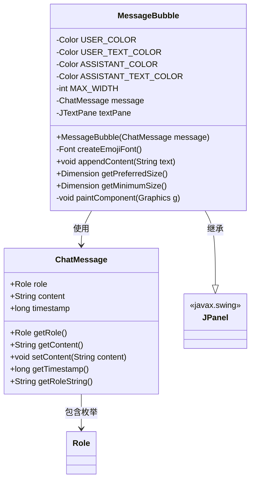
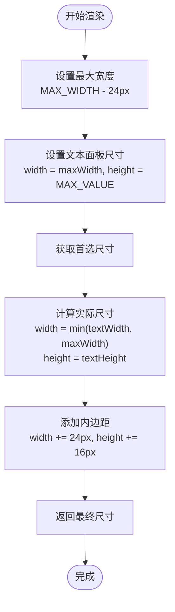
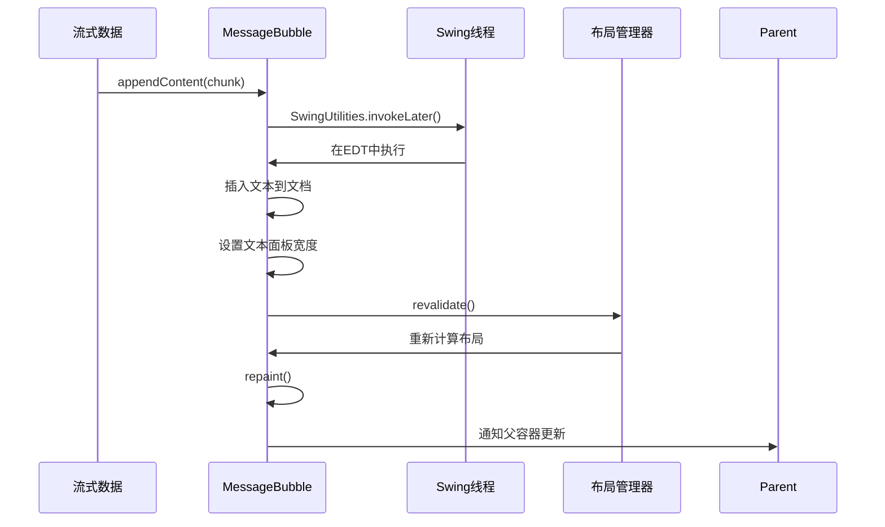
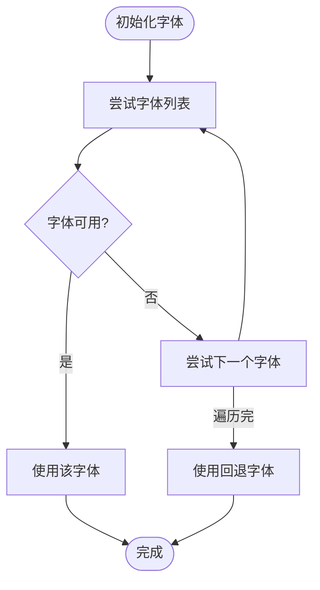
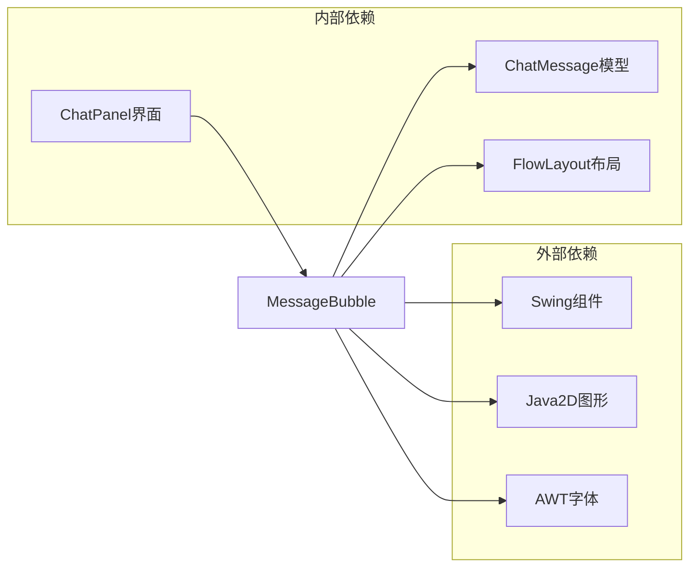

# MessageBubble消息气泡

<cite>
**本文档引用的文件**
- [MessageBubble.java](file://src/com/llmchat/ui/components/MessageBubble.java)
- [ChatMessage.java](file://src/com/llmchat/model/ChatMessage.java)
- [ChatPanel.java](file://src/com/llmchat/ui/ChatPanel.java)
- [ChatListPanel.java](file://src/com/llmchat/ui/components/ChatListPanel.java)
- [ModernTextArea.java](file://src/com/llmchat/ui/components/ModernTextArea.java)
- [ModernButton.java](file://src/com/llmchat/ui/components/ModernButton.java)
- [ChatSession.java](file://src/com/llmchat/model/ChatSession.java)
</cite>

## 目录
1. [简介](#简介)
2. [项目结构](#项目结构)
3. [核心组件](#核心组件)
4. [架构概览](#架构概览)
5. [详细组件分析](#详细组件分析)
6. [依赖关系分析](#依赖关系分析)
7. [性能考虑](#性能考虑)
8. [故障排除指南](#故障排除指南)
9. [结论](#结论)

## 简介

MessageBubble是Java LLM聊天界面中的核心消息显示组件，采用现代化设计理念，为用户和助手消息提供差异化外观。该组件实现了智能的文本换行、自动尺寸计算和流畅的动画效果，为用户提供直观的聊天体验。

## 项目结构

该项目采用模块化的架构设计，主要分为以下层次：

**图表来源**
- [ChatPanel.java:21-84](file://src/com/llmchat/ui/ChatPanel.java#L21-L84)
- [MessageBubble.java:14-58](file://src/com/llmchat/ui/components/MessageBubble.java#L14-L58)

**章节来源**
- [ChatPanel.java:1-335](file://src/com/llmchat/ui/ChatPanel.java#L1-L335)
- [MessageBubble.java:1-170](file://src/com/llmchat/ui/components/MessageBubble.java#L1-L170)

## 核心组件

### 消息气泡设计规范

MessageBubble组件实现了两种不同的消息类型外观：

#### 用户消息样式
- **背景色**: 深蓝色 (#007AFF)
- **文字颜色**: 白色
- **气泡形状**: 圆角矩形，16px圆角半径
- **对齐方式**: 右对齐显示

#### 助手消息样式
- **背景色**: 浅灰色 (#F0F0F0)
- **文字颜色**: 深灰色 (#1E1E1E)
- **气泡形状**: 圆角矩形，16px圆角半径
- **对齐方式**: 左对齐显示

### 文本渲染机制

组件采用JTextPane进行高级文本渲染，支持：
- **emoji字体支持**: 自动检测并使用系统emoji字体
- **多平台兼容**: Windows Segoe UI Emoji, macOS Apple Color Emoji, Linux Noto Color Emoji
- **字体回退机制**: 当首选字体不可用时自动降级到备用字体
- **样式继承**: 使用StyledDocument和StyleConstants进行样式管理

**章节来源**
- [MessageBubble.java:14-58](file://src/com/llmchat/ui/components/MessageBubble.java#L14-L58)
- [MessageBubble.java:123-144](file://src/com/llmchat/ui/components/MessageBubble.java#L123-L144)

## 架构概览

MessageBubble在整个聊天系统中的位置和交互关系如下：

**图表来源**
- [ChatPanel.java:289-312](file://src/com/llmchat/ui/ChatPanel.java#L289-L312)
- [MessageBubble.java:24-58](file://src/com/llmchat/ui/components/MessageBubble.java#L24-L58)

## 详细组件分析

### MessageBubble类结构分析

**图表来源**
- [MessageBubble.java:14-170](file://src/com/llmchat/ui/components/MessageBubble.java#L14-L170)
- [ChatMessage.java:8-44](file://src/com/llmchat/model/ChatMessage.java#L8-L44)

### 文本换行和尺寸计算

MessageBubble实现了智能的文本换行机制：

**图表来源**
- [MessageBubble.java:147-163](file://src/com/llmchat/ui/components/MessageBubble.java#L147-L163)

### 动态内容更新机制

组件支持实时追加内容的流式显示：

**图表来源**
- [MessageBubble.java:89-121](file://src/com/llmchat/ui/components/MessageBubble.java#L89-L121)

**章节来源**
- [MessageBubble.java:89-121](file://src/com/llmchat/ui/components/MessageBubble.java#L89-L121)
- [MessageBubble.java:147-163](file://src/com/llmchat/ui/components/MessageBubble.java#L147-L163)

### 颜色配置和主题系统

MessageBubble实现了基于消息角色的颜色配置：

| 消息类型 | 背景色 | 文字颜色 | 字体大小 |
|---------|--------|----------|----------|
| 用户消息 | #007AFF | White | 14px |
| 助手消息 | #F0F0F0 | #1E1E1E | 14px |

**章节来源**
- [MessageBubble.java:15-18](file://src/com/llmchat/ui/components/MessageBubble.java#L15-L18)
- [MessageBubble.java:44-48](file://src/com/llmchat/ui/components/MessageBubble.java#L44-L48)

### 字体和emoji支持

组件具有完善的字体支持机制：

**图表来源**
- [MessageBubble.java:63-84](file://src/com/llmchat/ui/components/MessageBubble.java#L63-L84)

**章节来源**
- [MessageBubble.java:63-84](file://src/com/llmchat/ui/components/MessageBubble.java#L63-L84)

## 依赖关系分析

MessageBubble与其他组件的依赖关系：

**图表来源**
- [MessageBubble.java:3-9](file://src/com/llmchat/ui/components/MessageBubble.java#L3-L9)
- [ChatPanel.java:299-312](file://src/com/llmchat/ui/ChatPanel.java#L299-L312)

**章节来源**
- [MessageBubble.java:3-9](file://src/com/llmchat/ui/components/MessageBubble.java#L3-L9)
- [ChatPanel.java:299-312](file://src/com/llmchat/ui/ChatPanel.java#L299-L312)

## 性能考虑

### 渲染优化策略

1. **延迟渲染**: 使用SwingUtilities.invokeLater确保在事件调度线程中更新UI
2. **增量更新**: 支持流式内容追加，避免全量重绘
3. **缓存机制**: 预计算preferredSize，减少重复计算开销
4. **内存管理**: 合理释放图形资源，使用dispose()方法

### 内存使用分析

- **单个气泡内存**: 约1-2KB（取决于文本长度）
- **批量渲染**: 大量消息时采用增量渲染策略
- **字体缓存**: 系统字体资源由JVM管理

## 故障排除指南

### 常见问题及解决方案

#### 1. 文本显示异常
**症状**: 文本显示为方块或乱码
**原因**: 字体不可用或编码问题
**解决**: 检查emoji字体支持，确保系统字体安装完整

#### 2. 消息气泡尺寸异常
**症状**: 气泡过宽或过窄
**原因**: 最大宽度计算错误
**解决**: 检查MAX_WIDTH常量和内边距计算

#### 3. 滚动条不工作
**症状**: 新消息无法自动滚动到底部
**原因**: 滚动面板配置问题
**解决**: 确保垂直滚动条策略设置为AS_NEEDED

**章节来源**
- [MessageBubble.java:117-120](file://src/com/llmchat/ui/components/MessageBubble.java#L117-L120)
- [ChatPanel.java:314-319](file://src/com/llmchat/ui/ChatPanel.java#L314-L319)

## 结论

MessageBubble组件通过精心设计的现代化UI和高效的渲染机制，为聊天应用提供了优秀的用户体验。其核心特点包括：

1. **差异化外观**: 通过颜色和对齐方式清晰区分用户和助手消息
2. **智能换行**: 自适应文本宽度，确保最佳阅读体验
3. **流式渲染**: 支持实时内容更新，适合对话场景
4. **跨平台兼容**: 完善的字体支持和主题适配
5. **性能优化**: 合理的内存管理和渲染策略

该组件与整个聊天系统的集成展现了良好的架构设计，为后续功能扩展奠定了坚实基础。