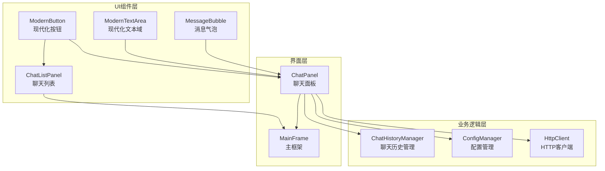
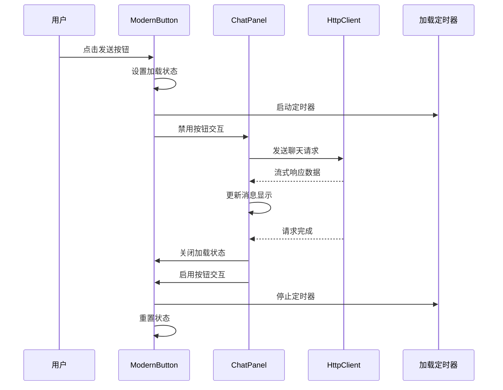
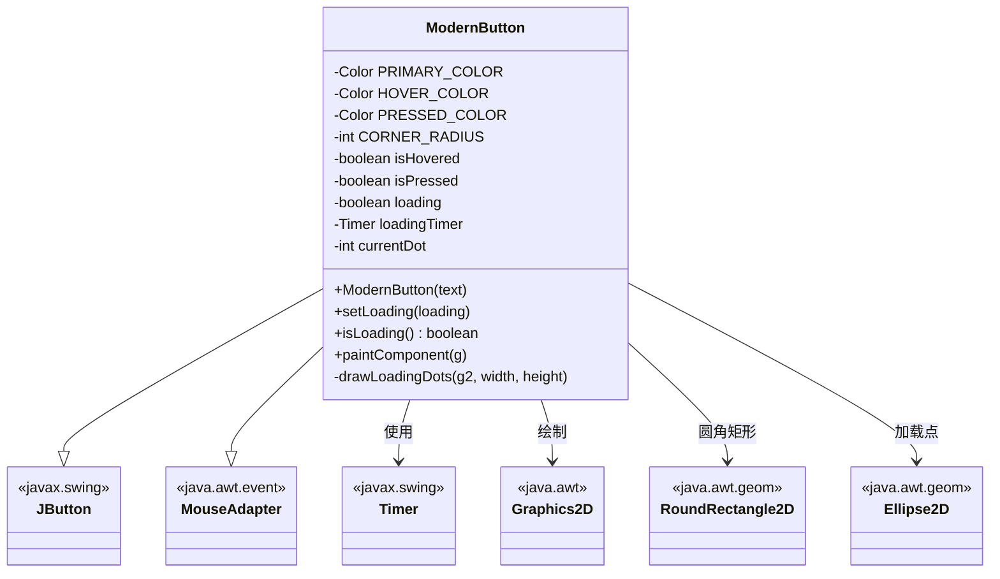
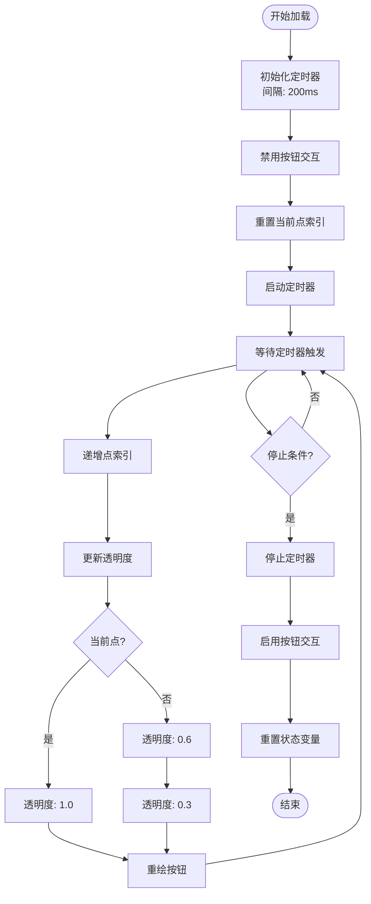
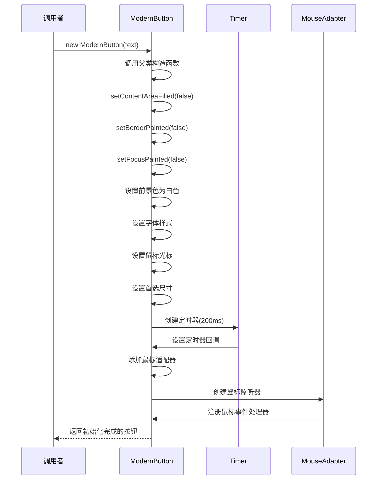
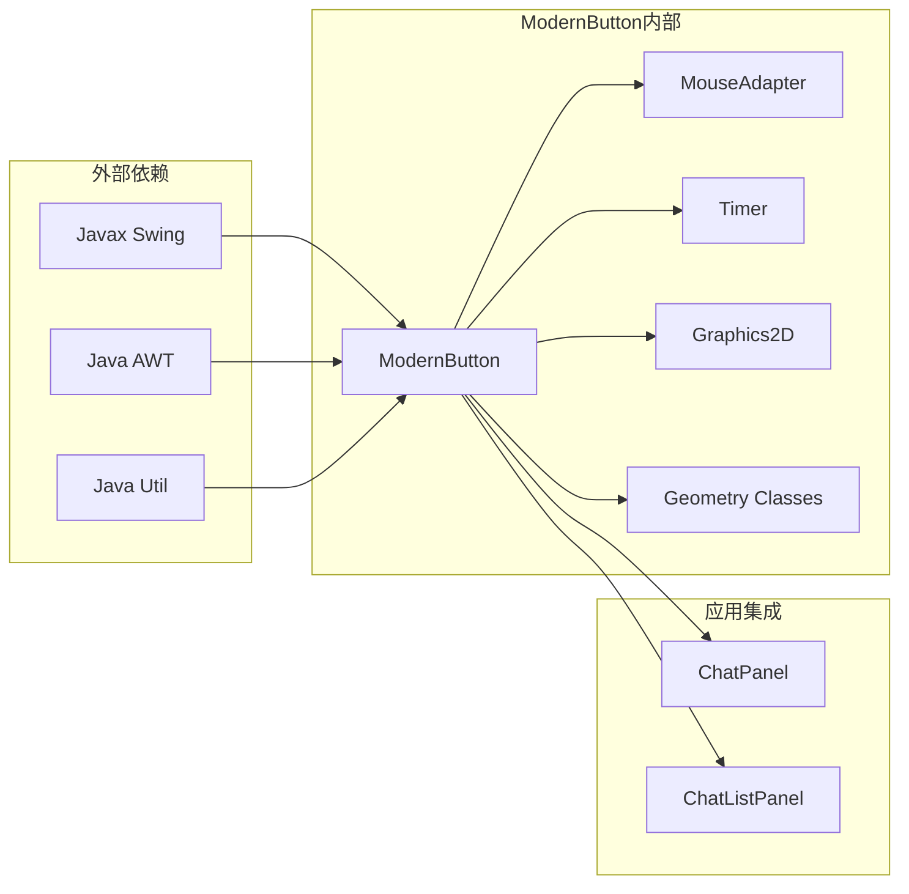

# ModernButton现代化按钮

<cite>
**本文档引用的文件**
- [ModernButton.java](file://src/com/llmchat/ui/components/ModernButton.java)
- [ChatPanel.java](file://src/com/llmchat/ui/ChatPanel.java)
- [ChatListPanel.java](file://src/com/llmchat/ui/components/ChatListPanel.java)
- [MainFrame.java](file://src/com/llmchat/ui/MainFrame.java)
- [MessageBubble.java](file://src/com/llmchat/ui/components/MessageBubble.java)
- [ModernTextArea.java](file://src/com/llmchat/ui/components/ModernTextArea.java)
</cite>

## 目录
1. [简介](#简介)
2. [项目结构](#项目结构)
3. [核心组件](#核心组件)
4. [架构概览](#架构概览)
5. [详细组件分析](#详细组件分析)
6. [依赖关系分析](#依赖关系分析)
7. [性能考虑](#性能考虑)
8. [故障排除指南](#故障排除指南)
9. [结论](#结论)
10. [附录](#附录)

## 简介

ModernButton是Java Swing应用程序中的现代化按钮组件，专为现代聊天界面设计。该组件提供了丰富的视觉反馈和流畅的用户体验，包括状态颜色管理、圆角矩形外观、渐变效果以及加载状态动画等功能。

该按钮组件采用现代化设计理念，具有以下特点：
- 响应式状态管理（正常、悬停、按下）
- 圆角矩形设计和抗锯齿渲染
- 三点加载动画效果
- 与整体UI主题的无缝集成
- 简洁的API接口

## 项目结构

该项目采用模块化的UI组件架构，ModernButton作为独立的组件被多个界面使用：



**图表来源**
- [ModernButton.java:1-159](file://src/com/llmchat/ui/components/ModernButton.java#L1-L159)
- [ChatPanel.java:1-335](file://src/com/llmchat/ui/ChatPanel.java#L1-L335)
- [ChatListPanel.java:1-241](file://src/com/llmchat/ui/components/ChatListPanel.java#L1-L241)

**章节来源**
- [ModernButton.java:1-159](file://src/com/llmchat/ui/components/ModernButton.java#L1-L159)
- [ChatPanel.java:1-335](file://src/com/llmchat/ui/ChatPanel.java#L1-L335)

## 核心组件

ModernButton组件的核心功能围绕以下几个关键方面构建：

### 设计理念
- **现代化视觉风格**：采用圆角矩形设计，符合现代UI设计趋势
- **状态驱动的视觉反馈**：通过不同的颜色状态提供即时的用户反馈
- **流畅的动画效果**：加载状态的三点动画提供良好的用户体验
- **主题一致性**：与应用的整体设计语言保持一致

### 视觉特性
- **颜色状态管理**：三种主要状态对应不同的颜色方案
- **圆角矩形外观**：统一的圆角半径设计
- **抗锯齿渲染**：确保高质量的图形输出
- **字体和间距**：优化的字体选择和间距设置

**章节来源**
- [ModernButton.java:11-18](file://src/com/llmchat/ui/components/ModernButton.java#L11-L18)
- [ModernButton.java:31-40](file://src/com/llmchat/ui/components/ModernButton.java#L31-L40)

## 架构概览

ModernButton在应用架构中扮演着重要的角色，作为用户交互的核心组件之一：



**图表来源**
- [ChatPanel.java:224-297](file://src/com/llmchat/ui/ChatPanel.java#L224-L297)
- [ModernButton.java:78-91](file://src/com/llmchat/ui/components/ModernButton.java#L78-L91)

## 详细组件分析

### 类结构分析



**图表来源**
- [ModernButton.java:14-159](file://src/com/llmchat/ui/components/ModernButton.java#L14-L159)

### 颜色状态管理系统

ModernButton实现了完整的颜色状态管理机制：

| 状态 | 颜色值 | 用途 | 触发条件 |
|------|--------|------|----------|
| 正常 | `new Color(0, 122, 255)` | 默认状态 | 鼠标离开按钮 |
| 悬停 | `new Color(0, 102, 204)` | 鼠标悬停 | 鼠标进入按钮区域 |
| 按下 | `new Color(0, 82, 184)` | 鼠标点击 | 鼠标按下事件 |

### 加载状态动画机制

加载状态动画是ModernButton的核心特性之一，采用三点动画模式：



**图表来源**
- [ModernButton.java:42-45](file://src/com/llmchat/ui/components/ModernButton.java#L42-L45)
- [ModernButton.java:136-157](file://src/com/llmchat/ui/components/ModernButton.java#L136-L157)

### 构造函数和初始化

ModernButton的构造函数负责设置基础属性和事件监听器：



**图表来源**
- [ModernButton.java:31-73](file://src/com/llmchat/ui/components/ModernButton.java#L31-L73)

**章节来源**
- [ModernButton.java:14-159](file://src/com/llmchat/ui/components/ModernButton.java#L14-L159)

## 依赖关系分析

ModernButton组件的依赖关系相对简单，主要依赖于标准的Java Swing库：



**图表来源**
- [ModernButton.java:3-9](file://src/com/llmchat/ui/components/ModernButton.java#L3-L9)

### 组件耦合度分析

ModernButton与应用其他部分的集成关系：

| 集成点 | 集成方式 | 作用 |
|--------|----------|------|
| ChatPanel | 事件监听器 | 发送消息功能 |
| ChatListPanel | 按钮实例 | 新建对话功能 |
| MessageBubble | 无直接依赖 | 通过ChatPanel间接交互 |
| HttpClient | 无直接依赖 | 通过ChatPanel间接调用 |

**章节来源**
- [ChatPanel.java:108-113](file://src/com/llmchat/ui/ChatPanel.java#L108-L113)
- [ChatListPanel.java:55-61](file://src/com/llmchat/ui/components/ChatListPanel.java#L55-L61)

## 性能考虑

ModernButton在设计时充分考虑了性能优化：

### 渲染性能
- **抗锯齿优化**：仅在必要时启用抗锯齿渲染
- **最小重绘**：通过状态变化触发精确的重绘区域
- **图形对象复用**：重用几何对象减少内存分配

### 动画性能
- **定时器频率**：200ms的刷新间隔平衡流畅度和性能
- **状态机简化**：简单的三状态切换避免复杂的计算
- **透明度计算**：预计算透明度值减少运行时计算

### 内存管理
- **对象池化**：几何对象在绘制时临时创建
- **事件监听器**：单实例监听器避免重复注册
- **颜色缓存**：颜色值在类级别定义避免重复创建

## 故障排除指南

### 常见问题及解决方案

#### 1. 按钮状态不正确
**症状**：按钮颜色不随鼠标状态变化
**原因**：鼠标事件监听器未正确注册
**解决**：检查MouseAdapter的注册和事件处理逻辑

#### 2. 加载动画不显示
**症状**：调用setLoading(true)后按钮无变化
**原因**：定时器未启动或重绘未触发
**解决**：验证定时器启动逻辑和repaint调用

#### 3. 字体显示异常
**症状**：按钮文字显示不完整或变形
**原因**：字体设置或渲染问题
**解决**：检查字体配置和渲染提示设置

#### 4. 颜色不正确
**症状**：按钮颜色不符合预期
**原因**：颜色常量定义或状态判断错误
**解决**：验证颜色值定义和状态切换逻辑

**章节来源**
- [ModernButton.java:47-72](file://src/com/llmchat/ui/components/ModernButton.java#L47-L72)
- [ModernButton.java:100-134](file://src/com/llmchat/ui/components/ModernButton.java#L100-L134)

## 结论

ModernButton现代化按钮组件成功地实现了现代化UI设计原则，提供了优秀的用户体验和良好的性能表现。该组件的主要优势包括：

### 技术优势
- **简洁的API设计**：易于使用的构造函数和状态管理方法
- **完整的状态系统**：覆盖了用户交互的所有关键状态
- **高质量的视觉效果**：圆角矩形设计和流畅的动画效果
- **良好的性能表现**：优化的渲染和内存管理策略

### 设计优势
- **主题一致性**：与应用整体设计风格完美融合
- **用户友好**：直观的状态反馈和响应机制
- **可扩展性**：清晰的架构便于功能扩展和定制

### 应用价值
ModernButton不仅是一个简单的UI组件，更是整个应用现代化设计的重要组成部分。它为用户提供了一致且愉悦的交互体验，同时为开发者提供了可靠的组件基础。

## 附录

### 实际使用示例

#### 在聊天界面中使用ModernButton

```java
// 创建发送按钮
ModernButton sendButton = new ModernButton("发送");
sendButton.addActionListener(e -> sendMessage());

// 在输入面板中集成
JPanel inputPanel = new JPanel(new BorderLayout(10, 0));
inputPanel.add(modernTextArea, BorderLayout.CENTER);
inputPanel.add(rightPanel, BorderLayout.EAST);

// 设置按钮事件处理
rightPanel.add(sendButton);
```

#### 在聊天列表中使用ModernButton

```java
// 创建新建对话按钮
ModernButton newChatButton = new ModernButton("+ 新对话");
newChatButton.setPreferredSize(new Dimension(90, 32));
newChatButton.addActionListener(e -> {
    if (listener != null) {
        listener.onNewChatClicked();
    }
});
```

### 最佳实践建议

1. **颜色一致性**：确保按钮颜色与应用主题保持一致
2. **状态管理**：正确处理加载状态的开启和关闭
3. **事件处理**：为按钮添加适当的事件监听器
4. **性能优化**：避免不必要的重绘操作
5. **可访问性**：确保按钮具有良好的键盘导航支持