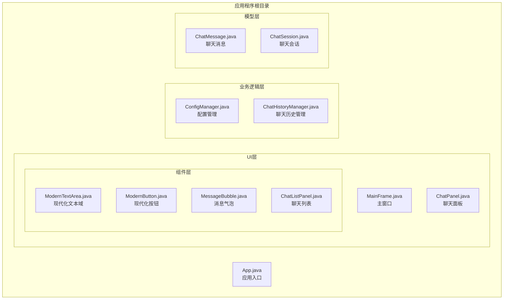
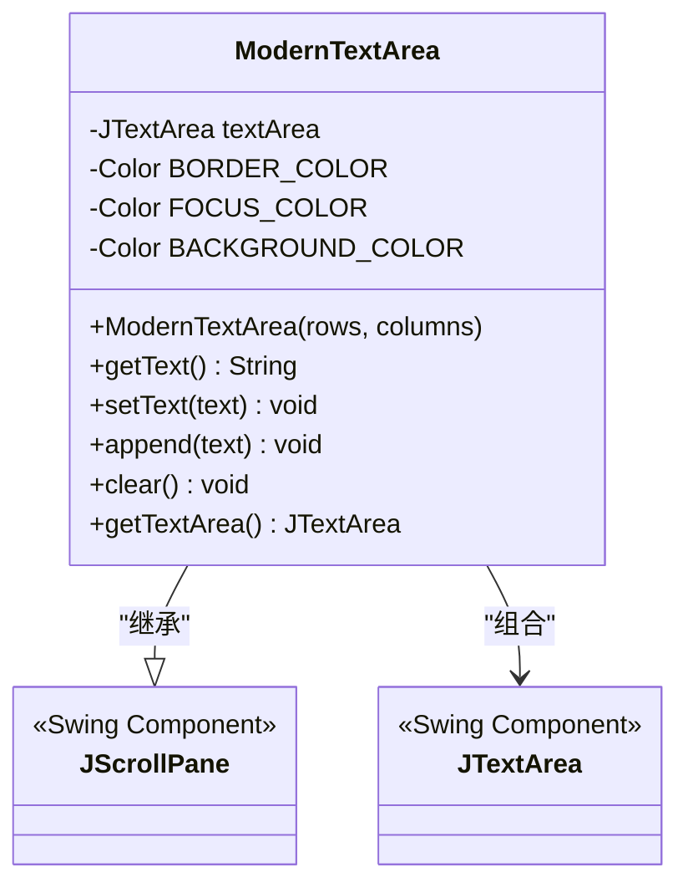
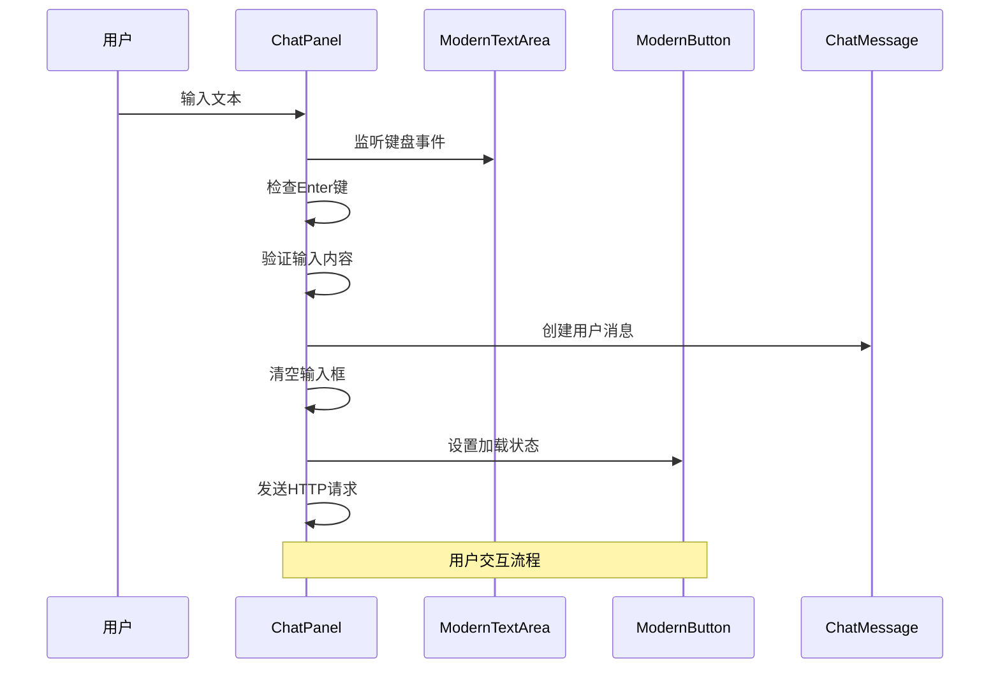
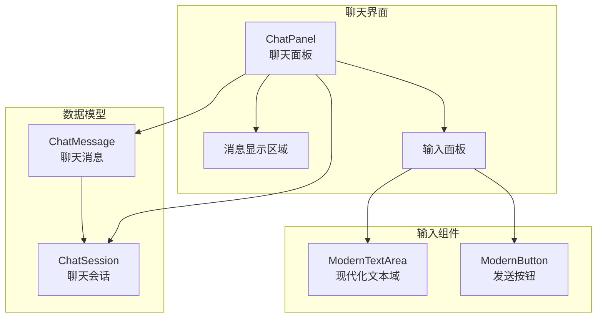
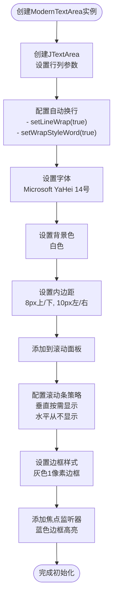
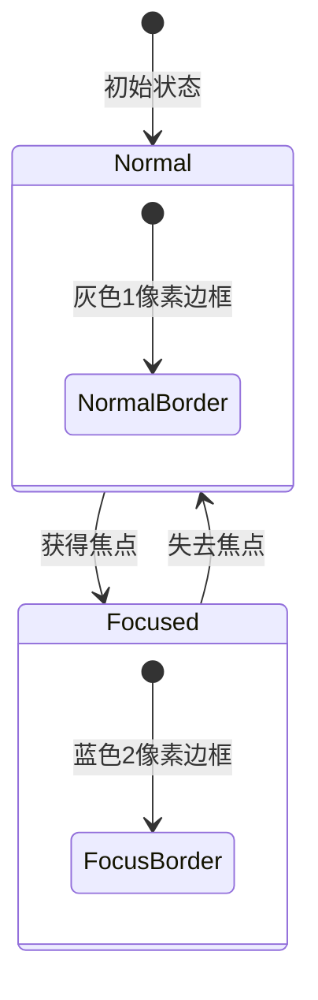
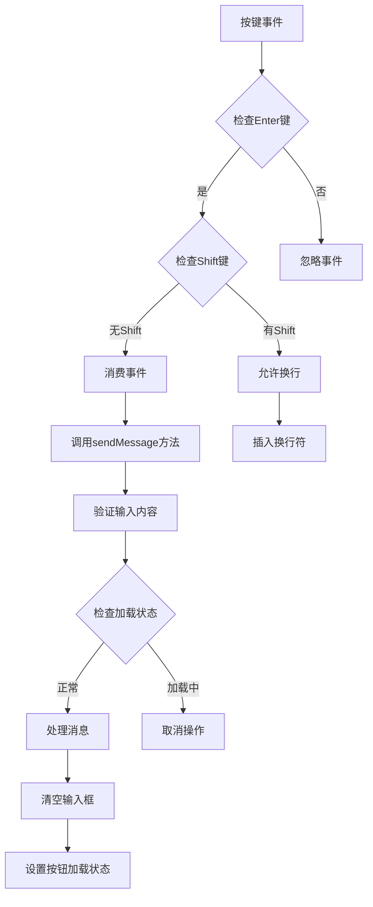
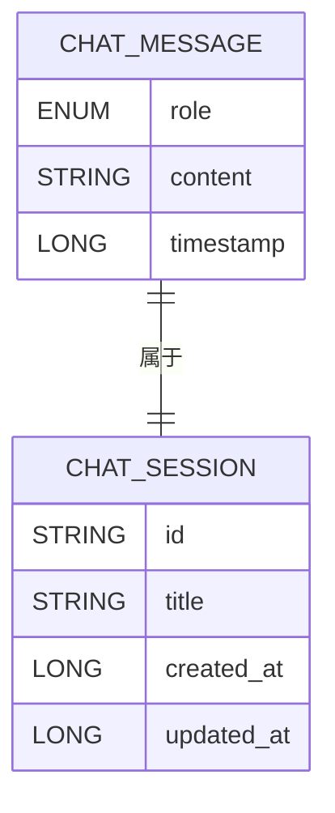
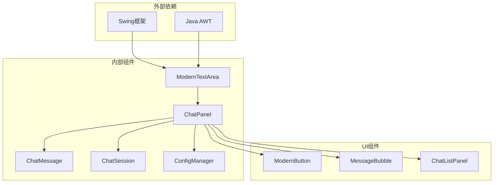

# ModernTextArea现代化文本域

<cite>
**本文档引用的文件**
- [ModernTextArea.java](file://src/com/llmchat/ui/components/ModernTextArea.java)
- [ChatPanel.java](file://src/com/llmchat/ui/ChatPanel.java)
- [MainFrame.java](file://src/com/llmchat/ui/MainFrame.java)
- [ChatMessage.java](file://src/com/llmchat/model/ChatMessage.java)
- [ChatSession.java](file://src/com/llmchat/model/ChatSession.java)
- [ConfigManager.java](file://src/com/llmchat/config/ConfigManager.java)
- [App.java](file://src/com/llmchat/App.java)
</cite>

## 目录
1. [简介](#简介)
2. [项目结构](#项目结构)
3. [核心组件](#核心组件)
4. [架构概览](#架构概览)
5. [详细组件分析](#详细组件分析)
6. [依赖关系分析](#依赖关系分析)
7. [性能考虑](#性能考虑)
8. [故障排除指南](#故障排除指南)
9. [结论](#结论)

## 简介

ModernTextArea是Java Swing应用程序中的现代化文本域组件，专为聊天界面设计。该组件提供了现代化的视觉效果、自动换行功能、智能滚动条管理和行高自适应能力。它支持键盘快捷键操作，特别是Enter键用于发送消息，同时具备良好的用户体验和可扩展性。

该组件在LLM Chat聊天应用中发挥着关键作用，为用户提供流畅的多行文本输入体验，支持长文本内容的高效编辑和管理。

## 项目结构

LLM Chat应用程序采用模块化的架构设计，ModernTextArea作为UI组件之一，位于专门的组件包中：

**图表来源**
- [App.java:11-25](file://src/com/llmchat/App.java#L11-L25)
- [MainFrame.java:19-36](file://src/com/llmchat/ui/MainFrame.java#L19-L36)
- [ChatPanel.java:21-55](file://src/com/llmchat/ui/ChatPanel.java#L21-L55)

**章节来源**
- [App.java:1-27](file://src/com/llmchat/App.java#L1-L27)
- [MainFrame.java:1-177](file://src/com/llmchat/ui/MainFrame.java#L1-L177)
- [ChatPanel.java:1-335](file://src/com/llmchat/ui/ChatPanel.java#L1-L335)

## 核心组件

### ModernTextArea组件概述

ModernTextArea是一个继承自JScrollPane的复合组件，内部封装了JTextArea，提供了现代化的文本输入体验：

**图表来源**
- [ModernTextArea.java:12-65](file://src/com/llmchat/ui/components/ModernTextArea.java#L12-L65)

### 关键特性

1. **现代化外观设计**：使用统一的颜色方案和边框样式
2. **自动换行功能**：支持按单词换行，提升阅读体验
3. **智能滚动管理**：垂直滚动条按需显示，水平滚动条禁用
4. **焦点状态管理**：动态改变边框颜色以指示焦点状态
5. **字体一致性**：使用Microsoft YaHei字体确保跨平台兼容性

**章节来源**
- [ModernTextArea.java:18-44](file://src/com/llmchat/ui/components/ModernTextArea.java#L18-L44)

## 架构概览

ModernTextArea在整个应用架构中扮演着重要的输入组件角色，与聊天面板紧密协作：

**图表来源**
- [ChatPanel.java:93-119](file://src/com/llmchat/ui/ChatPanel.java#L93-L119)
- [ChatPanel.java:189-297](file://src/com/llmchat/ui/ChatPanel.java#L189-L297)

### 组件交互关系

**图表来源**
- [ChatPanel.java:31-38](file://src/com/llmchat/ui/ChatPanel.java#L31-L38)
- [ChatMessage.java:8-43](file://src/com/llmchat/model/ChatMessage.java#L8-L43)
- [ChatSession.java:11-90](file://src/com/llmchat/model/ChatSession.java#L11-L90)

## 详细组件分析

### ModernTextArea实现细节

#### 初始化配置

ModernTextArea在构造函数中完成了所有必要的初始化工作：

**图表来源**
- [ModernTextArea.java:18-44](file://src/com/llmchat/ui/components/ModernTextArea.java#L18-L44)

#### 文本操作接口

组件提供了简洁的文本操作方法：

| 方法 | 参数 | 返回值 | 功能描述 |
|------|------|--------|----------|
| `getText()` | 无 | String | 获取当前文本内容 |
| `setText(String text)` | String | void | 设置指定文本内容 |
| `append(String text)` | String | void | 追加文本内容 |
| `clear()` | 无 | void | 清空所有文本 |
| `getTextArea()` | 无 | JTextArea | 获取内部文本区域 |

#### 焦点状态管理

组件通过焦点监听器实现了动态的视觉反馈：

**图表来源**
- [ModernTextArea.java:33-43](file://src/com/llmchat/ui/components/ModernTextArea.java#L33-L43)

**章节来源**
- [ModernTextArea.java:12-65](file://src/com/llmchat/ui/components/ModernTextArea.java#L12-L65)

### 与ChatPanel的集成

#### 键盘事件处理

ChatPanel中的ModernTextArea实现了智能的键盘事件处理：

**图表来源**
- [ChatPanel.java:93-101](file://src/com/llmchat/ui/ChatPanel.java#L93-L101)
- [ChatPanel.java:189-222](file://src/com/llmchat/ui/ChatPanel.java#L189-L222)

#### 发送按钮状态联动

ModernTextArea与发送按钮建立了紧密的状态同步机制：

| 状态 | ModernTextArea行为 | 发送按钮行为 |
|------|-------------------|-------------|
| 输入文本 | 边框变为蓝色 | 启用状态 |
| 清空文本 | 边框恢复灰色 | 禁用状态 |
| 发送中 | 禁用输入 | 显示加载动画 |
| 发送完成 | 启用输入 | 恢复正常状态 |

**章节来源**
- [ChatPanel.java:92-119](file://src/com/llmchat/ui/ChatPanel.java#L92-L119)
- [ChatPanel.java:189-297](file://src/com/llmchat/ui/ChatPanel.java#L189-L297)

### 数据模型支持

#### ChatMessage集成

ModernTextArea产生的文本内容会被封装到ChatMessage对象中：

**图表来源**
- [ChatMessage.java:8-43](file://src/com/llmchat/model/ChatMessage.java#L8-L43)
- [ChatSession.java:11-90](file://src/com/llmchat/model/ChatSession.java#L11-L90)

**章节来源**
- [ChatMessage.java:1-44](file://src/com/llmchat/model/ChatMessage.java#L1-L44)
- [ChatSession.java:1-91](file://src/com/llmchat/model/ChatSession.java#L1-L91)

## 依赖关系分析

### 组件间依赖关系

**图表来源**
- [ModernTextArea.java:3-8](file://src/com/llmchat/ui/components/ModernTextArea.java#L3-L8)
- [ChatPanel.java:3-16](file://src/com/llmchat/ui/ChatPanel.java#L3-L16)

### 关键依赖特性

1. **Swing框架依赖**：完全基于Java Swing构建，确保跨平台兼容性
2. **事件驱动架构**：通过监听器模式实现组件间的松耦合通信
3. **数据绑定机制**：通过ChatMessage和ChatSession实现数据的结构化管理
4. **配置管理集成**：与ConfigManager协作处理API配置验证

**章节来源**
- [ModernTextArea.java:1-66](file://src/com/llmchat/ui/components/ModernTextArea.java#L1-L66)
- [ChatPanel.java:1-335](file://src/com/llmchat/ui/ChatPanel.java#L1-L335)

## 性能考虑

### 渲染优化

ModernTextArea在设计时考虑了以下性能优化：

1. **延迟渲染**：仅在需要时更新UI组件
2. **事件节流**：通过consume()方法避免重复处理键盘事件
3. **内存管理**：合理使用StringBuilder处理流式响应
4. **滚动优化**：设置合适的滚动增量提高滚动体验

### 内存使用分析

| 组件 | 内存占用 | 优化建议 |
|------|----------|----------|
| ModernTextArea | ~5KB | 使用单例模式共享字体资源 |
| ChatPanel | ~10KB | 按需加载消息内容 |
| ChatMessage | ~2KB | 实现消息池减少GC压力 |
| ChatSession | ~5KB | 使用懒加载机制 |

## 故障排除指南

### 常见问题及解决方案

#### 文本换行问题

**症状**：文本超出边界后不换行
**原因**：可能未正确设置line wrap属性
**解决方案**：
1. 确认JTextArea的line wrap已启用
2. 检查wrap style word设置
3. 验证容器的preferred size计算

#### 滚动条显示异常

**症状**：滚动条不按预期显示或隐藏
**原因**：滚动策略配置不当
**解决方案**：
1. 检查VERTICAL_SCROLLBAR_POLICY设置
2. 确认HORIZONTAL_SCROLLBAR_POLICY设置为NEVER
3. 验证viewport的大小计算

#### 焦点状态问题

**症状**：焦点变化时边框颜色不正确
**原因**：焦点监听器注册失败
**解决方案**：
1. 确认FocusListener正确添加到textArea
2. 检查颜色值的定义和使用
3. 验证repaint调用时机

**章节来源**
- [ModernTextArea.java:33-43](file://src/com/llmchat/ui/components/ModernTextArea.java#L33-L43)

### 调试技巧

1. **事件跟踪**：使用System.out.println监控键盘事件
2. **状态检查**：通过JOptionPane显示当前组件状态
3. **内存监控**：使用JVM工具监控内存使用情况
4. **性能分析**：使用SwingUtilities.invokeLater优化UI更新

## 结论

ModernTextArea现代化文本域组件成功地将传统Swing组件与现代设计理念相结合，为LLM Chat应用提供了优秀的文本输入体验。其主要优势包括：

1. **现代化设计**：统一的颜色方案和边框样式提升了整体视觉效果
2. **智能交互**：自动换行、焦点状态管理和键盘快捷键支持
3. **良好集成**：与ChatPanel和其他UI组件无缝协作
4. **可扩展性**：清晰的接口设计便于功能扩展和定制

该组件在聊天应用场景中表现出色，特别是在长文本输入和实时消息处理方面展现了优秀的性能和用户体验。通过合理的架构设计和优化策略，ModernTextArea为开发者提供了一个可靠、易用且功能丰富的文本输入解决方案。

未来可以考虑的功能增强包括：
- 最大字符数限制功能
- 输入验证和格式化支持
- 更丰富的快捷键组合
- 自定义主题和样式支持
- 多语言输入法集成