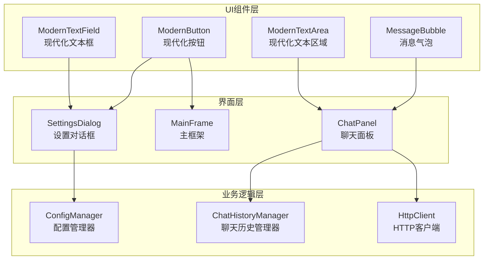
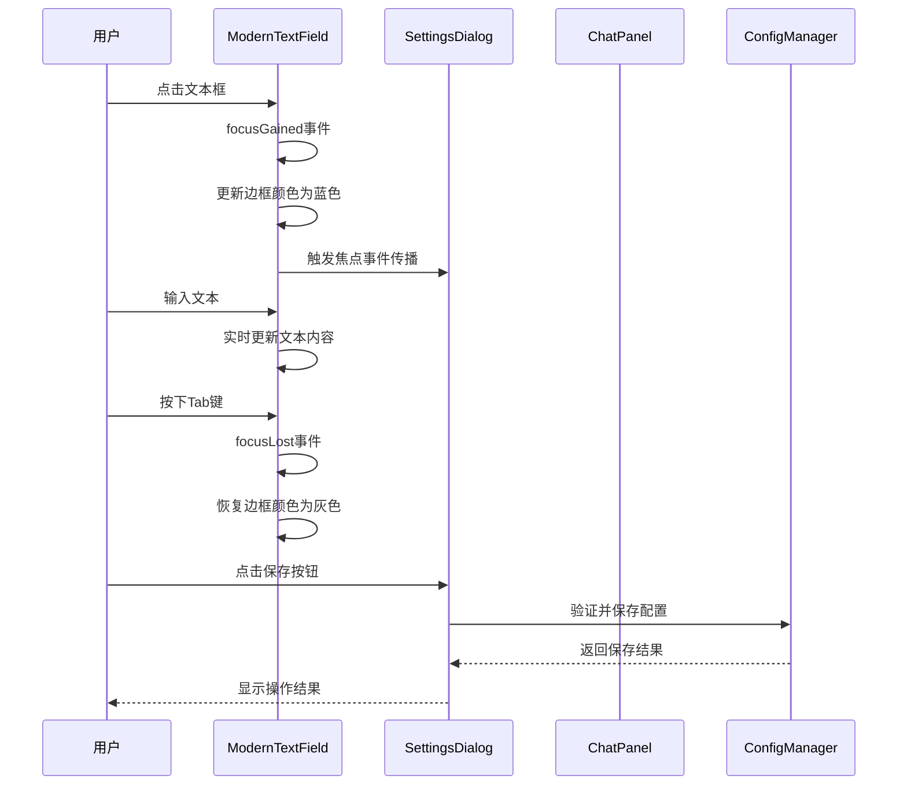
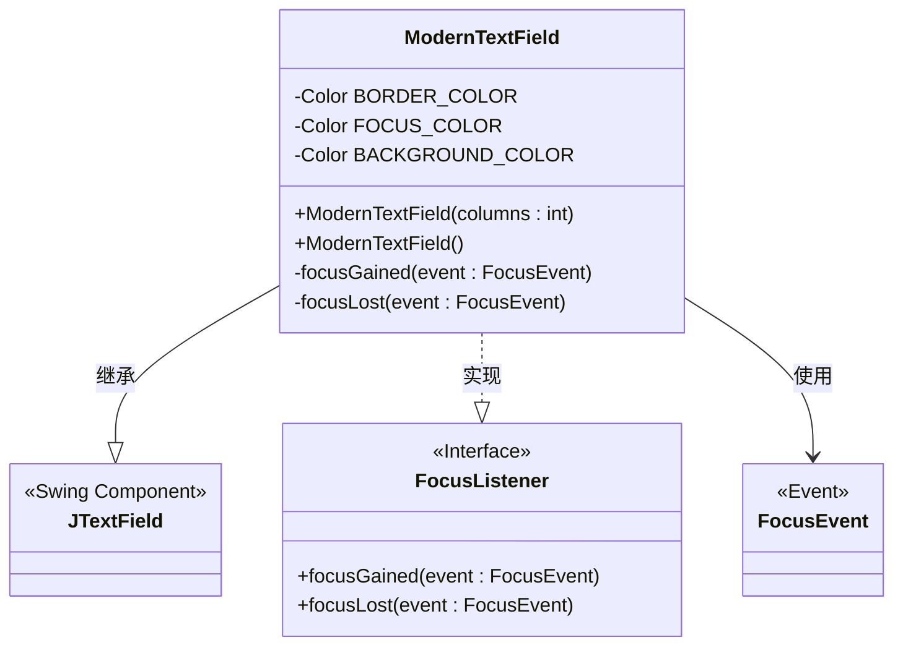
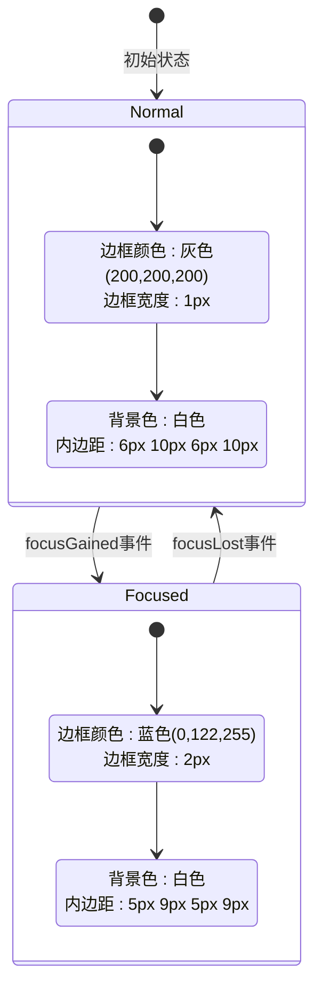
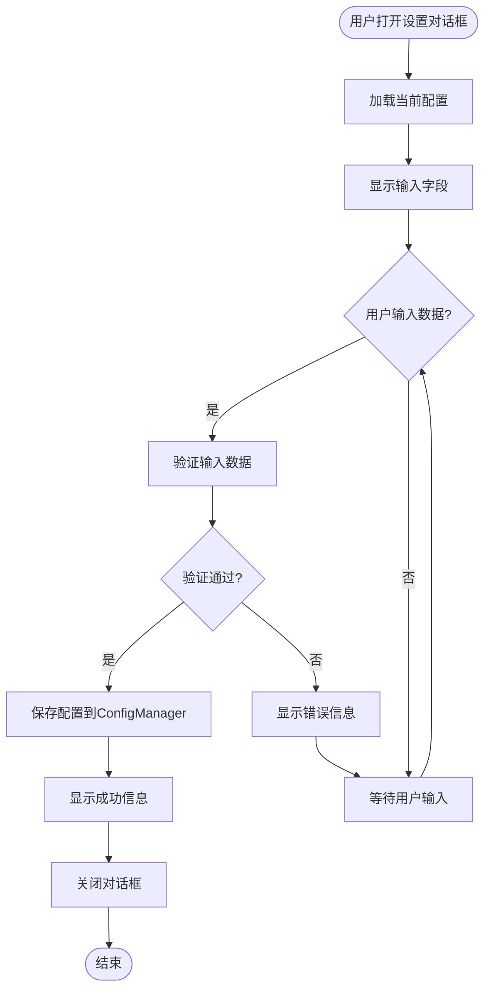
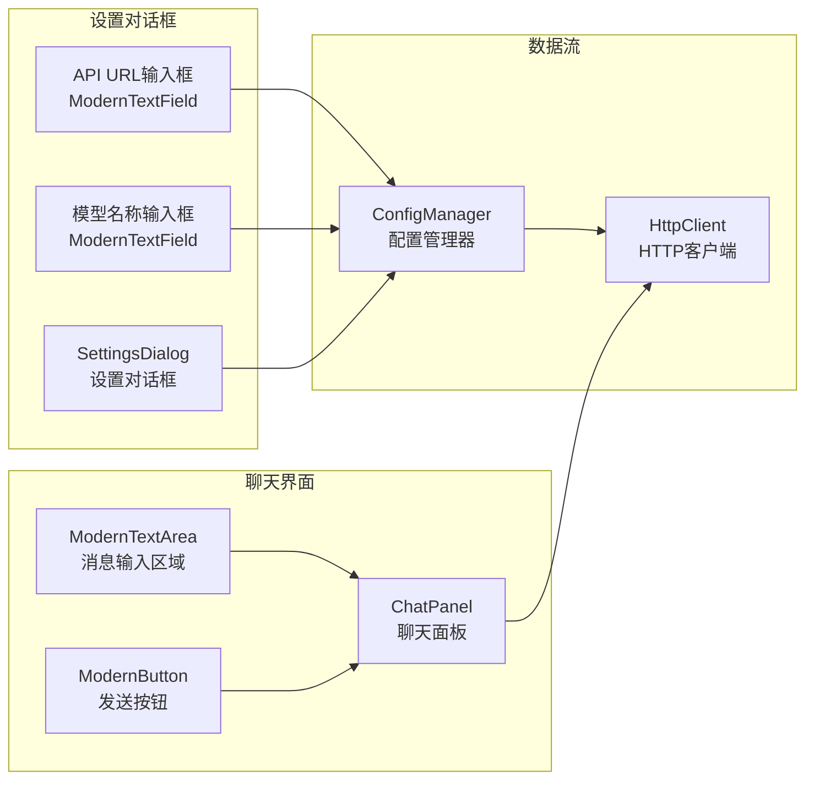
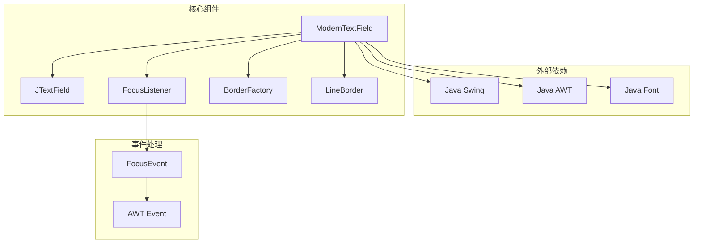

# ModernTextField现代化文本框

<cite>
**本文档引用的文件**
- [ModernTextField.java](file://src/com/llmchat/ui/components/ModernTextField.java)
- [SettingsDialog.java](file://src/com/llmchat/ui/SettingsDialog.java)
- [ChatPanel.java](file://src/com/llmchat/ui/ChatPanel.java)
- [ModernButton.java](file://src/com/llmchat/ui/components/ModernButton.java)
- [ModernTextArea.java](file://src/com/llmchat/ui/components/ModernTextArea.java)
- [MessageBubble.java](file://src/com/llmchat/ui/components/MessageBubble.java)
- [MainFrame.java](file://src/com/llmchat/ui/MainFrame.java)
</cite>

## 目录
1. [简介](#简介)
2. [项目结构](#项目结构)
3. [核心组件](#核心组件)
4. [架构概览](#架构概览)
5. [详细组件分析](#详细组件分析)
6. [依赖关系分析](#依赖关系分析)
7. [性能考虑](#性能考虑)
8. [故障排除指南](#故障排除指南)
9. [结论](#结论)
10. [附录](#附录)

## 简介

ModernTextField是Java Swing应用程序中的现代化文本输入框组件，专为现代用户界面设计而开发。该组件提供了优雅的视觉效果、流畅的交互体验和完善的焦点管理功能。它采用简洁的设计语言，通过精心设计的边框样式、颜色过渡和动画效果，为用户提供直观且美观的输入体验。

该组件的核心设计理念是"少即是多"，通过最小化的视觉元素传达清晰的信息层次，同时保持高度的可用性和可访问性。组件支持多种交互状态，包括正常状态、悬停状态、聚焦状态和禁用状态，每种状态都有相应的视觉反馈。

## 项目结构

该项目采用模块化的架构设计，将不同的UI组件按照功能进行分类组织。ModernTextField作为组件库的一部分，位于专门的组件目录中，与其它UI组件如按钮、文本区域等形成完整的UI套件。



**图表来源**
- [ModernTextField.java:1-49](file://src/com/llmchat/ui/components/ModernTextField.java#L1-L49)
- [SettingsDialog.java:15-37](file://src/com/llmchat/ui/SettingsDialog.java#L15-L37)
- [ChatPanel.java:21-55](file://src/com/llmchat/ui/ChatPanel.java#L21-L55)

**章节来源**
- [ModernTextField.java:1-49](file://src/com/llmchat/ui/components/ModernTextField.java#L1-L49)
- [SettingsDialog.java:15-37](file://src/com/llmchat/ui/SettingsDialog.java#L15-L37)
- [ChatPanel.java:21-55](file://src/com/llmchat/ui/ChatPanel.java#L21-L55)

## 核心组件

ModernTextField组件具有以下核心特性：

### 设计特点
- **边框样式**：采用1像素细边框设计，提供清晰的视觉边界
- **焦点状态管理**：智能的焦点切换机制，提供即时的视觉反馈
- **占位符显示**：支持占位符文本显示，引导用户输入
- **字体设置**：统一的字体系统，确保跨平台一致性
- **颜色主题**：预定义的颜色方案，支持主题切换

### 技术实现
组件继承自JTextField，通过重写构造函数和添加焦点监听器来实现现代化的外观和行为。内部使用静态常量定义颜色和尺寸，确保设计的一致性。

**章节来源**
- [ModernTextField.java:12-48](file://src/com/llmchat/ui/components/ModernTextField.java#L12-L48)

## 架构概览

ModernTextField在整个应用架构中扮演着重要的角色，它不仅是一个独立的UI组件，更是整个现代化UI设计体系的重要组成部分。



**图表来源**
- [ModernTextField.java:26-42](file://src/com/llmchat/ui/components/ModernTextField.java#L26-L42)
- [SettingsDialog.java:216-248](file://src/com/llmchat/ui/SettingsDialog.java#L216-L248)

**章节来源**
- [SettingsDialog.java:15-37](file://src/com/llmchat/ui/SettingsDialog.java#L15-L37)
- [ChatPanel.java:86-119](file://src/com/llmchat/ui/ChatPanel.java#L86-L119)

## 详细组件分析

### ModernTextField类结构分析



**图表来源**
- [ModernTextField.java:12-48](file://src/com/llmchat/ui/components/ModernTextField.java#L12-L48)

#### 核心属性和常量

组件定义了三个关键的颜色常量：
- `BORDER_COLOR`: 默认边框颜色，使用RGB(200, 200, 200)的浅灰色
- `FOCUS_COLOR`: 焦点状态边框颜色，使用RGB(0, 122, 255)的蓝色
- `BACKGROUND_COLOR`: 背景颜色，使用纯白色

这些颜色选择遵循了现代UI设计的最佳实践，确保了良好的对比度和可读性。

#### 构造函数设计

组件提供了两个构造函数：
- 带参数的构造函数：允许指定列数，便于控制初始宽度
- 无参构造函数：使用默认的20列设置

两种构造方式都设置了相同的字体、背景色和边框样式，确保一致的用户体验。

**章节来源**
- [ModernTextField.java:13-19](file://src/com/llmchat/ui/components/ModernTextField.java#L13-L19)

### 焦点状态管理系统

ModernTextField实现了完整的焦点状态管理机制，通过重写FocusListener接口来处理焦点变化事件。



**图表来源**
- [ModernTextField.java:26-42](file://src/com/llmchat/ui/components/ModernTextField.java#L26-L42)

#### 焦点事件处理流程

当文本框获得焦点时，组件会执行以下操作：
1. 更换边框颜色为蓝色
2. 增加边框宽度到2像素
3. 调整内边距以提供更好的视觉效果

当文本框失去焦点时，组件恢复到原始状态：
1. 恢复边框颜色为灰色
2. 恢复边框宽度为1像素
3. 恢复原始内边距

这种即时的状态反馈为用户提供了清晰的操作确认。

**章节来源**
- [ModernTextField.java:26-42](file://src/com/llmchat/ui/components/ModernTextField.java#L26-L42)

### 在设置对话框中的应用

ModernTextField在SettingsDialog中承担着重要的配置输入角色，特别是在API URL和模型名称的输入场景中。



**图表来源**
- [SettingsDialog.java:187-248](file://src/com/llmchat/ui/SettingsDialog.java#L187-L248)

#### 配置验证机制

SettingsDialog实现了完整的输入验证机制，确保用户输入的数据符合要求：

1. **API URL验证**：检查URL是否为空
2. **API Key验证**：检查密钥是否为空  
3. **模型名称验证**：检查模型名称是否为空

每个验证步骤都会向用户显示相应的错误信息，并阻止配置的保存操作。

**章节来源**
- [SettingsDialog.java:216-241](file://src/com/llmchat/ui/SettingsDialog.java#L216-L241)

### 在聊天界面中的协作使用

虽然ModernTextField主要用于设置对话框，但它与聊天界面中的其他组件形成了良好的协作关系。



**图表来源**
- [SettingsDialog.java:74](file://src/com/llmchat/ui/SettingsDialog.java#L74)
- [ChatPanel.java:92](file://src/com/llmchat/ui/ChatPanel.java#L92)

**章节来源**
- [ChatPanel.java:86-119](file://src/com/llmchat/ui/ChatPanel.java#L86-L119)

## 依赖关系分析

ModernTextField的依赖关系相对简单，主要依赖于标准的Java Swing库和一些基本的AWT类。



**图表来源**
- [ModernTextField.java:3-8](file://src/com/llmchat/ui/components/ModernTextField.java#L3-L8)

### 内部依赖关系

组件内部的依赖关系体现了良好的单一职责原则：

1. **继承关系**：ModernTextField继承自JTextField，获得了所有文本输入功能
2. **组合关系**：通过BorderFactory和LineBorder创建复合边框
3. **事件处理**：实现FocusListener接口处理焦点事件

这种设计确保了组件的可扩展性和可维护性。

**章节来源**
- [ModernTextField.java:12-48](file://src/com/llmchat/ui/components/ModernTextField.java#L12-L48)

## 性能考虑

ModernTextField在设计时充分考虑了性能优化，采用了多种策略来确保流畅的用户体验：

### 渲染优化
- **延迟渲染**：只在状态变化时更新UI，避免不必要的重绘
- **轻量级边框**：使用简单的线条边框而非复杂的图形效果
- **缓存字体**：使用系统字体减少字体加载开销

### 内存管理
- **静态常量**：颜色和尺寸使用静态常量，避免重复创建对象
- **事件监听器**：使用匿名内部类实现，生命周期与组件绑定

### 事件处理效率
- **直接状态更新**：焦点事件处理直接修改组件属性，无需额外的中间层
- **最小化UI变更**：只更新必要的视觉属性，减少布局计算

## 故障排除指南

### 常见问题及解决方案

#### 焦点状态不正确
**问题描述**：文本框的焦点状态显示异常
**可能原因**：
- FocusListener未正确注册
- 边框更新逻辑出现异常
- 组件被其他事件覆盖

**解决方法**：
1. 检查构造函数中的FocusListener注册
2. 验证边框颜色和尺寸的更新逻辑
3. 确认没有其他组件覆盖焦点事件

#### 字体显示问题
**问题描述**：字体显示不符合预期
**可能原因**：
- 字体名称不存在
- 字体大小设置不当
- 跨平台字体兼容性问题

**解决方法**：
1. 验证字体名称的有效性
2. 检查字体大小设置
3. 考虑使用系统默认字体作为后备方案

#### 颜色显示异常
**问题描述**：颜色显示与设计规范不符
**可能原因**：
- 颜色值设置错误
- 颜色空间不匹配
- 系统主题影响

**解决方法**：
1. 验证RGB值的正确性
2. 检查颜色空间转换
3. 测试不同系统主题下的表现

**章节来源**
- [ModernTextField.java:26-42](file://src/com/llmchat/ui/components/ModernTextField.java#L26-L42)

## 结论

ModernTextField现代化文本框组件展现了现代UI设计的最佳实践，通过精心设计的视觉效果、流畅的交互体验和完善的焦点管理，为用户提供了优秀的输入体验。组件的设计理念体现了简洁、一致和可用性的核心原则。

该组件的成功之处在于：
- **设计一致性**：统一的颜色方案和边框样式
- **交互反馈**：即时的焦点状态变化
- **可扩展性**：基于标准Swing组件的架构设计
- **性能优化**：高效的渲染和事件处理机制

在未来的发展中，可以考虑添加更多的自定义选项，如支持自定义字体、颜色主题和动画效果，以满足更复杂的应用需求。

## 附录

### 使用示例

#### 在设置对话框中使用
```java
// 创建API URL输入框
ModernTextField apiUrlField = new ModernTextField(30);

// 创建模型名称输入框
ModernTextField modelNameField = new ModernTextField(20);
modelNameField.setVisible(false);
```

#### 在聊天界面中配合使用
```java
// 与ModernButton和ModernTextArea配合使用
ModernButton sendButton = new ModernButton("发送");
ModernTextArea inputArea = new ModernTextArea(3, 40);
```

### 最佳实践建议

1. **颜色一致性**：在整个应用中保持统一的颜色方案
2. **字体选择**：优先使用系统字体确保跨平台兼容性
3. **事件处理**：合理处理焦点事件，提供清晰的视觉反馈
4. **性能监控**：定期检查组件的渲染性能和内存使用情况