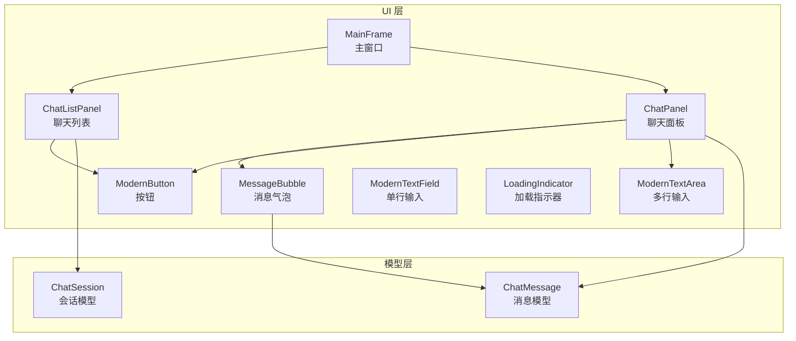
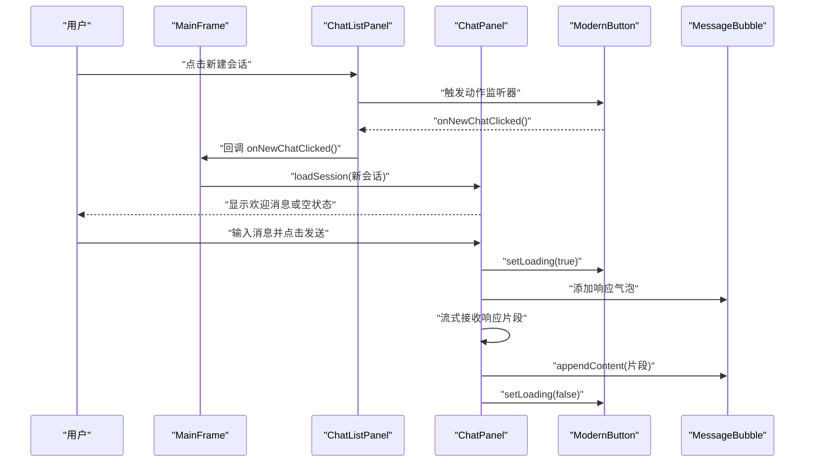
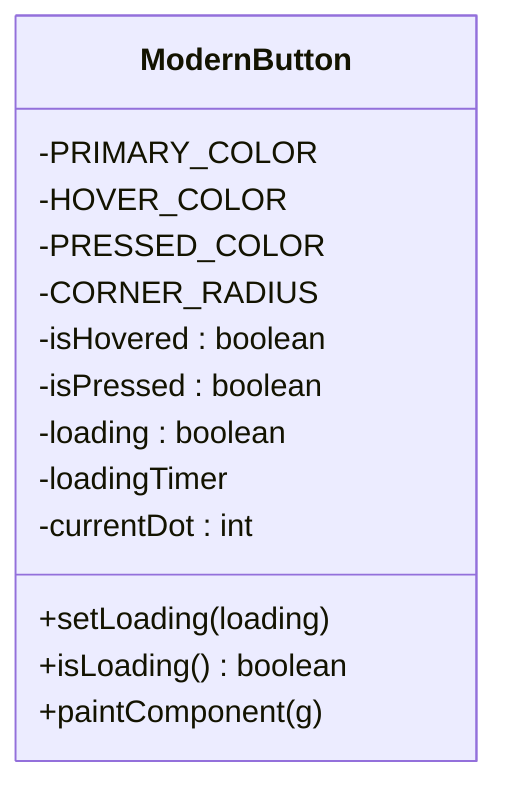
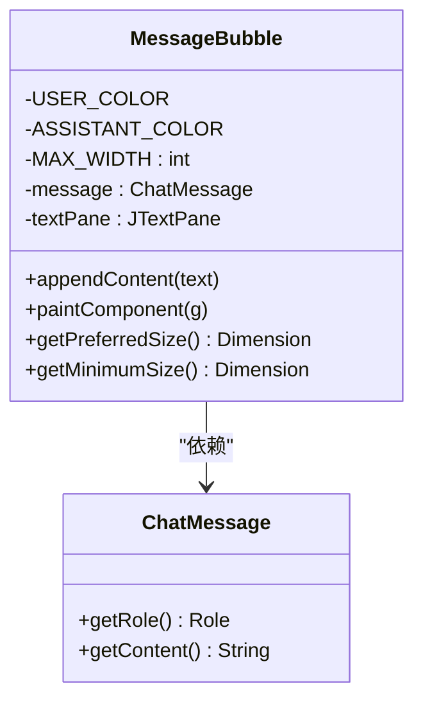
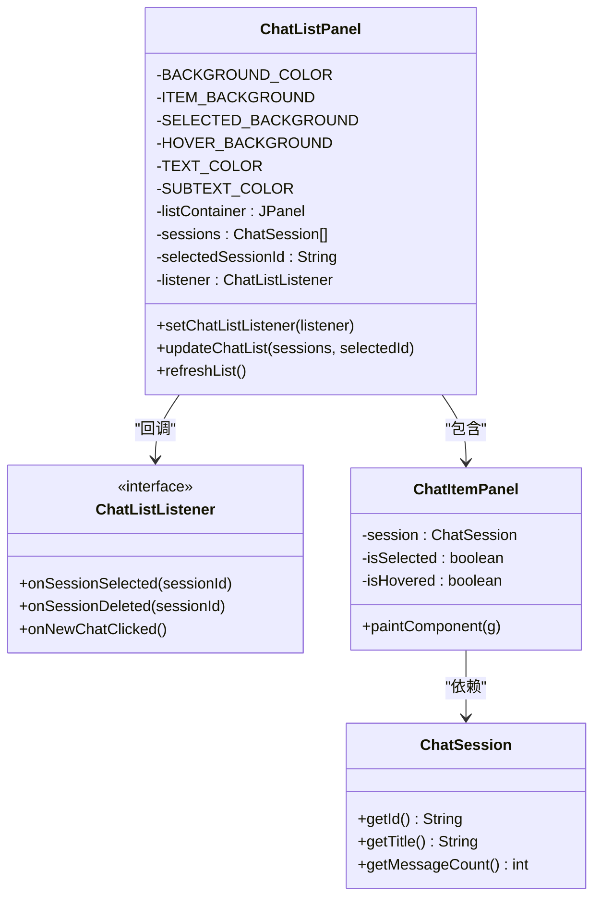
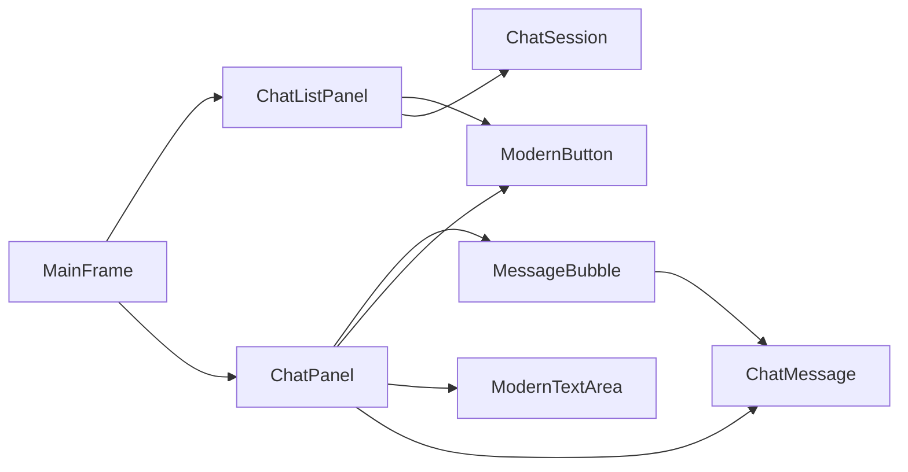

# 自定义组件库

<cite>
**本文档引用的文件**
- [ModernButton.java](file://src/com/llmchat/ui/components/ModernButton.java)
- [MessageBubble.java](file://src/com/llmchat/ui/components/MessageBubble.java)
- [ChatListPanel.java](file://src/com/llmchat/ui/components/ChatListPanel.java)
- [LoadingIndicator.java](file://src/com/llmchat/ui/components/LoadingIndicator.java)
- [ModernTextArea.java](file://src/com/llmchat/ui/components/ModernTextArea.java)
- [ModernTextField.java](file://src/com/llmchat/ui/components/ModernTextField.java)
- [ChatMessage.java](file://src/com/llmchat/model/ChatMessage.java)
- [ChatSession.java](file://src/com/llmchat/model/ChatSession.java)
- [ChatPanel.java](file://src/com/llmchat/ui/ChatPanel.java)
- [MainFrame.java](file://src/com/llmchat/ui/MainFrame.java)
</cite>

## 目录
1. [简介](#简介)
2. [项目结构](#项目结构)
3. [核心组件](#核心组件)
4. [架构总览](#架构总览)
5. [详细组件分析](#详细组件分析)
6. [依赖关系分析](#依赖关系分析)
7. [性能考虑](#性能考虑)
8. [故障排除指南](#故障排除指南)
9. [结论](#结论)
10. [附录](#附录)

## 简介
本文件系统性地文档化了 Java LLM 聊天界面项目的自定义 Swing 组件库，重点覆盖以下组件：
- ModernButton：现代化按钮，支持悬停、按下、加载动画与禁用态
- MessageBubble：消息气泡，支持用户与助手消息的不同配色、emoji 字体适配与动态追加文本
- ChatListPanel：侧边栏聊天列表，支持会话选择、删除、新建会话以及高亮与悬停态
- LoadingIndicator：轻量级加载指示器，用于非按钮场景
- ModernTextArea / ModernTextField：现代化输入组件，支持焦点态边框变化与便捷文本操作

文档将从视觉外观、行为特性、状态管理、事件处理、样式定制、构造参数与属性配置、事件监听器设置、使用示例与最佳实践等方面进行深入说明，并解释组件间的协作关系与数据传递机制。

## 项目结构
组件库位于 UI 层的 components 包下，配合 model 层的消息与会话模型，以及 ChatPanel 和 MainFrame 等 UI 控制器共同构成完整的聊天界面。

图表来源
- [ChatPanel.java:1-335](file://src/com/llmchat/ui/ChatPanel.java#L1-L335)
- [MainFrame.java:1-177](file://src/com/llmchat/ui/MainFrame.java#L1-L177)
- [ChatListPanel.java:1-241](file://src/com/llmchat/ui/components/ChatListPanel.java#L1-L241)
- [ModernButton.java:1-159](file://src/com/llmchat/ui/components/ModernButton.java#L1-L159)
- [MessageBubble.java:1-170](file://src/com/llmchat/ui/components/MessageBubble.java#L1-L170)
- [ModernTextArea.java:1-66](file://src/com/llmchat/ui/components/ModernTextArea.java#L1-L66)
- [ModernTextField.java:1-49](file://src/com/llmchat/ui/components/ModernTextField.java#L1-L49)
- [LoadingIndicator.java:1-94](file://src/com/llmchat/ui/components/LoadingIndicator.java#L1-L94)
- [ChatMessage.java:1-44](file://src/com/llmchat/model/ChatMessage.java#L1-L44)
- [ChatSession.java:1-91](file://src/com/llmchat/model/ChatSession.java#L1-L91)

章节来源
- [ChatPanel.java:1-335](file://src/com/llmchat/ui/ChatPanel.java#L1-L335)
- [MainFrame.java:1-177](file://src/com/llmchat/ui/MainFrame.java#L1-L177)

## 核心组件
本节概述三个关键组件的设计目标与职责：
- ModernButton：提供统一的现代化视觉风格与交互反馈，支持加载动画与禁用态
- MessageBubble：渲染单条消息的气泡，自动适配用户/助手角色、emoji 字体与换行
- ChatListPanel：侧边栏会话列表，负责会话项的渲染、交互与事件回调

章节来源
- [ModernButton.java:1-159](file://src/com/llmchat/ui/components/ModernButton.java#L1-L159)
- [MessageBubble.java:1-170](file://src/com/llmchat/ui/components/MessageBubble.java#L1-L170)
- [ChatListPanel.java:1-241](file://src/com/llmchat/ui/components/ChatListPanel.java#L1-L241)

## 架构总览
组件间协作关系如下：
- MainFrame 作为顶层容器，组合 ChatListPanel 与 ChatPanel，并通过监听器驱动数据刷新
- ChatPanel 负责消息展示、输入处理与流式响应接收，内部使用 MessageBubble 渲染消息
- ChatListPanel 提供会话列表，内部使用 ModernButton 触发“新建会话”，并通过回调通知 MainFrame
- MessageBubble 依赖 ChatMessage 模型，根据角色切换配色与文本样式
- ModernButton 在发送按钮与新建按钮场景中提供一致的视觉与交互体验

图表来源
- [ChatListPanel.java:55-61](file://src/com/llmchat/ui/components/ChatListPanel.java#L55-L61)
- [ChatPanel.java:108-109](file://src/com/llmchat/ui/ChatPanel.java#L108-L109)
- [ChatPanel.java:243-296](file://src/com/llmchat/ui/ChatPanel.java#L243-L296)

## 详细组件分析

### ModernButton 组件
- 设计目标
  - 提供统一的圆角矩形按钮外观，支持悬停、按下与加载三种状态
  - 加载状态下显示三圆点动画，同时禁用交互，避免重复提交
- 视觉外观
  - 默认使用主色调，悬停时加深，按下时进一步加深
  - 圆角半径统一，字体为粗体，白色文字，手型光标
- 行为特性
  - 鼠标进入/离开、按下/释放时更新内部状态并重绘
  - 加载动画由定时器驱动，按顺序点亮不同透明度的圆点
- 状态管理
  - isHovered / isPressed：用于绘制状态判断
  - loading：控制是否启用加载动画与交互禁用
  - currentDot：动画帧索引
- 事件处理
  - 内置鼠标监听器，维护 hover/pressed 状态
  - 对外暴露 setLoading()/isLoading() 以控制与查询加载状态
- 样式定制
  - 颜色常量：主色、悬停色、按下色；圆角半径固定
  - 文字颜色、字体、尺寸、光标、首选尺寸可直接在构造中调整
- 构造函数与属性
  - 构造函数：接受按钮文本，初始化外观、字体、尺寸、光标与禁用焦点绘制
  - 关键方法：setLoading(boolean)/isLoading()
- 使用示例与最佳实践
  - 发送按钮：在点击后立即调用 setLoading(true)，在异步完成后再 setLoading(false)
  - 新建会话按钮：与 ChatListPanel 的 ChatListListener 配合使用
  - 注意：加载期间禁用按钮，避免重复点击

图表来源
- [ModernButton.java:14-159](file://src/com/llmchat/ui/components/ModernButton.java#L14-L159)

章节来源
- [ModernButton.java:1-159](file://src/com/llmchat/ui/components/ModernButton.java#L1-L159)

### MessageBubble 组件
- 设计目标
  - 渲染单条消息气泡，区分用户与助手角色，支持 emoji 字体与自动换行
- 视觉外观
  - 用户消息：蓝色背景、白色文字
  - 助手消息：浅灰背景、深灰文字
  - 圆角矩形背景，内边距统一
- 行为特性
  - 支持动态追加文本 appendContent，内部使用 SwingUtilities.invokeLater 确保线程安全
  - 通过重新计算文本区域尺寸与多次 revalidate/repaint 确保换行正确
  - getPreferredSize 基于文本内容与最大宽度计算，保证气泡宽度合理
- 状态管理
  - 依赖 ChatMessage 的角色字段决定配色与文本样式
- 事件处理
  - 无显式事件监听器，主要通过外部调用进行内容更新
- 样式定制
  - 颜色常量：用户/助手背景与文字色
  - 最大宽度常量：限制气泡宽度，超过则换行
  - 字体族优先级：Windows、macOS、Linux 的 emoji 字体回退策略
- 构造函数与属性
  - 构造函数：接收 ChatMessage，初始化文本样式与字体
  - 关键方法：appendContent(String)/getPreferredSize()/getMinimumSize()
- 使用示例与最佳实践
  - 在 ChatPanel 中逐条创建并添加到消息面板
  - 流式响应时，先创建空气泡，再通过 appendContent 逐步追加
  - 注意：追加文本后需触发 revalidate/repaint，确保布局更新

图表来源
- [MessageBubble.java:14-170](file://src/com/llmchat/ui/components/MessageBubble.java#L14-L170)
- [ChatMessage.java:8-44](file://src/com/llmchat/model/ChatMessage.java#L8-L44)

章节来源
- [MessageBubble.java:1-170](file://src/com/llmchat/ui/components/MessageBubble.java#L1-L170)
- [ChatMessage.java:1-44](file://src/com/llmchat/model/ChatMessage.java#L1-L44)

### ChatListPanel 组件
- 设计目标
  - 侧边栏显示所有聊天会话，支持新建、选择与删除
- 视觉外观
  - 背景色统一，选中项与悬停项有明显高亮
  - 顶部标题与新建按钮区域，列表区域带滚动条
- 行为特性
  - updateChatList 接收会话列表与当前选中 ID，内部刷新显示
  - ChatItemPanel 内部维护 hover 状态并绘制背景
  - 删除按钮弹出确认对话框，确认后回调 onSessionDeleted
- 状态管理
  - sessions：当前会话列表
  - selectedSessionId：当前选中会话 ID
  - listener：外部监听器，接收选择、删除、新建事件
- 事件处理
  - 新建按钮：触发 onNewChatClicked
  - 会话项：点击非当前项触发 onSessionSelected
  - 删除按钮：点击弹出确认对话框，确认后触发 onSessionDeleted
- 样式定制
  - 背景色、选中色、悬停色、文字色、副文字色均为常量
  - 圆角半径与间距通过内部绘制与布局控制
- 构造函数与属性
  - 构造函数：初始化 UI 结构与滚动面板
  - 关键方法：setChatListListener(listener)/updateChatList(sessions, selectedId)
- 使用示例与最佳实践
  - 在 MainFrame 中设置监听器，处理会话切换与删除
  - 列表为空时显示提示文本
  - 删除操作需二次确认，避免误删

图表来源
- [ChatListPanel.java:15-241](file://src/com/llmchat/ui/components/ChatListPanel.java#L15-L241)
- [ChatSession.java:11-91](file://src/com/llmchat/model/ChatSession.java#L11-L91)

章节来源
- [ChatListPanel.java:1-241](file://src/com/llmchat/ui/components/ChatListPanel.java#L1-L241)
- [ChatSession.java:1-91](file://src/com/llmchat/model/ChatSession.java#L1-L91)

### LoadingIndicator 组件
- 设计目标
  - 轻量级加载指示器，适用于非按钮场景
- 视觉外观
  - 三圆点按序变亮，形成流动感
- 行为特性
  - start/stop 控制动画启停，isRunning 查询状态
  - 内部使用 Timer 驱动帧切换
- 状态管理
  - running：动画运行标志
  - currentDot：当前高亮圆点索引
- 使用示例与最佳实践
  - 与 ModernButton 的加载状态配合使用，或在独立场景中替代按钮加载

章节来源
- [LoadingIndicator.java:1-94](file://src/com/llmchat/ui/components/LoadingIndicator.java#L1-L94)

### ModernTextArea / ModernTextField 组件
- 设计目标
  - 提供现代化输入体验，支持焦点态边框变化与便捷文本操作
- 视觉外观
  - 边框颜色随焦点变化，获得焦点时加粗边框
- 行为特性
  - ModernTextArea：JScrollPane 容器内的 JTextArea，支持自动换行与滚动
  - ModernTextField：JTextField，支持焦点监听与边框复合边框
- 样式定制
  - 背景色、边框色、焦点色均为常量
  - 字体族与字号统一
- 使用示例与最佳实践
  - 在 ChatPanel 中作为输入区域使用，支持 Enter 发送与 Shift+Enter 换行
  - 通过 clear()/getText()/setText()/append() 管理文本

章节来源
- [ModernTextArea.java:1-66](file://src/com/llmchat/ui/components/ModernTextArea.java#L1-L66)
- [ModernTextField.java:1-49](file://src/com/llmchat/ui/components/ModernTextField.java#L1-L49)

## 依赖关系分析
- 组件依赖
  - ChatListPanel 依赖 ChatSession 模型与 ModernButton
  - ChatPanel 依赖 ChatMessage 模型、HttpClient、ConfigManager、ChatHistoryManager，并使用 MessageBubble 与 ModernButton
  - MessageBubble 依赖 ChatMessage
- 数据流
  - MainFrame 通过 ChatListPanel 的监听器与 ChatPanel 协作，驱动会话切换与刷新
  - ChatPanel 将用户输入转换为 ChatMessage 并通过历史管理器持久化，同时通过 MessageBubble 渲染
- 事件流
  - 用户交互事件（点击、键盘）在各组件内部处理，必要时通过监听器向上层传递

图表来源
- [MainFrame.java:57-83](file://src/com/llmchat/ui/MainFrame.java#L57-L83)
- [ChatPanel.java:305-312](file://src/com/llmchat/ui/ChatPanel.java#L305-L312)
- [ChatListPanel.java:117-119](file://src/com/llmchat/ui/components/ChatListPanel.java#L117-L119)
- [MessageBubble.java:21-28](file://src/com/llmchat/ui/components/MessageBubble.java#L21-L28)
- [ChatMessage.java:14-16](file://src/com/llmchat/model/ChatMessage.java#L14-L16)
- [ChatSession.java:14-18](file://src/com/llmchat/model/ChatSession.java#L14-L18)

章节来源
- [MainFrame.java:1-177](file://src/com/llmchat/ui/MainFrame.java#L1-L177)
- [ChatPanel.java:1-335](file://src/com/llmchat/ui/ChatPanel.java#L1-L335)
- [ChatListPanel.java:1-241](file://src/com/llmchat/ui/components/ChatListPanel.java#L1-L241)
- [MessageBubble.java:1-170](file://src/com/llmchat/ui/components/MessageBubble.java#L1-L170)
- [ChatMessage.java:1-44](file://src/com/llmchat/model/ChatMessage.java#L1-L44)
- [ChatSession.java:1-91](file://src/com/llmchat/model/ChatSession.java#L1-L91)

## 性能考虑
- 绘制优化
  - 所有自绘组件均启用抗锯齿，提升视觉质量
  - MessageBubble 在 appendContent 后进行多次 revalidate/repaint，确保布局稳定
- 事件与线程
  - ChatPanel 的流式响应通过 SwingUtilities.invokeLater 切换到 EDT，避免跨线程问题
- 动画与定时器
  - ModernButton 与 LoadingIndicator 使用 Timer 驱动动画，帧间隔统一，避免卡顿
- 布局与尺寸
  - MessageBubble 的 getPreferredSize 基于文本内容与最大宽度计算，减少无效重绘

## 故障排除指南
- 按钮无法点击
  - 检查是否处于加载状态（isLoading），若为 true 则按钮被禁用
  - 解决：在异步完成后调用 setLoading(false)
- 消息未显示或换行异常
  - 确认 appendContent 是否在 Swing 事件线程中调用
  - 确认已触发 revalidate/repaint 与父容器的再次更新
- 会话列表不刷新
  - 确认 MainFrame 已调用 refreshChatList 并传入最新会话列表与当前会话 ID
- 删除确认未生效
  - 确认 ChatListPanel 的删除按钮已绑定确认对话框与监听器回调

章节来源
- [ModernButton.java:78-98](file://src/com/llmchat/ui/components/ModernButton.java#L78-L98)
- [MessageBubble.java:89-121](file://src/com/llmchat/ui/components/MessageBubble.java#L89-L121)
- [ChatPanel.java:243-296](file://src/com/llmchat/ui/ChatPanel.java#L243-L296)
- [ChatListPanel.java:188-201](file://src/com/llmchat/ui/components/ChatListPanel.java#L188-L201)
- [MainFrame.java:171-175](file://src/com/llmchat/ui/MainFrame.java#L171-L175)

## 结论
该自定义组件库围绕现代 UI 风格与良好的用户体验进行了精心设计：
- ModernButton 提供一致的交互反馈与加载状态
- MessageBubble 实现了角色区分、emoji 字体适配与动态文本追加
- ChatListPanel 提供会话管理与事件回调，支撑主界面的数据流转
- 通过清晰的监听器接口与最小化的依赖，组件间协作高效且易于扩展

建议在后续迭代中：
- 将颜色与尺寸抽象为可配置主题
- 增加更多样式定制入口（如圆角、阴影、字体族）
- 为组件增加单元测试与可视化回归测试

## 附录
- 使用示例路径
  - 新建会话：[ChatListPanel.java:55-61](file://src/com/llmchat/ui/components/ChatListPanel.java#L55-L61)
  - 发送消息与流式响应：[ChatPanel.java:189-297](file://src/com/llmchat/ui/ChatPanel.java#L189-L297)
  - 消息气泡渲染：[ChatPanel.java:299-312](file://src/com/llmchat/ui/ChatPanel.java#L299-L312)
  - 会话列表刷新：[MainFrame.java:171-175](file://src/com/llmchat/ui/MainFrame.java#L171-L175)