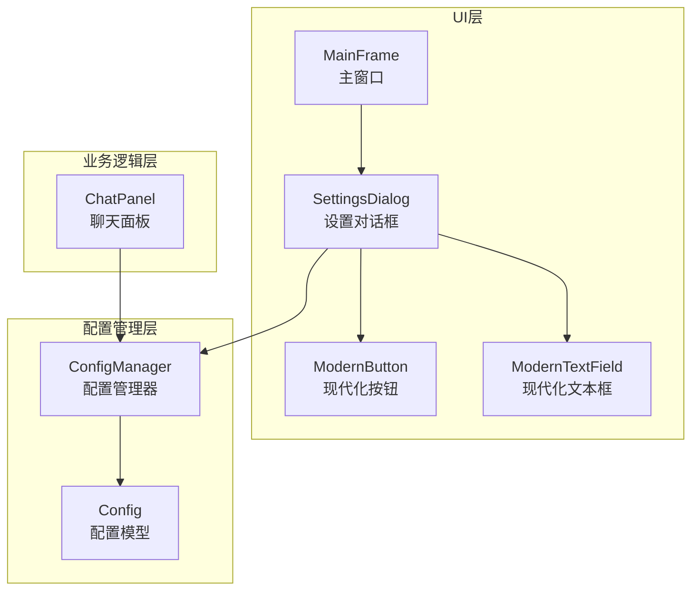
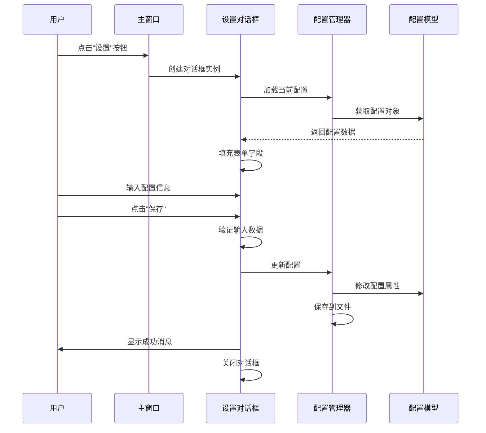
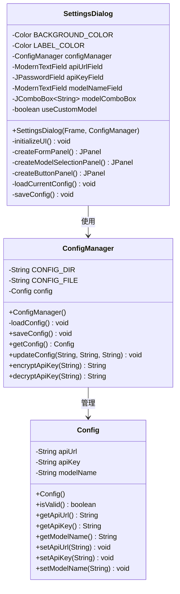
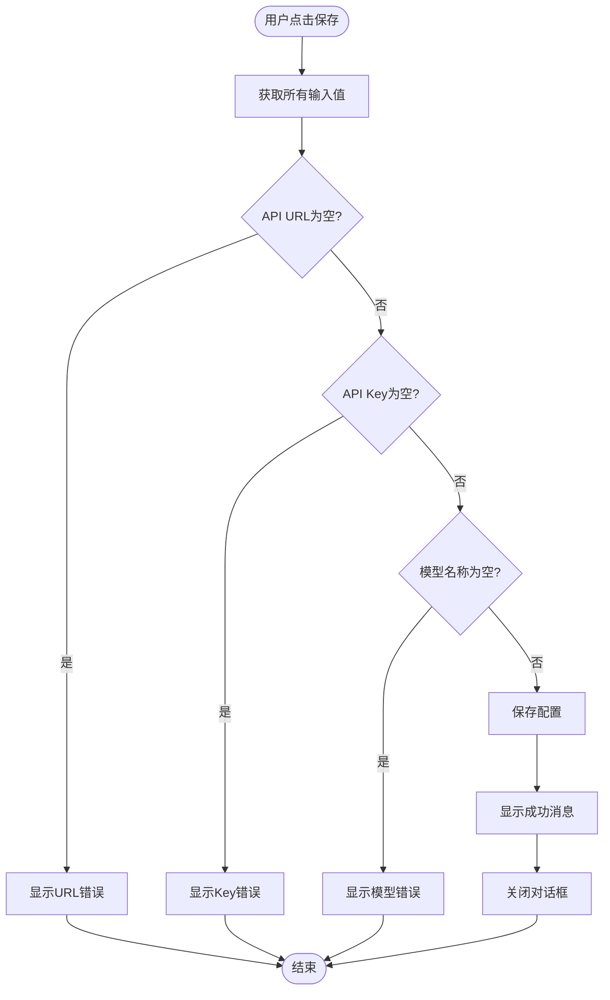
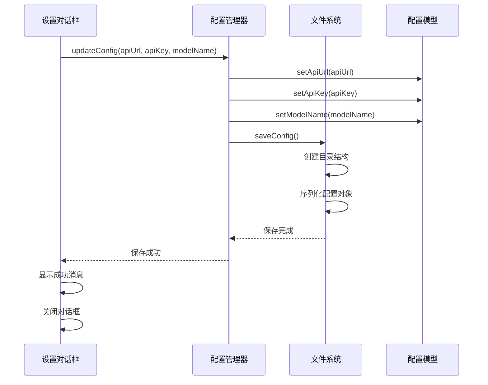
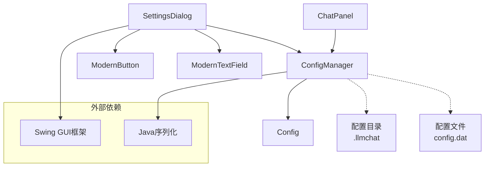
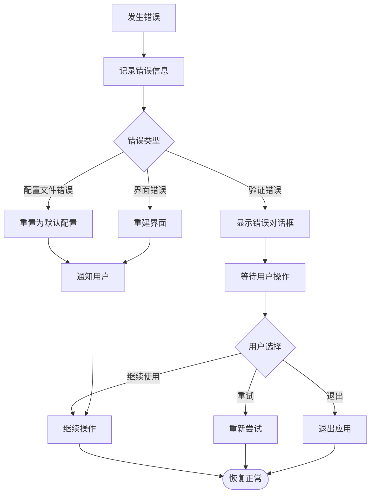

# 设置对话框

<cite>
**本文档引用的文件**
- [SettingsDialog.java](file://src/com/llmchat/ui/SettingsDialog.java)
- [Config.java](file://src/com/llmchat/model/Config.java)
- [ConfigManager.java](file://src/com/llmchat/config/ConfigManager.java)
- [MainFrame.java](file://src/com/llmchat/ui/MainFrame.java)
- [ModernButton.java](file://src/com/llmchat/ui/components/ModernButton.java)
- [ModernTextField.java](file://src/com/llmchat/ui/components/ModernTextField.java)
- [ChatPanel.java](file://src/com/llmchat/ui/ChatPanel.java)
</cite>

## 目录
1. [简介](#简介)
2. [项目结构](#项目结构)
3. [核心组件](#核心组件)
4. [架构概览](#架构概览)
5. [详细组件分析](#详细组件分析)
6. [依赖关系分析](#依赖关系分析)
7. [性能考虑](#性能考虑)
8. [故障排除指南](#故障排除指南)
9. [结论](#结论)

## 简介

设置对话框是Java LLM聊天界面项目中的关键配置组件，负责管理用户的API端点配置、密钥输入和模型选择。该对话框采用现代化的Swing界面设计，提供了直观的用户交互体验和完整的配置验证机制。

## 项目结构

设置对话框位于UI层的设置模块中，与配置管理和模型定义紧密协作：

**图表来源**
- [SettingsDialog.java:15-37](file://src/com/llmchat/ui/SettingsDialog.java#L15-L37)
- [ConfigManager.java:14-22](file://src/com/llmchat/config/ConfigManager.java#L14-L22)
- [Config.java:8-20](file://src/com/llmchat/model/Config.java#L8-L20)

**章节来源**
- [SettingsDialog.java:1-250](file://src/com/llmchat/ui/SettingsDialog.java#L1-L250)
- [ConfigManager.java:1-101](file://src/com/llmchat/config/ConfigManager.java#L1-L101)
- [Config.java:1-52](file://src/com/llmchat/model/Config.java#L1-L52)

## 核心组件

设置对话框的核心功能围绕以下三个主要配置项展开：

### API端点配置
- **API URL字段**：支持用户自定义API端点地址
- **自动验证**：确保URL格式的有效性
- **默认值**：预设OpenAI官方API地址

### 密钥安全管理
- **密码字段**：安全的API密钥输入
- **隐藏显示**：防止密钥在界面上明文显示
- **数据保护**：内存级的安全处理

### 模型选择机制
- **预设模型**：支持多种主流大语言模型
- **自定义模式**：允许用户输入自定义模型名称
- **动态切换**：根据用户选择动态显示相应输入控件

**章节来源**
- [SettingsDialog.java:73-103](file://src/com/llmchat/ui/SettingsDialog.java#L73-L103)
- [SettingsDialog.java:120-169](file://src/com/llmchat/ui/SettingsDialog.java#L120-L169)

## 架构概览

设置对话框采用MVC架构模式，实现了清晰的关注点分离：

**图表来源**
- [MainFrame.java:122-125](file://src/com/llmchat/ui/MainFrame.java#L122-L125)
- [SettingsDialog.java:27-37](file://src/com/llmchat/ui/SettingsDialog.java#L27-L37)
- [SettingsDialog.java:216-248](file://src/com/llmchat/ui/SettingsDialog.java#L216-L248)

## 详细组件分析

### 设置对话框类结构

**图表来源**
- [SettingsDialog.java:15-37](file://src/com/llmchat/ui/SettingsDialog.java#L15-L37)
- [ConfigManager.java:14-75](file://src/com/llmchat/config/ConfigManager.java#L14-L75)
- [Config.java:8-50](file://src/com/llmchat/model/Config.java#L8-L50)

### 对话框布局设计

设置对话框采用了响应式布局设计，确保在不同屏幕尺寸下都能提供良好的用户体验：

#### 布局层次结构
- **主面板**：采用BorderLayout布局
- **标题面板**：显示"API配置"标题
- **表单面板**：垂直排列所有配置字段
- **按钮面板**：右对齐的确认和取消按钮

#### 视觉设计规范
- **色彩方案**：白色背景配深灰色文字
- **字体规范**：统一使用Microsoft YaHei字体
- **间距控制**：合理的边距和元素间距
- **焦点状态**：输入框获得焦点时的颜色变化

**章节来源**
- [SettingsDialog.java:39-65](file://src/com/llmchat/ui/SettingsDialog.java#L39-L65)
- [SettingsDialog.java:171-185](file://src/com/llmchat/ui/SettingsDialog.java#L171-L185)

### 配置项输入控件

#### API URL输入控件
- **类型**：ModernTextField现代化文本框
- **特性**：支持实时验证和焦点状态反馈
- **默认值**：OpenAI官方API地址
- **验证规则**：非空检查和URL格式验证

#### API Key输入控件
- **类型**：JPasswordField密码字段
- **安全特性**：字符掩码显示
- **数据处理**：内存级安全处理
- **验证规则**：非空检查

#### 模型选择控件
- **类型**：JComboBox组合框
- **预设选项**：gpt-3.5-turbo, gpt-4, gpt-4-turbo, gpt-4o, gpt-4o-mini
- **自定义模式**：通过"自定义..."选项启用
- **动态显示**：根据选择条件性显示或隐藏输入框

**章节来源**
- [SettingsDialog.java:74](file://src/com/llmchat/ui/SettingsDialog.java#L74)
- [SettingsDialog.java:86-96](file://src/com/llmchat/ui/SettingsDialog.java#L86-L96)
- [SettingsDialog.java:130-168](file://src/com/llmchat/ui/SettingsDialog.java#L130-L168)

### 验证机制实现

设置对话框实现了多层次的数据验证机制：

**图表来源**
- [SettingsDialog.java:216-248](file://src/com/llmchat/ui/SettingsDialog.java#L216-L248)

#### 验证规则
- **必填验证**：所有字段都必须填写
- **格式验证**：API URL需要有效的URL格式
- **业务验证**：确保配置数据的完整性

#### 错误处理策略
- **即时反馈**：验证失败立即显示错误消息
- **用户友好**：使用标准的JOptionPane对话框
- **流程中断**：验证失败时阻止配置保存

**章节来源**
- [SettingsDialog.java:227-241](file://src/com/llmchat/ui/SettingsDialog.java#L227-L241)

### 模态显示和数据绑定

#### 模态对话框行为
- **阻塞特性**：显示时阻止用户与父窗口交互
- **生命周期管理**：自动处理对话框的创建和销毁
- **位置定位**：相对于父窗口居中显示

#### 数据绑定机制
- **双向绑定**：从配置管理器读取数据到界面显示
- **单向更新**：从界面收集数据到配置管理器
- **实时同步**：模型选择变化时的动态界面更新

**章节来源**
- [SettingsDialog.java:27-37](file://src/com/llmchat/ui/SettingsDialog.java#L27-L37)
- [SettingsDialog.java:187-214](file://src/com/llmchat/ui/SettingsDialog.java#L187-L214)

### 配置保存流程

配置保存采用序列化机制，确保数据的持久化存储：

**图表来源**
- [SettingsDialog.java:244](file://src/com/llmchat/ui/SettingsDialog.java#L244)
- [ConfigManager.java:70-75](file://src/com/llmchat/config/ConfigManager.java#L70-L75)

#### 存储机制
- **文件路径**：用户工作目录下的.llmchat/config.dat
- **序列化格式**：Java标准序列化机制
- **目录创建**：自动创建必要的目录结构

#### 安全考虑
- **数据保护**：配置文件存储在应用专用目录
- **权限控制**：遵循操作系统的文件权限机制
- **备份策略**：配置文件的可靠存储

**章节来源**
- [ConfigManager.java:15-16](file://src/com/llmchat/config/ConfigManager.java#L15-L16)
- [ConfigManager.java:44-58](file://src/com/llmchat/config/ConfigManager.java#L44-L58)

## 依赖关系分析

设置对话框的依赖关系体现了清晰的分层架构：

**图表来源**
- [SettingsDialog.java:3-6](file://src/com/llmchat/ui/SettingsDialog.java#L3-L6)
- [ConfigManager.java:15-16](file://src/com/llmchat/config/ConfigManager.java#L15-L16)

### 组件耦合度
- **低耦合**：设置对话框仅依赖配置管理器接口
- **高内聚**：配置管理器集中处理所有配置相关逻辑
- **清晰边界**：各组件职责明确，无交叉依赖

### 外部依赖管理
- **Swing框架**：提供GUI组件和事件处理
- **Java序列化**：实现配置数据的持久化
- **系统文件系统**：提供配置文件的存储能力

**章节来源**
- [SettingsDialog.java:19-25](file://src/com/llmchat/ui/SettingsDialog.java#L19-L25)
- [ConfigManager.java:27-39](file://src/com/llmchat/config/ConfigManager.java#L27-L39)

## 性能考虑

设置对话框在设计时充分考虑了性能优化：

### 内存管理
- **轻量级组件**：使用基础Swing组件，减少内存占用
- **及时释放**：对话框关闭时自动释放资源
- **避免重复创建**：复用现有的配置管理器实例

### 界面响应性
- **异步验证**：验证逻辑在用户输入时即时执行
- **防抖处理**：避免频繁的界面重绘操作
- **最小化重排**：只在必要时重新布局界面元素

### 数据处理效率
- **增量更新**：只更新发生变化的配置项
- **批量操作**：一次保存多个配置变更
- **缓存机制**：避免重复的文件I/O操作

## 故障排除指南

### 常见问题及解决方案

#### 配置加载失败
**症状**：启动时配置丢失或重置
**原因**：配置文件损坏或权限问题
**解决**：
1. 检查.llmchat目录是否存在
2. 验证文件权限是否正确
3. 手动删除损坏的config.dat文件

#### 验证失败错误
**症状**：保存配置时报错
**原因**：输入数据不符合验证规则
**解决**：
1. 确保所有字段都已填写
2. 检查API URL格式是否正确
3. 验证模型名称不为空

#### 界面显示异常
**症状**：对话框布局错乱或控件不可见
**原因**：组件初始化顺序问题
**解决**：
1. 确认组件按正确的顺序添加到容器中
2. 检查组件的可见性状态
3. 验证布局管理器的配置

**章节来源**
- [ConfigManager.java:33-38](file://src/com/llmchat/config/ConfigManager.java#L33-L38)
- [SettingsDialog.java:228-241](file://src/com/llmchat/ui/SettingsDialog.java#L228-L241)

### 错误恢复机制

设置对话框实现了完善的错误恢复机制：

**图表来源**
- [ConfigManager.java:33-38](file://src/com/llmchat/config/ConfigManager.java#L33-L38)
- [SettingsDialog.java:228-241](file://src/com/llmchat/ui/SettingsDialog.java#L228-L241)

## 结论

设置对话框作为Java LLM聊天界面项目的核心配置组件，展现了优秀的软件工程实践：

### 设计优势
- **用户友好**：直观的界面设计和清晰的验证反馈
- **功能完整**：涵盖所有必要的配置需求
- **安全性强**：采用多层验证和安全的数据处理
- **可维护性好**：清晰的代码结构和职责分离

### 技术特点
- **架构合理**：采用MVC模式，职责明确
- **扩展性强**：易于添加新的配置选项
- **性能优良**：优化的内存使用和界面响应
- **可靠性高**：完善的错误处理和恢复机制

### 改进建议
- **国际化支持**：添加多语言界面支持
- **配置导入导出**：支持配置文件的批量管理
- **高级验证**：增加更复杂的配置验证规则
- **配置模板**：提供常用配置的快速选择

设置对话框为整个应用程序提供了可靠的配置管理基础，确保用户能够轻松地定制和优化聊天体验。