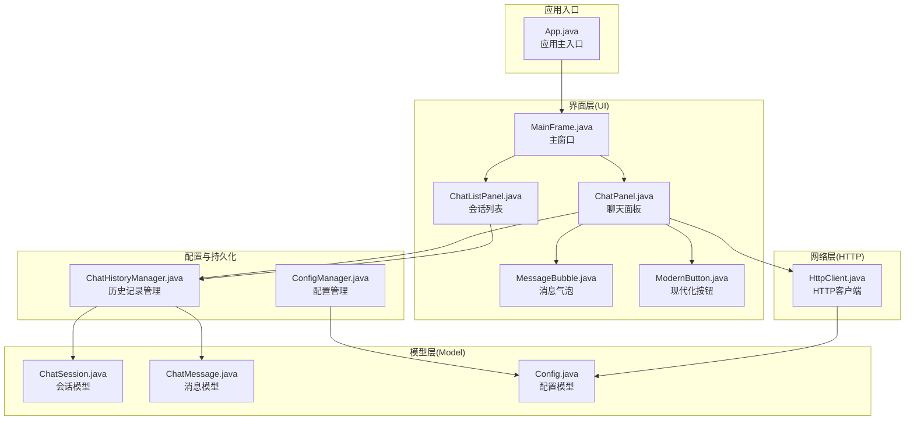
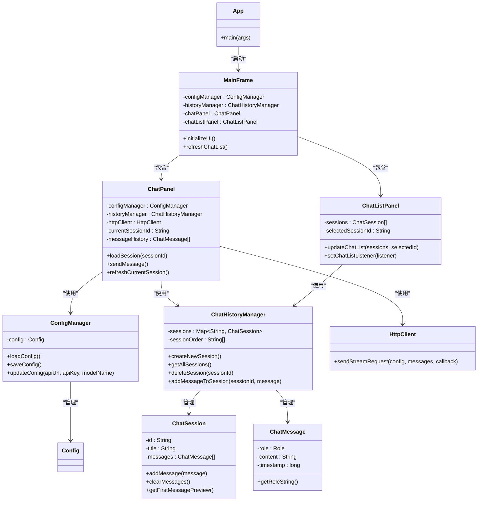
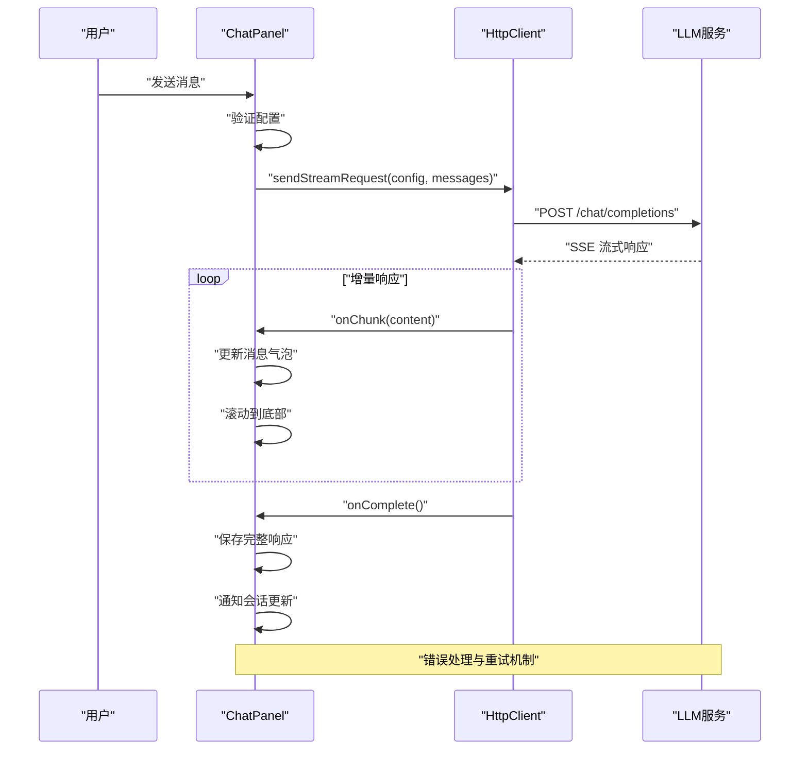
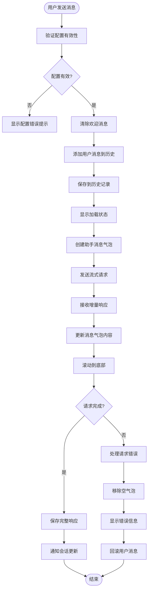
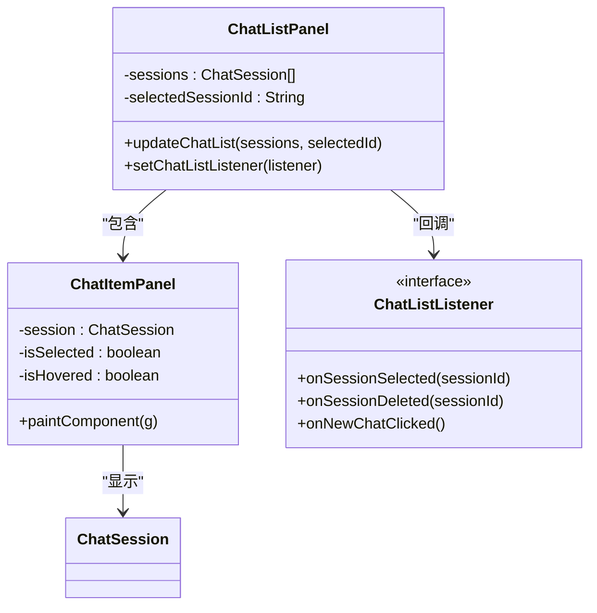
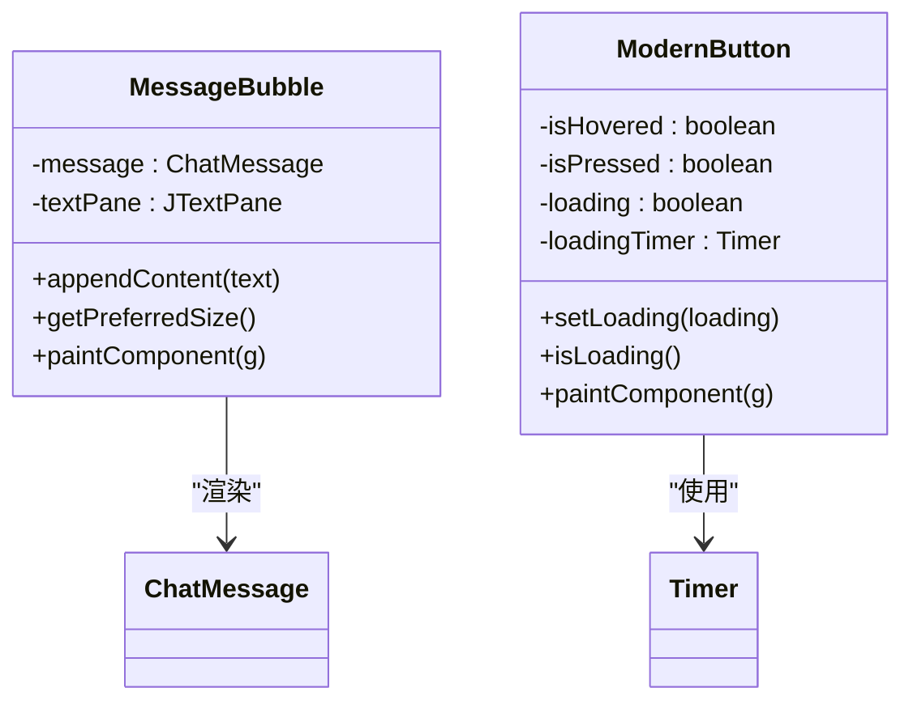
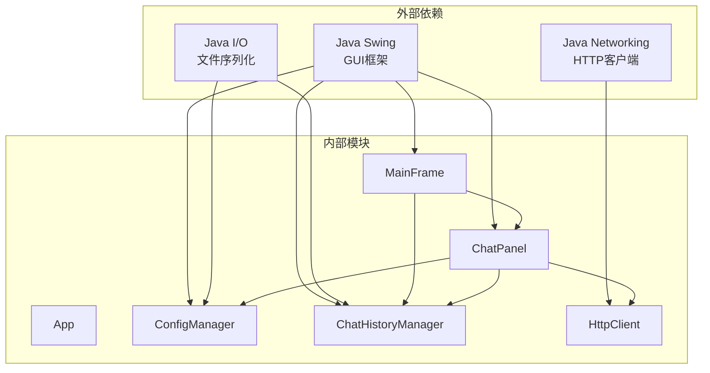

# 项目概述

<cite>
**本文档引用的文件**
- [App.java](file://src/com/llmchat/App.java)
- [MainFrame.java](file://src/com/llmchat/ui/MainFrame.java)
- [ChatPanel.java](file://src/com/llmchat/ui/ChatPanel.java)
- [ChatListPanel.java](file://src/com/llmchat/ui/components/ChatListPanel.java)
- [MessageBubble.java](file://src/com/llmchat/ui/components/MessageBubble.java)
- [ModernButton.java](file://src/com/llmchat/ui/components/ModernButton.java)
- [ChatSession.java](file://src/com/llmchat/model/ChatSession.java)
- [ChatMessage.java](file://src/com/llmchat/model/ChatMessage.java)
- [Config.java](file://src/com/llmchat/model/Config.java)
- [ConfigManager.java](file://src/com/llmchat/config/ConfigManager.java)
- [ChatHistoryManager.java](file://src/com/llmchat/config/ChatHistoryManager.java)
- [HttpClient.java](file://src/com/llmchat/http/HttpClient.java)
- [compile.bat](file://compile.bat)
- [run.bat](file://run.bat)
</cite>

## 目录
1. [简介](#简介)
2. [项目结构](#项目结构)
3. [核心组件](#核心组件)
4. [架构总览](#架构总览)
5. [详细组件分析](#详细组件分析)
6. [依赖关系分析](#依赖关系分析)
7. [性能考虑](#性能考虑)
8. [故障排除指南](#故障排除指南)
9. [结论](#结论)
10. [附录](#附录)

## 简介
本项目是一个基于 Java Swing 的桌面应用程序，用于与大语言模型进行交互式聊天。该应用提供了现代化的用户界面，支持多会话管理、历史记录持久化、实时流式响应以及可配置的 LLM 接口参数。通过 MVC 架构模式组织代码，实现了清晰的关注点分离：视图层负责用户交互与界面渲染，模型层封装数据结构与业务逻辑，控制器层协调各模块间的协作。

主要特性：
- 多会话管理：支持同时维护多个独立的聊天会话，每个会话拥有独立的历史记录与标题
- 历史记录持久化：自动保存会话数据到本地文件系统，确保应用重启后数据不丢失
- 实时流式响应：通过 HTTP SSE 流式传输实现 LLM 的增量响应显示
- 现代化界面设计：采用圆角矩形、柔和色彩与流畅动画的现代化 UI 设计
- 配置管理：支持 API 地址、认证密钥与模型名称的配置与加密存储

## 项目结构
项目采用分层的包结构，按照职责划分模块：
- com.llmchat.app：应用入口与全局初始化
- com.llmchat.ui：Swing 界面组件与交互逻辑
- com.llmchat.model：数据模型与业务实体
- com.llmchat.config：配置管理与历史记录持久化
- com.llmchat.http：网络通信与流式响应处理

**图表来源**
- [App.java:11-26](file://src/com/llmchat/App.java#L11-L26)
- [MainFrame.java:19-101](file://src/com/llmchat/ui/MainFrame.java#L19-L101)
- [ChatPanel.java:21-55](file://src/com/llmchat/ui/ChatPanel.java#L21-L55)

**章节来源**
- [App.java:1-27](file://src/com/llmchat/App.java#L1-L27)
- [compile.bat:1-21](file://compile.bat#L1-L21)
- [run.bat:1-5](file://run.bat#L1-L5)

## 核心组件
本节深入分析项目的关键组件及其职责分工。

### 应用入口与初始化
应用通过单一入口类启动，负责设置系统外观并初始化主窗口。该设计遵循 Java Swing 的最佳实践，确保在事件调度线程中创建和修改 UI 组件。

### 主窗口与布局管理
主窗口采用 BorderLayout 布局，包含头部工具栏与内容区域。内容区域进一步分为侧边栏（会话列表）与主聊天面板，使用分割窗格实现可调整的布局。

### 聊天面板与消息显示
聊天面板是核心交互区域，负责：
- 用户输入处理与快捷键支持（Enter 发送）
- 实时流式响应显示与滚动定位
- 会话状态管理与历史记录同步
- 错误处理与用户反馈

### 会话管理与持久化
会话管理系统提供完整的 CRUD 操作：
- 会话创建与删除
- 历史记录的序列化存储
- 会话顺序维护与索引管理
- 并发安全的数据访问

**章节来源**
- [App.java:12-25](file://src/com/llmchat/App.java#L12-L25)
- [MainFrame.java:38-101](file://src/com/llmchat/ui/MainFrame.java#L38-L101)
- [ChatPanel.java:44-55](file://src/com/llmchat/ui/ChatPanel.java#L44-L55)
- [ChatHistoryManager.java:23-65](file://src/com/llmchat/config/ChatHistoryManager.java#L23-L65)

## 架构总览
项目采用经典的 MVC 架构模式，明确分离关注点并提高代码的可维护性。

**图表来源**
- [App.java:11-26](file://src/com/llmchat/App.java#L11-L26)
- [MainFrame.java:24-36](file://src/com/llmchat/ui/MainFrame.java#L24-L36)
- [ChatPanel.java:24-49](file://src/com/llmchat/ui/ChatPanel.java#L24-L49)
- [ChatHistoryManager.java:20-27](file://src/com/llmchat/config/ChatHistoryManager.java#L20-L27)

## 详细组件分析

### HTTP 客户端与流式响应
HTTP 客户端实现了对 LLM API 的流式请求处理，支持增量响应显示与错误恢复。

**图表来源**
- [ChatPanel.java:242-297](file://src/com/llmchat/ui/ChatPanel.java#L242-L297)
- [HttpClient.java:66-127](file://src/com/llmchat/http/HttpClient.java#L66-L127)

组件特性：
- 线程安全的异步请求处理
- SSE 流式数据解析与内容提取
- JSON 字符串转义与反转义处理
- 超时控制与错误回调机制

**章节来源**
- [HttpClient.java:16-127](file://src/com/llmchat/http/HttpClient.java#L16-L127)
- [ChatPanel.java:242-297](file://src/com/llmchat/ui/ChatPanel.java#L242-L297)

### 聊天面板与消息显示
聊天面板实现了完整的消息交互流程，包括输入处理、消息渲染与滚动控制。

**图表来源**
- [ChatPanel.java:189-297](file://src/com/llmchat/ui/ChatPanel.java#L189-L297)

**章节来源**
- [ChatPanel.java:189-334](file://src/com/llmchat/ui/ChatPanel.java#L189-L334)

### 会话列表与交互
会话列表组件提供了直观的会话管理界面，支持新建、选择与删除操作。

**图表来源**
- [ChatListPanel.java:15-91](file://src/com/llmchat/ui/components/ChatListPanel.java#L15-L91)
- [ChatListPanel.java:130-240](file://src/com/llmchat/ui/components/ChatListPanel.java#L130-L240)

**章节来源**
- [ChatListPanel.java:96-125](file://src/com/llmchat/ui/components/ChatListPanel.java#L96-L125)

### 消息气泡与 UI 组件
消息气泡组件实现了现代化的消息显示效果，支持动态尺寸计算与 emoji 字体适配。

**图表来源**
- [MessageBubble.java:14-84](file://src/com/llmchat/ui/components/MessageBubble.java#L14-L84)
- [ModernButton.java:14-98](file://src/com/llmchat/ui/components/ModernButton.java#L14-L98)

**章节来源**
- [MessageBubble.java:89-121](file://src/com/llmchat/ui/components/MessageBubble.java#L89-L121)
- [ModernButton.java:78-98](file://src/com/llmchat/ui/components/ModernButton.java#L78-L98)

## 依赖关系分析
项目依赖关系清晰，遵循单一职责原则与依赖倒置原则。

**图表来源**
- [App.java:3-6](file://src/com/llmchat/App.java#L3-L6)
- [ChatPanel.java:3-9](file://src/com/llmchat/ui/ChatPanel.java#L3-L9)
- [HttpClient.java:6-11](file://src/com/llmchat/http/HttpClient.java#L6-L11)

**章节来源**
- [ConfigManager.java:5-9](file://src/com/llmchat/config/ConfigManager.java#L5-L9)
- [ChatHistoryManager.java:6-11](file://src/com/llmchat/config/ChatHistoryManager.java#L6-L11)

## 性能考虑
项目在性能方面采用了多项优化策略：

### 线程管理
- 使用 SwingUtilities.invokeLater 确保 UI 更新在事件调度线程中执行
- HTTP 请求在独立线程中处理，避免阻塞 UI 线程
- 加载动画使用定时器实现平滑的视觉反馈

### 内存管理
- 使用 StringBuilder 构建请求体，减少字符串拼接开销
- 消息气泡采用延迟布局计算，仅在需要时重新计算尺寸
- 会话数据使用并发集合保证多线程安全

### I/O 性能
- 配置与历史记录采用二进制序列化，提升读写效率
- 文件操作使用缓冲流，减少磁盘 I/O 次数
- 索引文件与会话文件分离存储，支持快速随机访问

## 故障排除指南
常见问题与解决方案：

### 启动问题
- **问题**：应用无法启动或出现外观异常
- **原因**：系统外观设置失败或 Java 版本不兼容
- **解决**：检查系统外观支持，确保 Java 8+ 环境

### 网络连接问题
- **问题**：流式响应超时或连接失败
- **原因**：网络不稳定、API 密钥无效或服务器限制
- **解决**：检查网络连接，验证 API 配置，查看错误日志

### 数据持久化问题
- **问题**：会话数据丢失或损坏
- **原因**：文件权限不足或磁盘空间不足
- **解决**：检查用户目录权限，清理磁盘空间，备份重要数据

**章节来源**
- [ConfigManager.java:33-35](file://src/com/llmchat/config/ConfigManager.java#L33-L35)
- [ChatHistoryManager.java:48-52](file://src/com/llmchat/config/ChatHistoryManager.java#L48-L52)

## 结论
本项目展示了如何使用 Java Swing 构建现代化的桌面聊天应用。通过合理的架构设计与模块化组织，实现了功能完整、性能优良且易于扩展的 LLM 交互界面。项目的核心优势在于：

- 清晰的 MVC 架构分离，便于维护与测试
- 完善的会话管理与持久化机制
- 流式的用户体验与现代化的界面设计
- 良好的错误处理与用户反馈机制

对于初学者而言，该项目提供了学习 Java Swing 开发、网络编程与桌面应用架构的优秀范例；对于有经验的开发者，项目展示了如何在实际应用中平衡功能需求与性能要求。

## 附录

### 技术栈说明
- **Java Swing**: 图形用户界面框架，提供丰富的组件与事件处理机制
- **HTTP 客户端**: 基于 Java 标准库的 HttpURLConnection 实现
- **文件 I/O**: 使用对象序列化进行数据持久化
- **JSON 处理**: 自定义 JSON 字符串构建与解析逻辑

### 实际使用场景
- **开发者调试**: 通过流式响应实时查看 LLM 输出
- **内容创作**: 利用多会话管理功能进行创意写作
- **学习研究**: 通过历史记录对比不同模型的输出质量
- **企业应用**: 作为 LLM 对话系统的前端界面

### 开发建议
- 建议添加单元测试覆盖核心业务逻辑
- 可考虑引入日志框架替代 System.out 输出
- 建议增加配置热重载功能
- 可扩展支持更多 LLM API 格式